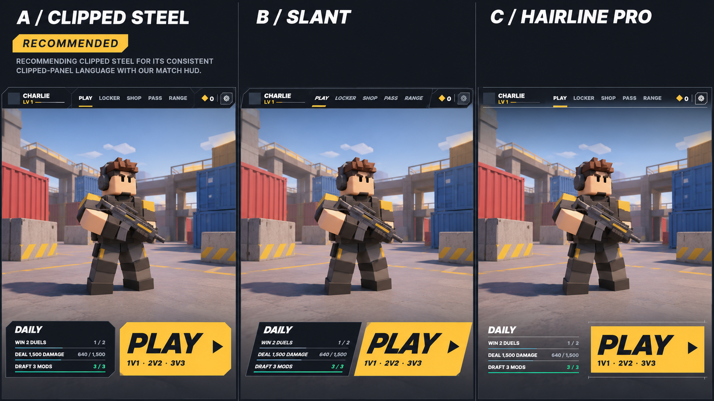
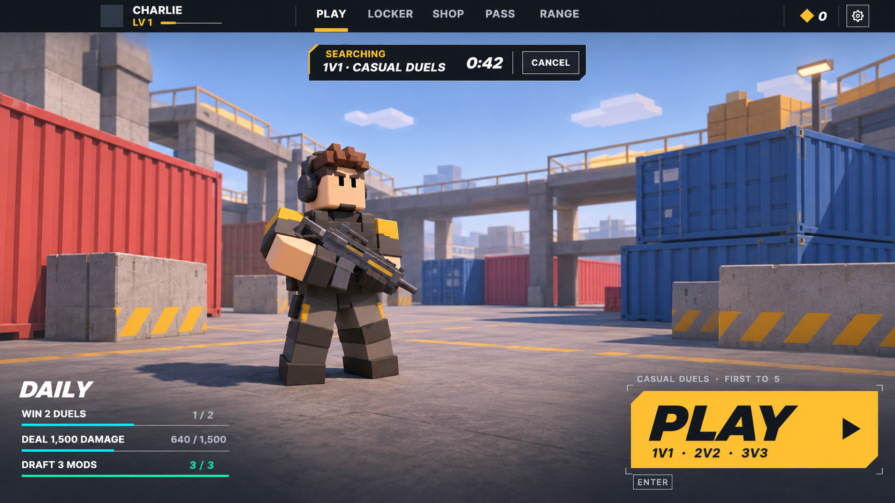
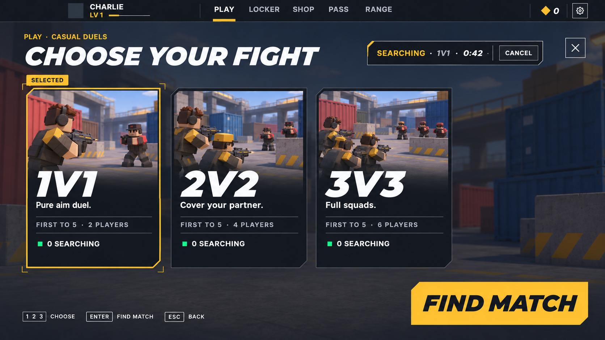
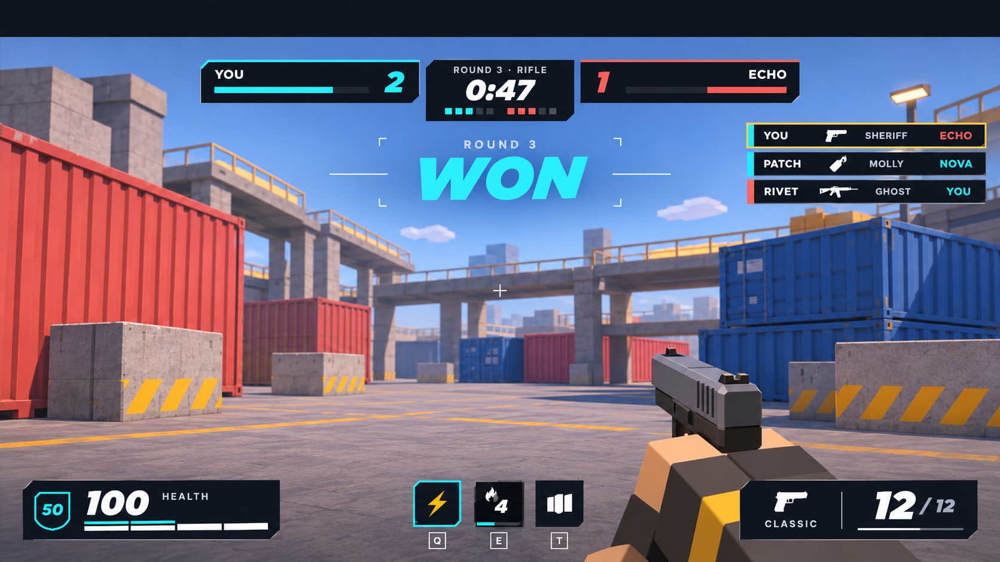
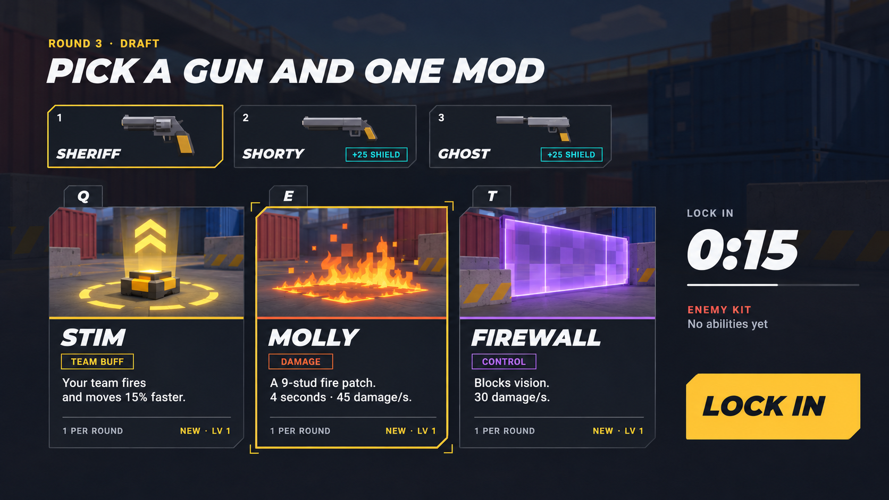

# Lobby UI and Queue

Lane B of the [Overnight 2026-11-04](../05%20Production/Overnight%202026-11-04.md) plan: the Lobby place's HUD (top bar, bottom bar), the full-screen **Play** menu, a server-authoritative **solo queue** with **bot backfill**, the **teleport** to a reserved Match server, and hooks from lane A's tagged world parts. Code: `src/lobby/**` (Rojo project `lobby.project.json`, port 34873). Image prompts: [Lobby UI Image Prompts](Lobby%20UI%20Image%20Prompts.md).

**Status (2026-11-05, evening):** bug fixes and the v2 style pass are in [section 8](#8-bug-fixes-and-style-pass-v2-2026-11-05-lane-e-lobby-ui-2) (top row in Roblox's top bar, crisp borders, chat and player list kept clear, one theme module; 9.2/10). Earlier the same day: built, playtested in Lobby Studio, then reworked in a **LihFolk review pass** (section 7): a compact arrangement for phones and small screens, safe-area split menus, gamepad selection, motion tokens, reduced motion, a 12+ px text floor, and teleport handling per LihFolk. Measured at 7 screen sizes; **quality score 9.2/10** (3 blind reviewers, median). `rojo build lobby.project.json`, selene and StyLua pass. Not tested: a real teleport (needs published places) and a physical gamepad.

## 1. Research (phase 1)
A Sonnet research pass on RIVALS, Valorant, Overwatch and Fortnite. Web sources on RIVALS' exact HUD were thin (guide sites only), so items marked *unverified* should be checked in the live game.
- **RIVALS:** a big green **Play** button opens a mode menu (1v1, 2v2, 3v3, 4v4, 5v5 duels plus arcade modes; Ranked is a separate page). Shop, rewards and settings sit along the bottom; currency is Keys. A physical **hologram/pads** in the lobby open the same queues. Duels are first to 5. *Unverified:* top-bar contents, button order, the in-queue overlay and the match-found beat.
- **Valorant:** text-first top nav (PLAY, COLLECTION, AGENTS, BATTLEPASS, STORE), mode tabs, a big PLAY button that becomes a searching state with an **elapsed timer and estimate** and a cancel. No accept step (its most criticised gap).
- **Overwatch:** estimated wait per role (players distrust estimates that lie); a persistent "searching" chip you can carry around menus.
- **Fortnite:** cancel is always reachable while matchmaking.
- **Complaints to avoid:** a queue stuck on "Searching" forever with no timeout or message (RIVALS); requirements not shown in the UI; trolls on instant queues.

**What we took:** elapsed time counts **up**, and the "estimate" is honest because it's a bound: **bots fill the empty slots after `botFillAfter`**, shown as a countdown and a progress bar. Cancel is always in the same place. A short, loud **MATCH FOUND** beat with both teams before the teleport. Live "N searching" per mode. Every failure ends in a message and the lobby state, never a hang. The queue follows you: close the menu and a pill at the top keeps the timer and cancel.

## 2. Design
Style: Theme tokens and the cut-corner 9-slice kit from the match HUD (`Config/Theme`, `src/client/Util/Ui.luau`, synced into the lobby as `LobbyClient.SharedUi`), Oswald titles, Montserrat labels, gold as the one "act now" colour, team cyan / orange-red only where teams mean something. Glitch is a 0.16 s cyan/magenta twitch on the PLAY / FIND MATCH hover and on MATCH FOUND, nothing else.

**Figma** ([Game UI file](https://www.figma.com/design/UbCKQXuZijn0Gpryt0uUxN), page Screens, row at y 2600-4480): components **Lobby · Components** (`icon/lobby/*` Shop, Locker, BattlePass, Range, Settings; `Lobby/Tile` with Label + Icon swap; `Lobby/PlayButton`; `Lobby/ModeCard` with Title / Key / Blurb / Meta / Count text and Selected, Two per side, Three per side toggles), and three screens built from them on the Theme variables and text styles: **Lobby · HUD**, **Lobby · Play menu (searching 2v2)**, **Lobby · Match found (2v2, 1 bot)**. The Roblox build follows these layouts px for px (1920 × 1080 design space). Critique from the mockups: the bars need contrast over the bright lobby, so the HUD got soft top/bottom shade gradients.

**HUD (`LobbyHud`)**
- **Top left:** profile card: headshot, display name, `LV 1` and an XP bar (placeholders until progression).
- **Top right:** currency chip (coin, amount, gold "+" → Shop) and a gear (→ Settings; the gear turns 60° on hover).
- **Bottom centre:** LOCKER · SHOP · **PLAY** · BATTLE PASS · RANGE. Side tiles are dark cut cards with vector icons; hover lifts 6 px, lights the fill, grows a gold accent line, sweeps a light band and whitens icon and label; press pops through UIScale. PLAY is gold with a breathing glow; while queued it turns dark with a spinner and shows SEARCHING / mode / elapsed, then MATCH FOUND in green.
- **Searching pill** (top centre, while queued and the Play menu is closed): spinner, SEARCHING · 2V2, "Bots fill in 0:16", the elapsed timer and CANCEL. Clicking it reopens the menu.
- **Toasts** under the top bar for failures (red strip) and info.
- Entrance: bars slide in, tiles rise one by one with a Back ease. Opening any menu slides the bottom bar away; the top bar stays (DisplayOrder 25 over menus at 20).

**Menus (`Router`)**: one at a time. While open: world **blur** (16) and **desaturation** (−0.25), a scrim with top/bottom vignette bands, character controls disabled, the mouse freed (`Modal`). Close with the ✕, gamepad B or Backspace (Esc is Roblox's). Content fades as one CanvasGroup; the header slides in from the left.

**Play menu (`QueueMenu`)**: "PLAY · CASUAL DUELS / CHOOSE YOUR FIGHT"; three cards (1V1 / 2V2 / 3V3) with a colour wash per mode (stand-in for card art), the mode in display type, ally-vs-enemy figures, a one-line pitch, "FIRST TO 5 · N PLAYERS", a live green dot with **N SEARCHING**, and **BOTS AFTER 0:30**. Keys 1 / 2 / 3 select, Enter finds a match. Selected = white outline, raised fill, gold underline; cards rise in staggered on open. **FIND MATCH** (gold, breathing) becomes a status panel while searching: spinner, SEARCHING · MODE, the line "Looking for players · bots fill empty slots in 0:16", a big elapsed timer, a gold bar filling toward bot fill, and CANCEL. Picking another card while searching shows **SWITCH TO 3V3** (the wait restarts).

**Match found (`LobbyMatchFound`)**: a dark band opens from the middle with gold edges; **MATCH FOUND** punches in (1.35 → 1, Back) with the glitch twitch; "2V2 · CASUAL · 1 BOT"; both teams as headshot cards (you in gold, bots as dark BOT slots) popping in; **TELEPORTING IN 3-2-1** with ticks, then TELEPORTING…. In Studio it then shows the exact TeleportData JSON it would have sent. Sounds: LockIn + Banner, Tick / TickFinal, CardIn per slot.

**Other panels (`Panels`)**: same chrome, a believable skeleton with a shimmer, and a gold COMING SOON line: Shop (featured card + 6 items), Battle Pass (tier bar, premium and free tracks), Locker (real gun renders for Primary / Secondary / Melee, click to preview), Settings (a working **UI sounds** toggle; the rest marked SOON), Range (what it will be).

## 3. Queue system (server)
`src/lobby/server/Services/QueueService.luau` (state, remotes), `Matchmaking/Matchmaker.luau` (pure rules), `Matchmaking/Launcher.luau` (reserve + teleport). Numbers: `src/lobby/shared/Config.luau` (`ReplicatedStorage.Lobby.Config`, lobby-only so it isn't in Shared/Config).

| Config | Value | Meaning |
|---|---|---|
| `MODES` | 1v1, 2v2, 3v3 (`teamSize` 1/2/3, `enabled`) | Add 4v4 here later |
| `botFillAfter` / `botFillAfterStudio` | 30 / 5 s | Oldest player's wait before bots fill |
| `matchFoundDelay` | 3.5 s | The MATCH FOUND beat (no cancel) |
| `teleportAttempts`, `retryBackoff` | 4, {1, 2, 4, 8} s | Per-player attempts; backoff after a thrown TeleportAsync (Failure / Flooded results wait 2 / 10 s) |
| `teleportTimeout` | 25 s | Still here after this → back to lobby + message |
| `studioHold` | 6 s | Studio: how long the payload card stays |
| `RATE.QueueRequest` | 2/s, burst 4 | Token bucket |

**Flow**
```
idle ──join(mode)──► searching ──(2×teamSize queued) or (oldest waited botFillAfter)──► found (3.5 s)
  ▲   ◄──leave────────┘                                                                  │ one ReservedServerId (GUID) per match
  │                                                                                      ▼
  └──── failed (message) ◄── reserve fails / TeleportAsync fails ×3 / InitFailed ×3 / timeout ── teleporting ──► Match place
  └──── Studio: log + show TeleportData, back to idle after 6 s
```
- One queue per mode, oldest first. A full match takes the first 2 × teamSize; bot fill takes **everyone waiting** in that mode.
- **Teams:** humans alternate A, B, A, B so real players face each other first; bots fill what's left on each side.
- Players who leave during the beat are dropped; the rest still go (with `bots = true` if the match is now short).
- **TeleportData** (contract in the Overnight note), set with `TeleportOptions:SetTeleportData` on a `TeleportOptions.ReservedServerId` teleport (one GUID per match, kept server-side; `ReserveServerAsync` is deprecated per LihFolk and the docs, so the contract note's "ReservedServerAccessCode" became this; lane C only reads TeleportData, so nothing changes for it): `{ v = 1, matchId, mode, teams = { {userIds}, {userIds} }, bots }`. `bots` is true when fewer than 2 × teamSize humans go. Note for lane C: in bot fill the second team can be an empty array.
- **Failure handling** (LihFolk: Teleporting and Multi-Place Games; Error Handling and Retries): only `TeleportResult.Failure` (retry after 2 s) and `Flooded` (after 10 s) are retried, per player, with the options `TeleportInitFailed` hands back; `GameFull`, `GameEnded`, `GameNotFound` and `Unauthorized` end with a specific message; `IsTeleporting` is ignored. A thrown `TeleportAsync` retries each player with 1, 2, 4, 8 s backoff, up to 4 attempts. A per-attempt deadline (25 s) returns anyone still here; a launch error or a stuck "found" (20 s) returns everyone. Every give-up sets `idle` and sends a "failed" toast.
- **Studio:** `RunService:IsStudio()` skips reserve/teleport, prints `[Queue] STUDIO: would teleport …` with the JSON to Output and shows it on the MATCH FOUND card.

**Remotes and state** (`src/lobby/shared/LobbyNet.luau`, folder `ReplicatedStorage.LobbyRemotes`, separate from the match's `Remotes`)
| Name | Direction | Payload |
|---|---|---|
| `QueueRequest` | client → server | `("join", mode)` or `("leave")` |
| `QueueEvent` | server → one client | `{ kind = "found", mode, teams, teamSize, startsAt }` · `{ kind = "studio", mode, payload }` · `{ kind = "failed", text }` · `{ kind = "info", text }` |
| Player attributes | server-owned | `QueueStatus` (idle / searching / found / teleporting), `QueueMode`, `QueueSince`, `QueueStartsAt` (server time) |
| Folder attributes | server-owned | `Queued1v1`, `Queued2v2`, `Queued3v3`, `BotFillAfter` |

Lane A: world signs ("X queued" per bay) can read `ReplicatedStorage.LobbyRemotes:GetAttribute("Queued2v2")` and listen with `GetAttributeChangedSignal`.

## 4. World hooks
`WorldPrompts` adds a local ProximityPrompt (E / gamepad X, instant) to anything tagged, through CollectionService added/removed signals, so late tags and streamed-in parts work:
| Tag | Opens | Notes |
|---|---|---|
| `LobbyQueue` | Play menu | `Mode` attribute ("1v1" / "2v2" / "3v3") preselects the mode and the prompt says "Queue 2V2" |
| `LobbyShop`, `LobbyBattlePass`, `LobbyLocker` | those panels | |
| `LobbyRangeEntrance` | Range panel (placeholder until the in-place Range teleport exists) | |
| `LobbySpawn` | not hooked (spawning is server/world work) | |
Tagged Models use their PrimaryPart (or first BasePart); big pads get a reach of half their footprint + 6 studs (10-24).
**Checked with lane A's real tags (2026-11-05):** 8 `LobbyQueue` pads (four 1v1, two 2v2, two 3v3; tagged BaseParts such as `Lobby.Hub.Duels.Pad_2v2_AW.QueueZone`) and one part each for Shop, Battle Pass, Locker and Range all got their prompt after streaming in. On the 2v2 pad the prompt read "Queue 2V2 / Duels" (reach 12.5) and E opened the Play menu with 2V2 selected; E at `Market.ShopZone` opened the Shop panel.

## 5. Security notes
- The client can only send `join(mode)` / `leave`. The handler rate-limits first, then checks `typeof(action) == "string"`, mode is a string ≤ 8 chars and in `Config.MODE_BY_ID` with `enabled`. State changes are only legal from the right state (join from idle/searching, leave only while searching), so spamming can't cancel a found match or double-queue.
- Every displayed value (status, timers, counts, teams) comes from server-owned attributes or server events; the client never says who it is matched with.
- `PlayerRemoving` clears the queue entry, state, limiter bucket and any pending teleport.
- **TeleportData isn't secret or tamper-proof** (it travels through the client). The access code to the reserved server is never sent to clients, so only teleported players can join, and the worst a tamperer can do is change their own match's teams. Hardening for ranked: write `{matchId → teams, mode}` to a MemoryStore hash map when the match is formed and have the Match place read it by `matchId` (the Lobby note's original rule "teleport data only carries a match ID").
- Security review: see [Test log](#test-log).

## 6. Later: cross-server matchmaking (MemoryStore)
Today the queue is per Lobby server, which is fine while one lobby holds everyone. When there are several lobby servers:
1. `join` adds `{userId, mode, since, serverJobId}` to a **MemoryStoreService sorted map** per mode (key = userId, sort key = `since`) with a short expiration renewed by a heartbeat, so crashed servers' players vanish.
2. One elected **matchmaker** (a lease key in a MemoryStore hash map, renewed every few seconds; any lobby server can take over) reads the oldest N per mode, applies the same `Matchmaker.pick` rules, removes them atomically (`UpdateAsync`), reserves a Match server and publishes `{matchId, accessCode, teams}` via **MessagingService** (topic per server, or a hash-map entry each server polls).
3. Each lobby server teleports **its own** players with that access code and the same TeleportData. `QueueService`'s state machine and the whole UI stay as they are: only the "queues" table becomes remote. Parties would join as one entry with a size.
Budget: MemoryStore requests scale with players (1000 + 100 × CCU per minute), fine for heartbeats every few seconds.

## 7. LihFolk review pass (2026-11-05)
Read through the `roblox-ui-builder`, `lihfolk-figma` and `quality-score` skills and these vault notes (via `lihfolk-lookup`): **05 UI and UX**: HUD Design, UI Motion Language and Timing, Menu Archetypes, Responsive UI for Phone Tablet Console and PC, Safe Areas and Insets, Gamepad and Console UX, Settings Menu Design, Accessibility; **21 LihFolk UI Design System** (LihFolk UI Spec); **32 Case Studies / Case Study - Rivals**; **41 Multiplayer Services**: Teleporting and Multi-Place Games, Reserved and Private Servers in Practice, TeleportService - Engine Reference Card, Error Handling and Retries, Matchmaking Queues with MemoryStore, MemoryStore Service; **22 Anti-Exploit and Security**: Rate Limiting and Abuse Prevention, Remote Abuse Patterns and Rate Limiting in Practice, False Positives Lag and Fair Enforcement.

| Found missing | Fixed |
|---|---|
| No scale floor: text drew about 5 px on a 667 x 375 phone (Responsive UI; LihFolk UI Spec) | `Util/Layout`: one clamped **Fit** UIScale per cluster (HUD floor 0.76, menus `min(w/1760, h/980)`), and a **text floor**: at least 15 design units and 14 px drawn, counting nested UIScales |
| Bottom bar and Play cards didn't fit a phone | A **compact arrangement** (short side under 640 px: phones and 1024 x 600) on an 800 x 420 canvas: 96 px tiles with short labels ("PASS") clear of the thumbstick and jump zones, a slim profile, the pill under it, the HUD hidden behind menus, 240 x 208 cards with cropped art and no blurb, shorter status line, larger close/cancel/toggles. The family is decided once from the first real viewport (the camera reports a placeholder size at first) |
| `IgnoreGuiInset` menus put buttons under the Roblox top bar (Safe Areas and Insets) | Every menu is two guis: an edge-to-edge dimmer (`ScreenInsets.None`, DisplayOrder 19) and content in `CoreUISafeInsets` (20), `SafeAreaCompatibility = None` |
| No gamepad selection (Gamepad and Console UX) | Each menu content is a `SelectionGroup` with `Stop` on all sides; the Router selects the menu's focus button at the start of its entrance (FIND MATCH or the selected card; Settings' first toggle; else Close) and clears it on close; a shared 3 px gold `SelectionImageObject`; selection uses the hover look; B closes even while a button is selected |
| Motion timings ad hoc and long (UI Motion Language and Timing) | `Fx.MOTION` tokens: press 0.05, hover 0.1, exit 0.12 (Quad In, no overshoot), dimmer 0.18 / 0.12, enter 0.22, reveal 0.4, stagger 0.04; hover 1.04 + 3 px lift, press 0.96, scaled from the centre. The card rise keeps the project's own 48 px / 0.32 s (project notes win) |
| No reduced motion; idle loops always running | `Fx.reduced()` follows `GuiService.ReducedMotionEnabled` and a Settings toggle: movement snaps, fades and colour still ease, loops / sweeps / glitch / shake stop (shake becomes a red flash). Loops pause while their ScreenGui is disabled |
| Small dim text (#69727F, about 3.6:1) | Secondary text uses `textSecondary` (#A7B0BC, about 8:1). Settings toggles show ON / OFF as a word too |
| FIND MATCH could stack requests (Menu Archetypes) | Ignored for 1.5 s or until the server state changes; shows JOINING... |
| ReserveServerAsync deprecated; every TeleportResult retried | See section 3: `ReservedServerId`, retry only Failure / Flooded, final messages, 1-2-4-8 s backoff |
| Rejected remote calls invisible | Dropped and counted by reason (rate / badAction / badMode / unknownMode), a summary warned once per 60 s; never kicks |
| Esc to close (Menu Archetypes) | Not possible: Roblox reserves Esc for its menu. Backspace and gamepad B close instead |

**Measured** (a client script set each cluster to the scale Layout picks for that screen and read drawn text size, `TextFits`, glyph-box clashes between texts, the smallest button, the bar against the thumb zones, HUD cluster overlaps and the menu's footprint in the safe area under the 58 px top bar):
| Screen | Family | Min text | Min tap | Overflow / clashes / overlaps |
|---|---|---|---|---|
| 1920 x 1080 | desktop | 14.2 px | 57 px | none |
| 1600 x 900 | desktop | 13.3 px | 47 px | none |
| 1366 x 768 | desktop | 13.0 px | 46 px | none |
| 1024 x 600 | compact | 18.0 px | 72 px | none |
| 932 x 430 | compact | 13.3 px | 53 px | none |
| 844 x 390 | compact | 13.3 px | 47 px | none |
| 667 x 375 | compact | 13.2 px | 45 px | none (bar 441 of 447 px) |
(Taken with a 13 px floor.) **Round 2, final:** 14 px drawn floor, an 8 px gap under the compact header, no menu can open behind MATCH FOUND, and two label boxes made taller after the measure caught vertical overflow. Re-measured: desktop text min 14.8 / 14.6 / 14.5 px (1920 / 1600 / 1366), compact 18.0 / 14.2 / 14.2 / 14.3 px (1024 / 932 / 844 / 667); no overflow, clashes or overlaps; taps unchanged (45 px minimum).

Bugs this pass caught in play: controllers read the layout family before the camera had its real size (mixed phone constants with desktop scale); phone card positions used the 1920 canvas; the MATCH FOUND band was a fixed 52% (now sized to its content); the larger desktop HUD's profile covered the menu header (now hides behind menus); "N SEARCHING" ran into "BOTS AFTER" (own row now); COMING SOON overlapped its line (auto-layout row).

**Quality score** (`lihfolk:quality-score`, rubric `ui.md`, 3 blind Sonnet reviewers per round, median per criterion): first **8.3** (U3 style 1, U5 readability 1; all gates pass); after one fix round **9.2** (U1 2, U2 2, U3 2, U4 2, U5 1, U6 2; reviewers 8.3 / 9.2 / 9.2). Logged in `.lihfolk/ledger.jsonl`. The remaining U5 point was small secondary text in short windows; round 2 (above) raised the floor to 14 px and opened the compact header gap, measured but not re-scored.

## Image prompts and uploaded art
[Lobby UI Image Prompts](Lobby%20UI%20Image%20Prompts.md). The core chat generated them in ChatGPT (sources in `assets/UI/lobby/`); uploaded to group 11116787 with `tools/opencloud/upload_asset.py --type Decal`. Open Cloud returns the **Decal** id; ImageLabels need the **Image** id inside it (resolved with `InsertService:LoadAsset(decalId)` → `Decal.Texture`). Image ids in use:
| Art | Image id | Used in |
|---|---|---|
| icon_shop / locker / battlepass / range / settings | 134974442051869 / 73637059723267 / 133121960419132 / 82357119585599 / 85379480378289 | `Util/Icons.luau` ASSETS (white, tinted) |
| icon_coin | 122645025340088 | wallet chip |
| mode_1v1_card / 2v2 / 3v3 (cut corner baked in by PIL, 52 px at 2×) | 114141951060405 / 112915965638467 / 124665198768296 | `QueueMenu.luau` MODE_ART, under a dark top shade and a faint mode-colour wash |
Clearing an id falls back to the vector icon / colour wash. The un-cut `mode_*.png` uploads (decals 113115926168704…) are unused.

## Test log
**2026-11-04, Lobby Studio playtest (place 133387545285290, Rojo 34873)**, driven through MCP mouse/keyboard input (no module requires):
- HUD: profile (headshot, name, LV 1), wallet + gear, five bottom tiles with the uploaded icons; entrance animation plays. Output clean (only the known plugin warning 203785492).
- PLAY → Play menu with blur, desaturation, scrim; three art cards, 1V1 preselected, live "N SEARCHING", "BOTS AFTER 0:05" (Studio value).
- Enter → searching: IN QUEUE tag, 1 SEARCHING, timer 0:02, "bots fill empty slots in 0:03", progress bar, CANCEL.
- Backspace → menu closes, searching pill at the top and the SEARCHING play tile keep the timer.
- CANCEL (mouse) → `QueueStatus` idle, `Queued1v1` 0, FIND MATCH back.
- Bot fill after 5 s → MATCH FOUND band: you vs BOT (1v1) and you + 3 BOTs (2v2), countdown, then "STUDIO: TELEPORT SKIPPED" with the JSON. Output: `[Queue] STUDIO: would teleport 1 player(s) to place 71551303511506 with TeleportData {"teams":[[284035946],[]],"bots":true,"mode":"2v2","matchId":"…","v":1}`. Back to idle after 6 s.
- A temporary pad tagged `LobbyQueue` with `Mode = "3v3"` got the prompt "Queue 3V3 / Duels" (reach 10); E opened the menu with 3V3 selected. Pad removed.
- LOCKER → Locker panel with the Vandal / Classic / Knife renders.
- Fixed during the test: the Match Found band was a fixed 540 px (now 52% of the screen); the countdown overwrote the Studio heading; card figures overlapped the art (moved into the dark half) and titles needed a top shade; the pill showed "0" at the end of the countdown; cancel buttons are now named (`…Status.CancelHolder.Cancel`, `LobbyHud.Searching.Pill.CancelHolder.Cancel`) so tests can click them by path.
- Note: Studio `screen_capture` in play mode sometimes returns stale or white 3D frames; check state through attributes, not only screenshots.

**Security review** (roblox-reviewer): no high findings. Fixed all mediums/lows: a launch error or a hung reserve can no longer strand players on "found" (pcall + `foundTimeout` 20 s); teams are split once at MATCH FOUND and leavers are only removed (the screen stays true); one teleport retry path per player with a per-attempt deadline (no double retry, no "failed" while a teleport is in flight); world prompts re-attach when a tagged Model's parts stream in; `LobbyNet` reuses its folder instead of replacing live remotes. For lane C: the match server must check each arriving player's UserId is in `teams` for that `matchId` and not trust `bots` / `mode` blindly.

## Notes for other lanes
- **Lane A:** tag the **BasePart** of each pad/terminal (or set the Model's `ModelStreamingMode` to Atomic/Persistent) so prompts never go missing under streaming. Bay signs can read `ReplicatedStorage.LobbyRemotes` attributes `Queued1v1/2v2/3v3`.
- **Lane C:** in bot fill, `teams[2]` can be an empty array; humans alternate across teams.
- `art-source/uploads.json` holds my 12 upload records but also other lanes' uncommitted entries, so I left it for the core chat to commit.

## What the user should test tomorrow
1. Lobby Studio, Rojo connected on 34873, Play: the bars slide in; hover each tile (lift, sweep, sound) and click each one; Backspace or ✕ closes.
2. PLAY → pick 2V2 → FIND MATCH: the timer counts, bots fill after 5 s in Studio, MATCH FOUND shows you + 3 bots, then the TeleportData card. **Listen** to the sounds (Open, CardIn, LockIn, Banner, Tick); swap any you don't like in `Shared/Config/UiSounds`.
3. Queue, then walk around: the pill stays at the top; CANCEL works there and in the menu.
4. Once lane A's pads are tagged, walk to a 1v1/2v2/3v3 pad and press E: the menu opens on that mode.
5. **Real teleport** (only works in a published game): publish both places, join the Lobby from the Roblox app with a friend or alt, both queue 1v1 → you land in the same reserved Match server. Solo: wait 30 s → you land in a Match server with bots (needs lane C's TeleportData reader).
6. Decide: casual queue name ("CASUAL DUELS"), the 30 s bot fill, and whether humans should be teammates or opponents when bots fill (now opponents).
7. **Phone / small screen:** Studio → Test → Device emulator: iPhone SE (667 x 375) and a notched phone in both landscapes. Expect the compact arrangement: five tiles clear of the stick and jump buttons, the pill under the profile, the HUD hidden behind menus, 240-wide cards. Or set `workspace` attribute `LobbyForceLayout` to `"phone"` / `"desktop"` in Studio (Studio only) to force an arrangement.
8. **Gamepad:** plug one in; open PLAY: FIND MATCH is selected with a gold ring, the D-pad moves between the cards, A presses, B closes.
9. **Reduced motion:** Settings → REDUCED MOTION on: menus fade without sliding, no sweeps or spins.

## 8. Bug fixes and style pass v2 (2026-11-05, lane E `lobby-ui-2`)
Status: **built, checked at 7 sizes, scored 9.2/10 (3 blind reviewers), committed** (`d2335db`, `c5dfdb1`). Not done: Device-emulator screenshots and saving the Lobby place. Both need computer use, which nobody could approve while you were out (see "What the user should check tonight").

### Plan (phase 1)
**The three bugs, found in play (Studio 1539 x 604, `GuiService.TopbarInset` = 208..1539 x 58):**
1. *Top bar ignores the GUI inset:* the HUD's top clusters and its top shade lived in a `CoreUISafeInsets` gui, so the shade started 58 px down with a hard edge, and the profile and wallet floated in a second row under Roblox's bar instead of beside its buttons.
2. *Borders don't line up:* every panel was a 9-slice (`Ui.cut`) whose outline image scaled with `SliceScale = corner / 32`, so outline width changed per element (corners 10-26 → about 1-2.5 px), then went soft under the fractional Fit `UIScale`; `UIStroke`s were 1.5 px; the PLAY / FIND MATCH glows were the same cut shape 16 px larger, so their corners weren't concentric. Tested: `UIScale` does scale `UIStroke` (a 40 px stroke under 0.25 drew 10 px), so strokes can be snapped.
3. *Chat and player list cover items:* the profile (top left) sat under the TextChatService window and the wallet / gear (top right) under the player list; menu headers and close buttons sat in the same corners.

**Fix plan (LihFolk: Safe Areas and Insets; Responsive UI for Phone Tablet Console and PC; ScreenGui Fundamentals; Layout - Scale Offset and Constraints):**
- Top-bar items go **into Roblox's top-bar row**: a `TopbarSafeInsets` gui (the free strip right of Roblox's buttons, which flexes with them), 44 px chips matching Roblox's buttons; when that strip has no height (console), the row drops to the core-UI safe area top with a 12 px margin. Shades move to an edge-to-edge `None` gui.
- Every shape becomes `UICorner` + `UIStroke` (2 px, `Border` mode) from one kit; nested radii follow LihFolk's rule (inner = outer − gap); strokes are snapped to whole drawn pixels per Fit scale (`Layout.snapStrokes`).
- HUD clears chat and the player list by layout: top row in Roblox's bar, everything else on the bottom dock (searching pill above it on desktop, under the top bar on phones where chat and the player list start closed). Full-screen menus hide the chat window and the player list while open and restore them on close (flag `Style.FLAGS.hideCoreUiInMenus`).

**Style pass (designed in Figma first: [Game UI file](https://www.figma.com/design/UbCKQXuZijn0Gpryt0uUxN), page Screens, row y 4700-6440: `Lobby v2 · Tokens`, `Lobby v2 · HUD 1920x1080`, `Lobby v2 · Play menu 1920x1080`, `Lobby v2 · HUD phone 667x375`).** One theme module `src/lobby/client/Util/Style.luau` (every colour, size, radius, stroke, font and flag) and one kit `Util/Kit.luau`. Rounded surfaces with a top-lit gradient and a stacked soft shadow; the gold PLAY / FIND MATCH get a 6 px lip that sinks on press (LihFolk UI Spec: depth is a lip); Montserrat Heavy for display (matches the Lobby's Montserrat Black signs), Builder Sans for labels and body (LihFolk: Gotham is retired and renders as Montserrat); mode colours from the Lobby world pads (1V1 `#FF7A2F`, 2V2 `#27B7FF`, 3V3 `#A15CFF`); full-bleed ChatGPT mode art (the un-cut `mode_*.png`) on the cards.

RIVALS references: a research pass couldn't fetch any screenshot of RIVALS' lobby menus (wiki and guide sites blocked; only store key art, kept locally in `References/lobby-ui/third-party/`, not committed). What we know from text: a green PLAY on the HUD opening a mode list, an "improved top bar and queue UI" in Update 13. So the pass leans on the LihFolk UI Spec and on general RIVALS polish (clean rounded shapes, one loud action colour, bold sans type); **the user should compare it with the live game.**

### What changed (phases 2-3)
**Bug 1, top bar and the GUI inset.** The profile, wallet and settings now sit **in Roblox's top-bar row** beside its buttons. They live in a `LobbyTopBar` gui with `ScreenInsets = TopbarSafeInsets`. The chips are 44 px, like Roblox's own, and they move whenever `GuiService.TopbarInset` changes. With no top bar (console), the row moves to the top of the core-UI safe area with a 12 px margin. The shades moved to an edge-to-edge `LobbyHudShade` gui (`None`), so the hard line 58 px down is gone. Before and after: `before-hud-1539x604.jpg` → `after-hud-desktop-hover.jpg`.

**Bug 2, borders.** The lobby UI no longer uses scaled 9-slices:
- Every shape is a `UICorner` plus a 2 px `UIStroke` (Border mode), built by `Util/Kit`.
- Radii come from tokens and follow the nested rule (inner = outer − gap). The art is inset 2 px and uses radius − 2; the focus ring uses + 4; each glow layer uses + its grow.
- `Layout.snapStrokes` resets each stroke so it draws a **whole number of pixels** at the cluster's Fit scale. I tested that `UIScale` does scale `UIStroke`: a 40 px stroke under a scale of 0.25 drew 10 px.
- The glows are concentric layers, not a larger copy of the shape.

**Bug 3, chat and player list.** Nothing interactive sits below Roblox's top bar on the left or right any more.
- The top row is inside the bar. The dock is at the bottom, and so is the searching pill on desktop.
- Phones have no pill. A phone's chat opens over the top of the screen, so instead a red ✕ badge on PLAY cancels the search (45 px drawn).
- Full-screen menus hide the chat window, chat bar and player list while they're open. On close they restore exactly what was showing before (`Util/CoreUi`, switch `Style.FLAGS.hideCoreUiInMenus`). I verified this in play by reading the `TextChatService` and `StarterGui` state before, during and after.
- Toasts sit above the dock, or at the top while a menu is open.

**Style pass.**
- One theme module, **`src/lobby/client/Util/Style.luau`**, holds every colour, font, type size, radius, stroke, spacing, shadow, glow, dock size and menu size. It also holds three look flags: `hideCoreUiInMenus`, `shadows` and `shine`.
- The builders are in `Util/Kit.luau`. The Play menu and all five panels share the menu chrome in `Util/Menu.luau`.
- Surfaces are rounded, with a top-lit gradient, a light 2 px edge and a stacked soft shadow.
- PLAY and FIND MATCH are gold, with a darker lip that the face sinks into on press and a breathing layered glow.
- Type is Montserrat Heavy for display and Builder Sans for labels and body.
- The mode cards use full-bleed ChatGPT art: the un-cut uploads (image ids 132175332386485, 88838344441665, 91043835690868), cropped to the fighters and faded into the card. Mode colours come from the Lobby's pads.
- Smaller pieces: SELECTED and IN QUEUE pill tags, key-chip hints, and a round close button in the same place on every menu. The Locker marks its selected slot.
- No new images were needed, so I didn't use ChatGPT this pass.
- Motion keeps the existing tokens: press 0.05 s, hover 0.1, exit 0.12 In, enter 0.22, reveal 0.4. Reduced-motion fades and gamepad selection stay as they were. The focus ring now matches each button's corner.

Files:
- New: `Util/Style.luau`, `Util/Kit.luau`, `Util/Menu.luau`, `Util/CoreUi.luau`.
- Rewritten: `Controllers/LobbyHud.luau`.
- Restyled on the kit: `Controllers/QueueMenu.luau`, `Controllers/Panels.luau`.
- Also changed: `Util/Fx.luau`, `Util/Layout.luau`, `Util/Router.luau`.

Server code and remotes are untouched. The client still only sends `join(mode)` / `leave` through `QueueState`, so no new security review was needed.

LihFolk notes used:
- `05 UI and UX`: Safe Areas and Insets; Responsive UI for Phone Tablet Console and PC; ScreenGui Fundamentals; Layout - Scale Offset and Constraints; UI Motion Language and Timing; Menu Archetypes; Gamepad and Console UX; Accessibility; Figma Property Mapping for Roblox UI.
- `21 LihFolk UI Design System` (LihFolk UI Spec): spacing, radii, nested radius, lip depth, text floor.
- `32 Case Studies`: Case Study - Rivals. It has no UI visuals.
- Skills: `roblox-ui-builder` (Gotham is retired; use Builder Sans), `lihfolk-figma` and `quality-score`.

### Measured at 7 sizes
Running the Device Emulator needs computer use, which nobody could approve while you were out. Instead I checked the sizes with a **size harness** in play mode:
1. Clone the live HUD and Play menu into frames of exact device sizes.
2. Draw Roblox's top-bar buttons, chat window and player list where they sit.
3. Apply the Fit scale and text floor that each size would get.
4. Measure by script, in drawn px.

| Size | Family | Buttons | Under Roblox UI / off-screen | Min tap | Min text |
|---|---|---|---|---|---|
| iPhone SE 667 x 375, HUD while queued | phone | 8 | none | 44 px | 14.3 px |
| iPhone SE 667 x 375, Play menu | phone | 6 | none | 45 px | 14.3 px |
| 844 x 390 with chat **and** player list open | phone | 8 | none | 44 px | 14.2 px |
| Tablet 1024 x 768 with chat and player list | desktop | 9 | none | 44 px | 14.3 px |
| Desktop 1920 x 1080 with chat and player list | desktop | 9 | none | 44 px | 15.2 px |
| Console 1920 x 1080, no top bar | desktop | 9 | none | 44 px | 15.2 px |
| Studio window 1539 x 604 (live play, both families) | both | | none seen | | |

The first harness run caught two real bugs, both fixed:
- The phone pill's CANCEL drew 36 px.
- At 844 x 390 with chat and the player list open, the phone pill sat under both.

Screenshots are in `vault/02 Art/References/lobby-ui/20261105/`:
- Before: `before-hud-1539x604.jpg`, `before-hud-2.jpg`.
- Figma: `figma-hud-v2.png`, `figma-play-menu-v2.png`.
- After: `after-hud-desktop-hover.jpg`, `after-hud-phone-family.jpg`, `after-play-desktop.jpg`, `after-play-searching.jpg`, `after-play-phone-family.jpg`, `after-pill.jpg`, `after-match-found-2v2.jpg`, `after-locker.jpg`, `round2-play-searching-phone-family.jpg`, `round2-match-found-3v3.jpg`.
- Sizes: `sizes-iphone-se-and-844.jpg`, `sizes-desktop-tablet-console.jpg`.

The `third-party/` folder next to it holds RIVALS store art for mood only. Don't commit it.

### Style choices to discuss (all in `Util/Style.luau`)
| # | Choice made | Alternatives (cheap to switch) |
|---|---|---|
| 1 | **Rounded shapes** (radius 14-22, pills for chips) with a 2 px white-14% edge | Keep the match HUD's **cut-corner** identity (the Kit shapes would go back to a cut 9-slice at a fixed scale), or sharper 6-8 px radii for a more tactical look |
| 2 | **Gold** `#FFC83D` as the one action colour (PLAY, FIND MATCH, level, coin) | A RIVALS-style **green** PLAY (the `primary*` tokens to the `#3FD68A` family), or the glitch cyan for a sci-fi feel |
| 3 | **Montserrat Heavy** display + **Builder Sans** labels | Oswald (the match HUD's condensed titles) for display, to match in-match UI; or Builder Sans Black everywhere for a Roblox-native feel |
| 4 | **Dark navy glass** panels (`#1C2531` → `#121922`, 6% transparent) with stacked soft shadows | Lighter, more colourful panels (RIVALS' brighter feel), or flat panels with no shadows (`FLAGS.shadows = false`) |
| 5 | Top row **inside Roblox's top bar**; menus **hide chat and the player list** | Keep chat visible in menus (`FLAGS.hideCoreUiInMenus = false`; the menu content would then need to shrink away from the top-left corner), or a separate bar under Roblox's |

### Scores (`lihfolk:quality-score`, rubric `ui.md`)
**Round 1** used three blind Sonnet reviewers, taking the median per criterion. Result: **9.2**.
- Criteria: U1 2, U2 2, U3 2, U4 2, U5 1, U6 2.
- Reviewers' raw scores: 9.2, 8.6 and 8.3.
- Reviewer 3 failed a gate on a stale phone screenshot that still showed the old phone pill. The re-shot harness (current build) shows no pill and no overlap.
- U5 (small grey secondary text) was the lowest criterion for all three reviewers.

**Fix round 1** changes:
- Secondary text is now `#C8D0DB` (about 11:1) and muted text `#A6B0BE` (about 7.5:1).
- The card meta lines use the secondary colour.
- The dock slides away during MATCH FOUND.
- The Locker marks its selected slot.
- The MATCH FOUND band is slightly translucent.

**Round 2** used one blind reviewer. Result: **9.2**, with gates passing and U1 2, U2 2, U3 2, U4 2, U5 1, U6 2.
- The remaining U5 point is phone small caps at 14 px drawn (dock labels, card meta lines). The reviewer wants about 16 px on phones.
- Raising the phone floor to 16 px would overflow the phone card meta lines, so I stopped. Final score: **9.2**.
- The next step, if you want it, is a phone-only 16 px floor with shorter phone strings ("FT5 · 6P", or dropping the meta line). Or honour Roblox's preferred text size (`GuiService.PreferredTextSize`).

Logged in `.lihfolk/ledger.jsonl`.

### What the user should check tonight
1. **Save the Lobby place** (Ctrl+S, Save to Roblox, not Publish). The new client code is in Studio through Rojo 34873, but I couldn't press Ctrl+S without computer use.
2. In Lobby Studio, press Play. The profile, wallet and gear should sit **in Roblox's top bar** next to its buttons. Open the chat and the player list and check that nothing of ours is under them.
3. Hover and click each dock tile and PLAY. You should see the lift, the gold edge, and the gold face sinking into its lip. Open PLAY: the chat and the player list should disappear while the menu is open and come back when you close it.
4. Queue, then close the menu: the pill shows above the dock. When MATCH FOUND appears, the dock slides away.
5. In Test → Device emulator, try **iPhone SE**, an **iPad** and a **1080p TV**. The harness numbers above say everything fits, but please look. On phones there's no pill, just a red ✕ on PLAY while searching.
6. Decide the 5 style choices above, or tell me your own. Each one is a token change.
7. Figma: the v2 frames (Screens page, y 4700-6440) show the design before the build. Since then the phone pill became the ✕ badge and the close / cancel buttons got bigger. The build is now the reference.

## 9. Match HUD v2 (2026-11-05)
The in-match UI (score bar, draft, health, ammo, ability slots, kill feed, banners) now uses this same v2 look, through shared modules (`src/shared/Config/UiStyle.luau`, `src/shared/UiKit.luau`, `src/shared/CoreUi.luau`). Details, screenshots, scores and a check list: [Match HUD](Match%20HUD.md).

**Update (evening):** the user reverted the match UI to the v1 look (cut corners, Oswald). The shared modules stay because the Lobby uses them. See [Match HUD](Match%20HUD.md) → "Decision 2026-11-05".

## 10. UI concept pass (2026-11-05, evening, lane E)
**Why:** the user on the Lobby v2: the fonts and some of the effects are good, but the round, circular, pill look reads as "AI-made", not like a professional game. The match HUD is back on v1 (cut corners) by the user's choice. This pass proposes **one shape language for both**, before anything is built in Roblox. The user picks first.

### Reference board
28 captures are in `vault/02 Art/References/ui/third-party/`. They are third-party screenshots for study only, and **never committed** (the repo is public). Most come from Interface In Game's archive. They cover Valorant, Overwatch 2, Apex, The Finals, Marvel Rivals, Fortnite, CS2 and XDefiant, plus RIVALS and Arsenal on Roblox. A Phantom Forces capture was blocked (HTTP 403).

What makes each one read as professional:

| Game (files) | Hierarchy | Edges and corners | Type | Spacing and texture | Motion (known from play) |
|---|---|---|---|---|---|
| Valorant (01-06) | A full-width top nav with PLAY as a raised centre tab. The main action is a flat block at the bottom centre. | Square panels. The signature is hairline 1 px rules with small notches, chevrons and corner ticks. The agent banners have a pointed bottom. | Small tracked caps for labels; one big display word per screen (BUY PHASE, CLUTCH, MVP). | Pale or dark translucent panels on a blurred scene, lots of air, left-aligned lists. | Short slides and fades; the banner pops once. |
| Overwatch 2 (07-10) | A giant italic page title at the top left, a card row, and keybind hints in the bottom corners. The queue is a compact block at the top centre with CANCEL. | Nearly square cards (about 2 px radius). The selected card is filled with colour. | Heavy italic display; bold caps labels. | Flat white cards on a blurred world; one accent per state. | Cards lift on hover. |
| Apex (11-12) | Tabs along the top with a red underline on the active one. READY is the biggest block, at the bottom left. | **Slanted cuts** on blocks, tabs and the health plate. | Condensed caps. | Dark slabs with a red accent, chunky and military. | — |
| The Finals (13-15) | An italic title with the logo at the top left. Mode cards with a dark label bar at the foot. | Sharp rectangles; slanted background shapes. | Heavy **italic** condensed caps. | One loud brand colour (red) as the background, flat colour fields, no gradients on the controls. | Snappy. |
| Marvel Rivals (16-19) | A huge italic mode name. Parallelogram mode tiles. A big timer in hero select. | Parallelograms and diagonal cuts throughout. | Heavy italic. | Diagonal light shafts and bold background shapes. | Lots of sweep and slide. |
| Fortnite (20-21) | Text tabs with a yellow active tab. A huge yellow READY at the bottom right. | Slanted tabs and buttons. | Heavy condensed. | Flat colour blocks. | — |
| CS2 (22-23) | The HUD is just numbers on hairlines: health and ammo at the bottom, team portraits at the top. | Almost no panels. | Clean sans with large numerals. | Minimal. | — |
| XDefiant (24-25) | Small sharp HUD plates; a giant WINNERS word with score columns. | Sharp rectangles, light transparency. | Heavy italic numerals. | Clean. | — |
| RIVALS, Arsenal (26-28) | A Roblox-scale HUD: a big ammo count, a portrait strip at the top, a bottom icon dock in the lobby. | RIVALS is rounded and playful. Arsenal is sharp and blocky. | Bold sans. | Lighter polish than the PC games. This is the bar we want to beat. | — |

**What they share:**
- **Few, sharp shapes.** Corners are square, or cut or slanted on purpose. None of them uses one soft radius everywhere.
- Each game has **one signature detail** and repeats it: Valorant's notches and hairlines, Apex's slants, the italic slabs in The Finals and Marvel Rivals.
- **Navigation is text along the top edge**, and PLAY/READY is the one biggest block, anchored to an edge or corner.
- **Strong size contrast:** one huge italic word against small tracked caps.
- **Flat accent fills** for the action; glow is only for focus or reward moments.
- Panels are **anchored to the screen edges**, not floating capsules.

### Why v2 reads as "AI-made"
Taken from our own captures (`lobby-ui/20261105/after-hud-desktop-hover.jpg`, `after-play-desktop.jpg`):
1. **One radius on everything.** The player chip, currency chip, dock buttons, PLAY, the mode cards, the SELECTED tag, the key hints and the close button are all rounded in the same family (12-16 px or full pill), and the avatar, "+", gear and close are circles. That reads like a web component kit. LihFolk *UI Design Systems* treats radius as role-based steps, not one value.
2. **Floating capsules.** The top-left profile pill and the top-right currency pill float with gaps on every side. Professional HUDs anchor bars to an edge.
3. **A soft drop shadow and glow halo on every surface**, plus an outer glow on the selected card and on PLAY. It's the glassmorphism or Dribbble look; there's no restraint.
4. **A gradient gold capsule with a lip** for PLAY and FIND MATCH. It reads as a casual mobile CTA. Shooters use a flat or angled block.
5. **An icon-over-label dock.** The bottom bar (LOCKER, SHOP, PLAY, BATTLE PASS, RANGE) is a phone-app tab bar. Shooters put text nav at the top edge.
6. **No structural detail.** There are no rules, ticks, cut corners or slants, so nothing says "engineered" or makes the UI ours. LihFolk *UI Style Directions*: every direction needs one signature detail.
7. **Centred, symmetric layouts with even padding** everywhere (the PLAY menu is a centred row with a centred button). Professional screens are asymmetric: title top left, content, action bottom right.
8. **Weak type contrast.** Montserrat Heavy is right, but the titles aren't much bigger than the labels and nothing is italic or condensed. All the references use one huge display word.
9. **The mode-card art** is glossy, generic AI illustration. It reads AI even with perfect UI. Replace it with in-engine renders of our own characters and maps.

**Keep from v2** (the user liked these):
- the fonts (Montserrat Heavy and Builder Sans);
- the press and hover feedback (sink and lift);
- the selection ring, recast as a sharp 2 px frame;
- the MATCH FOUND pulse and shine sweep;
- the safe-area and chat fixes;
- the phone layout.

### LihFolk rules applied
Notes are in `vault/LihFolk/`:
- *UI Style Directions - A Visual Vocabulary for Briefs* (05):
  - Name one direction and say who owns palette and shape. Here: shape = "clipped/angular competitive", palette = our v2 tokens.
  - One signature detail.
  - Brief with 3-5 references plus take/leave lists.
  - Test on several screens, not one.
  - Third-party screenshots are study-only, **so none are uploaded to ChatGPT**: the prompts describe what to take in words.
- *UI Design Systems* (05): radii as role steps, here 0 / 2 / 6 px plus a 45° cut. Colours by role, never per screen. Two type families.
- *LihFolk UI Spec* (21): the nested-radius rule is kept for the few rounded items. The spacing scale is 4/8/12/16/24/32. **Only its numbers are taken.** Its candy-pill look is exactly what's being dropped.
- *HUD Design* (05):
  - One giant primary action, placed on an edge.
  - Status at the top, actions at the bottom, the centre third clear.
  - Slots for stackable elements.
  - A popup lane for the round banner and the draft.
- *Text Fonts and Rich Text* (05): Montserrat Heavy for display and Builder Sans for labels; no TextScaled.
- *Race HUD - Position, Laps, Splits, Speedometer and Minimap* (05): monospaced digits for timers and ammo, so they don't wobble.
- *Accessibility*, *Colour-Blind Safe Design*, *Readable Text and UI Scale* (05/42):
  - 4.5:1 body contrast.
  - Ally and enemy differ in lightness and by icon, not hue alone.
  - 12 px drawn minimum (13 in matches).
  - Near-opaque plates over a busy world.
- *Responsive UI for Phone Tablet Console and PC*, *Safe Areas and Insets* (05): 44 px taps (48 on the HUD); concepts checked against a 667 x 375 frame.
- *UI Motion Language and Timing* (05):
  - Enter 0.18-0.30 s, exit 0.10-0.18 s.
  - Linear only for cooldown sweeps.
  - Stagger capped at 0.4 s.
- *Squash Stretch and Anticipation in UI and Characters* (47): professional UI presses 3-5%, not cartoon 8-15%.
- *Reward Moments and Celebrations* (47): banner and MVP tiers; the button becomes active only after about 0.3 s.
- *Gamepad and Console UX* (05), *Top 25 QoL Wins by Effort* (58): a strong 2-3 px selection frame shared by mouse and gamepad.
- *AI Image Generation for Icons Thumbnails and Concepts*, *Prompting and Verifying AI Output* (15):
  - Image AI is used for mood and layout only, then rebuilt in Figma.
  - Ask for options first.
  - Prompts say what **not** to do.
- *What Craft Looks Like on Roblox - Lessons from Top Studios* (60): escalation without clutter; the loudest treatment only at the top tier.

### Proposed direction: "Clipped steel"
The shape language is **the match HUD's v1 cut corner** (the look the user chose to keep), taken further and used in the Lobby too. One language covers the whole game.
- **Shapes:**
  - Square rectangles. Primary panels and buttons get a **45° cut on the top-left and bottom-right corners**: 8 px small, 12 px medium, 20 px large. That cut is the signature.
  - **1 px hairline rules and corner ticks** for structure. The ticks mark the selected or primary element.
  - No pills, no circles (except the crosshair), no soft shadows, no glow halos, no gradient buttons.
- **Type:** v2's fonts kept. Montserrat **Black Italic / ExtraBold Italic** for display words and numbers; small tracked caps for labels (Builder Sans in Roblox; Inter stands in for it in Figma).
- **Colour:** the v2 palette, used flatly:
  - near-black panels at about 90%;
  - **gold only for the main action and the selection**;
  - cyan for ally and coral for enemy, each always paired with a word or edge position.
- **Layout:**
  - text tabs in a top bar anchored to the edge;
  - PLAY as the one big flat block at the bottom right;
  - titles at the top left, actions at the bottom right, key hints at the bottom left.
- **Motion** (from the v2 effects that were kept):
  - enter 0.22 s Out, exit 0.14 s In;
  - press scale 0.97;
  - hover lifts by 4 px and brightens the stroke;
  - the selection frame and ticks snap in;
  - the shine sweep only on PLAY / FIND MATCH / LOCK IN once they're ready;
  - the MATCH FOUND pulse is kept.

**Figma frames** (file `UbCKQXuZijn0Gpryt0uUxN`, Screens page), with renders in `assets/UI/concepts/figma-v3-clipped-*.png`:
- [Lobby 1920x1080](https://www.figma.com/design/UbCKQXuZijn0Gpryt0uUxN?node-id=31-756): the top bar with text tabs, the searching bar (state), DAILY at the bottom left, PLAY at the bottom right.
- [PLAY menu 1920x1080](https://www.figma.com/design/UbCKQXuZijn0Gpryt0uUxN?node-id=32-756): a left-aligned title with the searching bar beside it, sharp mode cards with the gold selected frame and ticks, FIND MATCH, key hints.
- [Match HUD 1920x1080](https://www.figma.com/design/UbCKQXuZijn0Gpryt0uUxN?node-id=34-756): the clipped score plates under Roblox's bar, the kill feed with weapon icons, the one-word round banner in the popup lane, health with segments, Q/E/T slots with a cooldown, ammo with the gun icon and a divider.
- [Draft 1920x1080](https://www.figma.com/design/UbCKQXuZijn0Gpryt0uUxN?node-id=35-756): gun row, Q/E/T ability cards with key tabs and role rules, two-line descriptions, timer, LOCK IN.

(These links are to the frames as updated after the review board below. The first versions were replaced in place.)
- [Phone HUD 667x375](https://www.figma.com/design/UbCKQXuZijn0Gpryt0uUxN?node-id=29-736) and [Phone Lobby 667x375](https://www.figma.com/design/UbCKQXuZijn0Gpryt0uUxN?node-id=29-794):
  - Roblox's top bar, thumbstick and jump zones are drawn as `skip_` layers, and nothing interactive sits in them. Ammo and the Lobby's PLAY were moved out of them on the first check.
  - Touch buttons are 48-64 px clipped squares, not circles.
  - On phones the Lobby tabs become a right-edge rail.

**Tokens:** a Figma variable collection named **"UI v3 Clipped (concept)"**, with 40 variables. All the frames' colours are bound to it.
- **Colour:**
  - surface `11151C`, surface-raised `1A2029`, surface-select `232B36`;
  - text `F5F7FA`, text-muted `A6B0BE`, text-dim `6B7482`;
  - action `FFC83D`, on-action `11151C`;
  - ally `2FD3E6`, enemy `FF5A4E`, success `3FD68A`;
  - line `3A4350`, line-strong `6B7482`.
- **Shape:** cut-sm 8, cut-md 12, cut-lg 20; radius-none 0, radius-xs 2.
- **Stroke:** hair 1, panel 1.5, select 3, accent 4.
- **Space:** 4, 8, 12, 16, 24, 32, plus edge 48.
- **Type:** display-xl 96, display-l 64, display-m 40, number-hud 64, card-name 48, title 26, tab 22, body 20, label 18, small 15.
- **Size:** tap-min 52, topbar 64, ability-slot 84, feed-row 44.
- **Alpha:** panel 0.94, scrim 0.6.

(Values after the review board below; the table there shows what changed.)

In Roblox this would replace `Config/UiStyle`'s RADIUS / SHADOW / GLOW groups with a `CUT` group. The cut shapes need a 9-slice set (the match already has `cutFill` / `cutLine` at 32 px cuts). That's a build decision for after the user picks.

**ChatGPT concept images:** lane E's signed-out try was refused. Codex then made them from prompts 1-4 (`assets/UI/concepts/prompts.md`). They're committed in `assets/UI/concepts/chatgpt/`. The user's verdict: "look pretty good". They're references to raise quality, not to copy one-to-one.

### Review board: ChatGPT images vs the Figma frames (2026-11-05, evening)
| Image | Better than the first Figma frames | Where the Figma frames are better |
|---|---|---|
|  `01-three-directions` | Shows A, B and C on one real scene. The differences are small: B slants everything and C only drops the DAILY panel. That's a sign that **the scale and spacing matter more than the corner treatment**. | — (an options board) |
|  `02-lobby` | **Everything is about 1.3x bigger**: tabs about 22 px, the name about 22, the queue bar about 600 x 76 with a divider before CANCEL, PLAY about 540 x 168. The bright in-engine scene makes the dark UI pop. DAILY sits on the scene with no panel. The avatar sits left of centre, leaving room for PLAY. | Frame-accurate safe zones (Roblox's top-bar strip). Bound tokens. A real ENTER key hint. |
|  `03-play-queue` | The **searching bar moves beside the title** (top right) while the menu is open. **Shorter copy** ("Pure aim duel.") and no "BOTS FILL" line. Real face-off art fills each card's top half. Bigger key hints and a bigger close button. | The selected card's key number stays visible; exact spacing; it isn't art-dependent. |
|  `04-match-hud` | **Weapon silhouettes in the kill feed.** A gun icon plus a divider in the ammo plate. Thicker team edges (about 5 px), bigger pips. Solid ability icons in bigger slots. Health segments thicker. The banner is bigger, with ticks around it. | The Roblox top-bar strip and chat zone are reserved; it shows the cooldown sweep; the numbers are exact. |
|  `05-draft` | **Two-line descriptions** split by fact. Ability art shows the effect in our arena (the beacon, the fire patch, the purple wall). Bigger gun pictures. | **Keeps the key hints** (1 2 3 / Q E T / HOLD / ENTER) and the selected-gun summary under LOCK IN. The real descriptions stay intact; the image paraphrased STIM's. |

**What the images get wrong (don't copy):**
- A UI over a bright, sharp render is the best case. The real lobby and arena are busier, so keep the 0.94 panel alpha and the bottom scrim.
- The copy was invented (STIM's text); the copy stays from `Config/Mods`.
- 01's "RECOMMENDED" label is the prompt's own words, not a design element.

### Recommendation: "Clipped steel" at the images' scale
Keep A, the clipped-corner language that matches the v1 HUD the user kept. **Take the scale, weight and details from the images.** The Figma frames above are now updated to this, so the user compares finished frames.

Token changes (Figma collection "UI v3 Clipped (concept)", already applied):

| Token | Was | Now | Why |
|---|---|---|---|
| `type/tab` (new) | 16 | 22 | top-bar tabs read at 0.35x phone scale too |
| `type/label` | 15 | 18 | labels, key hints, DAILY rows |
| `type/body` | 17 | 20 | card copy (draft cards use 22) |
| `type/small` | 13 | 15 | 12 px drawn floor at phone scale |
| `type/title` | 24 | 26 | — |
| `type/number-hud` | 56 | 64 | health 72 / ammo 80 in the frames |
| `type/card-name` (new) | 40 | 48 | ability names |
| `stroke/panel` (new) | 1 | 1.5 | panel outlines; hairline rules stay 1 |
| `stroke/select` | 2 | 3 | selected card / gun frame |
| `stroke/accent` | 3 | 4 | team edges on the score plates (5 in the frame) |
| `alpha/panel` | 0.90 | 0.94 | plates over a busy world |
| `size/ability-slot` (new) | 72 | 84 | Q/E/T slots |
| `size/feed-row` (new) | 36 | 44 | kill-feed rows with a weapon icon |

Layout rules added:
- the queue bar sits beside the title while the PLAY menu is open;
- mode and ability copy is **at most 2 short lines**, split by fact;
- the kill feed and ammo use **weapon silhouettes**. That needs one white icon per gun, an asset task;
- the mode-card and ability-card art should be **in-engine renders of our maps**, not illustrations. The images show the target framing.

Phone frames: the labels that had slipped under the 12 px floor (10-11 px) are raised to 12.

**Not changed by the images:** colours (they used our hex values), the cut sizes (8/12/20, with 24 on the biggest blocks) and the layout zones.

### For the user to decide
1. **Is "Clipped steel" the direction**, the v1 cut corner across the whole game with v2's fonts? The other two from the prompt are B "Slant" (parallelograms, heavy italic) and C "Hairline pro" (almost no panels). The ChatGPT options image will show all three once signed in.
2. **Bottom dock vs top tabs** in the Lobby. Top text tabs are what every reference does; the bottom icon dock is the RIVALS-on-Roblox pattern.
3. **Mode-card art:** replace the AI-illustrated art with in-engine renders of our characters on our maps (recommended).
4. **Should the match HUD move to this exact version** (italic numbers, segmented health, square Q/E/T with outlined key boxes), or stay pure v1 for now?
