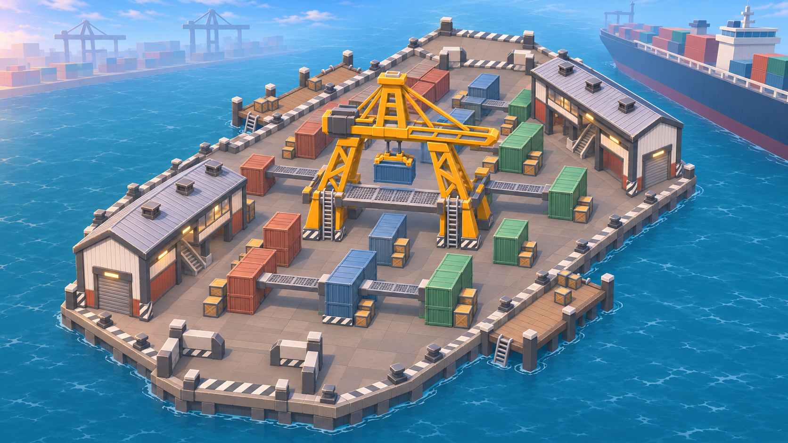
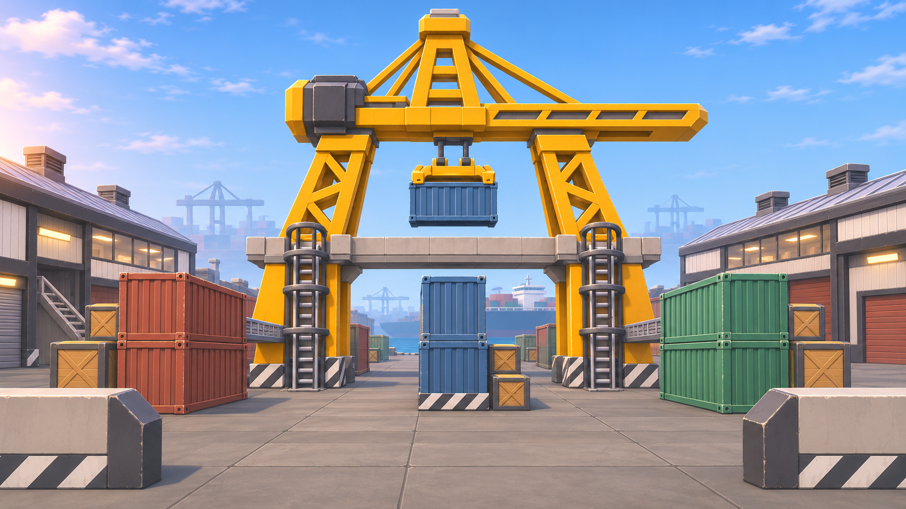
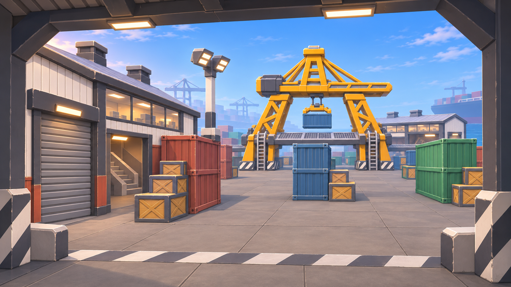
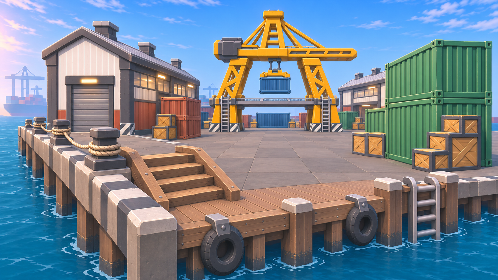
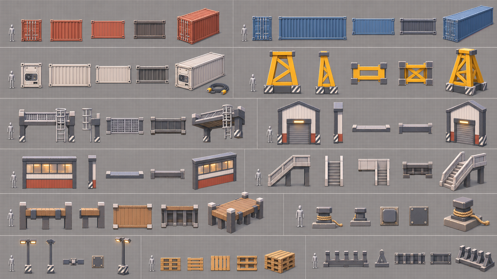
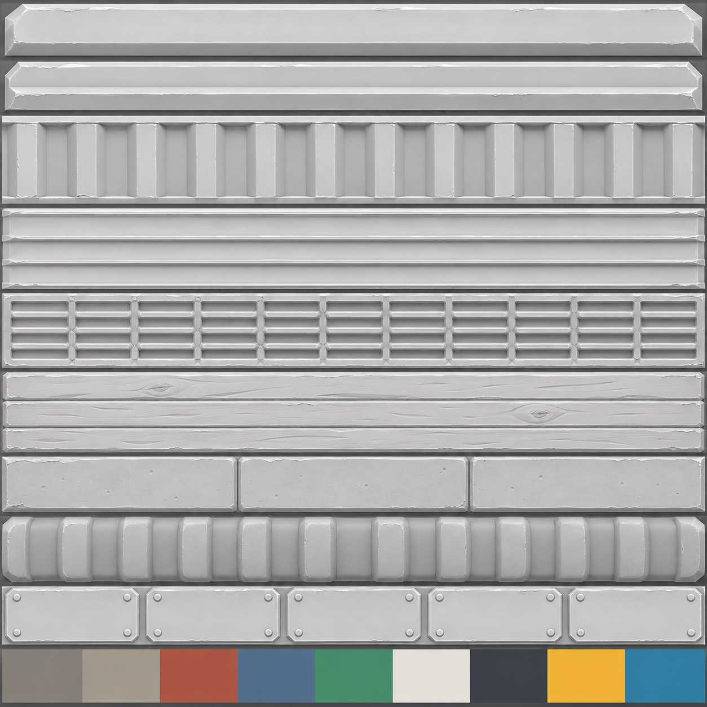

# Dockyard2 (redesign of Dockyard)

The 2026-11-05 redesign of [Dockyard](Dockyard.md) in the new environment style ([Lobby Style Guide](../../02%20Art/Lobby%20Style%20Guide.md), [Art Direction](../../02%20Art/Art%20Direction.md) → direction change 2026-11-04). Same idea: a container pier with three lanes, a gantry crane over the middle and a Shed on each flank, for 1v1 to 4v4. Built next to the old map, which stays untouched. **Not in the match rotation** until the user approves the swap; in Studio set the Workspace attribute `ForceMap = "Dockyard2"`. Lane G of the [Day Plan 2026-11-05](../../05%20Production/Day%20Plan%202026-11-05.md).

**Map id** `Dockyard2`. **World origin (-3000, 200, 0).** These origins are already taken: Whitebox (0, 200, 0), Big Whitebox (0, 200, -1500), Dockyard (-1500, 200, 0), Metro (1500, 200, 0), Old Town (0, 200, 1500), Greenhouse (1500, 200, -1500), Rooftops (1500, 200, 1500), Bunker (-1500, 200, 1500) and Snowpeak (-1500, 200, -1500).

**Status (2026-11-05, lane G):** all 8 phases done.
- Built in the match place: greybox, kit (asset 127619569582290, 26 pieces), art and lighting.
- **Audit 0** (0 z-fighting pairs over 1,940 visible parts).
- **Blind score 8.75 / 10** (3 reviewers, medians; first draft 5.4, 3 fix rounds).
- Playable with `Workspace.ForceMap = "Dockyard2"`, and not in the rotation (`Config/Match` has a one-line comment only).
- ⚠ **The match place is not saved yet.** Computer use for Studio was denied, so whoever holds the match Studio must press **Ctrl+S (Save to Roblox)**. The `.rbxm` backups are also not made: MCP code can't reach localhost, so use Studio's Save to File.

---

## 1. What's wrong with the old Dockyard
These come from its renders, its note and a rerun of `tools/maps/dockyard_layout.py`.

| Problem | Evidence | Fix in Dockyard2 |
|---|---|---|
| **Too dark and too realistic.** Dusk (orange to violet), corrugated realistic containers, sodium lamps. The blue and green containers go muddy in shade, and the user called the maps "too tactical and realistic". | [From the B spawn](../../02%20Art/References/maps/dockyard/dockyard-preview-from-b-spawn.jpg); the note had to raise the ambient after the first test | Bright afternoon and a stylized kit, with lighting that does the contrast (§4) |
| **A dominant hot seat.** The 2-high Crane stack (top at 16, Updraft only) sees **61%** of the floor. LihFolk: "a single high ledge with a view over the whole map becomes the only place anyone stands". | layout script, high-lane table | 1-high stack climbed from two crates; it sees 40% (change 1) |
| **First sight at 3.8 s** sprinting: a 73-stud diagonal from your own apron into the enemy Shed alley | `first_sight` | Closed. The first look is now across the middle at ~42 studs, at 4.3 s (change 2) |
| **A Shed sees out of its roller door all the way up the far apron, and the apron sees in** | the Shed screen covered only part of the door | Roller door moved behind the screen (change 3) |
| **The open quay.** Two 3.5 crates on a 114-stud line; worst distance to full cover was 17.9 | cover spread | One full-cover Quay stack with a 6-wide quay walk beside it (change 4) |
| **A 138-stud lateral line** across the middle band | longest lines | Apron box moved into the band; the line is now 122 and threads five gaps (change 4) |
| **Flank routes 1 s slower than the middle** (248 vs 226) | routes | Now 247 vs 237, within 0.5 s (change 5) |
| Visual noise: 7-high multicoloured end walls and a high-contrast corrugation on every box | renders | Calm, lighter backdrop stacks in desaturated tones; broad, few ribs on the containers (§4) |

What the old map gets right, and Dockyard2 keeps: lane colour as a callout language (red, blue, green), two heights of fight (ground and stack tops at 8), the middle band as the lane-rotation route, spawns out of every sightline (0%), and closing the ends with containers out of reach instead of invisible walls.

## 2. References
Images of other games stay out of the repo. Sources were checked on 2026-11-05.

| Reference | What to take |
|---|---|
| [Valorant Icebox breakdown (ONE Esports)](https://www.oneesports.gg/valorant/full-breakdown-of-icebox-valorants-act-iii-map/), [Icebox guide (Beebom)](https://beebom.com/valorant-icebox-map-guide) | The closest style target: stylized containers with clean bevels and painted colour, yellow cranes, a short mid. **Colour-named callouts** ("Green", "Yellow", "Orange") are exactly our lane language. |
| Splatoon *Port Mackerel* ([Inkipedia](https://splatoonwiki.org/wiki/Port_Mackerel); the page blocks bots) | A bright stylized container yard with three paths through a grid of containers and **three cross links through the centre**; climbable boxes. Our middle band plus the crossings at the dividers do the same job. |
| [RIVALS Docks (wiki)](https://robloxrivals.fandom.com/wiki/Docks), [Legacy Docks](https://robloxrivals.fandom.com/wiki/Legacy_Docks) | The RIVALS port map: a concrete pier ringed by water, climbable buildings, an out-of-bounds crane and terminal as the skyline. RIVALS also **redesigned** its Docks, a precedent for a v2 next to the old one. |
| [Overwatch 2 map design (Blizzard)](https://news.blizzard.com/en-us/article/23785339/uniting-gameplay-and-style-behind-overwatch-2-s-complex-map-design), [Oasis design (Game Developer)](https://gamedeveloper.com/design/learn-how-blizzard-designed-i-overwatch-s-i-oasis-map) | Art guides players to the objective. Symmetric maps tell their sides apart with colour and signage (our two Sheds: a red one and a green one). An "arena in an arena" with a ring around it spreads fights (the crane court with the lanes around it). |
| [RTG crane](https://en.wikipedia.org/wiki/Rubber_tyred_gantry_crane), [container crane](https://en.wikipedia.org/wiki/Container_crane), [Commons: gantry cranes](https://commons.wikimedia.org/wiki/Category:Gantry_cranes), [Belfast terminal](https://commons.wikimedia.org/wiki/File:Belfast_Container_Terminal,_April_2019.jpg), [Commons: container terminals](https://commons.wikimedia.org/wiki/Category:Container_terminals) | Real shapes in a sunny palette: the RTG portal (four legs on bogies, a box girder, a cab and a spreader), the ship-to-shore crane silhouette for the skyline, stack rhythm and lane widths. |
| [Intermodal container](https://en.wikipedia.org/wiki/Intermodal_container) | Proportions: 20 / 40 ft × 8 × 8.5 ft, 32 × 8 × 8 and 16 × 8 × 8 studs at our scale (kept). The corner castings and posts become the bevel and trim detail. |
| [Lobby Style Guide](../../02%20Art/Lobby%20Style%20Guide.md) and its renders ([spawn](../../02%20Art/References/lobby/rebuild-20261104/01-spawn.jpg), [Duels hall](../../02%20Art/References/lobby/rebuild-20261104/02-duels-hall.jpg), [kit sheet](../../02%20Art/References/lobby/rebuild-20261104/bunker2-sheet-a.jpg)) | The kit language: designed profiles, stepped plinths and collars, picture-frame openings, a bevel hierarchy, layering, clean SmoothPlastic trims, calm textures on big surfaces, Montserrat Black signs. |
| Counter-example: [a realistic container port (80.lv)](https://80.lv/articles/have-a-look-at-this-detailed-and-realistic-container-port) | What not to do: rain, rust and realism. Used for yard layout only. |

### What the LihFolk notes add (cited)
- **Layout.** Three lanes: fast and exposed, slow and covered, and vertical or interior. Mirror the long sightlines. Keep no single dominant perch. Cover is 2.5–3.5 (low) or 7+ (full), never 4–6. Spawns face a landmark. Keep route times within ~1 s. (*Combat Arena and Encounter Layout* §2 and §6, *Objective Mode Maps*, *Spawn Points Safe Zones and Respawn Flow*, *Genre Playbook - Shooters FPS and TPS*, all in `LihFolk/33 Level Design` and `10 Game Design and Genres`.)
- **Landmark.** One global landmark that covers 3–5° of view, has a unique black silhouette and is seen in the first frame after spawning. The crane is that landmark; its girders (52–56) are out of reach (*Level Design Principles - Flow Sightlines and Landmarks*).
- **Modelling.** Bevels of 1–6% of the form, ~0.15–0.3 at 40 studs. Above 6–8% looks inflated and toy-like. Primary, secondary and tertiary masses differ by 2–3×. Spend triangles on silhouettes. A trim must be ≥ d/170 thick to survive distance. (*Bevels Chamfers and Edge Highlights Without Textures*, *Shape Language and Silhouette Testing*, *Proportion Exaggeration and Gameplay Distance*, *Spending Triangles Where the Camera Looks*, in `54 Untextured Stylised Modelling` and `55 Modelling Nuance and Readability`.)
- **Colour and value.** 3–5 value bands at about 60/30/10. The ground is mid to dark-mid (V 35–60%). Structures sit one band away. Characters must separate from both. One dominant hue plus neutrals plus one small accent. Check in greyscale. (*Colour Scripts and Value Structure for Untextured Art*, *Environment Art Styles*, `44 Materials and Surfaces` / `06 World Building and Art`.)
- **Light.** The "Bright cartoon" recipe (§3.1) is the base. The sun sits 30–50° up at a quarter angle. Lit faces are 1.5–2.5× the shade. Bloom threshold ≥ 1.2. Local lights are shadowless, and we raise their range, not their brightness. (*Stylized Lighting Recipes*, *Lighting Untextured Art in Roblox*, *Atmosphere Sky Clouds and Post-Processing*, *Light Sources and Shadows*, `07 Lighting VFX and Audio`.)
- **Craft.** One shared palette and material set, light as wayfinding, an identity you can read from one frame, budgets set first (*What Craft Looks Like on Roblox - Lessons from Top Studios*, `60 High-Craft Game Teardowns`; *Teardown - Phantom Forces*: simple world geometry, strong silhouettes).

## 3. Layout (checked)

`python tools/maps/dockyard2_layout.py [--luau]` holds the plan as data, prints the checks, writes the SVG and, with `--luau`, the greybox data. Its docstring lists every change. Symmetry: 180° rotation (team A at -Z, B at +Z). Size: the same 136 × 184 pier and 36 × 18 spawn alcoves, because it already plays from 1v1 to 4v4.

| Check | Dockyard | **Dockyard2** | Target |
|---|---|---|---|
| Spawn sees spawn; enemy floor or tops that see a spawn | never; 0% / 0% | never; 0% / 0% | ~0 |
| First sight, sprinting / walking | 3.8 s / 5.2 s (73-stud diagonal into a Shed alley) | **4.3 s / 5.9 s** (across the middle, ~42 studs) | as late as the 5.1 s meet allows |
| Best perch (share of the floor it sees) | Crane stack 61% (Updraft only) | Shed roof 55% (Updraft only, the old value); Crane stack **40%** (anyone can climb it) | no single dominant perch |
| Rays over 100 / over 70 studs | 0.6% / 6.5% | **0.4% / 5.2%** | Whitebox 6.4% over 70 |
| Longest lines | quay 114, Shed alley 116, lateral 138 | quay 124 (from deep in your own Shed out of the roller door up the far quay), Shed alley 116, lateral **122** (threads five gaps) | one marksman family per side |
| Distance to full cover: average / worst | 4.6 / 17.9 | **4.4 / 16.0** | worst under ~15 except the long lane |
| Route via flank vs middle | 248 vs 226 (+1.0 s) | **247 vs 237 (+0.5 s)** | within ~1 s |
| Spawn to the middle; meet | 141 studs (6.4 s); 5.1 s | 142 studs (6.4 s); 5.1 s | — |
| Gaps under 6 studs | none | none | none |
| Highest reach (16 + 7.2 jump + 28 Updraft) | 51.2, under the girders (52) and the end walls (56) | same | out of reach |

The five changes:
1. **Crane stack 2-high → 1-high**, climbed from a crate at each end. Anyone can reach and contest the middle. It isn't an Updraft-only hot seat any more.
2. **Crane legs 3 → 4 square** (the chunkier stylized gantry). The **Crane box** moves 2 in from the leg line, so the **Shed screen** can sit 2 further west without a pinch gap. Together they close the old first-sight diagonal.
3. **The Shed roller door moves 4 west** (x 46–56), behind the screen. No line runs from the enemy apron into a Shed.
4. **Quay crates → one Quay stack** (20 ft, 6 clear of the barrier) for full cover mid-quay, and **the Apron box moves into the middle band** (44, 6) to cut its lateral lines.
5. Together these bring the **flank routes within 0.5 s of the middle**.
6. **Stepped spawn baffle** (added in scoring round 2): a 1-high 40-footer with a 20-footer on its west half. Still 0% of enemy floor and tops see a spawn, and the spawn view opens over the low half to the crane.

Callouts stay what the old map taught: **Red / Blue / Green** lanes, **Crane** (the stack), **High** (divider tops), **Red Shed / Green Shed**, **Apron**, **Quay**, **Tower**.

## 4. Look (style frame)

**Identity: a sunny harbour.** A warm sand-grey deck. Lane-coloured containers (terracotta, harbour blue, sea green, all one value band). A **signal-yellow gantry crane** as the landmark and the map's single accent. White and charcoal port trims. A teal harbour under a clear afternoon sky. The Lobby is a dark warm-concrete bunker with teal-slate structure and one accent per wing. Dockyard2 is outdoors, lighter and cooler, with one warm accent, so the two never read as the same place. The team colours (cyan, orange-red) and glitch magenta are kept off the map.

- **Value structure** (LihFolk *Colour Scripts*):
  - The deck is the ground band (V ~49%).
  - Containers and cladding sit one band up.
  - Trims are charcoal (dark accents) or white (cab, signs, bay numbers).
  - The crane yellow is the 10% spike, with nothing else in its band.
  - Players (Roblox avatars) separate from a mid ground and mid structures.
- **Kit language** (Lobby Style Guide, applied to a port):
  - **Containers:** a body with broad proud ribs (five per 16, chamfered, instead of the old fine corrugation). Rounded corner posts and rails with castings in a darker step of the lane colour. A door end with a picture-frame ring and recessed locking bars. A charcoal kick strip.
  - **Crane:** notched box-section legs on stepped bogies, a chamfered box girder, a white cab with a picture-frame window, a spreader, and tiny signal beacons.
  - **Shed:** a stepped concrete plinth, framed cladding panels with a lane-coloured band, picture-frame door surrounds, a deep eave (1.5–2 overhang for a strong shadow line) and a sign plate with Montserrat Black letters.
  - **Quay:** a coping with a bullnose lip, fenders and bollards.
  - **Lamp masts:** a stepped plinth, a tapered pole and a framed head.
- **Bevel hierarchy:** primary 0.45 (2 segments), secondary 0.14, tertiary 0.05. These are the Lobby's numbers nudged up for outdoor distances of 25–80 studs.
- **Surfaces:** the Lobby's painted textures (near-neutral greys, tinted by `Color`) go on the big surfaces only: deck slabs (`Dock2_Deck`), concrete (`Dock2_Concrete`), container bodies, cladding and roofs (`Dock2_Metal`), and stair treads (`Dock2_Grate`). Everything else is clean SmoothPlastic. Neon only on lamp heads and crane beacons.
- **Light:** a bright afternoon (ClockTime 15, latitude 0, so the sun rakes across the pier at ~45° and neither team looks into it). Warm sun, cool ambient, Atmosphere density 0.28, bloom threshold 1.4. A few shadowless lamps at the Sheds and masts for the warm practical touch.
- The style frame proper is the kit's first render (phase 4 gate). It's checked against this note before the rest of the kit is built.

## 5. Restyle parameters (cheap to change)
Everything lives in **`tools/maps/dockyard2_style.py`**:

| Parameter | Controls | To apply a change |
|---|---|---|
| `PALETTE` | Every role's colour, Roblox material and MaterialVariant (deck, concrete, cladding, crane, trims, glows, water) | `python tools/maps/dockyard2_style.py --luau`, then rerun the Art + Lighting bundle in Studio (no Blender, no upload) |
| `LANE`, `FRAME_SHADE`, `BACKDROP` | The three lane colours, the frame shade and the far-stack colours | same |
| `VARIANTS` | Which textures the Dock2_* MaterialVariants use, and their tile size | same |
| `LIGHTING`, `FX`, `LAMP` | Sun, ambient, atmosphere, bloom, grade and lamp colour | same (Lighting block) |
| `BEVEL`, `SEGMENTS` | Bevel sizes of the kit | Blender rebuild → export → upload → kit install (see §7) |

## 6. Plan (phases)
1. ✅ Plan with references (this note).
2. ✅ Layout check script and SVG (`tools/maps/dockyard2_layout.py`).
3. ✅ Greybox in Studio (`tools/studio/maps/Dockyard2/Greybox.luau`). Walk it in play mode with screenshots, then critique.
4. ✅ Blender kit (`tools/blender/build_map_kit_dockyard2.py`, on the Lobby kit helpers) with a contact sheet. Coplanar audit at 0, then export, upload and install.
5. ✅ Art pass (`Art.luau`), lighting (`Lighting.luau`) and set dressing.
6. ✅ `tools/studio/maps/Audit.luau` reports 0.
7. ✅ Screenshots from each spawn, the middle and an overview.
8. ✅ Blind scoring (`lihfolk:quality-score`, world rubric, min 8.5), then fix rounds: **8.75**.

## Kit (phase 4)
`tools/blender/build_map_kit_dockyard2.py` builds the kit on the Lobby helpers (`lobbykit`, `build_lobby_kit_stylized`, `build_lobby_kit_bunker2`), into `art-source/maps/Dockyard2/Kit_Dockyard2.blend`. That's 19 pieces, 22.7k triangles for the whole kit. **Coplanar audit: 0** (`art-source/maps/Dockyard2/coplanar.json`, the Lobby audit run on the `Map_` collections). Uploaded as group `Kit`, **asset 127619569582290**.

| Piece | Tris | Design |
|---|---|---|
| `C20` / `C40` | 1,504 / 1,624 | A body with broad chamfered ribs (5 per 16 studs), three shallow roof panels and rear-end ribs (Lane role). Corner posts and rails in a darker step of the lane colour (LaneFrame). Door leaves 0.13 proud with a rib each, and charcoal locking bars with handles. Everything sits ≥ 0.03 inside the 8 × 8 × L envelope. |
| `C20Lo` / `C40Lo` | 668 / 740 | The background version: 3 ribs per 16, no roof panels, bars or bottom rails. Used for the end walls above eye level, the ships and the far stacks. |
| `Crane` | 4,968 | Notched octagonal legs on stepped bogies with tyres, two charcoal bands per leg, chamfered box girders, portal beams, the trolley and a white machinery house, a white cab with glass and visor, a spreader over the Crane stack (26–29, clear of anyone on the stack), and four tiny signal beacons. |
| `Shed` | 4,108 | A stepped concrete plinth, cladding walls with charcoal pilasters, a lane-coloured band, picture-frame door surrounds with rounded inner corners, cornices, gables, a roof whose top follows the greybox roof with a 1.1 eave, a white fascia, barge boards and ridge cap, inside portal frames clear of the doors, a roller drum, pendant lamps and a floor slab 0.06 proud. |
| `ShedSign1/2` | ~1,450 | A framed white plate over the roller door with "SHED 01" / "SHED 02" in Montserrat Black. Numbers, not colour names, so a lane restyle never contradicts the sign. |
| `Stair` | 1,384 | Grate treads 0.03 under the greybox slope with hazard nosings, charcoal stringers and white rails. |
| `Rack`, `Office`, `Crate` | 1,588 / 1,096 / 240 | A pallet rack packed full (it's full cover) with hazard beams; a white site cabin with framed windows and a hazard door; a wooden crate on a pallet with charcoal bands. |
| `QuayBarrier8` / `Short`, `QuayFace8`, `Bollard`, `LampMast` | 88 / 88 / 136 / 500 / 580 | A wall with a bullnose cap, a hazard band and a dark kick (cores stop 0.02 short, so neighbours show a hairline joint instead of a coplanar end). The deck edge with a chamfered coping 0.06 over the deck and a rubber fender. A lathed bollard. A mast with a stepped plinth, a tapered white pole and a twin head with warm lenses. |
| `StsCrane`, `Ship` | 352 / 144 | Skyline silhouettes in white, charcoal and slate, kept off the yellow so the RTG stays the one landmark. |

**Style frames** (Blender stand-in for the Roblox light; Roblox will be flatter and warmer):

Critique of the first frame, now fixed: everything read blue (a cool backdrop behind the blue lane). The backdrop palette now leans warm (sand, cream, faded terracotta, sage, mustard, slate), and the blue lane is calmer (`3E6C9C`). The crane reads as the landmark from every frame. The Shed's white walls and lane band read at a glance.

## Studio build (phases 3, 5, 6)
**Greybox** built and walked in play mode with `ForceMap = "Dockyard2"` against a bot: deck plus 93 parts, 4 + 4 spawns, 2 barriers.

Greybox critique:
- The lanes read by colour from every spot.
- 8-high boxes are clearly full cover.
- The crane is the landmark: its yellow legs show over every stack, and its top shows over the spawn baffle.
- In play the bot found us across the middle first, as the layout script predicted.
- The 2-high baffle fills the spawn view. Flagged, and the reviewers flagged it too (fixed in round 1).

**Kit installed** (`ServerStorage.MapKit.Dockyard2`). The **art pass** made 402 kit placements and 124 art parts, hid 93 greybox parts and reported "all kit pieces found". **`Audit.luau`: 0 z-fighting pairs over 1,676 visible parts.**

Studio passes, each measured in Studio:
| Pass | Seen | Change (all in `dockyard2_style.py`) |
|---|---|---|
| Sun | `GetSunDirection` was (-0.65, 0.65, **-0.40**) at latitude 0, so team B half-faced the sun | Latitude **23.5** gives (-0.71, 0.71, 0.00): 45° up, across the pier |
| Colour 1 | Containers came out royal blue and very saturated, though their colours were right | Roblox **Metal** mirrors the blue sky. Painted surfaces moved off Metal and the lanes went a step calmer |
| Colour 2 | Shaded faces still went deep blue | A more neutral ambient: OutdoorAmbient (146,148,156), EnvironmentDiffuseScale 0.2 |
| Water | A loud cyan | `#2A6878` |
| Water overlap | The 2048-wide water would overlap the old Dockyard's water plane between the maps | 1000 wide, 0.1 lower |

## Scoring (phase 8, `lihfolk:quality-score`, world rubric, 3 blind reviewers)
**Round 0: 5.4 / 10** (medians: W1 1, W2 1, W3 1, W4 1, W5 1, W6 2). Hard gates pass: audit 0, decor non-colliding, spawns safe, 275k triangles for the whole map (211k without the skyline), 4 lights. Reviewer scores were 5.0, 5.4 and 5.4 (recomputed with the right weight total, 12).

All three named the same problems:
1. **The spawn view is a blank container wall** with no visible route and no team identity (W1, W2).
2. **Smeared textures** on the containers and Shed walls (W3, W5).
3. **Raw grey slabs** of the end walls from outside, and a flat tan "beach" (W3).
4. **Plain lighting**, with crushed shadows and a murky Shed inside (W4).

Fix round 1 (all four at once, since each is independent and parameter-cheap):
- A framed **spawn sign** on the baffle ("DOCK A / DOCK B", with "◄ RED" and "GREEN ►" in the lane colours, showing which lane lies each way round it) and **white chevrons** on the deck leading out round both sides. These are new kit pieces `SpawnSignA/B` and `Chevron`.
- **Clean SmoothPlastic paint** on the containers and cladding (the ribs, rails and doors carry the detail). The roof is calm concrete.
- **End-wall backs** dressed with light containers. Far quays darker.
- **Light:** a brighter neutral ambient (no crush), warmer ColorShift, haze 1.1 for depth, lower grade contrast, and Shed lamps at 2.4.

Fix round 2 (+1.3, to 6.7):
- **Stepped spawn baffle:** a 1-high 40-footer with a 20-footer on its west half. Spawn safety is unchanged (0% / 0%), and the spawn now looks over the low half to the crane. The sign was resized onto the high half (layout change 6).
- **White reefers** for the Crane stack and its steps, a ground-level centre landmark.
- **Lane words painted on the deck** where each lane leaves the spawn end.
- A lighter Shed inside and surround. Ships get a lighter hull, the far quays get deck tiles, and the STS crane frames are grey.

Fix round 3 (+2.05, to **8.75**):
- A framed **"CRANE" plate** on each long side of the reefers.
- The flank lane words again in the middle band. Bug fixed on the way: the A half's words had been mirrored into the wrong lanes. They now take their lane from where they land.
- Warm light strips under the Shed tie beams, which show even where PointLights don't render.
- A warmer sun against cooler shade, haze 1.6, sun rays 0.08, a less pastel backdrop, the reefers toned down from overexposed white.

| Round | W1 (3) | W2 (3) | W3 (2) | W4 (2) | W5 (1) | W6 (1) | Score (median) | Reviewers |
|---|---|---|---|---|---|---|---|---|
| 0 | 1 | 1 | 1 | 1 | 1 | 2 | 5.4 | 5.0 / 5.4 / 5.4 |
| 1 | 1 | 1 | 1 | 1 | 1 | 2 | 5.4 | 5.0 / 5.4 / 5.4 |
| 2 | 2 | 1 | 1 | 1 | 1 | 2 | 6.7 | 6.7 / 7.5 / 6.7 |
| **3** | **2** | **2** | **2** | **1** | **1** | **2** | **8.75** | 6.7 / 8.75 / 8.75 |

**Lowest criteria:** W4 lighting (all three called it "tuned, not striking") and W5 density (big flat container faces, a bare Shed inside). One reviewer still read the lanes as "a maze of same-coloured walls" (W2 1). The scores are logged in `.lihfolk/ledger.jsonl`.

Final screenshots (`References/maps/dockyard2/r3-*.jpg`). Captures are edit mode with the map's lighting applied; Shed PointLights don't render in them.

| Spawn A | Spawn B | Middle (ground) |
|---|---|---|
|  |  |  |

| Mid lane | Red lane (apron) | Overview |
|---|---|---|
|  |  |  |

## What the user should check tonight
1. **Save first.** In the match Studio (the one with `ServerScriptService.Server`), press **Ctrl+S** (Save to Roblox). Dockyard2 is built in it but unsaved.
2. **Play it.** Set the Workspace attribute `ForceMap` to `Dockyard2`, press Play, and walk from your spawn. Is the "DOCK A/B" sign readable, and do RED / GREEN point the right way? Does the crane over the low half of the baffle pull you to the middle?
3. **The look against the Lobby.** Bright harbour, clean painted boxes, signal-yellow crane. Too bright, too toy-like, or not enough? Every colour, the sun and the haze are one edit in `tools/maps/dockyard2_style.py` (§5) and need no Blender.
4. **Lane colours.** Terracotta / harbour blue / sea green, plus the white reefers in the middle. Do they read at a glance in play? Is the blue too dark in shade?
5. **The Shed inside** in play mode, where the lamps do render. Reviewers only saw it without lights and called it murky.
6. **Feel.** Middle contact at ~4.3 s sprinting, the 1-high centre stack, the quay walk beside the new Quay stack. Does any spot feel like a camping perch?
7. Decide whether Dockyard2 should replace Dockyard in the rotation (then add `{ id = "Dockyard2", minTeam = 1, maxTeam = 4 }` and drop `Dockyard`).

## Known issues and follow-ups
- **Other maps are visible on the horizon.** Snowpeak's mountains and the old Dockyard's cranes show from Dockyard2, because all maps sit in Workspace at 1,500-stud spacing. This is project-wide, not specific to Dockyard2. A fix belongs in MapService (park the inactive maps in ServerStorage) or in more spacing.
- **Studio place IDs are swapped against our notes (2026-11-05).** The match content (maps, `Server`) is the instance with PlaceId **133387545285290**, and the Lobby content (`LobbyServer`) is **71551303511506**. `MapKit.luau` and `kit_bundle.py` assert 71551303511506, so lane G swapped that assert for a content check in its temporary bundles only. The core chat should verify which is right, then fix the memory note `place-ids` and those asserts.
- **Background:** the end walls' water-side faces show a grey backfill strip. The STS cranes are simple silhouettes.
- **Budget:** 1,815 MeshParts and ~300k triangles for the whole map, of which ~230k in the playable yard. That's over the old Dockyard's 192k; the light `Lo` containers carry the end walls.

## 7. Build and run order
1. Layout (rerun after any change): `python tools/maps/dockyard2_layout.py --luau` prints the checks and writes the SVG, the greybox LAYOUT block and the ART block (from `tools/maps/dockyard2_art.py`).
2. Style: `python tools/maps/dockyard2_style.py --luau --svg` writes the STYLE block of `Art.luau`, the LIGHT block of `Lighting.luau` and the palette board.
3. Kit: `blender --background --factory-startup --python tools/blender/build_map_kit_dockyard2.py -- [--render] [--preview]` (prints `COPLANAR 0`). Export: `blender --background --factory-startup art-source/maps/Dockyard2/Kit_Dockyard2.blend --python tools/blender/export_lobby_kit.py -- --maps Dockyard2 Kit`. Upload: `python tools/opencloud/upload_models.py --maps Dockyard2 --group 11116787 Kit` (updates asset 127619569582290).
4. In the match place, edit mode: `python tools/studio/maps/bundle.py Dockyard2 Greybox`, then `python tools/studio/maps/kit_bundle.py Dockyard2 Kit`, then `python tools/studio/maps/bundle.py Dockyard2 Art Lighting`; run each.
5. Check: `tools/studio/maps/Audit.luau` with argument `"Dockyard2"` (target 0). Then screenshots, saving the place and the backups `art-source/maps/Dockyard2/Dockyard2.rbxm` / `MapKit_Dockyard2.rbxm`.

## Concept pass 2026-11-05
Status: **in progress.** Brief: [Evening Review](../../05%20Production/Playtests/2026-11-05%20Evening%20Review.md).
- The user's verdict: better than the old map but "too simple": smooth plastic blocks, no depth, no levels. The crates work because they have texture and meaning.
- Target: Valorant-level detail with RIVALS clarity. The user approves the concepts before any modelling.
- Skills and notes used:
  - `gauntlet-vault`;
  - `lihfolk-worldbuilding`: focal hierarchy, three reads, materials at three scales, hero ≥ 1.5× taller;
  - `roblox-blender-modeling`;
  - LihFolk notes: *Modular Environment Kits*, *Trim Sheets Atlases and Vertex Colors*, *Textures Decals and Texture Memory*, *Materials MaterialVariants and SurfaceAppearance*, *Art Budgets - Triangles Draw Calls Memory*, *Combat Arena and Encounter Layout*, *Level Design Principles - Flow Sightlines and Landmarks*.

### What's wrong now (in-play evidence)
Screenshots:
- [spawn A in play](../../02%20Art/References/maps/dockyard2/whats-wrong/play-spawnA.jpg)
- [spawn A exit](../../02%20Art/References/maps/dockyard2/whats-wrong/play-spawnA-exit.jpg)
- [quay stacks](../../02%20Art/References/maps/dockyard2/whats-wrong/edit-quay-stacks.jpg)
- the round 3 set (`r3-*.jpg`)

1. **Silhouettes are boxes.** Every container, shed and wall is a rectangle with a thin bevel. Nothing breaks the skyline except the crane legs. There are no overhangs, diagonal bracing, cantilevers or stepped roofs.
2. **No height.** The whole map plays on one floor (y 0):
   - the crane is scenery;
   - the sheds have no upper floor;
   - the stacks can't be climbed;
   - there are no drops, ledges or catwalks, so a fight plays the same everywhere.
3. **Flat surfaces.** Container sides are one colour with moulded ribs. There's no rust, chipped edges, streaks, stencilled numbers or dirt. The quay deck is a clean grid of square tiles with no expansion joints, tyre marks or stains. SmoothPlastic everywhere reads as a toy.
4. **Missing trims and edges.**
   - Containers: corner castings and door hardware are token at best.
   - Sheds: no flashing, gutters, downpipes or roller-door frames.
   - Quay: no edge capping, kerb or fender line.
5. **The landmark is weak.** The crane is a yellow frame (two legs and a beam) about as tall as the stacks behind it, so it doesn't own the skyline. The backdrop ship and the STS crane are flat and far away.
6. **No place identity.** Apart from the "DOCK A" sign, nothing says which port this is. There's no terminal name, bay numbers, livery, reefer plugs, lashing gear, pallets or ropes.
7. **What works:**
   - the coloured container lanes;
   - the signs naming the lanes;
   - the yellow crane as the middle marker.

   Keep all three.

### Reference board (local only, never committed: third-party images)
23 images in `vault/02 Art/References/maps/dockyard/third-party/`. What to take from each is listed in that folder's `SOURCES.md`.
- **Games (12):**
  - Valorant Icebox ×2: container cover silhouettes, worn metal, hazard zoning.
  - Valorant Breeze ×2: piers, wood and rope wear, sea composition.
  - Overwatch Havana: harbour quay and warehouses.
  - Overwatch Junkertown: corrugated sheds, rust.
  - Overwatch Gibraltar: dock markings, water edge.
  - CS2 Nuke outside ×2: container yard, stripes and numbering.
  - RIVALS Docks ×3: lanes, cover, height, zone colour.
- **Real (11):**
  - STS cranes in Oakland, Tokyo and Hamburg: the crane silhouette, boom, legs and trusses.
  - Container stacks ×2: colour zoning, corrugation, stack heights.
  - A straddle carrier: a moving-prop silhouette.
  - Bollards and the quay edge ×2.
  - A timber jetty and pier ×2: pilings, ladders.
  - A quay warehouse: doors, loading beams.
- **Gaps:** no Krunker (no usable source), and the RIVALS shots are mostly overviews.

### LihFolk rules applied (what changes, and the note it comes from)
I read these folders in full for this pass: 33 Level Design, 06 World Building and Art, 55 Modelling Nuance and Readability, 54 Untextured Stylised Modelling, 14 3D Modeling, 45 Procedural Blender Assets, 44 Materials and Surfaces, 07 Lighting VFX and Audio, 19 Concept Sheets, 15 AI Tools, 60 High-Craft Game Teardowns, 32 Case Studies, 08 Animation, 47 Game Feel and Juice. Gaps: *Case Study - Rivals* has nothing on maps, and no note covers ChatGPT prompt syntax.

**Layout and height**
1. **Every high spot has two contested ways up, plus cover, and a share cap.** *Combat Arena and Encounter Layout* §6: a single high ledge that sees the whole arena becomes the only place anyone stands.
   - The crane catwalk gets a caged ladder on each side and a low parapet (2.5–3.5 studs).
   - A perch-share check (≤ 40%, as for Dockyard2) runs before any build.
2. **Cover is either low or full, never chest height.** Low is 2.5–3.5 studs, full is 7+ studs, and the 4–6 band is avoided (*Combat Arena and Encounter Layout* §2). Pallets, drums and lashing racks in that band are non-colliding decor, or are resized.
3. **Jump height is 5.6 studs** ([Gunplay](../Gunplay.md)), not 7.2. Rises are ≤ 4 studs per hop.
   - The catwalk deck sits at 14 studs, or 3+ studs clear of any stack edge, so it can't be jumped onto from a 2-high stack (8 + 5.6 = 13.6).
   - The reach table gets re-measured.
4. **The landmark is unique as a black silhouette.** It's at least 1.5× taller than anything else, in the first frame after spawning, and it doesn't hide a lane exit (*Level Design Principles - Flow Sightlines and Landmarks* §4; *World Composition and Set Dressing - Designed, Not Scattered* §2). A silhouette round of crane skylines comes before any hero image.
5. **No position beats its mirror.** Every long sightline has a matching one, the 180° symmetry stays, and the middle sightline stays at about 70 studs ([Game Plan](../../05%20Production/Game%20Plan.md) §5).

**Modelling: why it reads as plastic, and the fix**

6. **Bevels follow the material.** *Hard-Surface Modeling* §2: 1–2% of a form reads as manufactured, 3–6% as a toy. Our 0.45 on 8-stud containers is 5.6%.
   - Steel (containers, crane): 0.12–0.25.
   - Concrete and the landmark base: 0.3–0.45.
   - Tertiary bevels must be at least d/215 at our 80° FOV (*Bevels Chamfers and Edge Highlights Without Textures*; *Modelling to the Roblox Camera and Player Scale*).
7. **Shape hierarchy and imperfection.**
   - Primary, secondary and tertiary masses split about 65 / 25 / 10%, with one focal feature per piece (*Shape Language and Silhouette Testing*).
   - Stacked items tilt 2–6° and repeats vary by 20–40%. Walkable tops stay level (*Low-Poly and Stylized Modeling* §2; *Stylised Shop Stand Worked Example*).
8. **Panel lines** are 0.04–0.1 insets, or a row in the trim sheet's normal map. Geometry is used only where it shows in the silhouette (*Hard-Surface Modeling* §4).
9. **Undersides get modelled.** This is first person, so catwalk, mezzanine and jetty undersides get beams and stringers. This is a deliberate exception to *Spending Triangles Where the Camera Looks*.
10. **Small props are 1.5–2.5× real size,** in groups of a few large ones. Railing posts are at least 0.4 studs thick. Nothing is thinner than 0.2 studs (*Proportion Exaggeration and Gameplay Distance*).
11. **Triangle budget** (*Art Budgets - Triangles Draw Calls Memory*; *Mesh Optimization for Mobile*):
    - Containers drop from about 1.5k to ≤ 800 tris (the repeated-prop band).
    - Medium pieces 800–3,000. The crane (hero) 5–12k.
    - The map stays under 450k visible tris; Dockyard2 is about 300k today.

**Materials and texture budget**

12. **One 1024 trim sheet** for the map's kit, plus at most 6 MaterialVariants at 512 (StudsPerTile 8–16). This replaces today's twelve 1024 maps (*Textures Decals and Texture Memory*; *Stylised vs Realistic Material Pipelines* §6).
    - Texel density is 32–64 px per stud, with 64 on the crane.
    - Colour plus normal only; roughness is dropped.
13. **Tint, don't duplicate.**
    - The trim-sheet rows are near-white with `AlphaMode = TintMask`, so `Color` still sets the lane hue and the role restyle keeps working.
    - One SurfaceAppearance template is cloned so the pieces batch (*Trim Sheets Atlases and Vertex Colors*; *SurfaceAppearance PBR Workflow*).
    - Batching across different tints gets measured in the MicroProfiler.
14. **Wear is baked, not decals.** Edge wear, cavity and AO (0.35–0.5) go into the trim sheet (*Baking Lighting and Detail into Textures* §1, §3).
    - Bay numbers and stencils go in a sheet row or atlas (*Tiling Trim Sheets and Decal Tricks*).
    - Walkable surfaces stay calm. The wear is low-frequency, so the Lobby Style Guide's "low texture contrast" still holds (*Environment Art Styles*; *Colour Scripts and Value Structure for Untextured Art*: readability beats mood).
15. **Grating is opaque.** No transparency or alpha cards, because overdraw kills phones (*Mesh Optimization for Mobile*). Painted surfaces never use the Roblox Metal material.

**Colour and light**

16. **Lanes keep their colours.**
    - Zones are coloured by lane, not "warm half and cool half", so the lane callouts keep working.
    - The crane's yellow stays the only 10% spike, so hazard stripes are white and charcoal, not yellow (*Zone and Biome Art Direction*; *Colour Scripts…*).
17. **Lighting uses the Toon arena recipe** (§3.2 in *Stylized Lighting Recipes*), not Bright cartoon (a hub recipe):
    - high key, cool dominant (sky, water);
    - the environment desaturated, with saturation spent on the lanes and the crane;
    - warm key (255,225,190) against a cool fill;
    - haze 1–1.6, so the ship sits near the sky's value;
    - a greyscale test and a no-shadow test (phones below quality 4 have no shadows).

**Process**

18. **Order:** brief, silhouettes, overview, then the hero images, with the overview fed back as the reference for each (*AI Image Generation for Icons Thumbnails and Concepts* §5; *Matching a Concept Sheet - Boss Creature Case Study*).
    - Critique each round in the order purpose, silhouette, proportion, value, colour, edges, detail, with 3–5 must-fixes (*Critiquing a Model - Paintovers and Iteration*).
    - The prompt and the image stay together.

### Identity brief (one page, per *What Craft Looks Like on Roblox*, *World Composition and Set Dressing*)
- **Identity sentence:** "A working container pier at Port Halden on a bright windy afternoon, where a giant yellow crane stands over three painted lanes." The names are ours.
- **Story groups (2–3):**
  - a reefer container left open, with its cables cut;
  - a crane spreader parked half-lowered over the middle;
  - a lashing crew's break spot on the jetty (a flask, a chair, rope coils).
- **Not this:**
  - smooth plastic boxes;
  - a sci-fi port;
  - rust-everywhere grunge;
  - noisy decals on walkable floors;
  - a second yellow;
  - thin wires that cross sightlines;
  - real company logos.

### Direction (keep the layout: 3 lanes, crane in the middle, sheds on the flanks)
- **Height levels (new):**
  - **Crane gantry catwalk** at 14 studs: a caged ladder on each side and a low parapet. Perch share ≤ 40%.
  - **Shed mezzanines:** an office floor with a window strip over each flank lane and an inside stair. The window ledge gives a drop onto a container.
  - **Climbable stacks:** 2-high, with a grating bridge between them. Each hop is ≤ 4 studs (crates as steps).
  - **Lower jetty:** about 4 studs below the quay edge, with a ladder at each end.
- **Landmark:** a ship-to-shore gantry crane with a container hanging over the middle, unique as a black silhouette. The ship's hull is the backdrop wall.
- **Identity:** Port Halden, Terminal 7. Props:
  - reefer containers with cables;
  - lashing bars;
  - bollards with rope;
  - tyre fenders;
  - light masts;
  - pallets.
- **Colour:**
  - Lanes keep their hues: red, blue and green.
  - The crane is the only yellow.
  - The deck is neutral concrete. The sheds are white and grey cladding.
- **Materials:** in one 1024 trim sheet plus ≤ 6 variants at 512:
  - container steel with baked edge wear;
  - concrete with joints;
  - galvanised grating, opaque;
  - weathered timber;
  - ribbed cladding;
  - iron.

### Prompts (ChatGPT image generation, revised after the LihFolk read)
Attach 2 reference screenshots (current Dockyard2 spawn and the Lobby) plus 2–3 of the third-party references to every prompt.

Shared style block, appended to every prompt:
> Original stylized competitive FPS map concept, 3D game environment, polished hero-shooter craft: chunky exaggerated proportions, trims 2–4× real thickness, crisp chamfered edges, shallow panel lines, wear only on edges and corners, calm low-contrast floors. Detail is clustered at eye-level hero zones; the background is simple silhouettes. 3–5 clear value bands, mid-value ground; the landmark is the most saturated thing in view; forms read from colour planes, not cast shadows; readable in greyscale. No thin railings, mesh or wires; no text or lettering (leave signs blank); no people; no real brands. Not a copy of any existing game's map.
> Palette: deck grey #8A867E, concrete #A59D90, west-lane red #AD5843, middle-lane blue #52708E, east-lane green #438C6A, cladding white #E8E6E0, charcoal #3A3F47, crane yellow #F2B632 (crane only), sea #2F7FA6.
> Light: bright afternoon, warm sun from the side (left of frame), cool sky fill, light haze so far objects fade toward the sky.

0. **Silhouette round:**
   > 12 black silhouettes on white of different ship-to-shore gantry crane designs for a game landmark, each unique when blacked out, chunky and readable, side view.

   Pick one; the rest of the prompts use it.
1. **Overview** (generate first; it becomes the reference for 2–4 and 5):
   > High three-quarter aerial view of a compact arena shooter map on a container pier, 180-degree rotational symmetry, three parallel lanes.
   > - Left lane: through a long ribbed-metal shed with an upstairs office mezzanine.
   > - Middle lane: under a giant yellow ship-to-shore crane with a grated catwalk between its legs and a container hanging from its spreader.
   > - Right lane: along the quay edge, with a lower timber jetty below it.
   > - Container stacks, two high, coloured by lane (red, blue, green).
   > - Spawns at the two short ends. Water around the pier, a cargo ship hull moored alongside as the far wall.
2. **Hero, middle:**
   > Wide game camera, about 100° horizontal FOV, player eye height, standing in the middle lane looking along it toward the yellow crane (from image 1): the catwalk 14 ft up, with caged ladders on both sides and a low parapet; a container stack on each side with a grating bridge between them; concrete deck with expansion joints; the ship hull at the far end.
3. **Hero, spawn A:**
   > Same camera, looking out of a spawn bay: the corrugated shed on the left, with a roller door and an office window strip above; a red container stack with crates as steps; a light mast; the crane rising mid-distance, framed between the stacks.
4. **Hero, spawn B:**
   > The rotated twin: the quay edge on the left, with a timber stair down to the jetty, tyre fenders and bollards with rope; a green stack on the right; the crane ahead.
5. **Kit sheet:**
   > Environment modular kit sheet, orthographic front, side and top views plus one three-quarter view of each piece, grey background, a plain 5-ft mannequin beside each piece for scale, pieces on a 4-unit grid:
   > - 20 ft container and 40 ft container;
   > - reefer container;
   > - crane leg segment;
   > - catwalk section with parapet and caged ladder;
   > - shed wall module with roller door;
   > - shed wall module with window strip;
   > - mezzanine stair;
   > - jetty section with fenders;
   > - bollard with rope;
   > - light mast;
   > - pallet stack;
   > - lashing rack.
   >
   > Same style and palette.
6. **Trim sheet:**
   > Game trim sheet texture, 1:1 square, horizontal tiling strips stacked top to bottom with thin gaps:
   > - two chamfered-edge bevel strips;
   > - corrugated container panel strip;
   > - ribbed cladding strip;
   > - galvanised grating strip;
   > - timber plank strip;
   > - concrete joint strip;
   > - rubber fender strip;
   > - a row of blank stencil plates;
   > - a flat colour palette strip.
   >
   > All tintable near-white or light grey except the palette strip; wear baked on the edges only; stylized, low noise.

### Modelling plan (after the concepts are approved)
- **Blender, real detail** (the scripted kit with derived dimensions, a seed per piece and A1–A18 gates; coplanar 0; floating shells 0):
  - the crane (hero, 5–12k);
  - catwalk, ladder and parapet;
  - containers rebuilt at ≤ 800 tris, with corner castings, door bars and ribs in the silhouette;
  - the shed with mezzanine, flashing, gutters and downpipes;
  - the jetty with stringers;
  - bollard, fender and light mast;
  - ropes and cables swept along curves (`lihfolk_curves`).
- **Texture work:**
  1. One 1024 trim sheet (colour + normal), made from the approved trim-sheet concept, cleaned in Blender.
  2. Bake the edge wear, cavity and AO into the kit's rows (*Baking Lighting and Detail into Textures*).
  3. Up to 6 MaterialVariants at 512 for deck, cladding, timber and grating.
- **Phone budget:**
  - ≤ 450k visible tris.
  - Texture memory: about one 1024 sheet with 2 maps, plus 6 variants × 2 maps × 512, which is about 5 MB of 1024-equivalent maps against today's twelve.
  - Measured in Studio's Stats and the MicroProfiler before the art pass is called done.
- **Order:** layout re-check (perch share, jump 5.6), then greybox heights, kit, trim sheet, art, then the blind world-rubric score.

### Concept board (approved 2026-11-05: "I think it looks pretty good")
The images were made by Codex from the prompts above, in `art-source/maps/Dockyard2/concepts/`. The user's condition: "not follow the maps in exact one-to-one". The concepts set the quality bar, silhouettes, landmark, trims, materials, height and light. Our layout, sightlines, cover heights, spawn distances, 180° symmetry and the measured numbers above stay. Gameplay wins.

**Overview pick: v2.** It shows the whole pier in 180° symmetry: a shed on each flank, a jetty at each end, and the crane in the middle with its catwalk. That matches our layout. v1 is a closer, one-sided view.

| | |
|---|---|
|  |  |
|  |  |
|  |  |

[Silhouette round](../../../art-source/maps/Dockyard2/concepts/00-silhouettes.png) and [overview v1](../../../art-source/maps/Dockyard2/concepts/01-overview.png). Pick: the A-frame gantry (row 2, first) with a machinery house on the back, a lattice boom and a spreader. The hero views use the same crane.

**Adopted:**
- **Landmark:** a chunky yellow A-frame gantry crane.
  - Splayed legs with X-bracing, on black-and-white striped footings.
  - A machinery house, a lattice boom, and a spreader holding a blue container over the middle.
  - A concrete catwalk beam between the legs, with **caged ladders** on both legs.
- **Containers:**
  - corner castings, door bars and locking rods, deep ribs, a dark frame;
  - a white reefer container with a cooling unit and a coiled cable;
  - stacked 2-high, with crates as steps.
- **Sheds:**
  - a gable roof with roof vents;
  - white ribbed cladding over a red base band, with black-and-white striped corner guards;
  - a roller door with a lamp above it;
  - an office window strip with warm light;
  - an outside stair to the mezzanine.
- **Quay:**
  - a concrete deck with joints;
  - a coping edge in alternating black and white bands;
  - bollards with rope;
  - jersey barriers with stripes;
  - twin-head light masts.
- **Jetty:** timber planks on pilings, a timber stair down from the quay, tyre fenders on brackets and a steel ladder.
- **Backdrop:** hazy cranes and a container ship.
- **Materials:** the trim-sheet rows (bevel strips, corrugation, ribbed cladding, grating, plank, concrete, fender, plates).

**Dropped or changed (and why):**
- **Grating bridges between many stacks.** Too many perches. We keep one per side, and only after the perch-share check (≤ 40%, *Combat Arena and Encounter Layout* §6).
- **The concept's catwalk height and positions.** Our catwalk is at 14 studs so it can't be jumped onto from a stack at jump 5.6. The lanes keep our measured positions and widths.
- **Yellow crates.** The crane is the only yellow, so crates are natural timber, a desaturated tan, with charcoal frames.
- **Barriers and crates in the 4–6 stud band.** Barriers are low cover (3), and crate steps are ≤ 4 per hop.
- **The exact pier outline and jetty sizes.** We keep our quay and jetty from the layout script.

### Final kit list (Blender, real detail)
| Group | Pieces |
|---|---|
| Containers | `C20`, `C40` (≤ 800 tris each: castings, door bars, ribs in the silhouette), `C20Reefer` (unit + cable), low variants |
| Crane | `CraneLeg` (splayed, bracing, striped footing), `CraneBeam` (machinery house, boom lattice), `Spreader` + hanging container, `CraneCatwalk` (beam, parapet), `CagedLadder` |
| Shed | `ShedWall8` (ribbed cladding, base band, guards), `ShedDoor` (roller, lamp), `ShedOffice8` (window strip), `ShedGable` (roof, vents), `ShedStair` |
| Quay | `QuayCoping8` (striped), `Bollard` (rope), `Barrier` (jersey, stripes), `LightMast` (twin head) |
| Jetty | `Jetty8` (planks, pilings, stringers), `JettyStair`, `Fender` (tyre, bracket), `Ladder` |
| Props | `Crate`, `CrateStep`, `Pallet`, `PalletStack`, `LashingRack` |

Budget: the map stays ≤ 450k visible tris (about 300k today). Container triangles come down to pay for the new levels. Bevels: steel 0.12–0.2, concrete 0.3–0.45.

### Texture plan
Six MaterialVariants at 512 (colour plus a derived normal map), cut from the approved trim sheet ([06](../../../art-source/maps/Dockyard2/concepts/06-material-trim-sheet.png)) and tinted by role:

| Variant | Row |
|---|---|
| `Dock2_Corrugated` | containers |
| `Dock2_Cladding` | sheds |
| `Dock2_Concrete` | deck and quay |
| `Dock2_Plank` | jetty and crates |
| `Dock2_Grate` | catwalks (opaque) |
| `Dock2_Plate` | crane and structural steel |

These replace today's twelve 1024 maps.

### Birds (map life)
The current gulls are boxy (the verdict: "blocky and bad"). **Recommendation: remove them until there's a modelled replacement.**

The replacement:
- Silhouette: a tapered wing bent at the elbow, a neck collar, 5–15% asymmetry, two tones from the palette (*Shape Language and Silhouette Testing*; *Art-Direction Nitpicks - The Principles Behind Them*).
- Size: 300–500 tris (*Art Pipeline - Concept to In-Game Asset*).
- Motion: rigid wings flapping in bursts of 2–5 beats at about 0.8 Hz, with 2.5–5.5 s glides; spline paths with bank ≤ 35°; a random phase per bird (*Flight Flocks and Path Animation*).
- Runtime: client-only, at most about 20, moved with `BulkMoveTo`, culled off-screen (*Wildlife and Ambient Creature AI*).
- Placement: over the water only, never across a duel sightline, because motion pulls the eye like an enemy (*Level Design Principles…*). Dropped first on low-end devices (*Juice on a Budget - Mobile and Low-End*).

This is lane F's area; it's a recommendation only.

## Rebuild v3 from the concepts (2026-11-05 evening), first pass and blind score
Built on the same pipeline as Rooftops2. Committed in 2507958; the place needs saving (Ctrl+S).
- **Textures:** six of our own MaterialVariants (corrugated, cladding, concrete, plate, plank, grate) at 512, colour plus normal, cut from the approved trim sheet. They replace the Lobby's twelve 1024 maps.
- **Crane:** solid box-section legs with proud corner members and X bracing, knee braces under the girders, black-and-white striped footings, and riveted plate texture.
- **Containers:** corner castings on every container. The containers grew to about 1,900 triangles each, still over the 800 target for repeated pieces.
- **Paint and crates:** white paint and timber crates, so the crane is the only yellow.
- **Audit:** 0 pairs over 2,347 visible parts.
- **Bug found and fixed:** a patch replaced the same line in the crate builder, so every crate grew the crane's knee braces. These showed as floating yellow sticks and black bars on the ground.

| Concept | Build v3 |
|---|---|
|  |  |
|  |  |
|  |  |

**Blind score (world rubric, 3 fresh reviewers): 6.67.** The reviewers gave 7.50, 6.67 and 6.67; the medians are W1 2, W2 1, W3 1, W4 1, W5 1, W6 2. That is below the bar and below the earlier 8.75.

Part of the drop comes from the evidence, not the build:
- The overview camera showed mostly container tops.
- The quay shot was a tight wall.
- The spawn and shed shots came from the earlier pass, so the reviewers saw two texture styles.

The real gaps the reviewers named:
1. **Lane colours don't read.** Red, blue and green lanes don't show at eye height or from above. The fix is lane floor stripes and lane-coloured end containers.
2. **The deck and the stack tops are large flat fields.** They need stains, drains and cable runs.
3. **The shed interior is still the old smooth style.**
4. **The light is generic midday.** It needs haze and warm-cool contrast.

**Against the concepts:** the crane now reads like the concept's (braced, plated, striped feet), and the containers carry real corrugation and castings. Still missing are the concept's chunky quay coping with stripes, the jetty with tyre fenders, and the cleaner, bolder lane colours. No fix round tonight, as asked.

## Maps v4 (2026-11-05 late): plan
Source: the user's v3 review ([2026-11-05 Maps v3 Review](../../05%20Production/Playtests/2026-11-05%20Maps%20v3%20Review.md)): "looks much better", but it's a bit dark, the crate textures could be better, the "SHED 02" text is blocky and too simple, and "you're using too simple of shapes". It is built on the same pipeline as Rooftops2 v4.

| Item | v4 treatment |
|---|---|
| Brightness | Higher Exposure and Brightness, more OutdoorAmbient fill, Atmosphere haze for depth, and a warm sun against cool shade (the v3 reviewers' "generic midday"). LihFolk Stylized Lighting Recipes, "Bright cartoon" row as the start: Ambient at or below OutdoorAmbient per channel. |
| Crates | Rebuilt mesh with separate boards (frame, infill planks with gaps, X brace, corner irons, nail heads), plus a new plank texture with board seams and wood grain. |
| "SHED 02" | **Letters cut.** A modelled shed number plate with a stencilled number as a texture decal (a real font, rendered), or no number. |
| Shed interior | Modelled racks (uprights, beams, pallets with boxes), a workbench and hanging lamps instead of smooth boxes. |
| Lane colours | Lane floor stripes plus lane-coloured end containers (red, blue, green), readable at eye height and from above. |
| Deck breakup | Drains, cable runs, oil stains, tyre fenders and bollards on the quay coping. Flush art, no collision. |
| Simple shapes | Any remaining smooth primitive gets the Rooftops step 1 treatment: model it or cut it. |

The collision doesn't move. Results and side-by-sides follow below.

### Codex prop list (Dockyard2)
The same rules as the [Rooftops2 Codex prop list](Rooftops2.md#codex-prop-list-rooftops2-dockyard2s-list-is-in-its-note), including the mandatory vault and LihFolk rule. Material names are role names from `tools/maps/dockyard2_style.py` (`Wood`, `Charcoal`, `Rubber`, `Concrete`, `Hazard`, `Crane`, `White`, `Grate`). Crates come from the shared set R4 in the Rooftops2 note.

| # | Prop | Concept reference | Size (studs) | Tri budget | Palette / roles | Export path |
|---|---|---|---|---|---|---|
| D1 | **Bollard and fender set**: a mooring bollard (a cast body with a cap lip and bolts on a base plate), a tyre fender hung on a short chain, and a coiled rope | `art-source/maps/Dockyard2/concepts/05-kit-sheet.png` quay props; `02-hero-middle.png` | bollard 1.6 x 1.6 x 2.2; tyre 2.4 diameter x 0.8; coil 2 x 2 x 0.6 | 400 / 400 / 500 | Charcoal (cast iron), Rubber, Wood (rope, tinted) | `art-source/maps/Dockyard2/props/QuaySet.glb` (objects `Bollard`, `TyreFender`, `RopeCoil`) |
| D2 | **Shed rack and pallet set**: a pallet-rack bay (2 uprights with holes and bracing, 3 beam levels), a pallet, and stacked cartons on a pallet | `05-kit-sheet.png` shed interior; `03-hero-spawn-a.png` | rack 8 x 3 x 9; pallet 3 x 3 x 0.5; carton stack 3 x 3 x 2.5 | 1,800 / 300 / 600 | Crane (yellow uprights, small), Charcoal (beams), Wood, White (cartons, tinted) | `art-source/maps/Dockyard2/props/ShedRackSet.glb` (objects `Rack`, `Pallet`, `CartonStack`) |

#### Codex modeling results (2026-11-05)

Built D1 then D2 after the Rooftops sets through interactive Blender MCP. Every preview is a 3/4 render with a 5-stud grey scale block. Component parents have bottom-centre local origins and presentation offsets; place the named parent, with its role meshes, as one component.

| Prop | Exported tris / budget | Measured size (studs) | File paths | Off-spec / interpretation |
|---|---|---|---|---|
| D1 QuaySet | Bollard 296 / 400; TyreFender 388 / 400; RopeCoil 464 / 500 (set 1,148) | bollard 1.6 x 1.6 x 2.2; tyre body diameter 2.4 x 0.8 deep; with chain 3.0449 high; coil 2 x 2 x 0.6 | [GLB](../../../art-source/maps/Dockyard2/props/QuaySet.glb) / [blend](../../../art-source/maps/Dockyard2/props/QuaySet.blend) / [preview](../../../art-source/maps/Dockyard2/props/QuaySet_preview.png) | Parents `Bollard`, `TyreFender`, `RopeCoil`. Chain is included in the tyre budget; extends above the stated tyre-body diameter. Modelled tread channel, cast cap wear and twisted rope. Edge-treatment exception below. |
| D2 ShedRackSet | Rack 1,640 / 1,800; Pallet 268 / 300; CartonStack 580 / 600 (set 2,488) | rack 8 x 3 x 9; pallet 3 x 3 x 0.5; carton stack including pallet 3 x 3 x 2.5 | [GLB](../../../art-source/maps/Dockyard2/props/ShedRackSet.glb) / [blend](../../../art-source/maps/Dockyard2/props/ShedRackSet.blend) / [preview](../../../art-source/maps/Dockyard2/props/ShedRackSet_preview.png) | Parents `Rack`, `Pallet`, `CartonStack`. Two upright frames (four legs), actual open slots, three beam levels and bracing. Chipped pallet end and pressed carton corner. Edge-treatment exception below. |

All exported meshes pass the LihFolk geometry gate: no n-gons, loose/degenerate geometry, open/non-manifold edges, inconsistent normals, self-intersections or overlapping caps; rotation/scale applied and one material per role mesh. Re-importing each saved GLB preserved dimensions and triangle counts, with no preview helpers exported. Native files contain one asset scene plus its render setup. The independent 3/4-view visual review scored each set 16/18; this does not replace Studio integration testing.

**Edge-treatment exception:** primary forms use single-segment chamfers; thin hardware and strips use smaller widths than 0.06 studs, and some inset/hidden faces remain sharp to meet the tight budgets. Separate shells overlap intentionally at assembled joints. No text, logos or downloaded models.

Shared crates/barrel remain in the [R4 Rooftops export](../../../art-source/maps/Rooftops2/props/CrateSet.glb).

Sources used: this prop list and its named concepts, [Art Direction](../../02%20Art/Art%20Direction.md), the LihFolk `roblox-blender-modeling` skill, [Bevels Chamfers and Edge Highlights Without Textures](../../LihFolk/55%20Modelling%20Nuance%20and%20Readability/Bevels%20Chamfers%20and%20Edge%20Highlights%20Without%20Textures.md), [Spending Triangles Where the Camera Looks](../../LihFolk/55%20Modelling%20Nuance%20and%20Readability/Spending%20Triangles%20Where%20the%20Camera%20Looks.md), and [Clean Stylised Shading](../../LihFolk/54%20Untextured%20Stylised%20Modelling/Clean%20Stylised%20Shading%20-%20Weighted%20and%20Custom%20Normals.md).

### v4 results (built 2026-11-05 late)
Kit rebuilt headless (`tools/blender/build_map_kit_dockyard2.py`): 23 pieces, 29k triangles, coplanar 0, asset 127619569582290 updated. Installed in the match place: 510 placements, Studio audit 0 pairs over 2,469 visible parts. **The place needs saving (Ctrl+S).**

| Item | What was built |
|---|---|
| Text | **All part-built text is cut:** - SHED 01/02 - the DOCK A/B spawn signs, with their RED/GREEN words and arrows - the CRANE plate - the RED/BLUE/GREEN deck words - the chevrons |
| Shed sign | A framed plate in the Shed's lane colour (green on the east Shed, red on the west), with a white band and two lamp hoods. |
| Crates | The concept's crate: honey boards (CrateWood D3A262) in a darker frame (CrateFrame 8E6440), separate infill boards with gaps, an X brace on every face, a slatted lid, corner irons and a slatted pallet. About 900 tris. |
| Shed interior | - I-section portal frames (flanges and webs) - a pipe run along the water-side wall - junction boxes on the columns - a striped loading zone inside the roller door - walkway lines - the rack rebuilt: blue braced uprights, beams, slatted pallets and taped carton stacks |
| Lane colours | Lane stripes down each lane (red x −40, blue x ±8, green x +40), 1.2 wide and cut at the bay lines. The two eye-level rows of the end walls now take their lane's colour. |
| Deck breakup | 52 flush pieces (oil stains, drains, manholes), 8 apart and off the lines. |
| Light | Brightness 3.0, ExposureCompensation 0.2, Ambient (130, 134, 146), OutdoorAmbient (172, 176, 192), warm haze, a cool Atmosphere decay, and a clearer grade. The deck is a cooler, lighter grey. The shed lamps are down to 1.7 so the inside doesn't blow out. |

Collision didn't move, so the layout checks stand.

| Concept | Build v4 |
|---|---|
|  |  |
|  |  |
|  |  |
|  |  |
|  |  |
|  |  |

These are edit-mode captures with the map's own Lighting config and effects applied.

**Honest read against the concepts:**
- **Better:**
  - The crates now match the concept's.
  - The red lane reads at once.
  - The shed inside is lit and furnished.
  - The overview's end walls carry the lane colours.
  - There is no text.
- **Still short:**
  - The deck still reads warm brown in direct sun. The concrete texture is warm, so it needs a cooler texture row.
  - The blue lane containers go very dark navy in shade.
  - The shed walls are plain cream panels.
  - The containers stay simpler than the concept's (bolder ribs, door hardware).
  - The crane is unchanged.

**Blind score (`lihfolk:quality-score`, world rubric, 3 fresh reviewers): 6.7.** All three reviewers gave 6.7. The medians are W1 2, W2 1, W3 1, W4 1, W5 1, W6 2. That is level with v3 (6.67) and below the 8.5 bar, so it's still a draft. It's one score, as asked.

| W | Median | What the reviewers said |
|---|---|---|
| W1 composition | 2 | The crane is a strong landmark in every shot. |
| W2 navigation | 1 | The red lane reads clearly (one reviewer: "could earn a 2"). The blue stripe is thin beside dark navy faces, the green lane wasn't in the evidence, and the overview is a container wall. |
| W3 cohesion | 1 | The crane, containers and crates are cohesive. The sheds (outside and inside) are plain beige next to the concept's grey and white sheds with windows, roller doors and lamps. The shed's facade plate is small. |
| W4 lighting | 1 | Sunny and no longer dark. The overview haze reads cyan, and container faces in shade are underexposed. |
| W5 detail | 1 | The crates, rivets and pallets work. The deck, the container sides and the shed walls are still flat. |
| W6 scale | 2 | The containers, crates and doors read right against the 5-stud player. |

**Next, in order of gain:**
1. Lighter, more saturated lane containers in shade (raise LANE values, and give the blue more value).
2. Bolder lane markers: wider stripes, or painted lane-colour bands on the quay and container ends.
3. A green-lane evidence shot.
4. A shed facade pass: windows with warm glow, a corrugated roller-door texture and a bigger plate.
5. A cooler concrete texture row for the deck.
6. Codex's D1 and D2 props (fenders, bollards, racks) once imported.

### Codex props: lane G review (2026-11-05 late)

| # | Prop | Verdict |
|---|---|---|
| D1 | QuaySet (bollard, tyre fender, rope coil) | **Not used yet.** The bollard is plainer than our lathe bollard. The tyre fender and rope coil are good story props for the quay in the next pass, hung on the quay face and placed by the bollards. |
| D2 | ShedRackSet (rack, pallet, cartons) | **Not used.** The rack is 8 x 3 x 9 and doesn't fit the Shed's 14-long rack footprint, and its yellow uprights would be a second yellow. Lane G's v4 rack (braced blue uprights, pallets, cartons) stays. The pallet and carton stack could dress the Shed floor later. |
