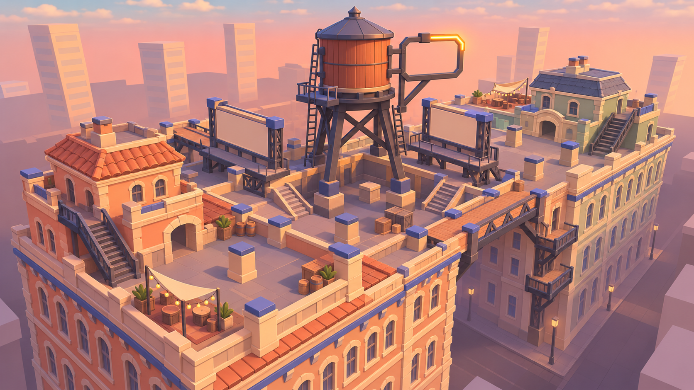
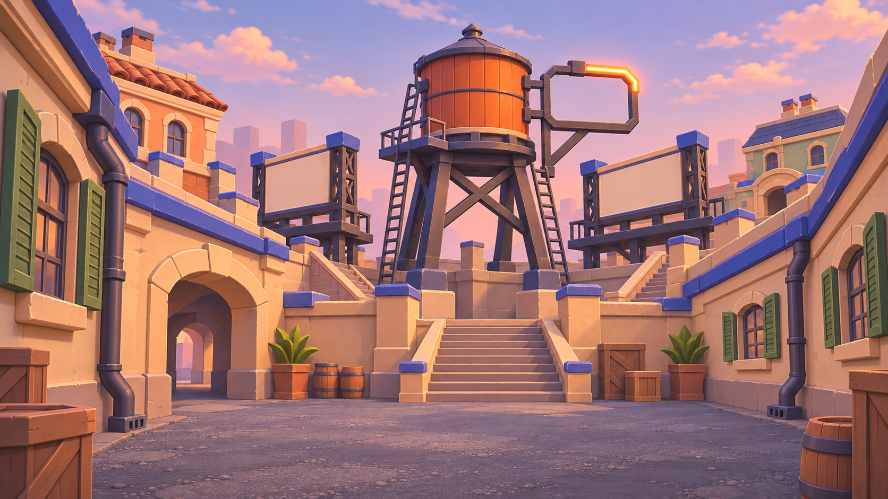
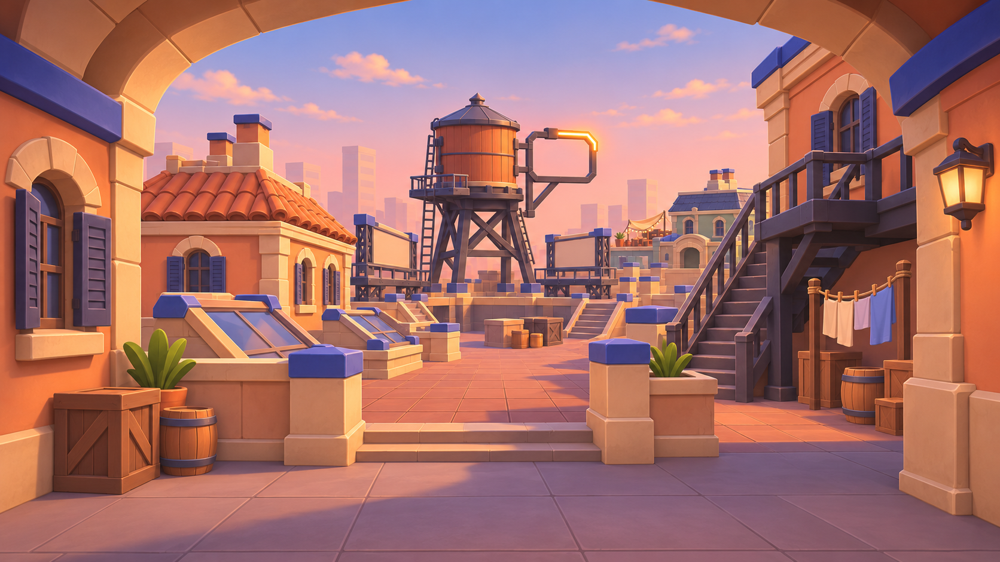
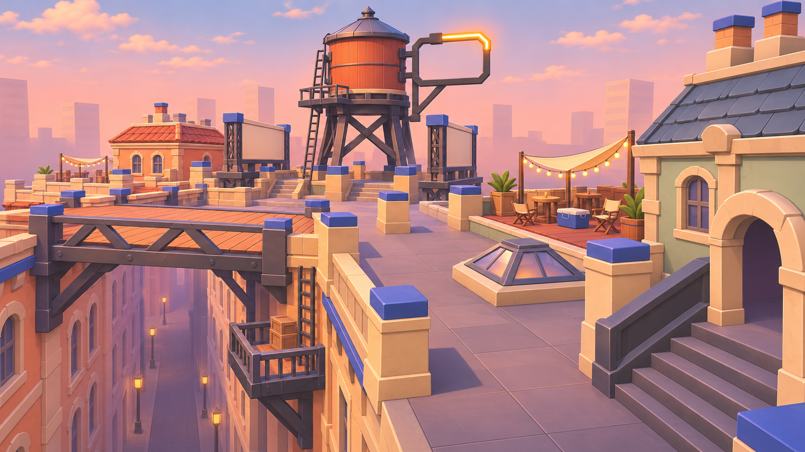
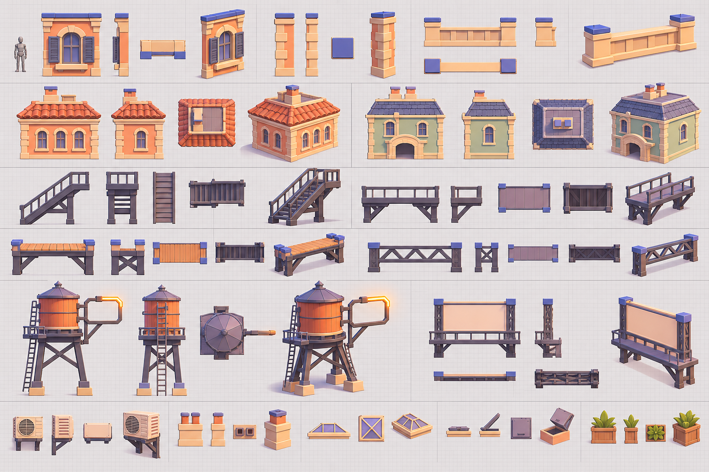
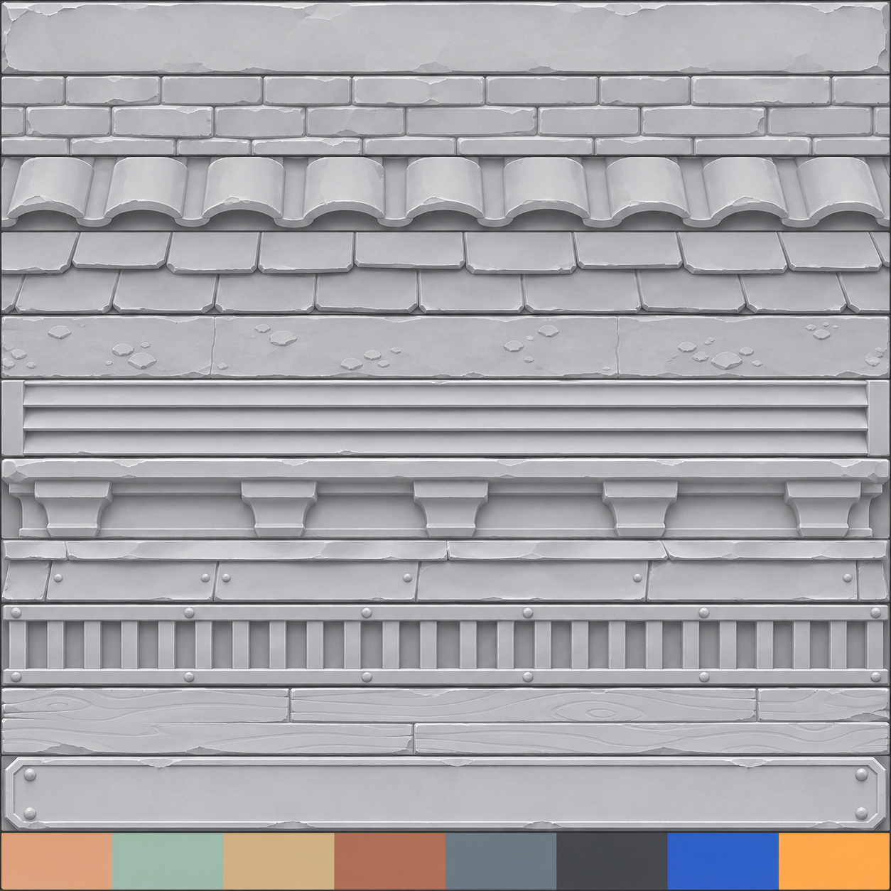

# Rooftops2 (redesign of Rooftops)

The 2026-11-05 redesign of [Rooftops](Rooftops.md) in the new environment style ([Lobby Style Guide](../../02%20Art/Lobby%20Style%20Guide.md), [Art Direction](../../02%20Art/Art%20Direction.md) → direction change 2026-11-04). Same idea: a city block, two team roofs over a sunken Pit with a water-tank tower, side towers on a gangway and a plank ramp, alleys to fall into, for 1v1 and 2v2. Built next to the old map, which stays untouched. **Not in the match rotation** until the user approves the swap; in Studio set the Workspace attribute `ForceMap = "Rooftops2"`. Template: [Dockyard2](Dockyard2.md).

**Map id** `Rooftops2`. **World origin (3000, 200, 0)** (free). Taken: Whitebox (0, 200, 0), Big Whitebox (0, 200, -1500), Dockyard (-1500, 200, 0), Metro (1500, 200, 0), Old Town (0, 200, 1500), Greenhouse (1500, 200, -1500), Rooftops (1500, 200, 1500), Bunker (-1500, 200, 1500), Snowpeak (-1500, 200, -1500), Dockyard2 (-3000, 200, 0). Pipeline and rules: [Maps](00%20Maps.md), [Game Plan](../../05%20Production/Game%20Plan.md) §5 (180° symmetry, three lanes, cover 3 / 7+, no dead ends, spawns out of sight, one long sightline ~70).

**Status (2026-11-05, lane G):** built in the match place (greybox, kit asset **78737454855986**, art and lighting).
- **Audit 0** (1,431 visible parts).
- Playable with `Workspace.ForceMap = "Rooftops2"`, and **not in the rotation** (no Config change at all).
- **Blind score 8.33 / 10, below the 8.5 bar** (8 fix rounds; the stop rule was reached). §9 has every round.
- The old Rooftops is untouched.
- ⚠ The match place must be **saved (Ctrl+S)** to keep it (the core chat saves).

**Why Rooftops next** (lane G's call, 2026-11-05): after Dockyard it's the map players will meet most in the core mode. It's one of the five 1v1 maps, with Whitebox, Bunker, Dockyard and Snowpeak, and RIVALS is a duel game first. It's the other dark map: blue hour, real brick, a 240-tall sign tower. That is exactly the "too tactical and realistic" look the user wants gone. Of the others, Bunker was already built in the Lobby's kit language, and Whitebox is deliberately abstract. Snowpeak has uncommitted edits by the user, so it waits for them. The large 2v2–4v4 maps (Metro, Old Town, Greenhouse) come after the duel pool.

---

## Lessons from Dockyard2 (applied from the start, so later maps start higher)
Dockyard2's blind score went 5.4 → 5.4 → 6.7 → 8.75 ([Dockyard2](Dockyard2.md) → Scoring). What moved it, as rules for every redesigned map:
1. **The spawn view must show the landmark and the way out.** A blank wall in front of the spawn cost composition and navigation the most. Make the spawn screen low enough on one side to see the landmark (check spawn safety in the layout script), and put a **framed sign** on it that names the base and the routes each way ("DOCK A ◄ GREEN  RED ►"; here "ROOF A/B ◄ EAST  WEST ►").
2. **Paint the routes.** Lane or side words on the floor where routes leave the base and where they cross the middle, named by where they *land* after the 180° turn (Dockyard2's first try mirrored them into the wrong lanes). Chevrons from the spawn round the screen.
3. **Give the middle a ground-level landmark** with a name plate (Dockyard2's white reefers with "CRANE"). Here it's the cobalt water tank on the lift tower, plus the billboards.
4. **Never put painted surfaces on Roblox Metal.** It mirrors the sky, so blue paint goes royal blue. Use clean SmoothPlastic paint, with the geometry (ribs, rails, frames) carrying the detail. Keep the Lobby's textures for big calm surfaces only (plaster, roof tiles), and check in Studio, not just Blender.
5. **Warm practical light that shows in captures:** Neon glow strips on lamps and interiors. PointLights don't render in edit-mode MCP captures, which the reviewers judge from.
6. **Warm sun against neutral-cool shade, haze for depth, lower grade contrast.** A blue ambient crushes blue paint in shade, and "tuned, not striking" was the last thing holding the score down.
7. **Dress every face the overview sees** (end-wall backs, far quays). Reviewers mark down raw slabs even outside the play space.

## 1. What's wrong with the old Rooftops
From its note, its renders and a rerun of `tools/maps/rooftops_layout.py` (the SVG was restored afterwards, nothing in the repo changed).

| Problem | Evidence | Fix in Rooftops2 |
|---|---|---|
| **Too dark, too realistic.** Blue hour (ClockTime 18.45), real brick, a lit-window rhythm, a 240-tall HOTEL sign tower. The note scores its own lighting 1/2 and detail 1/2 and admits cover only reads because the roofs are darker. | [Rooftops](Rooftops.md) §4 look and quality score; [overview](../../02%20Art/References/maps/rooftops/rooftops-preview-overview.jpg) | Golden afternoon, stylized plaster and tile, lighting does the contrast (§4) |
| **First sight at 1.7 s sprinting, 2.4 s walking**; the teams meet at 3.6 s. A front-edge look across a 40-stud Pit; spawn to the Pit is only 3.0 s. | script: first sight, routes | Change 1. Target first sight >= 3.0 s, meet >= 4.5 s |
| **Long diagonals.** 8.5% of visible pairs over 70 studs (Whitebox: 6.4%), 0.9% over 100, longest **128** ((-44,40) to (34,-62)). Game Plan §5 allows one ~70 line. | script: sightlines | Change 2. Target <= 100 and over-70 <= 6.4% |
| **Open gangways.** Furthest distance to full cover is **20** at (-44,12); average 6.9. | script: cover spread | Change 3. Target worst <= 15 |
| **The Pit is the slow route.** Spawn to spawn: 160 direct, 162 via the east tower, 164 via the west tower, **173 via the Pit** (7.9 s vs 7.3 s sprinting, +0.6 s). The centre should be the fast road. | script: routes | Change 4. Target all three within 0.5 s |
| **High-perch pile-up, unmeasured.** Ten Updraft-only tops (roof AC +8, tank house +8, lift tower +8, cooling tower +8, stair hut +9, lift house +10, flue +10, penthouse +11, tower hut +17, tank +22) and the script prints no perch share. | script: heights | Change 5: add the perch-share check (Dockyard2 has one), cap the best perch ~45% |
| **A hard fall.** Kill height y -24: 0.49 s from a roof, so a missed jump costs the life with no warning. | script: heights | Change 6: keep the fall (it is the map's idea) but make drop edges read |
| **Heavy kit for a small map.** 32 pieces, 828 MeshParts, 177k triangles; 72-tall facade columns with a window every 12 studs; 408 greybox Parts. | [Rooftops](Rooftops.md) §4 budget | Chunkier facades, fewer and bigger windows. Target <= 600 MeshParts, <= 120k triangles |

What the old map gets right and Rooftops2 keeps: 180° symmetry, three walkable layers 8 apart (Pit -8, roofs 0, towers +8), three ways across (catwalk, Pit, plank), the water tank tower as the hero landmark, flues that break alley lines, 0 unreachable cells, spawn safety (spawn sees spawn: never; 0% / 0% perches), z-fighting audit at 0.

## 2. References
Images of other games and other people's photos stay out of the repo (links only). Fetched on 2026-11-05; fandom and strategywiki block bots (403), marked "bot-blocked" where used (it came up in search).

| Reference | What to take |
|---|---|
| [Valorant Sunset (esports.net)](https://www.esports.net/news/valorant/sunset-map/) | A sunlit Los Angeles map with a wide mid and narrow close-quarters paths: warm, saturated light on pale walls. Our mood target, not our layout |
| [Valorant Ascent (Beebom)](https://beebom.com/valorant-ascent-map-guide), [Ascent (esports.net)](https://www.esports.net/wiki/guides/valorant-ascent-map/) | A bright stylized town of rooftops and a courtyard: three lanes, a wide centre, long lines closed by doors. Named places ("Wine", "Tree", "Heaven") are the callout model |
| [Valorant Bind (Beebom)](https://beebom.com/valorant-bind-map-guide) | Warm sandy plaster, colour-blocked trims, simple shapes: a stylized map that stays readable without fine detail |
| [RIVALS maps list (Bloxodes)](https://bloxodes.com/wiki/rivals/maps) | RIVALS has **no rooftop map** (39 maps, none a city roof): our opening. Closest: **Construction** (crane high ground, gaps, fall risks), **Station** (two buildings, breakable windows), **Dimension** (small platforms over a fall), and "Big" twins of small maps. See [Case Study - Rivals](../../LihFolk/32%20Case%20Studies%20of%20Top%20Roblox%20Games/Case%20Study%20-%20Rivals.md) |
| [Overwatch 2 map design (Blizzard)](https://news.blizzard.com/en-us/article/23785339/uniting-gameplay-and-style-behind-overwatch-2-s-complex-map-design) | Art guides the player: bold shape and colour per side, readable silhouettes, light used for direction |
| Splatoon *Moray Towers* ([StrategyWiki](https://strategywiki.org/wiki/Splatoon/Moray_Towers), bot-blocked) | Tall towers joined by ramps, ledges over long drops, a low centre between: our Pit-and-tower idea in a bright, toy-clean style |
| [Rooftop water tower (Wikipedia)](https://en.wikipedia.org/wiki/Rooftop_water_tower), [SoHo](https://commons.wikimedia.org/wiki/File:Rooftop_water_towers_in_SoHo,_Manhattan.jpg), [160 5th Ave](https://commons.wikimedia.org/wiki/File:Rooftop_water_tower,_160_5th_Ave,_Manhattan.jpg), [46th St, 1984](https://commons.wikimedia.org/wiki/File:Water_Towers_On_New_York_City%27s_46th_Street_-_June_1984.jpg), [Commons: NYC water towers](https://commons.wikimedia.org/wiki/Category:Water_towers_in_New_York_City) | The hero shape: a barrel tank with hoops and a cone cap on a braced steel stand with a ladder. We simplify it to a chunky cobalt tank (§4) |
| [Commons: roof terraces](https://commons.wikimedia.org/wiki/Category:Roof_terraces), [rooftop gardens](https://commons.wikimedia.org/wiki/Category:Rooftop_gardens), [fire escapes](https://commons.wikimedia.org/wiki/Category:Fire_escapes) | Sunny roofs with pergolas, planters and awnings, and the stair-and-landing silhouette: the friendly set dressing |
| [Lobby Style Guide](../../02%20Art/Lobby%20Style%20Guide.md) and its renders ([spawn](../../02%20Art/References/lobby/rebuild-20261104/01-spawn.jpg), [kit sheet](../../02%20Art/References/lobby/rebuild-20261104/bunker2-sheet-a.jpg)) | The kit language: stepped plinths and collars, picture-frame openings, bevel hierarchy, layering, clean SmoothPlastic trims, calm textures on big surfaces |
| [Dockyard2](Dockyard2.md) | The sibling redesign. Rooftops2 must not look like it (sunny harbour, sand deck, yellow crane) |
| Counter-example: the old [Rooftops Pit preview](../../02%20Art/References/maps/rooftops/rooftops-preview-pit.jpg) | Blue hour, dark brick, grey membrane: what not to repeat |

### What the LihFolk notes add (cited)
- **Layout** (`33 Level Design`): *Combat Arena and Encounter Layout* (cover 2.5-3.5 or 7+, never 4-6; routes within ~1 s), *Level Design Principles - Flow Sightlines and Landmarks* (one landmark 1.5x taller than the rest, in the first frame after spawning: the tank tower), *Spawn Points Safe Zones and Respawn Flow*, *Kill Planes, Map Boundaries and Out-of-Bounds Recovery* (a server depth check, not a Touched part).
- **Composition** (`06 World Building and Art`): *World Composition and Set Dressing - Designed, Not Scattered* (hero landmark, 2-4 primary forms, odd-numbered story groups), *Environment Art Styles*, *Art Budgets - Triangles Draw Calls Memory*, *Collision and Physics Geometry*.
- **Modelling** (`54 Untextured Stylised Modelling`, `55 Modelling Nuance and Readability`): *Bevels Chamfers and Edge Highlights Without Textures* (1-6% of the form), *Shape Language and Silhouette Testing*, *Proportion Exaggeration and Gameplay Distance*, *Spending Triangles Where the Camera Looks*.
- **Materials and colour** (`44 Materials and Surfaces`, `06`): *Stylised vs Realistic Material Pipelines*, *Materials MaterialVariants and SurfaceAppearance*, *Colour Scripts and Value Structure for Untextured Art* (3-5 value bands, 60/30/10, one accent, greyscale check).
- **Light** (`07 Lighting VFX and Audio`): *Stylized Lighting Recipes* ("Bright cartoon" base), *Lighting Mood and Time of Day*, *Atmosphere Sky Clouds and Post-Processing*, *Light Sources and Shadows* (local lights shadowless).
- **Craft** (`60 High-Craft Game Teardowns`): *What Craft Looks Like on Roblox*, *Teardown - Phantom Forces* (simple geometry, strong silhouettes).
- Skills to load for phases 3 to 7: `lihfolk-worldbuilding`, `roblox-blender-modeling`, `roblox-asset-import`, `lihfolk:quality-score`.

## 3. Layout changes to test
The plan lives as data in `tools/maps/rooftops2_layout.py` (a copy of `rooftops_layout.py` plus a perch-share check). Same 180° rotation, team A at -Z, B at +Z. Every change is a hypothesis: keep it only if the script confirms it.

| Check | Rooftops now | Target for Rooftops2 |
|---|---|---|
| Spawn sees spawn; enemy floor / Updraft tops seeing a spawn | never; 0% / 0% | same |
| First sight, sprint / walk | 1.7 s / 2.4 s | >= 3.0 s / 4.0 s |
| Both teams sprinting meet | 3.6 s (4.9 s walking) | >= 4.5 s |
| Sightlines over 70 / over 100 / longest | 8.5% / 0.9% / 128 | <= 6.4% / <= 0.5% / <= 100 |
| Distance to full cover: average / furthest | 6.9 / 20.0 | <= 6.5 / <= 15 |
| Spawn to spawn: direct / via a tower / via the Pit | 160 / 162-164 / 173 | 170-185, all within 0.5 s sprinting |
| Best perch (share of the floor it sees) | not measured | <= 45% |
| Gaps: Pit-roof 8, Pit-tower 8, tower-roof 16 | crossable (jump 8.7 walk / 11.9 sprint, Dash 12-24) | keep; no gap 4-7 |
| Places you can't walk to | 0 | 0 |

1. **Deeper roofs, Pit screens.** Team roofs 96 x 48 → 96 x 56 (the extra 8 goes to the spawn court; map bound Z 84 → 92) and a full-cover (7+) planter wall or awning screen on each Pit lip, offset from the stairs. Spawn to spawn ~176; the first look runs down a lane instead of across the Pit.
2. **Break the 128 diagonals.** They run from a front corner across the Pit into the far roof. Move one front-row AC unit per roof onto that diagonal and widen the flue into a short wall. Re-run the sightlines.
3. **Cover at the gangway foot.** A pergola post line or a stair-hut spur on each gangway, and a 7-high planter at (-44,12) and its twin.
4. **Pit stairs 4 studs nearer the middle** so the Pit stops being the slow route; the footbridges keep their length.
5. **Perch share.** Add the check; lower the huts and flues that see most of a roof, or add a parapet at their lip. The tank (+22) stays the one risky landmark seat.
6. **Readable fall.** No gameplay change: bright coping on every drop edge and a shaded, hazy alley below (street Parts in a darker teal), so a missed jump reads as "down there".

Callouts: **A roof / B roof**, **Pit**, **Tank** (lift tower), **West / East tower**, **Gangway**, **Plank**, **Penthouse**, **Alley**.

### Measured result (layout v2, 2026-11-05)

| Check | Rooftops | **Rooftops2** | Target |
|---|---|---|---|
| Z-fighting (box faces), clipping, slits | 0 / 0 / 0 | **0 / 0 / 0** | 0 |
| Spawn sees spawn; floor / Updraft tops that see a spawn | never; 0% / 0% | **never; 0% / 0%** | same |
| First sight, sprint / walk | 1.7 / 2.4 s | **1.9 / 2.6 s** | ≥ 3.0 / 4.0 (missed) |
| Both teams sprinting meet | 3.6 s | **3.9 s** | ≥ 4.5 (missed) |
| Over 70 / over 100 / longest | 8.5% / 0.9% / 128 | **8.6% / 0.8% / 132** | ≤ 6.4% / 0.5% / 100 (missed) |
| Distance to full cover: average / furthest | 6.9 / 20.0 | **7.2 / 20.2** (on the gangway, a lane) | ≤ 15 (missed) |
| Spawn to spawn: direct / via a tower / via the Pit | 160 / 162–164 / 173 | **173 / 175–177 / 183** | within 0.5 s (Pit +0.4 s, was +0.6) |

What was built, and what each change measured:
1. **Team roofs 96 × 56** (the middle and back rows move back 6–8; spawns at z ±68–73, barrier at ±64). Spawn to spawn is +13. The meet moves +0.3 s and first sight +0.2 s.
2. **Billboards 22 wide** (were 18), reaching x +1, 4 short of the stair. They cut the diagonals that slipped past their inner end, including the old first-sight line.
3. **Pit stairs 6 nearer the middle** (x 5–13, against the lift tower), and the Pit condenser removed because it left slits. The Pit route goes from +0.6 s to +0.4 s.
4. **A planter screen** (6 × 3, full cover) against the west parapet of each roof's front row. It cuts the west-lane diagonal and brings the longest line from 136 back to 132.

**Honest read:** the plan's sight targets aren't met. On a 1v1 map this small (teams meet at 3.9 s), the front edges see each other across the Pit by design, as with "Hold the edge". The remaining long lines are side-lane diagonals that each end in cover. Changes that kept the numbers flat or worse were dropped rather than kept for show. The next step, if the user wants it, is front-row screens on the Pit lips, which trade the Pit look-down for safety.

## 4. Look (style frame)
**Identity: sunny terracotta rooftops at golden afternoon.** A warm city of cream plaster, terracotta tile and white trims with **one cobalt accent**: the water tank and the awnings. The Lobby is dark warm concrete with teal-slate structure and one accent per wing; Dockyard2 is a sunny harbour with a sand deck and a signal-yellow crane. Rooftops2 is warmer and rosier than both (coral, terracotta, sage) with a blue spike, so no two maps read alike. Team cyan, orange-red and glitch magenta stay off the map.

| Role | Colour | Material (variant) | Note |
|---|---|---|---|
| Roof deck (ground band, V ~50%) | terracotta flat tile `#B8704F` | Slate or Brick, `Roof2_Tile` (calm, 8-stud tiles) | the Pit deck is cooler `#A8896E` |
| Team A building | warm coral plaster `#D98C66` | Concrete, `Roof2_Plaster` | facades, penthouse, huts |
| Team B building | pale sage plaster `#A9BBA0` | same | same pieces, tinted: distinct from A in colour and in greyscale |
| Towers and Pit walls | cream limestone `#D9C9A8` | same | |
| Trim (cornice, sills, coping, frames) | white `#F2EEE4` | SmoothPlastic | at least 0.05 proud |
| Structure (stairs, rails, stand, shutters) | charcoal `#3A3F47` | SmoothPlastic / Metal | route language: white rail tops and stair nosings |
| **Accent** | cobalt `#2E6BE0` | SmoothPlastic | tank, awnings, tower roof signs; <= 10% of any view |
| Glass | pale sky `#BFD8E8`, 0.3 transparency | Glass | big and few; warm panes `#F4D9A8` on one in six |
| Signs | Montserrat Black letters on a white plate, cobalt outline tube | Neon (outline only) | glitch ghosting only as a rare flicker, <= 5% of any view |

- **Landmark:** the cobalt **water tank on the lift tower**, seen from both spawns and 1.5x taller than anything else on the roofs. No 240-tall sign tower; the skyline is a ring of low plaster blocks and tile roofs at or under roof height, with a steeple or two far off.
- **Kit language** (Lobby Style Guide): bevels primary 0.45 (2 segments), secondary 0.14, tertiary 0.05. Parapets with a stepped coping and bullnose lip; 8-wide facade modules with picture-frame windows, a shutter pair and a deep cornice; the tank on a stepped plinth with a notched leg stand, collar and cap; AC units with five broad proud louvre ribs; stairs with chamfered steel stringers; awnings and pergolas as the friendly dressing.
- **Light:** golden afternoon, ClockTime ~16.3, latitude 0 (the sun is ~35° up and rakes along X, so neither team looks into it). Warm sun, cool sky ambient, Atmosphere density ~0.3 with a peach haze, bloom threshold >= 1.4. Long shadows fall into the alleys and give the falls a dark floor. Base: the "Bright cartoon" recipe. Local lights only at the tank and signs, shadowless.
- Greyscale and no-shadow views (phones below quality 4) are checked before moving on.

## 5. Kit pieces (Lobby kit language; 1 unit = 1 stud, origin bottom centre, front -Y)
About 30 pieces, <= 120k triangles placed, <= 600 MeshParts, none over 2048 studs.

| Group | Pieces |
|---|---|
| Facade | `Facade8A/B/C` (plaster, fewer bigger picture-frame windows, cornice, shutters), `Facade4`, `Plinth8/4`, `Quoin` |
| Edges | `Parapet8` (stepped coping, pier), `Ledge8`, `Sill` |
| Routes | `Stair16`, `Gangway16` (pergola rails), `PlankRamp16`, `Catwalk8` |
| Roof furniture | `ACUnit` (louvre ribs), `Condenser`, `Skylight`, `Planter`, `Pergola`, `Awning`, `Flue` |
| Hero shapes | `WaterTank` (cobalt), `LiftTower`, `TankHouse`, `CoolingTower`, `Penthouse` + `LetterA/B`, `StairHut`, `LiftHouse` |
| Signs, dressing | `RoofSign`, `Banner` (replaces the billboard), `StreetLamp`, `CityA/B/C` (low backdrop blocks), `Chimney`, `Steeple` |

## 6. Restyle parameters (cheap to change)
All in **`tools/maps/rooftops2_style.py`** (as `dockyard2_style.py`): `PALETTE` (role colours, materials, MaterialVariants), `TEAM_TINT`, `VARIANTS`, `LIGHTING` / `FX` / `LAMP`, `BEVEL` / `SEGMENTS`. Colour, texture and light changes: `python tools/maps/rooftops2_style.py --luau`, then re-run the Art + Lighting bundle in Studio (no Blender, no upload). Bevel or shape changes: Blender rebuild → export → upload → kit install.

## 7. Plan (phases)
1. Plan with references (this note).
2. Layout check script and SVG (`tools/maps/rooftops2_layout.py`): the §3 table, change by change.
3. Greybox in Studio (`tools/studio/maps/Rooftops2/Greybox.luau`, origin (3000, 200, 0)). Walk it in play mode, then critique.
4. Style frame, then the Blender kit (`tools/blender/build_map_kit_rooftops2.py` on the Lobby kit helpers) with a contact sheet. Coplanar audit at 0, export, upload (group 11116787), install.
5. Art pass (`Art.luau`), lighting (`Lighting.luau`), set dressing in odd-numbered groups.
6. `tools/studio/maps/Audit.luau "Rooftops2"` reports 0.
7. Screenshots from each spawn, the Pit, a tower and an overview; mobile budget; a 2-player play test with `ForceMap`.
8. Blind scoring (`lihfolk:quality-score`, world rubric, min 8.5), fix rounds, then ask the user about the swap. Vault upkeep: Home status, Asset Tracker row, a note in `05 Production/Playtests/`.

## Built (phases 3 to 7)
- **Greybox** (`tools/studio/maps/Rooftops2/Greybox.luau`, generated by `tools/maps/rooftops2_layout.py --write`): 436 parts, 4 + 4 spawns, 2 barriers, `KillDepth` 24. Walked in play mode with `ForceMap`: [overview](../../02%20Art/References/maps/rooftops2/greybox-overview.jpg), [from the A spawn](../../02%20Art/References/maps/rooftops2/greybox-play-a-spawn.jpg), [A front row](../../02%20Art/References/maps/rooftops2/greybox-play-a-front.jpg).
- **Kit** (`tools/blender/build_map_kit_rooftops2.py`, on the Dockyard2 and Lobby helpers): 39 pieces, about 32k triangles. **Coplanar audit 0.** [Contact sheet A](../../02%20Art/References/maps/rooftops2/kit-contact-a.jpg), [B](../../02%20Art/References/maps/rooftops2/kit-contact-b.jpg). Piece names and origins are the old Rooftops kit's, so the checked placements dropped straight in.
  - **Facades:** an 8-wide plaster column with storey bands, picture-frame windows, sills and a deep cornice. Variant B has two windows per storey, variant C has cobalt awnings.
  - **Roof furniture:** huts with a plinth, corner pilasters, a framed door and a cornice. AC units as two stacked louvred machines. A cobalt water tank with white hoops and cap.
  - **The Penthouse:** pilasters, downpipes, vents, a door awning with wall lamps, and end windows.
  - **Routes:** stairs and gangways with yellow rails and nosings, wooden catwalks, a plank ramp.
  - **Wayfinding:** "SUNSET SODA" billboards (two-sided), "SKY DINER" roof signs, "ROOF A/B" spawn signs (◄ side ►), TANK plates on the lift tower, painted PIT / WEST / EAST / ROOF A / ROOF B words, chevrons.
- **Art pass:** 264 placements and 25 art Parts (street, sidewalks, yellow lane lines). The visible greybox edges (parapets, coping, ledges, roofs) are restyled by their `Look` attribute.
- **Studio audit (`Audit.luau`): 0.** It found 121 pairs on the first install: facade columns at the building corners and plinths shared their end planes. They were fixed at the source by dropping hidden end caps and back faces (`open_box`), and the kit audit can't see these cross-piece pairs, so always run the Studio audit.
- **Sun:** latitude 23.5 at ClockTime 17.1 gives `GetSunDirection` (-0.97, 0.23, 0.00): low across the map, so neither team looks into it.

## 9. Scoring (`lihfolk:quality-score`, world rubric, 3 blind reviewers per round, medians)
| Round | W1 (3) | W2 (3) | W3 (2) | W4 (2) | W5 (1) | W6 (1) | Score | Gain | What changed before it |
|---|---|---|---|---|---|---|---|---|---|
| 0 | 2 | 1 | 1 | 1 | 1 | 2 | 6.67 | | first install |
| 1 | 2 | 1 | 2 | 1 | 1 | 1 | 7.08 (reviewers 7.08 / 7.5 / 7.9) | +0.4 | plaster on SmoothPlastic (the concrete variant read as brick), golden hour 17.1, varied city tints, yellow rails on every route, ROOF A/B words in the Pit |
| 2 | 2 | 1 | 2 | 1 | 1 | 2 | 7.5 | +0.4 | hut and Penthouse detail, two-tier AC units, cooler shade, darker towers |
| 3 | 2 | 2 | 1 | 1 | 1 | 1 | 7.5 | 0 | yellow lane lines down each main lane, spawn-court planters, deeper ambient |
| 4 | 2 | 1 | 2 | 2 | 1 | 1 | 7.92 | +0.42 | exposure -0.15, darker cream, cool street, no moon, wood decks, spawn chevrons, clipped Pit word fixed |
| 5 | 2 | 2 | 2 | 1 | 1 | 1 | 8.33 | +0.42 | route lines round the Penthouse, bigger chevrons, TANK plates, Penthouse awning and lamps, warm doors and AC paint |
| 6 | 2 | 1 | 2 | 2 | 1 | 1 | 7.92 (8.33 / 7.92 / 7.08) | -0.42 | Penthouse end windows, lift-tower vents and band, softer bands, awning and billboards (`AccentSoft`, `Poster`), cobalt chevrons, more sun contrast |
| 7 | 2 | 2 | 2 | 1 | 1 | 1 | 8.33 (8.33 / 7.08 / 8.33) | +0.42 | bigger chevrons, four per court exit, WEST/EAST words past the Penthouse |
| **8** | **2** | **2** | **1** | **2** | **1** | **1** | **8.33** (8.33 / 7.92 / 8.33) | 0 | wainscot, cap and warm cove glow on the Penthouse long faces, cream chevrons, deeper shade and grade contrast, EAST/WEST words moved past the lift house |

**Final: 8.33 / 10, below the 8.5 bar.** The stop rule was reached: rounds 6 (-0.42) and 8 (0) each gained less than 0.3. Rounds 5 to 8 sit at 7.9 to 8.3, and single reviewers swing a criterion by about ±1.

What the reviewers still mark down, all three in round 8:
- **W5:** big plain wall slabs at the spawn-court exit (the 6-wide gap between the Penthouse and the lift house).
- **W6:** oversized-looking windows, AC units and the TANK plate, with no avatar in frame.
- **W3:** flat navy window glass and dark door voids. These two are role colours in `rooftops2_style.py` (`Window`, `Door`), so they're a one-line restyle the user can judge in play.

The next fix, if wanted, is to lighten `Window` and `Door` and dress the lift-house and Penthouse ends at the court exit.

The reviewers repeat the same small set of issues: blank walls (Penthouse ends, lift-tower faces), chevron contrast, billboards competing with the tank, and eye-level light "tuned, not striking". Fix round 6 targets all four.

## What the user should check tonight
1. Save the match place (Ctrl+S): fix rounds 7 and 8 were installed after the 13:59 save. Then set `ForceMap = "Rooftops2"` and play.
2. **The look:** golden-afternoon terracotta roofs, apricot/sage plaster, a cobalt tank. Too warm? Too busy? Every colour and the light are in `tools/maps/rooftops2_style.py`.
3. **Routes:** spawn → chevrons round the Penthouse → yellow lane lines → the PIT footbridge. Do the stairs and gangways read?
4. **Feel:** first sight is still early (1.9 s). Do the deeper roofs and the planters help, or do the front rows need screens?
5. Decide whether Rooftops2 replaces Rooftops in the 1v1/2v2 rotation.

## 8. Open questions for the user
- Is rosy terracotta with cobalt right, or should it be cooler (sage and white)?
- Should the 8-wide alleys keep the instant fall, or get a short rescue ledge for 1v1?
- Roofs 56 deep make the map a little longer. Fine for 1v1 and 2v2?

## Concept pass 2026-11-05
Status: **in progress.** Brief: [Evening Review](../../05%20Production/Playtests/2026-11-05%20Evening%20Review.md).

The user's verdict: Rooftops2 is the weakest map, with no levels and no character. Target: Valorant-level detail with RIVALS clarity. The user approves the concepts before any modelling.

Skills and notes used: the same as the [Dockyard2 concept pass](Dockyard2.md#concept-pass-2026-11-05), namely `gauntlet-vault`, `lihfolk-worldbuilding` and `roblox-blender-modeling`, plus the LihFolk notes on kits, trim sheets, texture memory, budgets and arena layout.

### What's wrong now (evidence)
Screenshots:
- [overview](../../02%20Art/References/maps/rooftops2/r8-overview.jpg)
- [B court exit](../../02%20Art/References/maps/rooftops2/r8-b-court-exit.jpg)
- [Pit](../../02%20Art/References/maps/rooftops2/r8-pit.jpg)
- [A spawn court](../../02%20Art/References/maps/rooftops2/r8-a-spawn-court.jpg)

1. **No levels.** Both team roofs are one flat deck. The Pit is a single step down. Nothing can be climbed: no penthouse roof, no fire escape, no water-tank platform, no bridge over the alley. The billboard is a wall, not a perch.
2. **Cubes for buildings.** The huts, the Penthouse and the lift tower are boxes with a cap. None of them have a pitched roof, parapet profile, chimney stack, cornice depth, overhang or antenna clutter. The skyline towers behind are plain slabs with stripes for windows.
3. **Blank walls.** At eye height, the court exit is two big flat plaster slabs with flat navy windows and no reveals, sills, shutters, frames or interior. The doors are dark rectangles.
4. **Flat materials.**
   - The tile roof is a clean orange grid.
   - The plaster has no cracks, stains, patches or exposed brick.
   - There are no tar seams, gravel, flashing, drainpipes or roof hatches.
5. **No identity.** It could be any city. It has no street life below, no laundry lines, satellite dishes or rooftop garden, and no neighbourhood sign. The "Sunset Soda" billboard is the only story.
6. **Weak landmark.** The cobalt water tanks are small and repeated, so none of them own the skyline.
7. **What works:**
   - the warm golden light;
   - the team tones (apricot and sage);
   - the painted lane words;
   - the 180° layout and its measured timings.

   Keep all four.

### Reference board (local only, never committed: third-party images)
21 images in `vault/02 Art/References/maps/rooftops/third-party/`. What to take from each is listed in that folder's `SOURCES.md`.
- **Games (11):**
  - Valorant Split ×2: height stacking, trim bands, worn plaster and metal.
  - Valorant Ascent ×2: old-town identity, tiled roofs, colour zoning.
  - Valorant Sunset ×2: sun-baked palette, signage and trim.
  - CS2 Vertigo ×2: roof edges, steel and plank silhouettes, drops, parapets.
  - Overwatch Rialto: Mediterranean roofs and chimneys.
  - Overwatch Dorado: balconies, awnings, zoning.
  - RIVALS Station: clarity and zone colour.
- **Real (10):**
  - Lisbon rooftops ×3: roof planes at many heights, chimneys and antennas.
  - NYC water towers ×3: the tank silhouette (conical roof, hoops, stilted frame).
  - Fire escapes ×3: landings, stairs, railings, peeling paint.
  - A Marseille roofscape: clutter, lean-to roofs.
- **Gaps:** no Krunker, and only one RIVALS image (no rooftop map exists there).

### LihFolk rules applied (what changes, and the note it comes from)
The folders read are the same as for [Dockyard2](Dockyard2.md#lihfolk-rules-applied-what-changes-and-the-note-it-comes-from), and its rules 6–15 apply here unchanged:
- bevels by material; shape hierarchy; panel lines; modelled undersides; prop exaggeration;
- triangle budget; one 1024 trim sheet plus ≤ 6 variants at 512; TintMask tinting;
- wear baked, not decals; opaque grating.

The Rooftops-specific rules:
1. **The water-tank platform is not a lone power seat** (*Combat Arena and Encounter Layout* §6).
   - It needs two contested ways up (a ladder from each side) and a low parapet of 2.5–3.5 studs.
   - Before building, run the perch-share check. Rooftops already has ten tops only Updraft can reach; cap the share at ≤ 40%.
   - The platform must not see into either spawn court (*Spawn Points Safe Zones and Respawn Flow* §3).
2. **Jump is 5.6 studs** ([Gunplay](../Gunplay.md)). Penthouse roofs (+10) and billboard catwalks (+8) are reached only by stairs or ladders, never by a jump off AC units or planters.
   - Every rise is ≤ 4 studs per hop.
   - Rule 3 below keeps the props that could serve as steps in the decor band.
3. **Cover is low (2.5–3.5) or full (7+).** AC units, planters and chimney stacks in the 4–6 band become non-colliding decor or are resized (*Combat Arena and Encounter Layout* §2).
4. **One global landmark.** The timber water tank on a steel tower with the neon sign frame is the single landmark:
   - unique as a black silhouette;
   - at least 1.5× taller than anything else;
   - in the first frame after spawning;
   - not hiding a route exit.

   The many small cobalt tanks go. The old "Sunset Soda" billboard must stay dimmer than the landmark sign (*Level Design Principles - Flow Sightlines and Landmarks* §4; *World Composition and Set Dressing* §2).
5. **Neon is the single hot spot.**
   - It covers about one sixth of the sign frame's area, and nothing else glows as bright (*Stylized Lighting Recipes*).
   - Bloom threshold goes to about 1.1 so the neon actually blooms. It stays above the walls' brightness.
6. **Lighting: Golden hour** (*Stylized Lighting Recipes* §3.3), with the arena rule from §3.2 that the environment stays desaturated while team tones and the landmark carry the saturation.
   - About 17 h; top shift (255,190,120); bottom shift (60,40,80).
   - Peach haze (255,200,160) at density about 0.35, glare 0.4. No SunRays.
   - Low key and warm dominant, so it's the opposite of Dockyard2's high-key cool (*Colour Scripts and Value Structure for Untextured Art*: neighbouring maps differ in at least two of hue, key and saturation).
   - Greyscale and no-shadow tests, because colour has to come from the shifts when phones drop shadows.
7. **Detail goes where the camera looks** (*Teardown - Phantom Forces*; *Environment Art Styles*).
   - Facades at eye height get reveals, sills, shutters and drainpipes.
   - The skyline towers stay simple silhouettes, faded by haze toward the sky's value.
8. **Same process as Dockyard2:** silhouettes, then the overview, then the hero images, critiqued in a fixed order.

### Identity brief
- **Identity sentence:** "The sun-baked rooftops of an old harbour quarter at golden hour, where two neighbours' roofs face off across a sunken courtyard under a giant water tank." The district name is ours.
- **Story groups (2–3):**
  - a rooftop party left half-set: string lights, folding chairs, a cooler;
  - a laundry line with one sheet blown onto the parapet;
  - a pigeon loft with an open hatch.
- **Not this:**
  - plaster cubes with caps;
  - flat navy windows;
  - neon everywhere;
  - a copy of Venice, Lisbon or any real square;
  - thin antennas crossing sightlines;
  - noisy decals on floors.

### Direction (keep the layout: two team roofs, the Pit between them, east and west routes)
- **Height levels (new, 180° symmetric):**
  - **Penthouse roof (+10):** reached by an outside fire-escape stair. It overlooks the team's own roof only, so it can't spawn-peek.
  - **Water-tank platform (+12):** a ladder from each side and a low parapet. Perch share ≤ 40%.
  - **Bridges:** plank and steel bridges over the alley gaps. Beside each bridge, a drop to a fire-escape landing (-6) gives a flank route with a ladder back up.
  - **Billboard catwalk (+8):** behind each billboard, looking into the Pit through the gap between the panels.
- **Landmark:** one big timber water tank on a steel lattice tower in a neon sign frame (the sign is blank in the concepts; our own lettering comes later).
- **Colour:**
  - A roof: apricot plaster and terracotta tiles.
  - B roof: sage plaster and slate tiles.
  - The Pit: cream with cobalt trims.
  - The neon is the one spike.
- **Materials:** in one 1024 trim sheet plus ≤ 6 variants at 512:
  - plaster, with low-frequency cracks and stains;
  - exposed-brick corner patches;
  - terracotta and slate tiles;
  - tar-and-gravel roofing with flashing;
  - painted shutter wood;
  - fire-escape steel (opaque grating);
  - stone cornice;
  - plank.

### Prompts (ChatGPT image generation, revised after the LihFolk read)
Attach the current Rooftops2 [overview](../../02%20Art/References/maps/rooftops2/r8-overview.jpg), one Lobby screenshot, and 2–3 of the third-party references.

The shared style block is the same as Dockyard2's (chunky proportions, trims 2–4× real thickness, wear on edges only, value bands, no text, no thin wires, original). Only the palette and light lines change:
> Palette: apricot plaster #E3AA84, sage plaster #A9C2B0, cream plaster #D4B98F, terracotta tile #B5735A, slate tile #6E7B86, charcoal steel #3A3F47, cobalt trim #2F62C8, warm neon #FFB14A (landmark sign only).
> Light: golden late afternoon, low warm sun from the side, peach haze, cool violet shade; the landmark sign is the brightest point.

0. **Silhouette round:**
   > 12 black silhouettes on white of rooftop water-tank-on-tower landmarks with a sign frame, each unique when blacked out, chunky, side view.
1. **Overview** (generate first; it becomes the reference for 2–4):
   > High three-quarter aerial view of a compact arena shooter map across the rooftops of two old city blocks, 180-degree rotational symmetry.
   > - Each end: a team roof with a walled spawn court and a penthouse with a fire-escape stair to its roof (one roof apricot plaster with terracotta tiles, one sage with slate).
   > - Middle: a sunken rooftop courtyard (the Pit) under a giant timber water tank on a steel lattice tower with a blank neon sign frame and a ladder platform.
   > - Flanks: plank-and-steel bridges cross the alley gaps, with fire-escape landings below.
   > - Two back-to-back billboards with catwalks stand between the roofs.
   > - The streets far below. Golden hour.
2. **Hero, the Pit:**
   > Wide game camera, about 100° horizontal FOV, player eye height, standing in the sunken courtyard looking up at the water tank and tower (from image 1). Ladders up both sides, cream plaster walls with green shutters and drainpipes, a stair up to the terracotta roof ahead, tar-and-gravel floor.
3. **Hero, spawn A:**
   > Same camera, looking out of the apricot spawn court across the terracotta roof: chimney stacks, skylights, a fire-escape stair climbing to the penthouse roof on the right, a laundry line, the landmark mid-distance.
4. **Hero, spawn B:**
   > The rotated twin: the sage roof with slate tiles, a plank-and-steel bridge over an alley gap with the street far below, a rooftop party corner, the landmark ahead.
5. **Kit sheet:**
   > Orthographic front, side and top views plus one three-quarter view, a 5-ft mannequin for scale, on a 4-unit grid:
   > - window bay facade module with shutters and sill;
   > - corner pier with quoins;
   > - cornice and parapet with coping;
   > - penthouse block;
   > - fire-escape stair and landing;
   > - plank bridge and steel bridge;
   > - water tank on lattice tower;
   > - billboard with catwalk;
   > - AC unit on brackets;
   > - chimney stack;
   > - skylight and roof hatch;
   > - planter box.
6. **Trim sheet:**
   > Game trim sheet texture, 1:1, horizontal tiling strips:
   > - plaster panel;
   > - exposed brick;
   > - terracotta tile row;
   > - slate tile row;
   > - tar-and-gravel;
   > - shutter slats;
   > - stone cornice profile;
   > - metal flashing;
   > - fire-escape grating (opaque);
   > - plank;
   > - a blank sign plate row;
   > - a flat palette strip.
   >
   > All tintable near-white except the palette strip; wear on edges only; low noise.

### Modelling plan (after the concepts are approved)
- **Blender, real detail** (scripted kit, derived dimensions, seed per piece, A1–A18 gates, coplanar 0):
  - the water tank and tower (hero, 5–12k);
  - facade modules with real reveals, shutters and sills (these replace the flat navy windows and blank slabs);
  - corner piers and cornices;
  - the penthouse with roof and parapet;
  - fire escapes and bridges with stringers underneath;
  - billboard catwalks;
  - AC, chimney, skylight and hatch;
  - laundry lines and cables (`lihfolk_curves`).
- **Textures and budget:**
  - One 1024 trim sheet (colour + normal) with baked edge wear, cavity and AO. Up to 6 MaterialVariants at 512 for plaster, tile, gravel and plank.
  - Repeated props at 100–800 tris; the map ≤ 450k visible tris.
  - Measured in Studio before the art pass is called done.
- **Order:** layout re-check (perch share, jump 5.6, spawn-court sightlines), greybox heights, kit, trim sheet, art, blind score.

### Concept board (approved 2026-11-05: "I think it looks pretty good")
The images were made by Codex from the prompts above, in `art-source/maps/Rooftops2/concepts/`. The user's condition: "not follow the maps in exact one-to-one". The concepts set the **quality bar, silhouettes, landmark, trims, materials, height and light**. Our layout, sightlines, cover heights, spawn distances, 180° symmetry and the measured numbers above stay. Where they conflict, gameplay wins.

| | |
|---|---|
|  |  |
|  |  |
|  |  |

[Silhouette round](../../../art-source/maps/Rooftops2/concepts/00-silhouettes.png): the pick is the top-left family (conical cap with a finial, banded drum, splayed legs, sign arm), which is the one the overview and hero views use.

**Adopted:**
- **Landmark:**
  - a timber water tank (orange-brown staves, two steel hoops, a charcoal conical cap with a finial);
  - on a charcoal steel tower with splayed legs and X-bracing, standing on cream stone footings;
  - a railed platform under the drum, with ladders on two sides;
  - a sign-arm frame with a warm neon top edge (blank; our own lettering later).
- **Parapet language,** which carries the place identity:
  - cream stone parapets with coping;
  - square piers every few studs with **cobalt caps**;
  - quoined corner piers;
  - cornices with corbels.
- **Facades:**
  - arched windows in stone surrounds with shutters (cobalt on A, green on the Pit and B), sills and drainpipes;
  - a cobalt string course;
  - the eye-height detail moves the blank slabs and flat navy windows out of view.
- **Team identity:**
  - A: apricot plaster with a terracotta hip-roof penthouse.
  - B: sage plaster with a slate mansard penthouse and an arched door.
  - Both with chimney stacks with pots.
- **Height levels:**
  - fire-escape stairs (charcoal steel, chunky) up to each penthouse roof;
  - a plank bridge on a steel truss with a fire-escape landing and ladder below it;
  - billboards on steel trestles with a catwalk;
  - the tank platform.
- **The Pit:** a sunken courtyard with a wide stone stair in the middle and side stairs, a gravel floor and an arched passage.
- **Props:**
  - crates, barrels and terracotta planters;
  - pyramid skylights;
  - AC units on brackets and a roof hatch;
  - a party corner (awning, string lights, chairs, a cooler);
  - a laundry line;
  - wall lanterns.
- **Light:** golden sun, peach haze, violet shade, a hazy skyline of simple slabs.
- **Materials:** the trim-sheet rows: plaster, brick, terracotta tile, slate, tar and gravel, louvre, cornice, flashing, grating, plank, sign plate.

**Dropped or changed (and why):**
- **The concept's exact plan.** It shows four billboards around the Pit and long bridges on both sides of the tank. We keep our two billboards, our lift-tower position for the tank, and our gangway, plank and gap lengths (8 / 16, crossable as measured).
- **Crates and barrels in lanes.** The concept scatters them at 3–5 studs. Cover is either 2.5–3.5 or 7+. Anything in the 4–6 band is non-colliding decor at walls and corners (*Combat Arena and Encounter Layout* §2).
- **Straight spawn view down the middle.** In concept 03, spawn A looks straight at the Pit. Our spawn barrier and court screens stay, because no spawn sees another.
- **Thin railings and laundry over lanes.** Posts are at least 0.4 studs thick, and laundry hangs only over decor corners, never across a sightline.
- **Neon everywhere.** Neon is only on the sign frame. String lights are small warm dots, not Neon.
- **Tall background slabs.** They stay low and hazed, at or below roof height plus 40, so the tank owns the skyline.

### Final kit list (Blender, real detail; the scripted kit rebuilt)
| Group | Pieces (detail that makes them read as made, not primitive) |
|---|---|
| Facade | `FacadeBay8` (arched window, stone surround, shutters, sill, drainpipe option), `FacadeBay4`, `CornerPier` (quoins), `Cornice8` (corbels), `StringCourse8`, `Plinth8` |
| Parapet | `Parapet8` (coping, cobalt-capped pier at one end), `ParapetPier`, `ParapetLow4` |
| Buildings | `PenthouseA` (hip roof, terracotta, chimneys), `PenthouseB` (slate mansard, arched door), `StairHut` (small hip roof), `LiftTower` (stone, string courses) |
| Landmark | `WaterTank` (drum, hoops, cap, finial), `TankTower` (splayed legs, X-bracing, footings), `TankPlatform` (railing, ladders), `SignArm` (frame + neon edge) |
| Routes | `FireStair` (stringers, treads, landing, rails), `FireLanding` + `Ladder`, `PlankBridge` (truss, planks, posts), `PitStairWide` (stone, cheeks), `Billboard` (trestle, catwalk, panel) |
| Props | `Crate`, `Barrel`, `Planter`, `SkylightPyramid`, `ACUnit` (bracket), `Chimney`, `RoofHatch`, `PartyCorner` (awning, chairs, table, cooler, string lights), `LaundryLine`, `WallLantern` |
| Backdrop | `CityBlockA/B` (hazed, windows as shallow insets) |

Budget: repeated pieces ≤ 800 tris, medium ≤ 3k, tank and tower ≤ 12k, the map ≤ 450k visible. Bevels: steel 0.12–0.2, stone and plaster 0.3–0.45 with 1 segment on repeats. Scripted from derived dimensions with a seed per piece. Coplanar 0, floating shells 0.

### Texture plan (phone budget)
Our own textures come from the approved trim sheet ([06](../../../art-source/maps/Rooftops2/concepts/06-material-trim-sheet.png)). The rows are cut out, made tileable and turned into **6 MaterialVariants at 512** (colour plus a normal map derived from the row's shading), applied by role through the existing style pipeline. Kit MeshParts are split by role, so no UV work is needed and `Color` keeps tinting them.

| Variant | Row | Used on |
|---|---|---|
| `Roof2_Plaster` | plaster panel | facades, parapets, penthouses (apricot, sage, cream by tint) |
| `Roof2_Brick` | brick | exposed corners, chimneys, plinths |
| `Roof2_Terracotta` | terracotta tile | A penthouse and hut roofs |
| `Roof2_Slate` | slate tile | B penthouse and hut roofs |
| `Roof2_Gravel` | tar and gravel | roof decks, the Pit floor |
| `Roof2_Plank` | plank | bridges, catwalks, crates |

Memory: 6 × 2 maps × 512² = 12 × 0.25 = 3 "1024-equivalents", against the Lobby's borrowed 1024 sets. The cornice, louvre, grating and sign rows are modelled as geometry first. A UV-mapped trim-sheet SurfaceAppearance follows only if the side-by-side shows the geometry falling short.

### Birds (map life)
The current pigeons are boxy. **Recommendation: remove them until there's a modelled replacement.** Use the same rules as Dockyard2's gulls:
- a rounded body, tapered wings, tail fan and neck collar;
- 300–500 tris;
- flaps in bursts with glides, on spline paths;
- client-only, capped and culled.

They perch on parapets and the pigeon loft away from routes, and take off only when a player comes near, never across a duel sightline. This is lane F's area; it's a recommendation only.

## Rebuild v2 from the concepts (2026-11-05 evening), first pass
**Status: built in Studio (ForceMap only). Not yet at the concepts' quality; the gaps are listed below.** The place needs saving (Ctrl+S).

**Side by side (concept | build):**

| Concept | Build v2 |
|---|---|
|  |  |
|  |  |
|  |  |

### What was built
- **Kit** (`tools/blender/build_map_kit_rooftops2.py`, concept-pass functions): 44 pieces, about 68.8k triangles; the heaviest is PenthouseB at about 9k. Coplanar is 0 in Blender, and the Studio audit is **0 pairs over 1,505 visible parts**, Life included.
  - **Facades:** arched windows in stone surrounds with keystones, sills on corbels, louvred shutters on the top storey, a corbelled cornice, a cobalt string course and downpipes.
  - **Penthouses:** A has a terracotta hip roof, B a slate mansard with dormers. Both have quoins, chimney stacks with pots, an arched door with lamps, and shuttered windows.
  - **Water tank:** 23 timber staves, steel hoops, a conical cap with a finial, a splayed X-braced stand, a railed platform, a maintenance ladder, and a sign frame with a warm neon top edge. Placed at 1.35×.
  - **Huts:** quoins, arched doors and low hip roofs. The lift tower is stone with a flat top.
  - **Routes:**
    - stone Pit stairs with cheek walls and cobalt caps;
    - a steel fire-escape gangway;
    - plank bridges on Warren trusses;
    - a new fire-escape stair and balcony with a steel panel parapet, knee braces and joists.
  - **Props:** AC units (cream casings, fan grilles, feet), pyramid skylights, terracotta planters with lumpy hedges, crates, barrels and a party corner.
- **Textures:** six MaterialVariants (plaster, brick, terracotta, slate, gravel, plank) at 512, colour plus normal, cut from the approved trim sheet by `tools/textures/make_map_variants.py`. The plaster was calmed after the first Studio look, which showed big creases. Roof2_Tile stays the Lobby's.
- **Greybox looks:** parapets and piers are cream stone, pier caps cobalt (`PierCap` look).
- **Height:**
  - New: a fire-escape balcony at +5 along each Penthouse. The layout now has five levels: Pit −8, roofs 0, balcony +5, towers +8, tank seat +27 (Updraft).
  - Tried and dropped: a walkable Penthouse roof at +11. It gave 144-stud lines into the enemy spawn court and dropped first sight from 1.9 to 1.7 s.
- **One landmark:** the corner tanks on the Tank houses are gone. The central tank is at 1.35×: drum 14.3–26.6, collision r 6.
- **Jump:** the layout script now uses 5.6 (Gunplay.md). Gaps measured: walking jump 7.6, sprinting jump 10.5. The 8-stud Pit–roof gap is sprint-only.
- **Birds:** the 12 boxy pigeons are moved out of `Rooftops2.Life` into `ServerStorage.MapBackups.Rooftops2_Pigeons` until a modelled bird exists. Lane F's Life script would recreate them if re-run.
- **Backup of v1:** `ServerStorage.MapBackups.Rooftops2_v1`, saved with the place. The v1 scripts are in git at 373de85. A file `.rbxm` could not be written from the Studio MCP (the localhost receiver is not on the Assistant HTTP allowlist). In Studio: right-click the backup → Save to File → `art-source/maps/Rooftops2/Rooftops2_v1.rbxm`.

### Layout re-measured (layout v3)
| Check | v2 | **v3** |
|---|---|---|
| Spawn sees spawn; floor / Updraft seeing a spawn | never; 0% / 0% | **never; 0% / 0%** |
| First sight, sprint / walk | 1.9 / 2.6 s | **2.0 / 2.8 s** |
| Over 70 / over 100 / longest | 8.6% / 0.8% / 132 | **9.0% / 0.9% / 132** (the higher tank seat) |
| Teams meet sprinting | 3.9 s | **3.9 s** |
| Unreachable cells; clipping; coplanar | 0; 0; 0 | **0; 0; 0** |

### Honest read against the concepts (quality gate)
Better: the place now reads as one old-town block with a clear landmark. Arched windows, quoins, hip and mansard roofs, fire escapes, trusses and real props replace "plaster cubes with caps". **It is not yet at the concepts' level:**
1. **Far skyline.** Plain striped slabs, saturated and tall. The concept's are soft, hazed and simple.
2. **The billboards.** "Sunset Soda" panels compete with the tank at eye height. The concept keeps them lower and blank.
3. **Surfaces at eye height.** Hut walls and quoins read flatter and darker in shade than the concept's pastel, evenly lit planes. Plaster tone and texture scale need a pass.
4. **Density of trims.** The concept has a cream parapet with cobalt caps everywhere you look. Ours has them only on the greybox parapets (boxes, no chamfer). A chamfered `PierCap` mesh would close that.
5. **No blind score yet.** Run `lihfolk:quality-score` after the next fix round, together with this side by side.

Suggested next round, in order: blank and lower the billboards (or replace them with the concept's trestle signs); haze and lower the far skyline; a chamfered pier-cap mesh; one lighting and palette check (greyscale and no-shadow).

### Fix round 1 (2026-11-05 evening) and blind score
Fixed the four shortfalls from the v2 side by side:
- **Pier caps:** 78 modelled cobalt caps (a chamfered slab and a hipped top) replace the box caps. The box caps stay as the collision.
- **Billboards:** blank cream panels on braced steel trestles, with a service catwalk and cobalt caps. The "Sunset Soda" lettering is gone, so the tank is the one landmark at eye height.
- **Skyline:** the city blocks have a stone base, pier strips, recessed window rows, a cornice, a set-back storey and a roof tank or antenna. The far ring is lower, in pale haze tones.
- **Shade:** Ambient and OutdoorAmbient are brighter and warmer, EnvironmentDiffuse is 0.35, and the grade has lower contrast and saturation.

The Studio audit is 0 pairs over 1,563 visible parts.

| Concept | Build v3 |
|---|---|
|  |  |
|  |  |
|  |  |
|  |  |

**Blind score (`lihfolk:quality-score`, world rubric, 3 fresh reviewers): 7.92.** The reviewers gave 7.92, 8.33 and 7.92. That is below the 8.5 bar, and it's one score with no further fix round, as asked.

| W | Medians | What the reviewers said |
|---|---|---|
| W1 composition | 2 | The tank on its stone tower is the clear focus in every shot. |
| W2 navigation | **1** | At eye height, stacked AC units and the hut and chimney blocks fill a third of the frame. In the Pit shot the route out isn't readable: dark undersides and trestle legs fill it. |
| W3 cohesion | 2 | One terracotta, cream-stone and cobalt language throughout. |
| W4 lighting | 2 | Golden hour reads. The Pit underside is crushed dark. |
| W5 detail | 1 | The terracotta floor fields are large and flat; detail is uneven. |
| W6 scale | 1 | The quoins and AC stacks read chunky against the player. |

**Honest read against the concepts:** the overview and the B-roof view are now clearly the same place as the concepts: the landmark, the stone and cobalt parapets, the hip and mansard roofs, the fire escapes, the trestle signs, a softer skyline. Eye height in the Pit and the walls in shade still fall short.

**The next fixes, when there's time:**
1. Lower the AC stacks (or turn them sideways) where they hide a route.
2. A lighter underside and fill light in the Pit, so its stairs read.
3. Floor breakup on the team roofs: tar patches, drains, a second tile tone.
4. Quoins one size smaller.

## Maps v4 (2026-11-05 late): rebuild the weak pieces as real models
Source: the user's v3 review ([2026-11-05 Maps v3 Review](../../05%20Production/Playtests/2026-11-05%20Maps%20v3%20Review.md)): "some things are built not well"; the text, the wheelbarrow in the middle, the cacti; the AC stacks, the dark Pit, the flat roof floors and the oversized quoins; "things are not to scale with the player"; "arrows that are not aligned"; "the whole thing doesn't feel like it fits the same vibe and at the same level of doneness and skill".

**What the v3 shots show** (v3-overview, v3-b-roof-to-tank, v3-a-roof-to-tank, v3-pit):
- **The cacti** are the Planter's three green bevelled lumps. **The wheelbarrow** is the Skylight: a sloped glass frame on four splayed legs over a slab, in the front row of each team roof.
- **Text:** the "SKY DINER" roof signs (letters as parts), the painted deck words (PIT, WEST, EAST, ROOF A/B) and the spawn signs.
- **Arrows:** the chevrons run straight along z, but the route turns round the Penthouse ends, so they point at walls.
- **AC stacks:** two 7.6 x 3.6 boxes stacked 7.5 tall, with 2.1-stud fans. That's 1.5x the player, and they read as toy speakers.
- **Floors:** one terracotta tile field from parapet to parapet. **The Pit floor** is dark tar under the trestles.
- **Quoins:** 1.6 long by 1.2 tall blocks on 6-wide huts.

### Treatment per piece (modelled or cut)
| Piece | v4 treatment | Concept reference |
|---|---|---|
| Planter (the cacti) | **Rebuilt** as a planter screen: a plaster planter box with a stone cap and cobalt corner caps, agave-style leaf clusters (tapered blades, not lumps), and a timber slat screen behind it to 7.5 so the cover stays full. | kit sheet bottom-right planters; 03-hero-spawn-a |
| Skylight (the wheelbarrow) | **Rebuilt** as the concept's hipped skylight: a stone curb, a mullioned glass hip in a charcoal frame, and cobalt corner caps. No legs. | kit sheet bottom-middle; 03-hero-spawn-a |
| ACUnit stacks | **Rebuilt** as one rooftop air-handler cabinet on a steel curb: louvred side panels, bolted access doors with handles, one top fan shroud, and a pipe run down to the roof. The collision stays 8 x 4 x 7.5 (gameplay cover), but it reads as one machine, not stacked toys. | kit sheet bottom-left (louvred units) |
| Roof signs "SKY DINER" | **Text cut.** A modelled blank sign frame with a cobalt-trimmed cream panel and lamp hoods, the same language as the trestle billboards. | kit sheet billboard |
| Deck words (PIT / WEST / EAST / ROOF A / ROOF B) | **Cut.** Wayfinding comes from the landmark (the tank), the lane lines and the light. LihFolk *World Composition*: "landmarks, light and openings guide before text does". | — |
| Chevrons | **Cut.** The court exits are framed by the lane lines and the Penthouse ends. | — |
| Spawn signs A / B | **Cut** (the team colour is the roof tone and the Penthouse roof). | — |
| Floors | **Breakup:** stone-kerbed paving inlays along the lanes (a lighter tile inside a cream kerb), roof drains, a hatch, and tar patches. Flush (0.04 proud), no collision. | 03-hero-spawn-a (paved terraces with kerbs) |
| Pit | A lighter floor (warm pavers), a warm fill light under the trestles, and lighter trestle undersides. | 02-hero-pit |
| Quoins | One size smaller: blocks 1.1 by 0.9 (from 1.6 by 1.2), with a 0.12 bevel. | kit sheet column |
| Party corner, crates, barrels | Kept. The crate gets the concept's frame-and-X planks; scale checked. | kit sheet crates |
| City backdrop | Kept (round 1). Only re-shot. | — |

### Scale audit against the R15 player (5 studs tall)
Numbers come from LihFolk *World Composition and Set Dressing* (doors 3.6-4 x 7.5-8, steps 1 high and at least 2 deep, railings 3) and our own measurements. Each piece is checked in Studio next to a dummy at 5.
- Doors 3.2 x 6.1 → 3.6 x 7.5 where the hut has room.
- Railings 3.3 (fine).
- Crates 3 and 2 (fine: waist and knee height).
- AC 7.5 → one cabinet with 0.9 louvre spacing and handles at 3.5.
- Quoins smaller.
- Sign panels at 9-19 (fine).
Results go in the table below once measured.

### Gameplay
The collision boxes don't move: the layout v3 checks stand (first sight, longest line, spawn safety). Only the art changes and the floor art lies flush. The AC cover stays full height, because the layout depends on it.

### Codex props (dedicated modeller): see "Codex prop list" below.

### LihFolk notes used
`lihfolk-worldbuilding` (§3 macro to micro, §6 "signs are 3-8 words built into the art; landmarks, light and openings guide before text does"); `roblox-blender-modeling` (1-segment soft bevel, budgets small 600/1,500, medium 2,000/4,000; symmetry; bottom-centre origins); `roblox-asset-import` (collision off for decoration, clone, don't re-import); 55 *Modelling Nuance and Readability*; 54 *Untextured Stylised Modelling*; 06 *World Composition and Set Dressing*.

### Codex prop list (Rooftops2; Dockyard2's list is in its note)
These are props a dedicated modeller would lift most. Codex builds them in Blender through its MCP while lane G is out of Blender (take `.claude-locks/blender.lock`). Lane G imports them afterwards. Lane G's interim versions (planter screen, AC cabinet) stand until Codex's are reviewed.

**Rules for every prop:**
- Read this note, [Art Direction](../../02%20Art/Art%20Direction.md) (model standard) and the LihFolk `roblox-blender-modeling` skill first. This vault-and-LihFolk rule is mandatory.
- 1 Blender unit = 1 stud, Z up, front −Y, origin bottom centre, transforms applied.
- 1-segment bevels (0.06-0.12) and weighted normals; no n-gons left after the bevel.
- Original designs only. **No text or logos.**
- One object per colour role. Name objects `<Prop>_<Part>` and name each material exactly as its role (`Wood`, `Charcoal`, `Stone`, `Plant`, `Pot`, `Accent`, `Metal`, `Trim`, `Glass`, `Rubber`, `White`). Lane G recolours by role in Studio, so plain flat colours are fine.
- Export `<Prop>.glb` (apply modifiers) and save `<Prop>.blend` beside it. No git.

| # | Prop | Concept reference | Size (studs, W x D x H) | Tri budget | Palette / roles | Export path |
|---|---|---|---|---|---|---|
| R1 | **Agave planter set**: a 6 x 3 plaster planter box with a stone cap, cobalt corner caps and 3 agave clusters (tapered, folded blades), plus a 2 x 2 pot variant | `art-source/maps/Rooftops2/concepts/05-kit-sheet.png`, bottom-right (planters); `03-hero-spawn-a.png` foreground | box 6 x 3 x 2.5 (leaves to about 5.5); pot 2 x 2 x 1.8 | 1,500 box, 600 pot | Pot (terracotta plaster), Stone (cream), Accent (cobalt), Plant (two greens) | `art-source/maps/Rooftops2/props/AgavePlanter.glb`, `AgavePot.glb` |
| R2 | **Rooftop AC cabinet**: one air-handler, louvred sides, a bolted access door with handles, a top fan shroud with a grille, a steel curb, and a pipe and conduit run | kit sheet, bottom-left (louvred units) | 8 x 4 x 7.5 (it fills a cover box exactly; nothing outside it) | 2,500 | Metal (warm grey), Charcoal (steel), Trim (cream panels) | `art-source/maps/Rooftops2/props/ACCabinet.glb` |
| R3 | **Water-tank detail kit** (fits our tank): a caged ladder, a platform railing, a valve wheel with an overflow pipe, a hipped cap with a finial, and 3 steel hoops | `05-kit-sheet.png` water tanks; `01-overview.png` | at kit scale: drum radius 4.4, drum y 4.4-13.4, platform y 4.0, cap to y 16. The tank is placed at 1.35x. | 3,000 for the whole kit | Charcoal, Wood (staves stay ours), Accent (cap) | `art-source/maps/Rooftops2/props/TankDetailKit.glb` |
| R4 | **Crate and barrel set** (shared with Dockyard2): a 3-stud crate (frame boards, infill planks with gaps, X brace, corner irons), a 2-stud crate, and a barrel (staves and 2 hoops) | kit sheet crates; `03-hero-spawn-a.png` (bottom-left crate and barrel) | crate 3 x 3 x 3; small 2 x 2 x 2; barrel 2.1 diameter x 2.6 | 600 / 400 / 500 | Wood, Charcoal | `art-source/maps/Rooftops2/props/CrateSet.glb` (objects `Crate3`, `Crate2`, `Barrel`) |

#### Codex modeling results (2026-11-05)

Built R1-R4 in order through interactive Blender MCP. Every preview is a 3/4 render with a 5-stud grey scale block. Sizes below are W x D x H in studs, before the tank's placement scale.

| Prop | Exported tris / budget | Measured size | File paths | Off-spec / interpretation |
|---|---|---|---|---|
| R1 AgavePlanter | 1,386 / 1,500 | vessel 6 x 3 x 2.5; foliage to 5.5 | [GLB](../../../art-source/maps/Rooftops2/props/AgavePlanter.glb) / [blend](../../../art-source/maps/Rooftops2/props/AgavePlanter.blend) / [preview](../../../art-source/maps/Rooftops2/props/AgavePlanter_preview.png) | Edge-treatment exception below. Three folded-blade clusters, hollow stone rim, cobalt caps and chipped plaster corner. |
| R1 AgavePot | 572 / 600 | vessel 2 x 2 x 1.8; foliage to 3.15 | [GLB](../../../art-source/maps/Rooftops2/props/AgavePot.glb) / [blend](../../../art-source/maps/Rooftops2/props/AgavePot.blend) / [preview](../../../art-source/maps/Rooftops2/props/AgavePot_preview.png) | Interpreted 1.8 as vessel height, following the planter's vessel/foliage convention; full asset height is 3.15. |
| R2 ACCabinet | 2,396 / 2,500 | 8 x 4 x 7.5 | [GLB](../../../art-source/maps/Rooftops2/props/ACCabinet.glb) / [blend](../../../art-source/maps/Rooftops2/props/ACCabinet.blend) / [preview](../../../art-source/maps/Rooftops2/props/ACCabinet_preview.png) | Nothing outside the cover envelope. Pipe/conduit on rear; louvres on front and both ends. Edge-treatment exception below. |
| R3 TankDetailKit | 2,740 / 3,000 | complete kit 11.0422 x 11.6322 x 16; fits drum radius 4.4, z 4.4-13.4 and platform z 4 | [GLB](../../../art-source/maps/Rooftops2/props/TankDetailKit.glb) / [blend](../../../art-source/maps/Rooftops2/props/TankDetailKit.blend) / [preview](../../../art-source/maps/Rooftops2/props/TankDetailKit_preview.png) | Authored at kit scale; use tank's 1.35x placement scale. Origin is the retained drum's bottom axis, preserving fit rather than centering the asymmetric outer bounds. Drum/platform fit guides are preview-only and absent from GLB; retained staves are not replaced. |
| R4 CrateSet | Crate3 596 / 600; Crate2 388 / 400; Barrel 500 / 500 (set 1,484) | 3 x 3 x 3; 2 x 2 x 2; barrel diameter 2.1 x 2.6 high | [GLB](../../../art-source/maps/Rooftops2/props/CrateSet.glb) / [blend](../../../art-source/maps/Rooftops2/props/CrateSet.blend) / [preview](../../../art-source/maps/Rooftops2/props/CrateSet_preview.png) | Named component parents `Crate3`, `Crate2`, `Barrel` with bottom-centre local origins, offset for presentation. Role children are `<Component>_<Role>`. Edge-treatment exception below. |

All exported meshes pass the LihFolk geometry gate: no n-gons, loose/degenerate geometry, open/non-manifold edges, inconsistent normals, self-intersections or overlapping caps; rotation/scale applied and one material per role mesh. Re-importing each saved GLB preserved dimensions and triangle counts, with no preview helpers exported. Native files contain one asset scene plus its render setup. The independent 3/4-view visual review scored each set 16/18; this does not replace Studio integration testing.

**Edge-treatment exception:** primary forms use single-segment chamfers; thin hardware and strips use smaller widths than 0.06 studs, and some inset/hidden faces remain sharp to meet the tight budgets. Separate shells overlap intentionally at assembled joints. No text, logos or downloaded models.

Sources used: this prop list and its named concepts, [Art Direction](../../02%20Art/Art%20Direction.md), the LihFolk `roblox-blender-modeling` skill, [Bevels Chamfers and Edge Highlights Without Textures](../../LihFolk/55%20Modelling%20Nuance%20and%20Readability/Bevels%20Chamfers%20and%20Edge%20Highlights%20Without%20Textures.md), [Spending Triangles Where the Camera Looks](../../LihFolk/55%20Modelling%20Nuance%20and%20Readability/Spending%20Triangles%20Where%20the%20Camera%20Looks.md), and [Clean Stylised Shading](../../LihFolk/54%20Untextured%20Stylised%20Modelling/Clean%20Stylised%20Shading%20-%20Weighted%20and%20Custom%20Normals.md).

#### Codex Job 2 results (2026-11-06)

| Deliverable | Tris / resolution | Size / fit | File paths | Notes / off-spec |
|---|---|---|---|---|
| A1 Citrus soda artwork | 2048 x 1024 PNG | 2:1 power-of-two canvas | [PNG](../../../art-source/maps/Rooftops2/textures/billboards/01_CitrusSoda.png) | Original unnamed fictional soda: bottle, orange and fizz shapes; no text or logos. |
| A2 Harbor scooter artwork | 2048 x 1024 PNG | 2:1 power-of-two canvas | [PNG](../../../art-source/maps/Rooftops2/textures/billboards/02_HarborScooter.png) | Original unnamed fictional scooter advert; no text or logos. |
| A3 Moonroof cinema artwork | 2048 x 1024 PNG | 2:1 power-of-two canvas | [PNG](../../../art-source/maps/Rooftops2/textures/billboards/03_MoonroofCinema.png) | Invented rooftop-adventure film image; no text, credits or logos. |
| A4 Terrace cafe artwork | 2048 x 1024 PNG | 2:1 power-of-two canvas | [PNG](../../../art-source/maps/Rooftops2/textures/billboards/04_TerraceCafe.png) | Invented neighborhood cafe: cup, steam and moka pot; no text or logos. |
| C TankParts | 2,256 total (kept below the previous 3,000-tri detail-kit budget) | Combined 12.8307 x 7.6 x 14.6 at native kit scale | [GLB](../../../art-source/maps/Rooftops2/props/TankParts.glb) / [blend](../../../art-source/maps/Rooftops2/props/TankParts.blend) / [preview](../../../art-source/maps/Rooftops2/props/TankParts_preview.png) | ONLY three separate component parents and seven role meshes. No drum, cap, hoops, stand, platform, railing or retained-tank geometry in GLB or blend. |

| TankParts component parent | Tris | Native W x D x H / placement |
|---|---|---|
| `CagedLadder` | 1,112 | 2.8048 x 2 x 10; feet z 4.60 (embedded into platform top 4.64), handrails to 14.60; on the original +X ladder side |
| `ValveRun` | 576 | 1.37 x 2.23 x 5.82; seated drum outlet, valve wheel and pipe down to roof z 0 |
| `OverflowPipe` | 568 | 2.2398 x 1.4979 x 13.12; upper drum outlet, supported downpipe, hollow drain end and roof bracket |

**Billboard aspect:** the current `billboard3()` has a 22 x 10 outer frame and a 21 x 9 clear opening (backing is 21.1 x 9), in [the read-only source script](../../../tools/blender/build_map_kit_rooftops2.py). A 2:1 power-of-two texture approximates that opening rather than matching its ratio exactly. Fit the whole artwork; full-face fitting widens it slightly. Aspect-preserving fitting with cream side gutters is also possible. Do not center-crop away the bottle cap, scooter lamp or steam. Distance readability was visually reviewed around 180-200 px board width, not tested in Studio.

**Art process / prompt set:** built-in `image_gen`, one original image per subject, followed only by PNG dimension normalization. Shared prompt: painted sign-painter/gouache advertising for a warm Mediterranean rooftop city at dusk, bold distant silhouettes, terracotta/cream/cobalt with muted ochre and charcoal, restrained sun-faded edge wear, full-bleed horizontal art, no lettering, numbers, logos, real brands or watermark. Subjects: citrus soda bottle/orange/fizz; original scooter on a ribbon road; caped rooftop courier against a moon; terrace espresso cup/moka pot/steam. Exact submitted prompts are embedded in each PNG's `GenerationPrompt` metadata.

**Fit and installation:** fitted to the actual retained 23-stave drum from `Kit_Rooftops2.blend`, using surface raycasts for mount plates. The latest concurrent kit rebuild's stave vertex positions were checked and matched. Actual source dimensions win over the older R3 brief: staves z 4.65-13.75, platform z 4.64, cap lip radius 4.85. Keep the tank's base-axis origin and apply the same **1.35x** placement scale. Native Blender coordinates are (Roblox X, -Roblox Z, Roblox Y). The shared fit-axis origin is intentional; do not recenter each part by its individual bounds.

**Replace attachments; do not stack them:** `CagedLadder` replaces the legacy/interim maintenance ladder on +X. `ValveRun` and `OverflowPipe` replace any interim pipe/valve additions, including any extracted from `TankDetailKit`. Retain the existing staves, core, hoops, cap, platform, guardrails and stand. The preview uses the actual retained tank in neutral grey with the old ladder omitted to show the replacement; that context exists only in the PNG. This job did not edit the kit or build script.

**Validation / palette:** all exported meshes pass LihFolk geometry gates; saved GLB re-import preserves dimensions and triangle counts, with no reference/helper leaks. Contact graph: all 77 exported shells connect through hardware to the retained tank/platform or roof (0 unseated, 0.002-stud contact tolerance). Final 3/4-view review: 16/18. Role colors match the current style file exactly: Charcoal `#3A3F47`, Metal `#A9A59C`, Accent `#3B5BC2`. Thin hardware retains the previously documented micro-chamfer exception. Studio integration was not performed.

### v4 results (built 2026-11-05 late)
Kit rebuilt headless (`tools/blender/build_map_kit_rooftops2.py`):
- 41 pieces, 69.6k triangles, coplanar 0.
- Asset 78737454855986 updated.
- Installed in the match place: 300 of 300 placements, Studio audit 0 pairs over 1,659 visible parts. **The place needs saving (Ctrl+S).**

| Piece | What was built |
|---|---|
| Planter (the cacti) | A plaster box with recessed stone panels, a stone cap, cobalt corner caps, and four agave rosettes (13 tapered, keeled blades each), either side of a timber slat screen on charcoal posts with cobalt caps. About 2,700 tris. |
| Skylight (the wheelbarrow) | A stone curb with a cream lip, a glass hip in a charcoal frame (hips, ridge, 3 mullions a side), and cobalt corner caps. No legs. |
| ACUnit | One air-handler cabinet on a steel curb: a louvre panel (9 blades), an access door with hinges and handles, end service panels, a fan shroud with a grille and hub, a filter hatch, and a pipe run. 1,700 tris. |
| Flue (the plain green boxes beside the Pit) | A brick chimney stack: brick shaft, stone quoins and bands, a blind arched niche with louvres, a stone cornice with a cobalt band, and two terracotta pots at the back edge. |
| Huts | Doors 3.2 x 6.6 (were 2.3 x 5.7). Smaller quoins. Arched windows on the side faces of the lift house, tank house and the old cooling tower, which is now a slate-roofed house. |
| Quoins | 1.1 x 0.7 x 0.62 blocks, 0.1 proud (were 1.6 x 0.9 x 0.8, 0.12 proud), on every hut, the Penthouses and the flues. |
| Text | **All part-built text is gone:** SKY DINER (the roof signs are blank cream panels with lamp hoods), the PIT / WEST / EAST / ROOF A / ROOF B deck words, and the spawn signs. |
| Arrows | **Cut:** the chevrons and the lane and court route lines. |
| Floors | 28 kerbed paving inlays (the main lanes, the spawn courts and the side-lane landings), 10 drains and 10 tar repairs. All flush, with no collision. |
| Pit | A lighter floor (RoofPit B3A48C) and Ambient one step up (124, 118, 136). |

Collision didn't move, so the layout v3 checks stand.

| Concept | Build v4 |
|---|---|
|  |  |
|  |  |
|  |  |
|  |  |
|  |  |
|  |  |

The shots are edit-mode captures with the map's own Lighting config and effects applied. They match play mode, minus the character.

**Honest read against the concepts:**
- **Better:** the planters, skylights, AC cabinets and flues now look like modelled objects in the concept's language. There's no text or arrows. The lanes and courts read as kerbed paving.
- **Still short of the concepts:**
  - The AC cabinets are bright cream-white and read a little loud against the terracotta.
  - The Penthouse B face is dark in shade.
  - The back-court planters' terracotta is saturated orange in the low sun.
  - The water tank and the skyline towers are unchanged.
  - The trestle billboards are blank panels; a painted texture would read richer.

**Blind score (`lihfolk:quality-score`, world rubric, 3 fresh reviewers): 6.3.** The reviewers gave 6.3, 7.5 and 6.3. That is below the 8.5 bar and below v3's 7.92, so v4 is still a draft. It's one score, as asked.

| W | Median | What the reviewers said |
|---|---|---|
| W1 composition | 2 | The tank is centred and framed in every roof shot, with the paved walkway leading to it. |
| W2 navigation | **1** | The roof routes read. The Pit shot is a dark wall and stair. That evidence shot was a poor angle (my error), but the Pit is still dark. The spawn court is a wide flat with no cue. |
| W3 cohesion | 1 | The brick, cobalt and terracotta kit holds together. The white AC cabinets, the saturated orange back-court planter and the dark shaded Penthouse B clash. |
| W4 lighting | 1 | The overview haze works. At eye height the sky reads teal, not the concept's pink dusk, and the shade is heavy. |
| W5 detail | 1 | The floors are better (the inlays) but still large terracotta runs; the concept has laundry lines, steps and prop clusters. |
| W6 scale | 1 | Doors and railings read right. The quoins, cobalt caps and AC cabinets still read chunky. |

Why it went down while the pieces got better: every reviewer judged the eye-level palette and sky against the concept's lilac dusk, and the v4 evidence included a bad Pit angle. The modelled pieces themselves were rated better: the planter, skylight, flues and inlays.

**Tiny fix applied after the score (not re-scored):** AC casing C7B9A2 (was the bright cream D9D1BF) and planter terracotta A8664A (was the saturated B9653F).

**Next, in order of gain:**
1. **Sky and grade toward the concept's pink-lilac dusk:** sky colour, Atmosphere Color/Decay, and the grade tint.
2. A Pit fill light and a lighter Penthouse B shade.
3. Smaller cobalt pier caps.
4. Story props in the courts (laundry line, crates), with Codex's R1-R4 props once imported.

### Codex props: lane G review and import (2026-11-05 late)
Each prop was checked against its concept and the brief (size, roles, budget). The kit now imports the GLBs (`codex_meshes()` in `tools/blender/build_map_kit_rooftops2.py`; lane G's own versions stay in the script as fallbacks).

| # | Prop | Verdict | Used as |
|---|---|---|---|
| R1 | AgavePlanter (box 6 x 3, three agaves, 1,386 tris) | **Used.** The leaves are better than lane G's (folded, upright rosettes). The brief had no cover screen. | `Planter`: Codex's box and agaves (the row doubled and scaled 0.78 either side), plus lane G's slat screen, so it stays full cover to 7.5. |
| R1 | AgavePot | Not placed yet (no 2 x 2 spot in the layout). | — |
| R2 | ACCabinet (8 x 4 x 7.5, 2,396 tris) | **Used.** Cleaner louvres, a bolted door, and a fan grille. | `ACUnit` |
| R3 | TankDetailKit | **Not used.** It's a whole new tank (plain drum, no staves) rather than parts that fit ours. The caged ladder and valve wheel are good, so a later pass could take just those. | — |
| R4 | CrateSet (Crate3, Crate2, Barrel) | **Used.** | `Crate`, `CrateSmall`, `Barrel` |

Installed in the match place: 300 of 300 placements, audit 0 pairs over 1,645 parts, coplanar 0, kit 71.1k tris. Not re-scored (one score per map tonight). **Save the place (Ctrl+S).**

| Codex prop in place | |
|---|---|
|  |  |
|  | |

## Maps v5 (2026-11-06 overnight): nothing floats, no blank signs, one palette
Source: the user's v4 playtest, [Maps v4 Review](../../05%20Production/Playtests/2026-11-05%20Maps%20v4%20Review.md). They reported:
- a floating thing next to the water tank;
- blank signs on the roofs;
- the mid-left and mid-right roof signs floating;
- other floating parts;
- inconsistent colours.

The bar is a map that looks human-built.

### Plan (loop until 8.5 or two rounds gaining under 0.3)
1. **Scripted floating-part audit**, [FloatAudit.luau](../../../tools/studio/maps/FloatAudit.luau), run on every install next to the z-fight [Audit.luau](../../../tools/studio/maps/Audit.luau).
   - Every visible part is a node, joined to every part it touches or overlaps. The test uses real triangles (EditableMesh, a column grid of axis rays), so a vertex on or inside another part counts as contact.
   - The map bottom (street, sea bed) is the ground. Any group that can't reach the ground floats.
   - Flying life (gulls, pigeons, drifting ships) and templates are skipped.
2. **Fix every unsupported part** with a real mount, or move or cut it.
3. **Signs:** Codex's original billboard art (fictional brands, no lettering) goes on as decals. Any sign it doesn't cover gets a real face or goes.
4. **One palette**, in the table below. Everything off-table is recoloured.
5. **The next list:** a dusk sky toward the concept, Pit light, smaller pier caps, and story props (laundry, clusters).
6. **Codex imports:** the R3 ladder and valve.
7. **Every round:** fixed evidence cameras ([evidence_cameras.json](../../../tools/maps/evidence_cameras.json), lighting by [PreviewLighting.luau](../../../tools/studio/maps/PreviewLighting.luau)), a side-by-side with the concepts, three blind scorers, then a commit.

LihFolk notes used:
- [World Composition and Set Dressing - Designed, Not Scattered](../../LihFolk/06%20World%20Building%20and%20Art/World%20Composition%20and%20Set%20Dressing%20-%20Designed%2C%20Not%20Scattered.md): nothing floats; story groups.
- Stylized Lighting Recipes, Golden hour row (`07 Lighting VFX and Audio`).
- Textures Decals and Texture Memory: 1024 decals.
- The quality-score world rubric.

### Palette (single table)
| Slot | Roles | Colour |
|---|---|---|
| Base: walls | A roof apricot `E3AA84`; B roof warm sage `B9C49E` (was a cool `A9C2B0` that read grey-blue); towers cream `D4B98F`; Pit `C8A983` | plaster |
| Base: stone and trim | Stone `E9D7B2`; Trim `ECE2CE` (was near-white `F2EEE4`) | cream family |
| Base: floors | Roof tile `B5735A`; Pit `ADA391` fine concrete (the gravel texture read as footprints); Paver `D9BBA3` | |
| Roofs | Terracotta `B8673F`; Slate `7D8898` (was `5F6B78`, read as a dark hole) | |
| Steel | Charcoal `3A3F47`; Metal `A9A59C` | |
| Machines | Appliance `B3AC9F` (Codex AC casing was on Trim, near-white) | warm mid-grey |
| Accents | Cobalt `3B5BC2` caps and frames (10%); AccentSoft `5C79AE`; green shutters `4F7F5A`; Pot `A27560` (less saturated); Brick `B27560` | |
| Glow | GlowWarm `FFC488` amber (`FFE2B8` bloomed white) | |
| Team colours | none on the map: team cyan and orange-red stay in the UI. Sides read by roof tone (A apricot, B sage). | |
| Billboard art | Codex artwork, decal tinted `E8DCD0` so it sits in the palette | |

### Round 1 (built 2026-11-06 ~00:10)
**Float audit, first run: 23 floating groups.**

| Floating part | Fix |
|---|---|
| **The water tank, the user's "floating thing"** | The stand's feet were at ±4.3 at 1.35 scale, so they stood in the air past the 10 × 8 lift tower. A sign loop also hung off the drum. Now the feet are at ±2.4 on bolted plates, with ring beams, X bracing and outriggers under the platform rim. The loop is cut. Codex's caged ladder (platform to cap) and valve wheel on its overflow pipe are in. |
| **Both roof signs**, 1.2 above the hut's hip roof | Two braced steel posts on the tower roof either side of the hut, with base plates, kickers and a service walkway. Codex art goes on both faces. |
| **14 skyline blocks**, 0.35 over the street | Sunk onto the street. |
| **Lane F's 4 facade banners**: the arm 0.1 off the wall, the cloth 0.1 under the arm | The arm runs into the wall on a plate, and the cloth hangs from the arm (`Rooftops2/Life.luau`). |

**After the fixes: 0 floating groups, 0 z-fighting pairs** (1,688 parts).

The other round 1 changes:
- **Billboards:** Codex's 4 artworks (`art-source/maps/Rooftops2/textures/billboards/`) are on both Pit billboards and both roof signs, front and back.
- **Palette:** as in the table above.
- **Sky:** our dusk skybox ([make_dusk_sky.py](../../../tools/textures/make_dusk_sky.py)) with pink haze. The point fills in the Pit made hot spots, so a higher Ambient replaces them.
- **Pier caps** one size smaller.
- **Story props:** a laundry line by the tank house, a stock corner at the cooling tower, and Codex agave pots.

**Blind score: 5.8** (reviewers 5.8, 6.7, 8.1; medians W1 1, W2 1, W3 1, W4 2, W5 1, W6 1). Lighting rated 2 by all three.
- Low: cohesion (the grey-blue sage hut, high-contrast brick, the bold posters).
- The blank cream lift tower seen from the Pit.
- The oversized AC.
- Flat floors.
- A sky seam: Roblox's Lf and Rt are the other way round. It's fixed, and the clouds stay below 32° so the Up face can't seam.

Shots: `vault/02 Art/References/maps/rooftops2/v5-r1-*.jpg`.

### Round 2
- **Lift tower:** windows on every face, two string courses and a downpipe.
- **AC:** a 5.6-tall cabinet on a 1.9 concrete pad. The 8 × 4 × 7.5 cover box is the same.
- **Palette:** warmer sage, softer brick, fine concrete in the Pit, amber lamps, muted decals.

Shots: `v5-r2-*.jpg`.

**Round 2 blind score: 7.1** (reviewers 7.1, 6.7, 7.1; medians W1 2, W2 1, W3 1, W4 2, W5 1, W6 1), +1.3.

Low points:
- **Navigation** (all three gave 1): the layers of stairs, catwalks and frames around the tank are hard to parse, and the spawn lane is bare.
- **Cohesion:** the AC's plain grey back face close to the a-roof-tank camera reads unfinished. The posters are louder than the concept's panels.
- Big flat terracotta fields.

### Round 3
- **AC back face:** louvre grilles and handles on the back (Codex left a plain plate).
- **Penthouse court face:** windows on the west half (blank since the spawn sign went), plus two downpipes.
- **Spawn lane:** potted agaves along it.
- **Floor:** paved strips round the Penthouse ends to the side lanes.

**Blind score: 6.7** (reviewers 6.7, 6.7, 7.1; medians W1 1, W2 1, W3 2, W4 2, W5 1, W6 1). W1 and W3 swap between 1 and 2 across reviewers.

### Round 4
- **Lighting:** exposure −0.25, Ambient back to (128,120,140), contrast 0.15. The cream tower and Pit read washed out.
- **Colour:** a deeper tower tone and Stone, and a warmer AC casing.
- **Z-fighting:** the paver connectors that z-fought (4 pairs) are cut.

**Audits: 0 floating groups and 0 z-fighting pairs** (1,764 parts).

**Blind score: 7.1** (reviewers 5.8, 7.1, 7.1).

### Stopped at 7.1 (the stop rule)
The scores per round were 5.8, 7.1, 6.7 and 7.1. Rounds 3 and 4 both gained under 0.3 on the best score so far (7.1), so this map stops by the rule. It doesn't reach the 8.5 bar.

What holds it back, and what would move it:
1. **Navigation, W2: 1/2 in all 12 reviews of rounds 1–4.** The Pit and tower views stack stairs, catwalks and billboard frames, and the cream walls hide the route.
   - Fix: a clear contrast language for routes, such as darker steel stair stringers against a cream wall and a lit route.
   - Fix: a camera pass by a person on what a player actually sees.
2. **The surrounding city:** flat skyline blocks on a flat slate street. Fix: a real street layer and modelled neighbour roofs.
3. **The AC cabinets** still read dark and large. The cover box (8 × 4 × 7.5) is gameplay, so a lower, wider unit would need a layout change.
4. **The posters are louder than the concept's panels.** Muted decals helped a little.

Best shots: [overview](../../02%20Art/References/maps/rooftops2/v5-r4-overview.jpg), [tower](../../02%20Art/References/maps/rooftops2/v5-r4-tower.jpg), [b-roof-side](../../02%20Art/References/maps/rooftops2/v5-r4-b-roof-side.jpg) and [side-by-side](../../02%20Art/References/maps/rooftops2/v5-r4-side-by-side.jpg).

### Codex job 2 review (2026-11-06)
- **Billboard art (4 PNGs):** used, on every sign face (round 1).
- **TankParts (C): not used.** It was built against the v4 stand, with feet at ±4.3. Its ValveRun and OverflowPipe stand on the ground 4.4–6.6 out from the drum axis. At the tank's 1.35 placement on the 10 × 8 lift tower that's past the tower's edge, so they'd float again, which was the user's v4 complaint. Its CagedLadder duplicates the R3 ladder that's already in (round 1). The files stay as Codex's.

### Round 5: a fresh angle on W2 navigation (2026-11-06, about 02:50)
**Change:** the Pit stairs now read by contrast. Before, they were cream stone on cream plaster. Now they have:
- terracotta treads;
- stone nosings;
- brick cheek walls;
- dark steel handrails on wall brackets.

**Status:**
- Installed: 0 floating groups, 0 z-fighting pairs (1,768 parts).
- Shots: `v5-r5-*.jpg` and the side-by-side.
- **Not scored yet.** The blind reviewers were stopped when the usage limit was reached.

**Next:** run the 3 blind reviewers on `v5-r5-*.jpg`.
