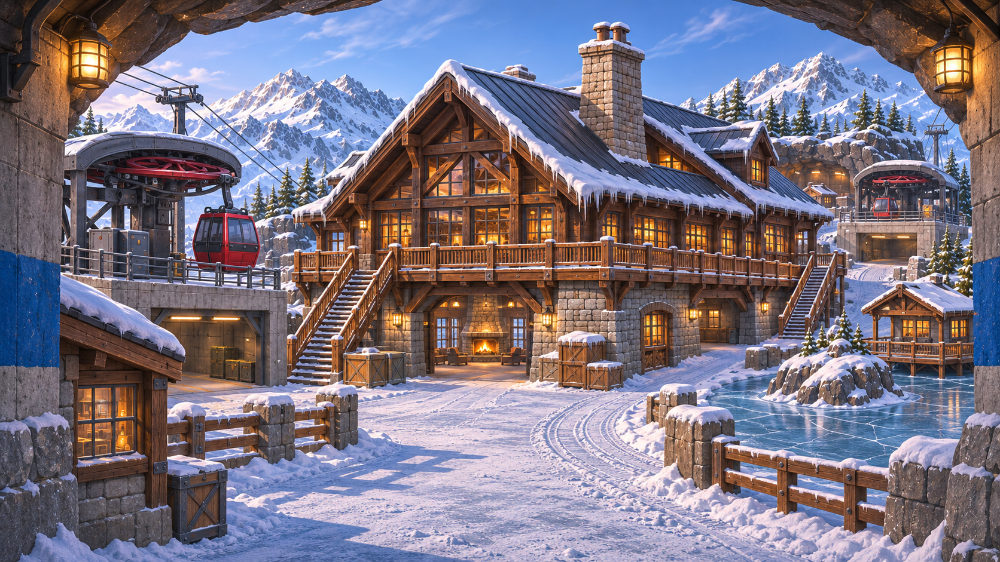
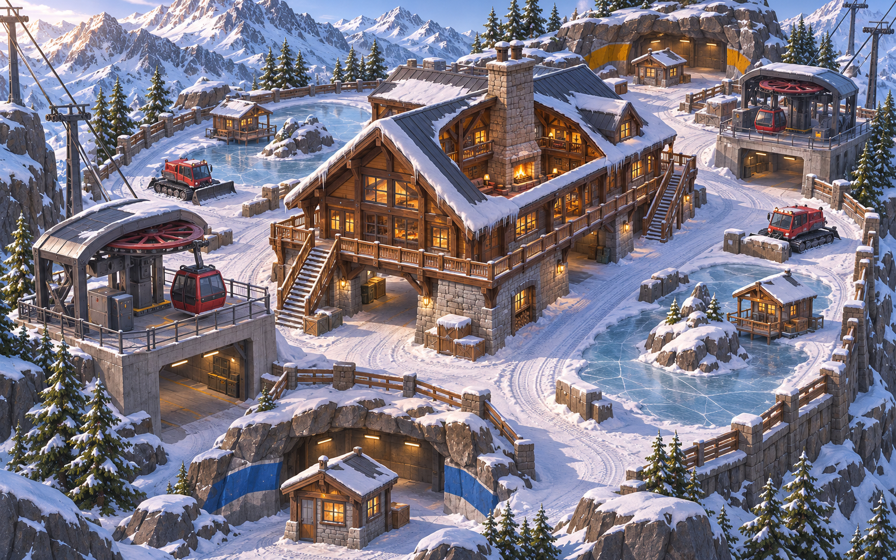
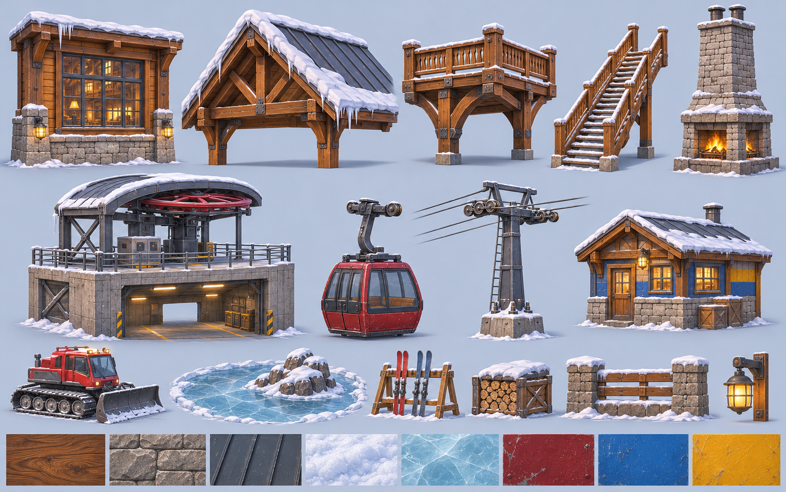

# Snowpeak2: Snowpeak Lodge rebuilt to the standard (2026-11-06)

A new version of [Snowpeak Lodge](Snowpeak%20Lodge.md) built to the [Map Quality Standard](Map%20Quality%20Standard.md), from the concepts the core chat delivered: [01 overview](../../../art-source/maps/Snowpeak2/concepts/01-overview.png), [02 hero](../../../art-source/maps/Snowpeak2/concepts/02-hero.png) and [03 kit sheet](../../../art-source/maps/Snowpeak2/concepts/03-kit-sheet.png). The user approves the finished map; the concepts are quality references.

- **Map id:** `Snowpeak2`, match place, origin **(-3000, 200, -1500)** (free: the nearest maps are Dockyard2 at (-3000, 200, 0) and Snowpeak at (-1500, 200, -1500)).
- **ForceMap only.** It isn't in the pool until the user approves it.
- **Old map untouched:** `Snowpeak` and `tools/studio/maps/Snowpeak/Art.luau` (the user's uncommitted edits) aren't modified.
- **Scripts:**
  - layout: `tools/maps/snowpeak2_layout.py`
  - palette: `tools/maps/snowpeak2_style.py`
  - signs: `tools/maps/snowpeak2_signs.py`
  - textures: `tools/textures/make_snowpeak2_textures.py`
  - kit and placements: `tools/blender/build_map_kit_snowpeak2.py`
  - Studio: `tools/studio/maps/Snowpeak2/{Greybox, Art, Lighting}.luau`
- **Shots:** `vault/02 Art/References/maps/snowpeak2/`.

## Identity
**"A warm timber lodge in a cold, bright saddle."**

| | |
|---|---|
| Landmark | The lodge, with its stone chimney rising to 34, the tallest thing on the field (eaves 20, station decks 10). The gondola cables climbing off the map mark the stations. |
| Heights | Snow 0; lofts, balconies and station decks at 10; roofs 20–30 (Updraft only). |
| Zone tone | Warm inside (timber, amber windows, fire) against cold outside (blue-white snow, blue shade). End paint on the patrol huts and stations: B blue `3D63A8`, A gold `C9962E`. Team colours stay in the UI. |
| Hero accent | The red gondola cabins (`A8262E`), far from team orange-red. |
| Story groups | The lodge lounge (fire, sofa, bar, boot room); the gondola stations (cabin parked on the rail, bullwheel); the pond with its skate hut; the ski-patrol hut; woodsheds and log piles; the snowcat. |

## Layout (unchanged)
`snowpeak2_layout.py` is a copy of `snowpeak_layout.py` with new output paths. The plan, numbers and checks are in [Snowpeak Lodge → Layout](Snowpeak%20Lodge.md).

## Palette (single table; `tools/maps/snowpeak2_style.py`)
| Slot | Roles | Material / variant |
|---|---|---|
| Ground | Snow `EEF2F8`, shade `DCE4EE`; terrace stone `8E8578`; ice `B9D6E6` | Snow / `Snow2_Snow`; Cobblestone / `Snow2_Stone`; Ice |
| Walls | Timber `8A5E3C`, dark `5A3C28`, light `A8805A`; shutters `4A6650` | WoodPlanks / `Snow2_Timber` |
| Stone | Stone `9A9388`, dark `6E6962` | Cobblestone / `Snow2_Stone` |
| Roofs | Standing seam `4A535E` under snow | Plastic / `Snow2_Roof` (no sky mirror) |
| Decks and floors | Oak `9A7450` | WoodPlanks / `Snow2_Plank` |
| Rock | `7C838C`, dark `5E656E` | Rock / `Snow2_Rock` |
| Steel | `5E656D`, dark `3E444B` | Plastic (no Roblox Metal on paint) |
| Accent | Gondola red `A8262E`; brass `A8864A` | SmoothPlastic; Metal |
| Glow | Warm `B07A48`, fire `C0602C`, amber `B8862E` | Neon (dark values: Neon brightens hugely, as calibrated on Bunker2) |
| Icicles | `C9DDEA` | Ice |

## What changed against Snowpeak
- **Our own textures:** six variants at 512 (timber boards with seams and grain, coursed fieldstone, snow with drift and sparkle, standing-seam roof, granite, deck planks), tinted by role. They replace the built-in Roblox materials.
- **Warm windows:** amber Neon replaces near-white. In the old map the windows read as blown-out white squares.
- **Icicles** along the lodge eaves (as in the concept).
- **Signs:** the lodge, station and patrol names are now rendered-font decals, replacing SurfaceGui text. Rule: no GUI or part text.
- **Lighting:** a brighter, warmer morning than the old map; the v4 complaint was "too dark".

## Results
Installed in the match place, ForceMap only. **The place needs saving (Ctrl+S); the core chat saves it.**

**Kit and checks:**
- 30 pieces, 550 MeshParts, about 80k triangles for the whole map.
- Kit coplanar 0 (80k triangles); Studio `Audit.luau` 0 pairs; `FloatAudit` 0 floating groups (569 parts).
- Install fixes for 7 groups the old kit left floating:
  - stair rail posts now reach the stringers;
  - the porch lanterns have brackets to the porch walls;
  - the station lamps are set into the roof slab;
  - the bar foot rail stands on posts.

**Rounds and blind scores** (3 fresh reviewers each; median):

| Round | Changes | Scores | Median |
|---|---|---|---|
| r1 | First install: our textures, sign decals, icicles, amber windows (they read saturated yellow, then red). | 5.00 / 5.00 / 4.58 | **5.00** |
| r2 | Closed a see-through notch in the ridge over each spawn alcove: the "sky rectangle" every reviewer named, also in the old map. Desaturated warm window Neon (`8C7660`). Half-bright interior lights (the lounge blew out orange). | 4.58 / 4.58 / 5.00 | **4.58** |
| r3 | Stations: fieldstone base, timber posts, standing-seam roof, red bullwheel. Lodge window mullions. Packed-snow paths from each spawn round the patrol hut to the lodge porch and the flanks. A lower, warmer, hazier sun (ClockTime 8.2). | 4.58 / 4.58 / 4.58 | **4.58** |
| r4 (fresh start) | Codex job H props fitted into their collision boxes (`codex_fit` in the kit script): the detailed snowcat, three snow-capped boulders (on a Slate role: the rock variant read near-black on their small UVs) and two sculpted drifts. Near cliffs remodelled in the far range's faceted language (no white ledge strips). Lighter rock and shade fill. | 4.58 / 5.42 / 4.58 | **4.58** |
| r5 | Backdrop rock and snow without the grainy variants (calm Slate rock, clean snow). Golden low sun (ClockTime 7.4, warmer shift). Other maps hidden during capture, as the core advised. | 5.00 / 4.58 / 5.00 | **5.00** |

**Consistent asks:**
- the gondola stations are plain grey boxes (the concept's are stone and steel with a bullwheel);
- the backdrop styles clash (faceted peaks next to noise-textured flat cliff faces);
- the snowcat, rocks and snow piles read as cubes;
- the snowfield is empty, with no paths or cover rhythm;
- flat noon light;
- the B spawn looks straight at the patrol hut's wall.

**Stopped by rule after r3**: r2 gained -0.42 and r3 gained 0.00, two rounds in a row under +0.3. The new Codex hero models restarted the count for r4-r5: r4 4.58, r5 5.00 (+0.42). I stopped there because every remaining ask is structural or a layout change, listed below. Best: **5.00 (r1, r5)**.

**Ready for approval?** No. Every round sits at about 4.6-5.0, and the reviewers' asks are now structural, beyond tuning:
1. **Remodel the primitive props** in Blender: the snowcat, cube boulders, wedge snow piles and benches.
2. **Rebuild the backdrop in one style.** The faceted far peaks and the flat noise-textured cliff faces (with white ledge strips) don't match; the concept has sculpted rock with snow ledges and pine belts.
3. **Give the B and A ends real spawn portals** (the concept's blue/gold framed arches) and open the spawn's view past the patrol hut. That moves a layout piece, so it's the user's call.
4. **Golden low-sun lighting and visible lamp pools.** Edit captures understate local lights.

Best shots:

| Concept | Build |
|---|---|
|  |  |
|  |  |
|  |  |
|  |  |

The thin cyan "spike" behind the lodge is a ridge crest of the backdrop seen edge-on. It isn't a stray part; there's no sliver in the mesh.

## Codex jobs

### Job H — replacement props (delivered 2026-11-06)

Completed after the Metro pair passed. Original models made through interactive Blender MCP against [03-kit-sheet](../../../art-source/maps/Snowpeak2/concepts/03-kit-sheet.png), [02-hero](../../../art-source/maps/Snowpeak2/concepts/02-hero.png), this note and the existing kit/layout (read only). All are **1 unit = 1 stud**, Z up, front −Y, origin bottom centre (0,0,0), applied transforms. Sizes are exported **X width × Y depth × Z height**, rounded to 0.001 stud. Every package includes a native scene, selected-role GLB and three-quarter preview with a grey **5-stud** scale block.

| Prop | Tris / strict ceiling | Size (studs) | Roles | Files | Result / limits |
|---|---:|---|---|---|---|
| Snowcat | 5,848 / 6,000 | 8 × 14 × 8 | Red, Steel, SteelDark, Rubber, CabGlass, GlowAmber, Snow | [GLB](../../../art-source/maps/Snowpeak2/props/Snowcat.glb) · [Blend](../../../art-source/maps/Snowpeak2/props/Snowcat.blend) · [Preview](../../../art-source/maps/Snowpeak2/props/Snowcat_preview.png) | Raked glazed cab; continuous tracks with 28 grousers per side and five profiled rollers; curved blade with cutting edge/ribs and hydraulic mounts; rear tiller, engine grilles, exhaust, steps, handrails, mirrors, steering/seat and beacon. |
| BoulderA | 776 / 1,000 | 8 × 6 × 7.917 | Rock, Snow | [GLB](../../../art-source/maps/Snowpeak2/props/BoulderA.glb) · [Blend](../../../art-source/maps/Snowpeak2/props/BoulderA.blend) · [Preview](../../../art-source/maps/Snowpeak2/props/BoulderA_preview.png) | Broad fractured shoulder with a fitted, rounded snow mantle. Lower-front cap cleared above the rock to remove a notch. |
| BoulderB | 776 / 1,000 | 6 × 5.5 × 5.935 | Rock, Snow | [GLB](../../../art-source/maps/Snowpeak2/props/BoulderB.glb) · [Blend](../../../art-source/maps/Snowpeak2/props/BoulderB.blend) · [Preview](../../../art-source/maps/Snowpeak2/props/BoulderB_preview.png) | Rounder asymmetrical boulder; a separate fitted closed snow cap. |
| BoulderC | 776 / 1,000 | 9 × 5.5 × 4.438 | Rock, Snow | [GLB](../../../art-source/maps/Snowpeak2/props/BoulderC.glb) · [Blend](../../../art-source/maps/Snowpeak2/props/BoulderC.blend) · [Preview](../../../art-source/maps/Snowpeak2/props/BoulderC_preview.png) | Low spreading slab with angular shoulders and a softer cap. |
| BoulderD | 776 / 1,000 | 5 × 4.5 × 7.519 | Rock, Snow | [GLB](../../../art-source/maps/Snowpeak2/props/BoulderD.glb) · [Blend](../../../art-source/maps/Snowpeak2/props/BoulderD.blend) · [Preview](../../../art-source/maps/Snowpeak2/props/BoulderD_preview.png) | Leaning upright mass with relaxed snow scallops. |
| SnowdriftA | 382 / 600 | 8 × 8 × 8 | Snow | [GLB](../../../art-source/maps/Snowpeak2/props/SnowdriftA.glb) · [Blend](../../../art-source/maps/Snowpeak2/props/SnowdriftA.blend) · [Preview](../../../art-source/maps/Snowpeak2/props/SnowdriftA_preview.png) | Steep ploughed pile, matching the old SnowPile8 nominal envelope; rounded asymmetric crown. |
| SnowdriftB | 382 / 600 | 18 × 8 × 8 | Snow | [GLB](../../../art-source/maps/Snowpeak2/props/SnowdriftB.glb) · [Blend](../../../art-source/maps/Snowpeak2/props/SnowdriftB.blend) · [Preview](../../../art-source/maps/Snowpeak2/props/SnowdriftB_preview.png) | Long wind-shaped bank for the SnowPile18 envelope; continuous crown shading. |
| SnowdriftC | 382 / 600 | 10 × 6 × 3 | Snow | [GLB](../../../art-source/maps/Snowpeak2/props/SnowdriftC.glb) · [Blend](../../../art-source/maps/Snowpeak2/props/SnowdriftC.blend) · [Preview](../../../art-source/maps/Snowpeak2/props/SnowdriftC_preview.png) | Low lobed drift for path-edge dressing, not a replacement for full-height cover. |

**Palette:** Red A8262E, Steel 5E656D, SteelDark/Rubber 3E444B, Rock 7C838C, Snow EEF2F8 and GlowAmber B8862E. CabGlass uses the existing style file's general glazing tint **B5C8D4, T0.55**, lifted from the old near-black cab tint for readability; its role name is retained. Painted steel stays matte. One role material per mesh, vertex colours kept: use white mesh tint on import. No text, logos or external textures.

**Checks:** every role mesh passes the LihFolk mesh gate: no loose/degenerate geometry, inconsistent normals, within-shell self-intersections or overlapping caps. Component contact audit: **0 floating components across 202 shells** (191 snowcat, 2 per boulder, 1 per drift). Caps meet their rocks; blade, mirrors, handrails and steering wheel have actual support. Each rock has 11 coplanar basal vertices at Z0; each drift has 32. Snowcat rests on its track-link sole at Z0. All eight final GLBs were reimported: triangles, mesh counts, role materials, vertex colours and dimensions match within 0.001 stud. Each .blend contains only its asset scene and preview stage; no proxy/ground/camera/light is in the GLB.

**Visual review:** Quick council, Art Director/Skeptic lens: snowcat **17/18**, boulders **15/18**, drifts **14/18**, no zero. Representative snowcat checked from four angles. The strongest objection prompted cleanup of the cap notch and pinched pile crowns; the follow-up inspection confirmed those fixes. Natural shapes remain deliberately stylised and simpler than the painted surface detail in the concepts.

**Placement / what to test:** anchor static meshes and use separate fitted gameplay collision; disable collision/touch/query on decorative mesh details. The snowcat keeps the old 8 × 14 × 8 envelope. Boulders vary in footprint/height; only choose a variant after checking its collision. The two tall piles keep the nominal old cover envelopes, but curved silhouettes must not conceal box collision outside their surface. The low C drift is decoration. Studio installation, playtest visibility, collision fit and installed-map scoring are pending; this job changes no layout, scripts or Studio content. Fine mechanical hardware deliberately uses some details thinner than the generic 0.2-stud guideline.

**Notes used:** this map's palette/results and concept pair; Art Direction, Map Quality Standard; LihFolk [Hard-Surface Modeling](../../LihFolk/14%203D%20Modeling/Hard-Surface%20Modeling.md) (workflow A), [Shape Language and Silhouette Testing](../../LihFolk/55%20Modelling%20Nuance%20and%20Readability/Shape%20Language%20and%20Silhouette%20Testing.md), [Exporting and Validating Models](../../LihFolk/14%203D%20Modeling/Exporting%20and%20Validating%20Models%20for%20Roblox.md), and the modeling/council skills.

### For the user (layout and structural; not built)
- **Spawn portals.** Give each end the concept's blue or gold framed arch, and open the spawn's view past the patrol hut, which every reviewer saw as a flat wall. That moves a layout piece.
- **Lanes on the flat field.** Fences, cover rows and stronger track lines. This changes cover and sightlines, so it needs the layout script and its checks.
- **Window glow.** Neon panes render as flat colour squares in edit captures. Lit interiors behind glass, or a SurfaceGui glow, would need a test in play mode.
- **Codex snowcat:** 4 small internal coplanar triangle pairs in its own mesh, not visible in Studio. Left as modelled; my offset attempts only moved them.
