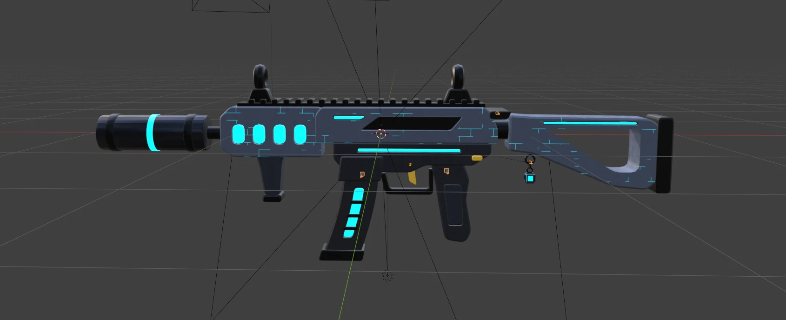

# Art Direction: Style B "Stylized Neon"

> **Retired 2026-10-25.** The game is dropping the sci-fi look. New standard: professional tactical guns, matte charcoal/black with PBR textures and a very restrained neon accent; master reference is the **Vandal** (`References/vandal-concept.webp`, `References/vandal-blender-check.jpg`). New guns are modelled by script (`tools/blender/build_vandal.py` is the template), baked to one shared texture set (`tools/blender/bake_textures.py`) and get a SurfaceAppearance in Studio. The model standard and import pipeline below still apply. This note gets rewritten as the new style settles.

**Master reference:** the finished **Bitrate** rifle. Every asset should look like it was made by the same artist, for the same game.

---

## Style rules (from Bitrate)
- Stylized hard-surface, chunky but clean. Rounded bevels on every edge, angular chamfered cuts, big readable shapes. **No** greebles, grime, scratches or logos.
- **Two-tone:** slate blue-grey upper panels with a subtle cyan circuit-trace pattern; near-black lower parts, grips, mags, barrels and buttpads.
- **Cyan neon** (`#00E5FF`) only as long thin lines, rounded "pill" vents, segmented mag bars and a muzzle ring.
- **Gold** only on the trigger and one small lever.
- **Magenta** (`#FF3DCB`) only on optic lenses and **wildcard energy parts**.
- Shared kit: the same black notched rail, flip-up ring sights, trigger and grip on every gun.
- **Charm loop** at the back of every gun (cosmetic charms later).
- **Silhouette rule:** every gun is recognisable from its black outline alone, on a phone.
- **No blood.** Hits spark and deaths dissolve into pixels (keeps the "Mild" content label).

## Palette
| Name | Hex | Use |
|---|---|---|
| Body Panel | `#56607C` | Upper panels (with circuit trace) |
| Body Dark | `#1C2030` | Lower parts, grips, mags |
| Metal | `#14161D` | Barrels, inner parts |
| Neon | `#00E5FF` | Glow strips (Roblox `Neon` material) |
| Accent | `#FFC83D` | Trigger, one lever |
| Lens / Exotic | `#FF3DCB` | Optic lenses, wildcard energy |

## Model standard (needed for the code to work)
Every weapon is a `Model` named **exactly** like its config ID (e.g. `Bitrate`, `HardReset`) in **`ReplicatedStorage.Weapons`**:
- **`Handle`**: PrimaryPart, invisible, at the pistol grip (Blender origin). Carries the `RightGrip` attachment.
- **`Rig`** folder: one invisible joint part per Blender bone (`Root`, `Mag`, `Slide`, `Bolt`, `Pump`, `Cylinder`, `Barrels`, `Rotor`, `Core`, `Orb`, `Trigger`, `Flash`, `Charm`), built in the bone's own axes. **`Rig.Motors`** holds a Motor6D per bone (Handle → Root → Mag …) with C0 at the bone head, so the Blender Fire/Reload animations play straight onto `Motor6D.Transform`.
- **Attachments** `Muzzle`, `LeftGrip`, `AimPoint`, `Eject`, `CharmPoint` sit on the joint part of the bone they ride on (Root for most; `Slide` for pistol AimPoint/Eject, `Barrels` for break-actions, `Orb` for Null). Find them with `FindFirstChild(name, true)`.
- **Mesh parts** keep the Blender names. Multi-material meshes are split as `<Part>_<Material>` (`Body_Panel`, `Body_Dark`, `Body_Metal`, `Body_Accent`, `Mag_Dark`…). Each is welded to its bone's joint part with a classic **`Weld`** (not WeldConstraint: its offset gets recomputed wrongly on clients).
- **Neon parts are separate MeshParts** with `Material = Neon`, so skins can recolour them. Lens parts are Neon `#FF3DCB`, optic glass at 0.25 transparency.
- Attachment and skin geometry (`Muzzle_Compensator_*`, `Sight_Holo_*`, `Skin_*`) has an `Option` attribute; options that are off in Blender are invisible.
- Every part: `Anchored = false`, `CanCollide/CanQuery/CanTouch = false`, `Massless = true`, `CastShadow = false`.
- Barrel along the Handle's **−Z** axis (Roblox forward), up = +Y.
- Size: Bitrate = **3.8–3.9 studs** (1 Blender unit = 1 stud).
- Triangles: sidearms ≤ 3K, primaries ≤ 5K, machine guns/wildcards ≤ 6K.

Check any time with `tools/studio/ValidateWeapons.luau` (paste into the Command Bar, or ask Claude to run it).

## Import pipeline (Blender → Roblox, scripted)
Rojo **can't** live-sync MeshParts (it leaves `MeshId` empty), so finished guns live in the Studio-owned `ReplicatedStorage.Weapons` folder and are saved with the place. Each gun also has a versioned backup in the repo.

1. **Source:** `art-source/weapons/GunTest.blend` (all guns, one collection each).
2. **Export:** `blender --background art-source/weapons/GunTest.blend --python tools/blender/export_weapons.py -- [Gun ...]` writes `art-source/weapons/Exports/<Id>.fbx` + `<Id>.json` (bones, locators, part centres, Fire/Reload keyframes). It runs on a background copy, so the .blend is never changed.
3. **Upload:** `python tools/opencloud/upload_models.py --group 11116787 [Id ...]` (key in the `ROBLOX_ASSETS_KEY` environment variable). Asset IDs go in `Exports/assets.json`; re-uploads add a new version to the same asset.
4. **Build:** `python tools/studio/make_build_data.py`, copy `tools/studio/rojo/` to `src/server/WeaponBuild/` (temporary, gitignored), run `tools/studio/receive_server.py`, then in Studio `require(WeaponBuilder).publish("<Id>")`. It inserts the upload into `ServerStorage.ImportStaging`, builds the gun to the standard, installs it in `ReplicatedStorage.Weapons` and saves `art-source/weapons/Studio/<Id>.rbxm`.
5. **Animations:** `python tools/make_weapon_anims.py` regenerates `src/shared/WeaponAnimations/<Id>.luau` from the exports.
6. **Save the place** in Studio, run the validator, tick the [Asset Tracker](../06%20Assets/Asset%20Tracker.md).

## VFX
**Realistic and simple (new direction, 2026-10-25).** All shot effects live in `EffectsController`; no neon. The old Style B set (cyan flashes and tracers, glowing bullet-hole rims, Ray Trace rail, Null beam, Loopback disc, pixel-dissolve deaths, kill flash) was removed.
- **Muzzle:** a fiery star burst down the barrel (2-frame flipbook, colours baked: white-hot core → amber → orange), a ragged side flame (third person, and smaller in first person), a soft warm core, a few embers, a grey smoke puff per shot and a warm light pop. After a burst the barrel smokes: wisps curl up while it cools (`HEAT_*`). Suppressed guns: a small flash, no side flame.
- **Brass:** pooled cylinders flown by hand from `Eject` (one bounce, then they lie flat), muted brass so they don't glow in sun.
- **Tracers:** thin warm streaks travelling at ~1400 studs/s (fainter for your own shots), none for suppressed guns.
- **Impacts by surface:** metal throws a spark shower; concrete/stone gets a dust puff, chips and a spark or two; wood splinters; ground/grass kicks up dirt; glass gets glints. Dust and chips are tinted from the surface colour. Bullet holes (64 pooled, lit by the scene, fade after 14 s) are tinted per material. Characters: a small puff, no blood.
- **Textures:** `python tools/vfx/make_real_vfx.py [--preview out.png]` (numpy + Pillow, seeded fractal noise, no Blender) writes `art-source/vfx/real/`: `flash_front_2x2`, `flash_side_2x2`, `smoke_2x2`, `dust_2x2`, `chips_2x2`, `hole`. The spark streak, soft glow and tracer gradient are kept from the first set (`art-source/vfx/`). `_2x2` sheets are flipbooks (each particle keeps one random frame).
- **Upload:** `python tools/opencloud/upload_asset.py --group 11116787 --type Decal <png> "GG VFX <name>"` returns a *Decal* id; particles, beams and images need the *Image* id behind it (Studio: `InsertService:LoadAsset(id)` → the Decal's `Texture`). Store that in `Config/VfxTextures`.
- **Rules:** fire uses `LightEmission` 1 with `Brightness` 1 (2 blew the flash out to white); smoke, dust and chips are lit by the scene (`LightInfluence` 1); fast guns pop a dimmer light; pool anything an automatic gun fires (tracers, shells, holes, burst emitters).
- **Screenshots:** in Studio set the `Workspace` attribute `VfxTimeScale` (0 freezes, 0.05 is slow motion); it freezes the viewmodel too. Studio runs at ~15 fps unfocused, so a tracer otherwise lasts under a frame.

To restore a gun by hand: right-click `ReplicatedStorage.Weapons` → **Insert from File** → `art-source/weapons/Studio/<Id>.rbxm`.

## Audio
Goal: RIVALS-style feel. Shots are punchy and satisfying, every class sounds different, and hit, headshot and kill confirms are crisp. Shots are **real recordings**, not synthesized: the user rejected a layered synth version (crack, sub thump, mechanism and fake room) as "really bad" (2026-10-25), so stay with real recordings and only polish them.
- **Sources (all free to use):** gunshots from [The Free Firearm Sound Library](https://opengameart.org/content/the-free-firearm-sound-library) (CC0; download in `art-source/audio/`, gitignored). Handling foley comes from the Audioscape library and melee and Ray Trace from ProSoundEffects, both Roblox-licensed and played by asset id. The Null beam hum, dry fire, low-ammo tick and the hit, headshot, kill and damage sounds are synthesized. Never use Creator Store gunshots from other uploaders: most are rips from COD, ArmA and similar games.
- **Atlas:** gunshots, the beam hum and UI sounds share one audio asset (Open Cloud allows 10 audio uploads a month without ID verification). `python -I tools/audio/build_sound_atlas.py [--preview]` writes `art-source/audio/GunAtlas.flac` (stereo 48 kHz) and `Config/SoundAtlas.luau`. `--preview` also writes an audition reel (`AtlasPreview.wav`, gitignored) to listen to before uploading. Upload with `python tools/opencloud/upload_asset.py --group 11116787 --type Audio art-source/audio/GunAtlas.flac "GG Gun Sound Atlas vN"`, then set `ATLAS` in `Config/Sounds`.
- **Polish (what fixed the "dull" raw library):** 45 Hz rumble cut, −2 dB at 350 Hz, presence +2–3.5 dB at 3.2 kHz, air shelf at 10 kHz, a weight shelf at 100 Hz for heavy classes, transient boost, the outdoor echo trimmed (snipers keep more of their boom), gentle glue compression, then loudness matched per class.
- **Class identity:** each class has its own recordings. Machine guns use the last shot of real full-auto bursts (the only shots in a burst with a clean tail). Snipers use the big bolt rifles with long tails. Overwrite is a Marlin .30-30. The suppressed guns are low-passed.
- **Variants and enemies:** each gun has up to 3 variants (separate recorded shots) plus a `_Far` slice from the library's mid-distance mic (mono, duller, quieter) that other players hear, so your gun and theirs never blur.
- **Runtime (`AudioController`):** a fixed pool of Sound voices on the atlas, each play just moving its `PlaybackRegion` (2D voices for you, Terrain-attachment 3D voices for others). Each sound is capped at 4 voices, never repeats the last variant, and gets a small random pitch. SoundGroups under `SoundService.Combat`: Gun (glue compressor, ducks a little under hit feedback), Enemy (glue + EQ), Feedback and Foley, with a master limiter. Mix numbers are in `Config/Audio`. Also: low-ammo tick under 25% of the mag, the bolt or pump after Pump/Bolt shots, and a thud when you take damage.
- **Rollback:** the first atlas (raw recordings) is asset 95621839199583; restore `Config/Sounds` and `Config/SoundAtlas` from commit 7f485d4. The rejected synth test is 88658182501404.

## First-person arms
- One long bevelled block per arm (RIVALS style, references in `References/rivals-viewmodel/`), generated by `tools/blender/make_arm_mesh.py` → `art-source/viewmodel/Arms.fbx` (ArmRight / ArmLeft, 1 × 5 × 1, smooth shading). UVs map each side onto that arm's region of the classic shirt template; the 2 studs nearest the hand carry the template's full arm height, like an R6 arm.
- Upload: `python tools/opencloud/upload_asset.py --group 11116787 --type Model art-source/viewmodel/Arms.fbx "GG Viewmodel Arms"`, then in Studio `InsertService:LoadAsset(id)` → each MeshPart's `MeshId` goes in `Config/Viewmodel` `ARM_MESH`.
