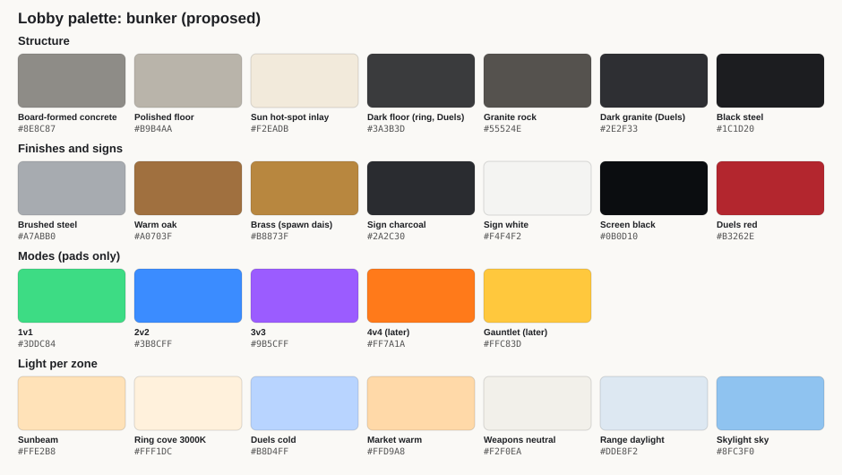
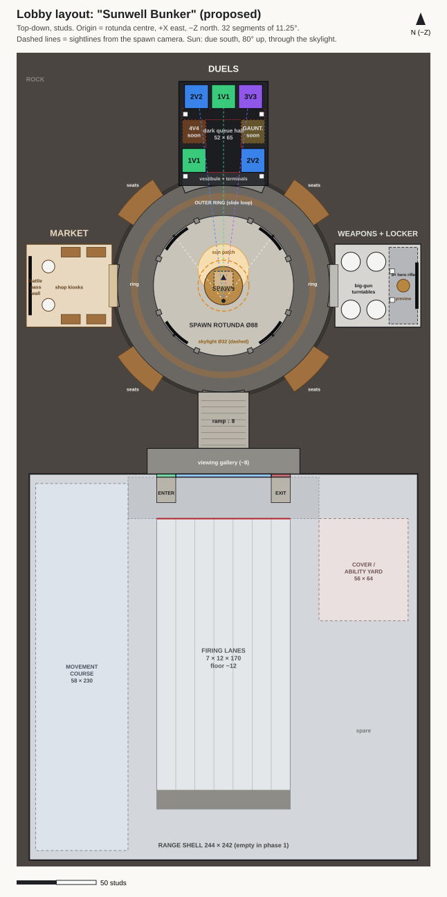
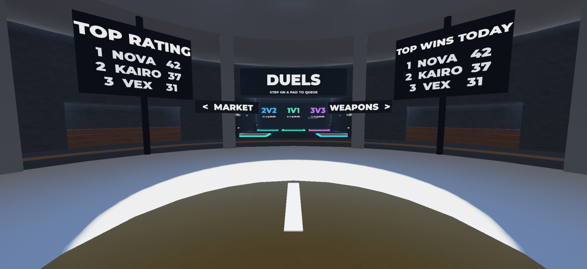
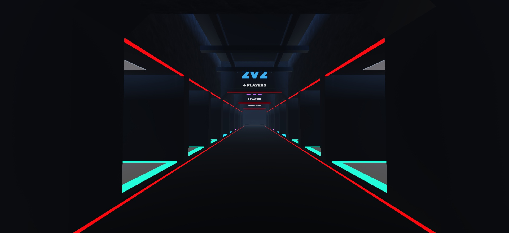

# Lobby Art Plan

The art plan for the [Lobby](../01%20Design/Lobby.md) place, phase 1 (build and art only). It holds the mood board, palette, materials and the top-down layout with dimensions, and it feeds the greybox (step 2) and the Blender kit (steps 3–4).

**Status (2026-10-29):** step 1 redone for the **circular bunker hub** (user decision, 2026-10-29: a round spawn rotunda with a skylight, an outer ring and four wings; no courtyard). **Approved 2026-10-29** with the defaults: 88-stud rotunda (the greybox walk is the scale check), one-way ENTER/EXIT range gates, Market west / Weapons east, no ring light wells yet. **Step 2 greybox approved 2026-10-29** after a second pass (see Greybox v2 below). Step 3 (Blender kit design) in progress.
- **Research:** 3 reference sweeps (bunker and skylight architecture, moody game lobbies and weapon showrooms, Roblox hub scale).
- **Layouts:** 3 independent layouts (readability, flow, mood), then a judge that rechecked the geometry and merged them into **"Sunwell Bunker"**.
- **Superseded:** the earlier rectangular "Axis Hall" with a courtyard.

---

## 1. Mood board

**One line:** a clean, expensive tactical training bunker cut into rock. A single sunbeam falls through a round skylight onto the spawn. Each wing has its own light mood, and the Duels hall is dark and tense like a horror-game lobby. Clean, never rundown, never sci-fi.

### What it should feel like
- **One hole, one beam, one target.** The hero shot is a mid-dark coffered dome around one bright disc of sky. Its beam lands on the spawn, which is the brightest thing in the building.
- **Raw rock against crisp architecture.** Rock shows only on the outer ring wall, around the skylight and high in the wings. Floors, plinths, signs and furniture stay dead straight and clean. Finished parts never butt into rock: a glowing gap, a deep concrete portal frame or a shadow gap always separates them.
- **Compress, then release.** You pass through a lower, narrower portal from the ring, then each wing opens up. The Range adds a step down to a viewing wall as its own reveal.
- **Every wing reads by three cues:** a big white-on-charcoal title over its portal, its own light temperature, and one hero object visible down its axis.
  - **Duels:** cold and dark, with lit pads glowing in their mode colours.
  - **Market:** warm and bright, with a battle-pass LED wall.
  - **Weapons:** neutral museum light, with a giant hero rifle.
  - **Range:** bright daylight lanes seen through glass.
- **The horror-lobby mood comes from darkness plus thin bright lines.** One light pool per pad, darkness between pools, light slits, deep-red edge strips and low haze, with no coloured rooms. The pads stay the most saturated things on screen.
- **Never show the light source.** Hidden cove strips, ceiling slots and back-lit panels read as premium, while visible bulbs read as cheap.
- **Mass behind, one hero in front.** In Weapons, a wall of real-size guns forms the backdrop for a single giant hero gun. In Market, calm repeated counters frame one slowly turning centrepiece.

### References
These are links only, so the images stay on their sites. **Take** is the specific thing to borrow.

| Zone | Reference | Take |
|---|---|---|
| Rotunda | [Pantheon, Rome](https://en.wikipedia.org/wiki/Pantheon,_Rome) | Rotunda + oculus proportions (oculus ≈ 0.2–0.36 of the diameter), coffered dome, a sun disc moving over the coffers. Lower it for a phone camera |
| Rotunda | [Turrell, Twilight Epiphany Skyspace](https://www.metalocus.es/en/news/turrell-skyspace-rice-university) | Knife-edge skylight rim, so the sky reads as a crisp disc; a perimeter bench |
| Rotunda | [Destiny 2: The Tower](https://www.destinypedia.com/Tower_(Destiny_2)) | Spawn slightly raised, overlooking the hub; every wing has one named destination |
| Ring | [Temppeliaukio rock church](https://en.wikipedia.org/wiki/Temppeliaukio_Church) | Rock wall → continuous light gap → floating finished ceiling on radial beams |
| Ring | [Washington Metro vaults](https://savingplaces.org/stories/save-brutalism-inside-washington-dc-metro) | Hidden uplight slot washing a coffered ceiling; no visible fixtures |
| Ring | [Teshima Art Museum](https://architizer.com/projects/teshima-art-museum) | Small knife-edged light wells repeat the skylight motif (option for the diagonals) |
| Materials | [Pionen bunker, Stockholm](https://en.wikipedia.org/wiki/Pionen) | Raw rock with clean steel and glass set into it (leave out its sci-fi props); oak and plants for warmth |
| Materials | [Church of the Light (Ando)](https://detail.de/de_en/sensory-masterpiece-church-of-the-light-by-tadao-ando-in-ibaraki-1991) | Concrete formwork grid 3.2 × 6.4 studs with tie-hole dots; light slits in a dark room (Duels) |
| Materials | [Stockholm metro rock stations](https://en.wikipedia.org/wiki/List_of_Stockholm_metro_stations) | Irregular cave plus crisp, level built elements; rock as one flat colour wash |
| Materials | [Hill Country Wine Cave](https://www.theplan.it/eng/design/hill-country-wine-cave-a-cellar-carved-entirely-out-of-rock) | Deep board-formed concrete portal frames cut into rock at each wing mouth |
| Materials | [Cheyenne Mountain Complex](https://www.airandspaceforces.com/article/fifty-years-of-mission-in-the-mountain/) | Rooms as clean pavilions standing free of the rock, with a lit shadow gap |
| Flow | [Hill of the Buddha (Ando)](https://www.asla.org/news-insights/dirt/tadao-andos-hill-of-the-buddha) | Compress-then-release approach into each wing |
| Duels | [Dead by Daylight: Campfire](https://deadbydaylight.wiki.gg/wiki/Campfire) | One warm pool per group and darkness between pools |
| Duels | [Phasmophobia truck](https://www.thegamer.com/phasmophobia-truck-overhaul-update-version-0620-explained/) | Wall consoles whose screen glow is the only light on your face (queue terminals) |
| Duels | [Rainbow Six Siege rim lighting](https://www.trustedreviews.com/news/rainbow-six-sieges-old-operators-could-be-getting-a-visual-redesign-to-make-them-look-like-heroes-3810646) | Cool rim light behind standing areas, so silhouettes pop against black |
| Duels | [Tower Defense Simulator elevators](https://tds.fandom.com/wiki/Elevators) | Pad sign hierarchy: MODE / X of N QUEUED / waiting or countdown bar |
| Market | [Gentle Monster flagship](https://hypebeast.com/2026/9/look-inside-gentle-monster-reimagined-new-york-flagship-store) | One slow-moving centrepiece with calm repeated counters around it |
| Weapons | [Royal Armouries, Hall of Steel](https://en.wikipedia.org/wiki/Royal_Armouries_Museum) | Trophy wall of real-size guns as a backdrop |
| Weapons | [Beretta Gallery](https://www.hookandbarrel.com/shooting/new-york-beretta-gun-gallery) | Hero gun on an island plinth you can walk around |
| Weapons | [Giant factice display models](https://www.jhmay.com/giant-perfume-display-bottle-models/) | Scale to a target on-screen size, not a fixed factor: rifles 4–6×, pistols 8–10× |
| Weapons | [Chichu Art Museum](https://benesse-artsite.jp/en/story/20210611-1671.html) | Hidden-slot daylight for display rooms, with rounded corners so the object is the only hard edge |
| Range | [Ready or Not: Headquarters](https://readyornot.wiki.gg/wiki/Headquarters) | Going down to the range is a ritual: a wide gentle descent with the viewing glass on the high side |
| Range | [Valorant: The Range](https://www.redbull.com/au-en/the-practice-range-map-guide-valorant) | The range is brighter and cooler than the hub: "lights on, focus" |
| Lighting | [Roblox: Beams](https://create.roblox.com/docs/effects/beams.md) and [Atmosphere](https://create.roblox.com/docs/environment/atmosphere) | Fake god rays need Beams + a bright floor hot-spot + one shadowless SpotLight; haze only shows on long sightlines |
| Scale | [RIVALS lobby video](https://www.youtube.com/watch?v=JJQYje2J3lM) | Visual check only: count avatar heights across a rotunda before locking our size |

**Gap:** no public source gives lobby sizes in studs. All our numbers are derived from our movement and readability rules, so measure once against a lobby video before the greybox is locked (see Open questions).

## 2. Palette and materials

| Material | Colour | Where |
|---|---|---|
| Board-formed concrete (3.2 × 6.4 formwork grid, tie holes) | `#8E8C87` | Rotunda drum and piers, portal frames, wing walls |
| Polished floor | `#B9B4AA` | Rotunda floor, with a lighter sun hot-spot inlay `#F2EADB` |
| Dark honed concrete | `#3A3B3D` | Ring floor (with an oak slide band), Duels floor |
| Granite rock | `#55524E` (dark `#2E2F33` in Duels) | Ring outer wall, around the skylight, high in the wings |
| Black steel | `#1C1D20` | Skylight rim and spokes, portal lintels, trusses, frames |
| Brushed steel | `#A7ABB0` | Rails, pad rims, plinth trims |
| Warm oak | `#A0703F` | Seating alcove tiers, Market slat walls and counters, the ring slide band |
| Brass | `#B8873F` | Spawn dais compass inlay, locker pedestal (the only warm metal) |
| Glass | one layer, Transparency ~0.7 | Range viewing wall, Market featured cases |

**Signs (one sign family):** white `#F4F4F2` heavy sans-serif, all caps, on charcoal steel `#2A2C30`. Screens are `#0B0D10` with LightInfluence 0. Never put light text straight onto rock or sunlit concrete.
**Mode colours (pads, pad signs and HUD only):** 1v1 green `#3DDC84` · 2v2 blue `#3B8CFF` · 3v3 purple `#9B5CFF` · 4v4 orange `#FF7A1A` (later) · Gauntlet gold `#FFC83D` (later). Always shown with a big numeral.
**Duels accent:** deep red `#B3262E` only (edge strips, tally lamps). No amber, so it never clashes with 4v4 orange or Gauntlet gold.
**Light per zone:**
- **Sunbeam:** `#FFE2B8`
- **Ring:** warm cove light `#FFF1DC` (3000K)
- **Duels:** cold `#B8D4FF` (7000K)
- **Market:** warm `#FFD9A8` (3200K)
- **Weapons:** neutral `#F2F0EA` (4500K)
- **Range:** cool daylight `#DDE8F2` (6000K)

## 3. Layout: "Sunwell Bunker"

**The idea:**
- **Spawn:** a round brass-and-oak dais in an 88-stud concrete rotunda. A 32-stud open skylight drops a real sunbeam onto it, while the default camera behind you stays in shade, for contrast.
- **Straight ahead:** the only double-width portal (52 wide), titled **DUELS**. Through it, three lit pads glow in their mode colours at the back of a dark, hazy room, and their signs read from spawn.
- **The ring:** a 24-wide concourse around the rotunda, with an exposed rock outer wall. Its floor is kept completely clear as the slide loop, and four oak seating alcoves are cut into the rock on the diagonals.
- **The other wings:** **MARKET** to the west, **WEAPONS + LOCKER** to the east and **RANGE** to the south (behind you), each through a 26.5-wide portal.
- **Range descent:** the Range wing ramps down 8 studs to a viewing gallery. Its glass wall looks down another 4 studs onto the lanes, and one-way ENTER/EXIT gates sit on either side of the glass.

**Conventions:**
- Units are studs. The origin is the rotunda centre on the floor, with **+X east and −Z north**.
- Bearings run from 0 = north, clockwise.
- The round parts use **32 segments of 11.25°**, so the 4 axes and 4 diagonals land on segment joints. Radii are on a 2-stud step.
- 1 stud ≈ 0.28 m, so the rotunda is about 25 m across.

### Zones
| Zone | Where | Size / height | Notes |
|---|---|---|---|
| **Spawn rotunda** | circle R44 | floor 0; colonnade openings 0–28; drum to 46; coffered dome to the rim at 54 | 8 concrete piers (3 × 3) at 22.5° + 45°k, 4 slim steel columns on the diagonals; the axis openings are 30.7 clear |
| **Skylight (oculus)** | circle R16 | rim y 54, 6-deep shaft, open sky at 60 | No glass; knife-edge steel rim, 8 thin spokes cast a spoke pattern into the sun patch |
| **Spawn dais** | circle R12, +0.5 | SpawnLocation 12 × 12 at (0, −3), facing north | Brass compass inlay whose north arrow points at Duels |
| Sun patch | about 31 × 32, centre (0, −10) | — | Real sun plus a lighter floor inlay, so it still reads with shadows off |
| **Leaderboards** (4) | diagonals, on the colonnade | 18 × 13.5 screens at y 13–26.5, double-sided | NE "top wins today", NW "top rating" (both in the first frame); SE/SW seen on turning; back faces carry wing arrows for the ring |
| **Outer ring** | ring R44–68 | 24 wide, ceiling 28 | Dark honed floor with an oak slide band on R54–58; lap 352 studs (16 s sprint); **nothing on the floor** |
| Ring rock wall | R68–70 | 28 | Rock above a 1.5 concrete plinth with a glowing warm gap at its foot |
| Seating alcoves (4) | diagonals, R68–80 | 3 oak tiers, 1.5 rise × 3 deep | About 21–27 seats each, facing the rotunda |
| **DUELS portal** | bearings 337.5–22.5 | 52 wide × 16 | Title band 40 × 8, "DUELS" 5.5-stud caps, "STEP ON A PAD TO QUEUE" |
| MARKET / WEAPONS / RANGE portals | bearings 270 / 90 / 180 | 26.5 wide × 16 | Title bands 26 × 8, 4.5-stud caps |
| **Duels wing** | x −28…28, z −128…−63 | ceiling 22 | Near-black walls, open trusses, rock above y 16; haze down the 22-wide aisle |
| End pads 2V2 · 1V1 · 3V3 | z −126…−111 | 15 × 15 bays, 13 × 13 decks at +0.5 | 1V1 dead centre on the spawn axis; signs 14 × 7 at y 8–15 (collision off), mode 5-stud caps |
| Side pads 1V1 + 2V2 (row 1) | x ±(11…26), z −86…−71 | same kit | Second queues for a 30-player load, facing the aisle |
| Reserved 4V4 + GAUNTLET (row 2) | x ±(11…26), z −104…−89 | same kit, unpowered | Behind steel shutters until they ship; kept off the hero axis |
| Queue terminals (4) | vestibule and cross aisle | 3 × 3, screen 2.5 × 1.6 | Open the queue menu; their screen glow is the light on your face |
| **Market wing** | x −124…−70, z −26…26 | ceiling 26 | Terrazzo + oak runner, oak slat walls, warm coffers |
| Battle-pass LED wall | end wall, x −122 | 36 × 16 (y 4–20) | The wing's hero, fully visible from spawn when you turn west |
| Shop kiosks (4) | two each side | 12 × 6 counters | Skins, bundles, currency, passes/codes |
| Featured podiums (2) | (−110, ±12) | 8 across, slow turntable under glass | Frame the battle-pass wall |
| **Weapons wing** | x 70…124, z −26…26 | ceiling 26 | Neutral gallery: smoked concrete, black steel |
| Big-gun turntables (4) | (80/96, ±15) | 12 across, gun ~18 long at y 7–10 | Guns scaled to a target size (rifles 4–6×, pistols 8–10×); white under-ring |
| Hero rifle (8×) | end wall, x 122 | 28 × 7 at y 10–17 | Slow specular sweep, on the axis |
| **Locker** | back of the Weapons wing, x 104…122 | blade sign 10 × 3 | Preview pedestal (8 across, brass) at (113, 0) under the hero rifle; 2 terminals |
| **Range descent** | x −16…16, z 67…102 | 28 wide inside, ramp 0 → −8 (1:4, 14°) | The flat ceiling at 16 gives 16 → 24 headroom |
| Viewing gallery | x −48…48, z 102…118 | floor −8, ceiling 16 | Dim, so the glass is the light; lean rails |
| Viewing glass | x −30…30 | 60 × 16, one pane | Mullions on the lane dividers; looks down onto the range |
| ENTER (west) / EXIT (east) gates | x ±(30…42) | 12 × 10 | One-way loop; 1:4 inner ramps down to the range floor at −12 |
| **Range shell** | x −122…122, z 118…360 | floor −12, 40 clear, roof slots for sun | **Empty in phase 1.** Fits the RangeBuilder yard: lanes x −42…42 (firing line z 146, berm z 316–328), movement course x −118…−60, cover yard x 60…116 |

### From spawn
| From the spawn camera (0, 7, 9.5) to | Distance | In the first frame? |
|---|---|---|
| DUELS title | 74 | Yes, centre (5.5 caps read to 165) |
| 1V1 / 2V2 / 3V3 end pad signs | 135–136 | Yes, framed by the portal (5 caps read to 150) |
| Side 1V1 pad deck + ring | 90 | Yes, 12° left |
| Leaderboards NE / NW | 51 | Yes, 37° right / left (1.8-cap rows read to 54) |
| "WEAPONS >" / "< MARKET" pier plaques | 52 | Yes, 18° off forward |
| MARKET / WEAPONS portals | 69 | **No** (82° to the side). Covered by the plaques, the arrows on the backs of the leaderboards and the light spill from each wing |
| Battle-pass wall / hero rifle (turned west / east) | 136 | Yes, the whole object is visible through the portal |
| Range viewing glass (turned south) | 134 | Yes, glowing at the end of the ramp |

### Walk times (walk 16 / sprint 22 studs/s)
| Route | Walk | Sprint |
|---|---|---|
| Spawn → Duels side pad | 4.9 s | 3.5 s |
| Spawn → Duels end pads | 7.2 s | 5.3 s |
| Spawn → queue terminal | 4.4 s | 3.2 s |
| Spawn → Weapons turntable | 5.1 s | 3.7 s |
| Spawn → Locker pedestal | 7.1 s | 5.1 s |
| Spawn → Market kiosk | 5.1 s | 3.7 s |
| Spawn → battle-pass wall | 7.4 s | 5.4 s |
| Spawn → ENTER RANGE gate | 8.6 s | 6.2 s |
| Spawn → firing line | 11.9 s | 8.7 s |
| Full ring lap | 22 s | 16 s |

Every interactive point in the hub is within 5.4 s of sprint from spawn.

### Lighting plan
- **Global:**
  - Future lighting. The sun is the **only** shadow caster, and props have CastShadow off.
  - Ambient `#1E222A`, OutdoorAmbient `#3A3F48`.
  - Atmosphere: Density 0.3, Haze 1.4. It only reads down the Duels aisle, the ramp and the lanes.
  - Bloom threshold 1.5, so only Neon and the sun patch bloom.
  - Colour correction: slight desaturation, so the concrete greys out and the pads pop.
- **Sun:** high, **due south at about 80° up**, so the beam lands on the spawn dais and leans 10° toward Duels.
  - This replaces the old "late afternoon" low sun, which can't get down a skylight shaft. The warm colour grade keeps the late-day warmth.
  - Target sun direction is about (0, 0.985, +0.174): start at ClockTime 12 with GeographicLatitude 33.5 (or 13.5 if the sun lands north). **Verify in Studio first.**
- **Fake sunbeam (works on low-quality phones):**
  - 4 additive Beams from the skylight rim to the floor patch
  - one shadowless SpotLight on the rim
  - a slow dust emitter
  - the lighter floor inlay
- **8 dynamic lights in total, all with Shadows off:**
  - 1 rotunda
  - 3 Duels (one pool over the end trio, one over each live side pad)
  - 1 Market
  - 1 Weapons (front-top 30° on the hero rifle and the pedestal)
  - 2 Range
- **Everything else glows with Neon or screens:** coves, rock gaps, light slits, pad rings, terminals and leaderboards.

### Signs (readable at d = 30 × cap height on a phone)
| Sign | Size | Text size | Reads to / from |
|---|---|---|---|
| DUELS title | 40 × 8 | 5.5 caps | 165 studs |
| Other portal titles | 26 × 8 | 4.5 caps | 135 studs, across the whole rotunda |
| End pad signs | 14 × 7 | mode 5 caps, "X / N QUEUED" 1.2 caps | read close |
| Side pad signs | 14 × 7 | mode 2.5 caps | read close |
| Leaderboards | 18 × 13.5, 50 PPS | title 2.4 caps, 5 rows at 1.8 caps | from spawn |
| Pier plaques | — | 2.2 caps | — |
| Range gate headers | — | 2.2 caps | — |
| Range markers | — | 2 caps at 10/25 m up to 6.5 caps at 150 m | the gallery |

About 40 SurfaceGuis in total, each with a long side ≤ 1000 px.

## 4. Performance plan (30 players on phones)
- **Round core from 6 instanced Blender meshes**, placed by script at exact 11.25° steps:
  - drum panel, dome coffer wedge, ring floor wedge, ring ceiling coffer, rock wall panel, alcove tier
  - plus piers, columns and one reused portal frame
  - About 180 MeshParts that share MeshIds, so they batch into a few draw calls.
  - Invisible Box collision per segment; **no CSG unions**.
- **Budget:** the hub stays under 2,500 instances and 250K triangles; the Range shell is about 150 instances in phase 1. 8 dynamic lights; at most 2 stacked transparent layers in any view; 3 low-rate particle emitters.
- **Streaming:**
  - StreamingEnabled with Improved model streaming, Opportunistic stream-out, PauseOutsideLoadedArea.
  - MinRadius 136, which covers the whole hub from spawn so the pads never show as a void. Fallback: 96 + Persistent end pads.
  - TargetRadius 512.
  - **Atomic** models: each pad bay, terminal, kiosk, podium, turntable, pedestal, leaderboard and portal frame, plus the beam rig.
  - **SLIM** only on the rock and static dressing.
  - The Range shell pre-streams when a player reaches the top of the ramp (phase 2).
- **Folders:** `Workspace.Lobby.{Rotunda, Ring, Wing_Duels, Wing_Market, Wing_Weapons, Wing_Range, RangeShell, Rock, Ambience}`.

## 5. Open questions (the user's call)
1. **Scale:** keep the compact 88-stud rotunda, with everything within about 5.4 s of sprint, or go grander at 96–110? Grander means longer walks and leaderboards that are harder to read. Best settled by counting avatar heights across a lobby video.
2. **Range entry:**
   - Two one-way gates (ENTER west, EXIT east) beside a 60-wide glass wall, or one central two-way gate with a full 84-wide glass wall.
   - Does first person start at the gate, or only on a lane?
3. **Side wings:** Market west and Weapons east, or swap them? This decides which wing a new player finds on their right.
4. **Skylight over the ring** (option): four small light wells on the diagonals, echoing the main skylight, cost one more Beam rig each.

## 6. Risks to check in the greybox
- **Sun:** the sun vector and latitude (does the patch land north or south?).
- **Low graphics quality:** phones below quality 4 lose shadows, so the inlay, Beams and SpotLight must carry the hero shot alone.
- **Duels mood:** light from the rotunda may wash out the dark Duels room. If it does, drop the lintel.
- **Leaderboard margin:** the rows read to 54 studs and the spawn camera is 51 away, so a 2.7-stud margin. Don't shrink them.
- **Side wings:** they are out of the first frame, so consider a short first-join camera pan (phase 2).
- **Streaming:** MinRadius 136 memory on low-end Android.
- **Range descent:** a slide down the 14° ramp toward the glass has 16 studs of run-off.
- **Geometry:** RangeBuilder needs re-origining in phase 2 (floor −12, firing line z 146). Ring tiles must cut cleanly at the portals and alcoves. There must be open sky above y 60 for the beam.

## Greybox (step 2, 2026-10-29)
- **Built** in the Lobby place as `Workspace.Lobby.Greybox`. Since v2 the scripts are in [`tools/studio/lobby/`](../../tools/studio/lobby/): `GreyboxKit.luau` (colours and helpers), `Hub.luau` and one `Wing_*.luau` per wing. `python tools/studio/lobby/bundle.py Hub Wing_Duels ...` writes a script for the Studio Command Bar. Each script replaces its own folder and refuses any other place. 7 folders, about 690 parts: Rotunda, Ring, Wing_Duels, Wing_Market, Wing_Weapons, Wing_Range, RangeShell.
- **Removed:** the template Baseplate and SpawnLocation (the baseplate covered the sunken Range). The spawn is `Rotunda.LobbySpawn`.
- **Lighting:** the planned sun is set (ClockTime 12, GeographicLatitude 33.5 gives exactly (0, 0.985, 0.174)). Ambient is lifted only for the greybox walk; step 6 sets the real values.
- **Checked by three independent read-only passes (all fixed):**
  - plan match: every zone is within tolerance
  - floor holes: 36K downward rays, none
  - leaks: 400-direction ray spheres from 35 points; the only openings are the skylight and the range roof slots
  - spawn sightlines
- **Changes the checks forced** (these replace the numbers in the Signs table above):
  - The flat title bands sank into the curved lintels, so they now sit at R66.3 (side wings) and R64.4 (DUELS) and are 10 tall (y 16.5–26.5). WEAPONS is 4.0 caps.
  - The Duels floor and ceiling start at z −64.6, so they don't poke into the ring.
  - End pad signs are 14 × 9.5 (y 8–17.5), so the 5-cap mode and the count both fit.
  - Leaderboards hang at y 12–25.5 and show the top 3 rows (5 don't fit at 1.8 caps). Their PPS is about 28, so TextSize stays ≤ 100. The arrows on their backs were mirrored and are fixed.
  - Pier plaques are 15 wide, because "WEAPONS >" at a readable size is about 14 studs of GothamBlack.
  - All sign text scales down to fit its panel and never goes above the planned cap.
  - The 25 marker is 2.6 caps (the gallery is about 70–75 studs away). The range shell has its roof with 3 north–south sun slots.
- **Screenshots:** `References/lobby/greybox/`: 01 spawn, 02 duels, 03 market, 04 weapons-locker, 05 range-gallery, 06 ring, 07 skylight.

## Greybox v2 (2026-10-29, after the user's walk test)
The user liked the walkthrough but asked for bigger, deeper, less boxy wings (in the spirit of RIVALS' long queue hall and cave-like market), a radial Weapons wing, and a **separate range** reached through a gate from a "mini version" in the hub. The hub (rotunda and ring) is unchanged. Each wing was rebuilt by its own script inside a fixed envelope, so wings can't overlap. Every wing passed checks for floor holes (raycast grid), leaks (400-direction ray spheres), its envelope, the connection to its portal and sign direction. Whole place: 1,548 greybox parts; hub leak test: all 26 escaping rays leave through the skylight.

| Wing | What it is now | Size |
|---|---|---|
| **Duels** (`Wing_Duels`, 308 parts) | A basilica-like dark hall on the spawn axis. A 22-wide aisle runs to a dormant GAUNTLET chamber with an apse and a gate. 5 arches (ceiling 16) open into 26-high mode sections with side "chapel" bays under 14-high soffits: **1V1 ×6** (12×12), **2V2 ×4** (15×15), **3V3 ×4** (17×16), **4V4 ×2** dormant (18×17), 2 dormant Gauntlet pads (18×18). Entrance vestibule with 4 queue terminals ("OR JUST PRESS PLAY"). Red edge strips. | x ±38, z −63…−299; first 1V1 bay 5 s walk |
| **Market** (`Wing_Market`, 285 parts) | A deep concrete portal, then one winding rock "street" (219 long, bends left, right, left), 44 wide between rock walls with a 20-wide oak runner. Leaning slate slabs, rock pillars and drops; the ceiling changes per segment (20–32). 6 built-in shop pavilions in facing pairs (SKINS/WRAPS, CHARMS/EMOTES, BUNDLES/CURRENCY) and 3 FEATURED podiums at the bends. The path ends in a **Battle Pass cavern** (68×92, 40 tall): 40×20 LED wall, a dais with reward plinths, CODES and PREMIUM kiosks. | x −70…−334, z −48…+66 |
| **Weapons** (`Wing_Weapons`, 303 parts) | A low corridor (two steel frames, 13.5 clear) into a round **ARMOURY**: R42, 30 tall, piers, ribs to a glazed lantern. 8 gun chapels (6 rifles 14–18 long, 2 pistols) with turntables and names; a central dais with the 8× hero rifle on pylons; the **LOCKER** apse straight ahead (brass pedestal, mannequin, 2 loadout terminals). | x 70…201, z ±60 |
| **Range, hub side** (`Wing_Range`, 141 parts) | A 1:4 ramp down 8 through steel frames into the **Range Lobby** (128×94, 28 clear). Its hero is a 44-wide window onto a **1:3 scale model of the range** (7 lanes, distance boards, silhouettes, berm) under a big RANGE title. Along the west aisle is the **ENTER RANGE** gate into a sealed transfer vestibule (`RangeEnterTrigger`); `RangeReturnPoint` sits beside it, and a RANGE STATUS screen balances the east side. | x ±64, z 67…216, floor −8 |
| **Real range** (`RangeFar`, 160 parts) | A separate sealed concrete building **1,000 studs south** (floor y 0, roof with 3 sun slots) laid out for RangeBuilder: 7×12 lanes, 170 long, firing line at z 1214, markers 10/25/50/100/150, berm, movement course 58×230, cover/ability yard 56×64. Arrival pad `RangeArrivalPoint` under a canopy facing the lanes, plus an **EXIT TO LOBBY** alcove (`RangeExitTrigger`). | x ±122, z 1010…1298 |

**Phase 2 hooks (code later):**
- Stepping into `RangeEnterTrigger` teleports to `RangeArrivalPoint`; `RangeExitTrigger` returns the player to `RangeReturnPoint`, in third person with the gun put away.
- `TestRange.ORIGIN` goes to about (0, 0.2, 1214).
- Pre-stream the range before the teleport.

**Screenshots:** `References/lobby/greybox-v2/` (01 spawn … 12 range arrival).

## Next
Step 3: the Blender modular kit, designed for these shapes (round segments, arches, rock panels, shop pavilions, pads, chapels, signs). Preview renders before modelling everything.
