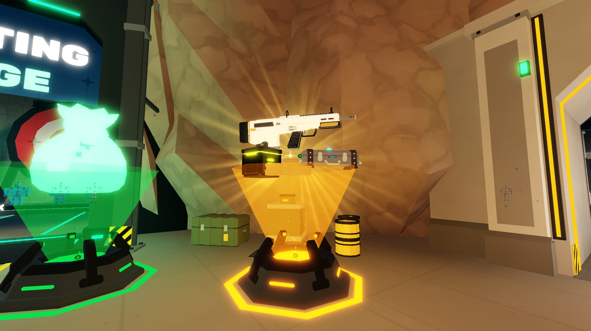
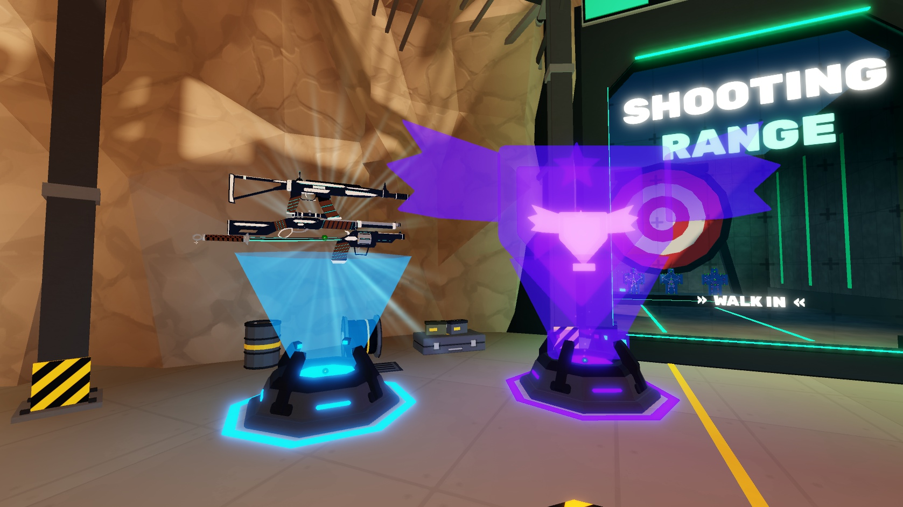
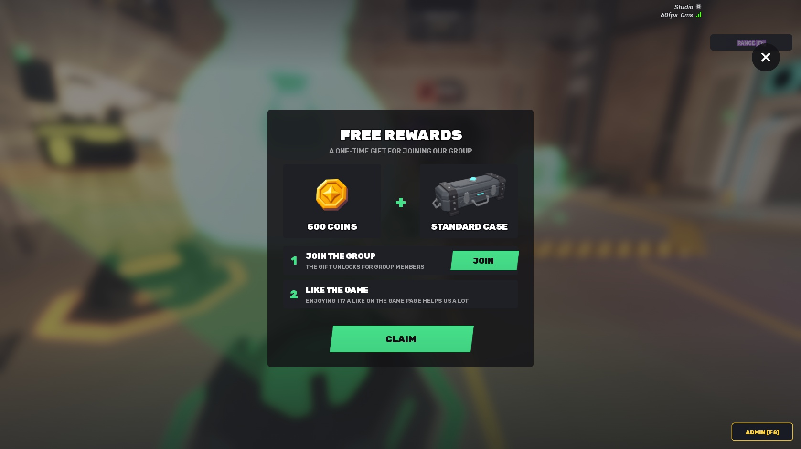

# Lobby Holograms

**Owner approved the look (2026-11-28).**

RIVALS-style hologram stands in the Lobby V5 hub: shop entry points players walk up to (owner 2026-11-28). Four stands, two either side of the Shooting Range gate:

| Side | Stand | Colour | Shows | Prompt opens |
|---|---|---|---|---|
| West (x −) | **Starter** (−24, −1580) | gold | Payload Lancer (Bulldog), Standard Case, Strike Box, coins: solid real-colour copies + light burst | Starter Bundle confirm (`ShopController.openDisplay("Starter")`, 67 R$). Once `StarterBought`: swaps to a Standard Case, "Open Cases" → Shop |
| West | **Free Rewards** (−12.5, −1572.5) | green | Goodie Bag as a two-layer Neon hologram | the new Free Rewards popup |
| East (x +) | **Tempest-Strike** (24, −1580) | blue | Vandal, Marshal, Sheriff, Katana: solid copies + burst | the bundle page (`openDisplay("TempestStrike")`) |
| East | **Battle Pass** (12.5, −1572.5) | purple | Season crest as a two-layer Neon hologram | `Router.open("BattlePass")`, hidden while `SeasonCatalog.screenOn()` is false |

All prompts are off until the Shop unlocks (`Config/Onboarding` UNLOCKS, 2 matches). The Battle Pass stand also fixes the pass's discoverability (its only other entry is the Shop's Home card).

## Look (from RIVALS, our build)
RIVALS reference (read-only, [Rivals Reference](../03%20Research/Rivals%20Reference/00%20Rivals%20Reference.md), `Hub.Important.Center.Hologram*` + `Hub.Extra.Center.SuperStarterBundle`): a small two-step base, an 8-wide Neon floor ring, a 12.5 × 9 Neon cone (transparency 0.25–0.5), the item as a pale Neon core (0.05) + saturated shell (0.5), bundles as solid real-colour items with a gold flare burst (rays, lens flares, sparkles), a Custom ProximityPrompt with a `PageName` attribute.

Ours, after the owner's first look ("less transparent, less subtle, it needs to entice"; "the flashing looks off"):
- **Projector** (Blender, `tools/blender/lobby_v5/build_holo_projector.py`, v02): an 8-sided battered plinth on a foot flange, a lens collar with a recessed lens, four emitter arms that run down the body face onto clamp plates (union before bevel, seated 0.02+), facet light strips. 1,908 tris total, 0 non-manifold on solids, 0 coplanar pairs, no subdivision. Built ×1.35 in Studio (≈6.7 wide).
- **Cone and ring**: Neon in the offer colour (dark hex so Neon doesn't clip white), cone transparency 0.8, ring 0.1. Double-sided cone geometry (inner faces on their own verts).
- **Items**: bundles are clean copies of the real models in their own colours (crate painted by `CrateLook`), with a burst behind them: slow-turning rays, a soft glow, star glints (our own textures, `art-source/lobby/HoloProjector/textures`). Emblems (bag, crest) are a pale Neon core at 0.08 + an accent shell at 0.55, 1.06×.
- **Light and motes**: one PointLight at the lens (brightness 1, range 12, no shadows), one mote emitter (rate 6).
- **Motion** (`Controllers/LobbyHolograms`, `Config.HOLOGRAM`): sway ±24° over 8 s (bundles face the hub), bob 0.22 over 3.4 s, the Free Rewards bag spins 22°/s. 30 Hz `BulkMoveTo`, only within 90 studs and with no menu open. **No flicker** and **no ForceField** (its scrolling shimmer read as flashing).
- Rejected on the way: ForceField + scanline texture items (too faint, "flashing"); one cyan for every stand (owner wanted RIVALS' enticing look, so each offer has its colour). Sunwell "one accent per room" is knowingly relaxed here for the shop stands.

## Free Rewards
A popup (`ServerStorage.LobbyUI.FreeRewards`, built by `tools/studio/BuildFreeRewards.luau` from the StreakSave card): gift tiles (500 coins + Standard Case, `Config/Economy.GROUP_REWARD`), **JOIN THE GROUP** (`GroupService:PromptJoinAsync`, group 11116787), **LIKE THE GAME** as a plain ask, and **CLAIM**.
- The server (`Services/GroupRewardService`) checks membership itself (`IsInGroupAsync`, then a fresh `GetGroupsAsync` for someone who joined mid-session), pays once inside one `PlayerDataService.transact`, and sets `buys.group` (state value `GroupRewardClaimed`). Remotes `GroupRewardClaim` / `GroupRewardEvent`, rate `{0.25, 2}`.
- **Likes are never a condition or rewarded**: LihFolk *Community Building* notes platforms prohibit rewarding ratings, so the reward is for the group only. The owner asked for "say you like the game"; the popup asks, nothing more.
- `buys.group` went in without a `PlayerData.VERSION` bump: release 1 (VERSION 2) wasn't live yet.
- Admin: **FREE GIFT: RESET** (`resetGroupReward`) in the admin panel's login & bundle flags.

## Build and budgets
- Studio: `Workspace.LobbyV5.Holograms` (Studio-owned), rebuilt by `tools/studio/lobby_v5/BuildLobbyHolograms.luau` (re-runnable; paste into execute_luau / the command bar). Each stand is a Model tagged `LobbyHologram` with `Offer`, `Projector`, `Hologram`, optional `HologramAlt`, `KeepOut` (invisible cylinder, keeps players off the base) and `PromptAnchor`. Stands are `ModelStreamingMode = Atomic`.
- **252 instances for all four stands** (Starter 83, Tempest 111, Free Rewards 30, Battle Pass 24). 4 PointLights, 10 emitters.
- Assets (group 11116787): projector FBX 106433727165434; textures (image ids) rays 116935114007248, glow 113177783739708, star 100881118533549. Open Cloud's "Decal" upload returns a **Decal** id: textures need the image id (`InsertService:LoadAsset(decal)` → `Decal.Texture`). Unused uploads: scanlines 90754740342951, cone falloff 90498122249065 (decal ids).
- Checks: no part of a keep-out or ring overlaps lobby geometry; every base sits on the floor (y 0); stands clear the range walkway (x ±8) and the lift deck (z > −1584).

## Verified (Studio Play, 2026-11-28)
- Each prompt opens its screen: Starter confirm, Tempest-Strike bundle page, Battle Pass, Free Rewards.
- Free Rewards CLAIM paid 500 coins + a Standard Case and showed CLAIMED; the test save was restored afterwards (coins 30,393, no Standard Case, gift reset).
- `StarterBought` on → the stand swaps to the case and the prompt reads "Open Cases / Shop"; off → back.
- Holograms move only near the camera; no errors in the output.

## Open
- The RIVALS reference models the owner imported (`Workspace.SuperStarterBundle`, `Workspace.HologramFreeRewards`) are still in the place: **delete them before publishing** (third-party assets).
- Shop confirm: the Starter Bundle's item line runs wider than the card (seen in the test; not from this work).
