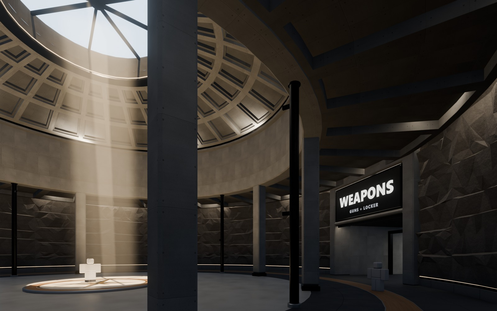
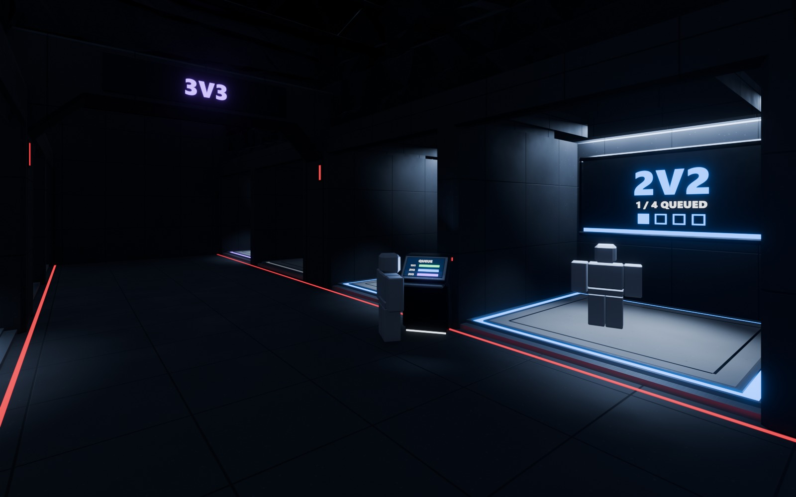

# Lobby Kit

The Blender modular kit for the [Lobby](../01%20Design/Lobby.md) (step 3 of phase 1). Every piece below replaces greybox parts from [`tools/studio/lobby/`](../../tools/studio/lobby/) and follows the [Lobby Art Plan](Lobby%20Art%20Plan.md) (palette, mood, budgets).

**Status (2026-10-30):** phase 1 steps 3-7 built. The kit is modelled, uploaded and assembled in the Lobby place for every area, with lighting, ambience, a review and fix pass and a final check (see **Built lobby** at the end). Waiting for the user's walk-through and approval.

## Conventions (what the importer can rely on)
- **Axes and scale:** same as the guns and Mods: Blender +X forward, +Z up, +Y left, **1 unit = 1 stud**.
- **Origins:**
  - straight pieces: on the floor at the centre of their back face, facing +X (into the room)
  - round pieces: at the circle's centre on the floor, with the piece's segment starting at bearing 0
  - props: on the floor at the centre
- **Grids:**
  - straight kit on a **5-stud** grid (sub-grid 0.5)
  - round kit in **11.25°** segments (32 per circle) at the plan's radii: rotunda R44, ring R68, armoury R42, apse R16. One mesh per radius; segments get placed by script, never by hand.
- **Names:** `Lobby_<Piece>` collections; objects `<Piece>_<Part>`. Neon/emissive parts are separate objects named `*_Glow` (so the game can recolour pad rings per mode and dim dormant bays).
- **Materials:** each Blender material carries `rbx_material` (Roblox base material), `rbx_variant` (MaterialVariant name, if any) and `rbx_color`, like the gun and Mod kits. Big tiling surfaces use **Roblox MaterialVariants** (textures made in step 5), not baked per-mesh textures, so 30+ wall segments share one texture set.
- **Collision:** visual meshes have CanCollide/CanQuery/CanTouch off; collision stays on the greybox-style invisible Box parts per segment (cheap and exact).
- **Budgets:** structural pieces ≤ 400 triangles, props ≤ 1.5K, hero props ≤ 3K. CastShadow off on everything smaller than a wall panel.

## Style sheet
| Material | Colour | Roblox | Finish / detail | Where |
|---|---|---|---|---|
| **Board-formed concrete** | `#8E8C87` | Concrete + variant `Lobby_ConcreteBoard` | Formwork panels **3.2 × 6.4** with 0.1 V-groove seams, tie-hole dots at panel corners, ±3% tone per panel | Rotunda drum, piers, portal frames, wing walls, Range |
| **Polished concrete** | `#B9B4AA` | Concrete + variant `Lobby_ConcretePolished` | Smooth, low roughness, faint aggregate; sun hot-spot inlay `#F2EADB` | Rotunda floor, Range Lobby |
| **Honed dark concrete** | `#3A3B3D` | Concrete + variant `Lobby_ConcreteDark` | Matte, fine aggregate, 5-stud saw-cut joints | Ring floor, Duels floor and walls |
| **Terrazzo** | `#D6C8B0` | Concrete + variant `Lobby_Terrazzo` | Fine light speckle | Market street, Armoury floor |
| **Granite rock** | `#55524E`, Duels `#2E2F33` | Slate + variant `Lobby_Rock` | Blasted, faceted rock; the faceting is in the mesh (low-poly chunks), the texture adds grain | Ring outer wall, Market walls, drops, pillars |
| **Black steel** | `#1C1D20` | Metal | Satin, 0.1 bevels | Mullions, lintels, frames, trusses, skylight rim, sign frames |
| **Brushed steel** | `#A7ABB0` | Metal | Fine directional brushing | Rails, pad rims, plinth trims, terminals |
| **Warm oak** | `#A0703F` | Wood + variant `Lobby_Oak` | Straight grain, slats **1 wide on a 1.5 pitch** | Seating tiers, slide band, shop slats and counters, Market runner |
| **Brass** | `#B8873F` | Metal | Warm satin; the only warm metal | Spawn dais compass, locker pedestal |
| **Glass** | `#A9C9CF` | Glass, Transparency 0.7 | One layer only | Range viewing glass, vitrines, lantern cap |
| **Light (Neon)** | cove `#FFF1DC`, cool `#DDE8F2`, Duels red `#B3262E`, modes | Neon, thin (≤ 0.3) | Never a big Neon surface | Coves, shadow gaps, pad rings, slits |

**Trims (shared sizes):**
- **Plinth:** 1.5 tall, set 0.25 in from the wall face.
- **Shadow gap:** 0.6 tall × 0.5 deep, with a glowing Neon strip inside, wherever finished work meets rock.
- **Portal frames:** 3 thick × 6 deep, with 0.25 chamfers.
- **Edges:** concrete chamfers 0.25; steel bevels 0.1.
- **Sign frames:** a 0.4 black-steel edge around a charcoal `#2A2C30` panel, plus a 0.3 colour edge strip (the mode or zone colour).
- **Mullions:** 0.5 wide.
- **Pad rings:** 1 wide, Neon set in a brushed-steel channel 0.1 below the deck.

## Kit pieces
### Structure (hub)
| Piece | Size (studs) | Replaces | Count | Notes |
|---|---|---|---|---|
| `RotundaPier` | 3 × 3 × 28 | Rotunda piers | 8 | Board-formed, steel base shoe, chamfered |
| `RotundaColumn` | Ø1.2 × 28 | Slim columns | 4 | Black steel, with the leaderboard mounting brackets |
| `RingBeam_R44` | 11.25° × 3 tall | Ring beam | 32 | With a warm cove lip at y 46 |
| `Drum_R44` | 11.25° × 15 tall | Drum | 32 | Formwork grid lines up with the segment |
| `DomeCoffer_R44` | 11.25° wedge, R16–44 | Dome panels | 32 | 3 rows of sunken coffers, darker inner faces |
| `OculusRim_R16` | ring, 6 deep | Oculus shaft | 1 | Knife-edge steel lip, 8 spokes, Neon cove ring |
| `SpawnDais` | Ø24 × 0.5 | Spawn dais | 1 | Brass compass inlay, north arrow to Duels, steel rim |
| `RingCeiling_R44_68` | 11.25° coffer slab | Ring ceiling | 32 | Coffer, with a perimeter slot glowing on the rock |
| `RingFloor_R44_68` | 11.25° wedge | Hub floor, slide band | 32 | Honed dark concrete with the oak slide band at R54–58 |
| `RockWall_R68` | 11.25° × 28 | Rock wall | 3 variants | Faceted rock above a 1.5 plinth with a glowing shadow gap at its foot |
| `AlcoveTiers` | 2 segments | Alcove tiers | 4 | 3 oak tiers on concrete, with a warm glow under each tier |
| `PortalFrame_26` / `_52` | 26.5 / 52 wide × 16 | Lintels, jambs | 3 + 1 | A deep board-formed frame cut into rock, with a title band slot |
| `TitleBand` | 26 / 40 × 10 | Portal titles | 4 | Steel frame for the SurfaceGui title |
| `LeaderboardFrame` | 18 × 13.5 | Leaderboards | 4 | Black steel bezel and hangers |
| `PierPlaque` | 15 × 3 | Plaques | 2 | Steel plaque with an arrow |

### Duels hall
| Piece | Size | Count | Notes |
|---|---|---|---|
| `DuelsArch` | 22 aisle × 16, chamfered shoulders | 5 | Red Neon edge, slot for the mode title |
| `DuelsTruss` | 76 span | about 10 | Black steel open truss |
| `DuelsBayShell` | 12 / 15 / 17 / 18 wide | 18 | Chapel bay: dividers, soffit (14), back wall, sign recess |
| `QueuePad_12/15/17/18` | bay size | 18 | Light deck, brushed channel, `Ring_Glow` (mode colour or dormant grey) |
| `BaySign` | 14 × 7 | 18 | Sign frame with a mode edge strip |
| `QueueTerminal` | 3 × 3 × 5 | 4 | Wall console, angled screen, a glow on your face |
| `GauntletGate` | 34 × 30 | 1 | Hero gate frame, dais rings |

### Market
| Piece | Size | Count | Notes |
|---|---|---|---|
| `RockSlab` | 3 variants, 10–20 tall | about 30 | Leaning faceted slabs that break up the walls |
| `RockPillar` / `RockDrop` | 2 variants each | about 12 / 15 | Faceted; drops stay above 14 |
| `ShopPavilion` | 18 wide × 10 deep × 12 | 8 | Concrete frame, canopy, oak slat back, counter, display stand, warm cove, header sign |
| `FeaturedPodium` | Ø8 | 3 | Turntable under a glass case, neon ring |
| `BattlePassWall` | 40 × 20 | 1 | LED wall bezel, dais, 3 reward plinths |
| `MarketPortal` | 26.5 × 16, 12 deep | 1 | Deep concrete portal |

### Weapons + Locker
| Piece | Size | Count | Notes |
|---|---|---|---|
| `ArmouryPier_R42` | 3 × 2.5 × 30 | 10 | With ribs up to the lantern |
| `GunChapel` | 33.75° bay | 8 | Stage, trophy back wall, cove light, turntable plinth |
| `GunTurntable` | Ø10 / Ø7 | 8 | Brushed rim, white under-glow; guns sit on top at display scale |
| `HeroDais` | Ø26, 2 steps | 1 | Light ring, two pylons for the 8× hero gun |
| `LanternRing_R16` | ring | 1 | Glazed lantern |
| `LockerApse` | R16–18 half round | 1 | Back-lit panel, brass pedestal, 2 terminals |
| `SteelFrame` | 22.5 × 13.5 | 2 | Corridor squeeze frames |

### Range (hub side and the real range)
| Piece | Size | Count | Notes |
|---|---|---|---|
| `RangeFrame` | 24 × 14 | 2 | Steel frame with daylight strips |
| `ViewingWindow` | 44 × 9 | 1 | Glass, mullions, rail |
| `ScaleModel` | 44 × 66 | 1 | The 1:3 mini range as one prop (lanes, boards, silhouettes, berm) |
| `EnterGate` | 12 × 10 | 1 | Glowing frame |
| `LaneDivider`, `DistanceBoard`, `TargetStand`, `Berm` | standard | many | Shared with the real range |

### Shared props
`Bench` (oak on concrete), `Planter` (concrete, low plants; a few only, as it's a bunker), `CoveLight` housing, `TrackLight`, `CableTray`, `FloorGuideStrip`, `Kerb`.

## Preview renders (step 3)
- **Style board** `References/lobby/kit/style-board.jpg`: every material and trim on sample blocks under the lobby lights.
- **Structure** `References/lobby/kit/structure.jpg` + `structure-detail.jpg`: a rotunda bay under the skylight sun (piers, drum, coffers, oculus rim, ring floor with the slide band, rock wall with its shadow gap, the WEAPONS portal frame).
- **Props** `References/lobby/kit/props-duels.jpg`, `props-market.jpg`, `props-weapons.jpg`: a 2V2 bay (pad, ring, sign, terminal, arch), a shop pavilion in the rock, a gun chapel with a turntable.

Sources: `tools/blender/lobbykit.py` (materials, helpers, stage), `build_lobby_styleboard.py`, `build_lobby_preview_structure.py`, `build_lobby_preview_props.py`; `.blend` files in `art-source/lobby/`.

## Pipeline (step 4, proven 2026-10-29)
1. `tools/blender/build_lobby_kit_<group>.py` builds `art-source/lobby/Kit_<Group>.blend` (one `Lobby_<Piece>` collection per piece at the origin) and a contact sheet `References/lobby/kit/contact-<group>.jpg`.
2. `blender --background --factory-startup art-source/lobby/Kit_<Group>.blend --python tools/blender/export_lobby_kit.py -- <Group>` writes `art-source/lobby/Exports/<Group>.fbx` + `.json`.
3. `python tools/opencloud/upload_models.py --lobby --group 11116787 <Group>` (asset ids in `Exports/assets.json`).
4. `python tools/studio/lobby/kit_bundle.py <Group> -o kit.luau`, run in the Lobby place: builds `ServerStorage.LobbyKit.<Piece>` Models whose pivot is the Blender origin. The importer lays Blender (x, y, z) as (-x, z, y), so every part gets a 180 degree turn to land on Roblox = (x, z, -y).
5. `tools/studio/lobby/Art_<Area>.luau` places the pieces with the `ArtKit.luau` helpers (`put`, `segCF`, `ringCF`, `finish`, `hide`, `tint`); `python tools/studio/lobby/bundle.py Art_<Area> -o art.luau`, run in the Lobby place. The greybox stays the collision: replaced parts are hidden, never deleted.

Materials tile on MeshParts at the same stud density as on Parts (tested with the RotundaPier), so the kit's stud UVs need no rescaling.

## Built lobby (steps 4-7, 2026-10-30)

Final screenshots: `References/lobby/final/` (spawn, dome, ring, Duels portal/hall/bays, Market street, Battle Pass, Armoury, Locker, Range Lobby, real range). Per-area work shots are in `References/lobby/art/` and art-director review shots in `References/lobby/review/`.

| Area | Kit group (asset) | Art script | Notes |
|---|---|---|---|
| Hub (rotunda + ring) | Hub (103195583303691) | `Art_Hub.luau` | coffered dome, oculus with sun shaft, bezel leaderboards (ring-side wing signs on the backs), compass dais, ring floor with oak slide band, rock alcoves with oak tiers; 8 invisible jamb colliders in `Art.Ring.JambCollision` |
| Duels | Duels (130727707369173) | `Art_Duels.luau` | dark hall with mode-coloured arches, 16 chapel bays with queue pads (live 1V1/2V2/3V3, dormant 4V4), queue terminals, Gauntlet chamber "coming soon" |
| Market | Market (136918066833549) | `Art_Market_Street.luau`, `Art_Market_Cavern.luau` | winding rock street with oak runner, 6 shops, 3 featured podiums with real guns, Battle Pass cavern with a season key-art LED wall |
| Weapons | Weapons + GunDisplay (81330914960667) | `Art_Weapons.luau` | Armoury with 8 gun chapels and trophy walls (flat museum finish, no SurfaceAppearances), hero Vandal on pylons, Locker apse with a mannequin |
| Range | Range (80078330894956) | `Art_Range.luau` | Range Lobby (scale model, ENTER gate, records lounge) and the real range (booths, lanes, berm, cover yard, movement course) |
| Surfaces | none | `Materials.luau` | 6 `Lobby_*` MaterialVariants from `tools/textures/make_lobby_textures.py` |
| Lighting | none | `Lighting.luau` | ClockTime 12 sun through the oculus, sky, atmosphere, bloom, colour correction, sun shaft (2 beams), bounce and ring cove washes |
| Ambience | none | `art-source/lobby/scripts/` | `AmbienceSetup.luau` builds `Workspace.Lobby.Ambience`; `AmbienceClient.luau` (a Script with RunContext Client) runs turntables, pad ripples, pulses, flicker, LED shimmer and dust; tag-driven and streaming-safe |

**Run order** (all re-runnable): greybox scripts → `kit_bundle.py <Group>` installers → `Materials` → `Art_*` → `Lighting` → `ambience_bundle.py` → `KitFidelity.luau` (sets CollisionFidelity Box through ApplyMesh, which a plain property write can't do from the MCP).

**Backups:** `art-source/lobby/Studio/` (LobbyKit, Lobby_Greybox, Lobby_Art, Lobby_Ambience, Lighting_Effects, MaterialVariants `.rbxm`).

**Final check (2026-10-30):** greybox collision unchanged (13,427 floor rays, 0 holes; no leaks except the oculus and the range roof slots); 30 routes clear; one SpawnLocation; Range hooks in place; 4,648 MeshParts on 793 unique meshes, all Box fidelity; 79 lights (2 cast shadows); 6 particle emitters; SurfaceGuis about 19 MB; one script in the place (AmbienceClient).

**Known issues / for phase 2:**
- `Lighting.Technology` can't be set from a script: set it to **Future** by hand (Lighting → Properties).
- Workspace streaming (not scriptable from the MCP): set **StreamingTargetRadius about 384**, **StreamingMinRadius 64-128** and **StreamOutBehavior Opportunistic**. When the Range teleport is coded, call `RequestStreamAroundAsync` on the arrival point before moving the player.
- Dynamic lights are above the original ~6 per area (Duels 24, Market 20, Weapons 11, Range 9 + 6), all shadowless except 2. Check on a low-end phone.
- Real range: the floor in front of the booths is dark, and the PRACTICE RANGE header hides behind lane signs 4 and 5 from the arrival pad.
- Market: the charm, emote, bundle and currency display items are still blocky placeholders; the Market podium guns keep their SurfaceAppearances (119).
- RangeReturnPoint stays where the greybox put it, so the Range isn't a one-way loop yet (a phase-2 decision).
- Studio's lighting lags a big camera jump by a few seconds; the real Range teleport may show the same brief settle.
- selene is blocked on this PC by Windows Application Control; stylua passes.
