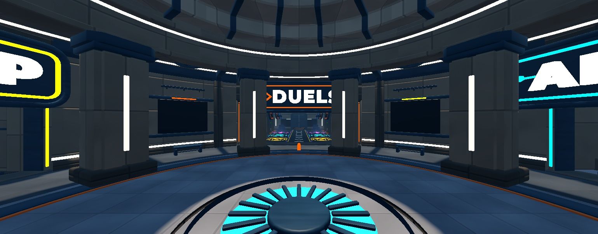
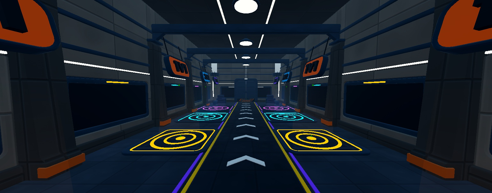
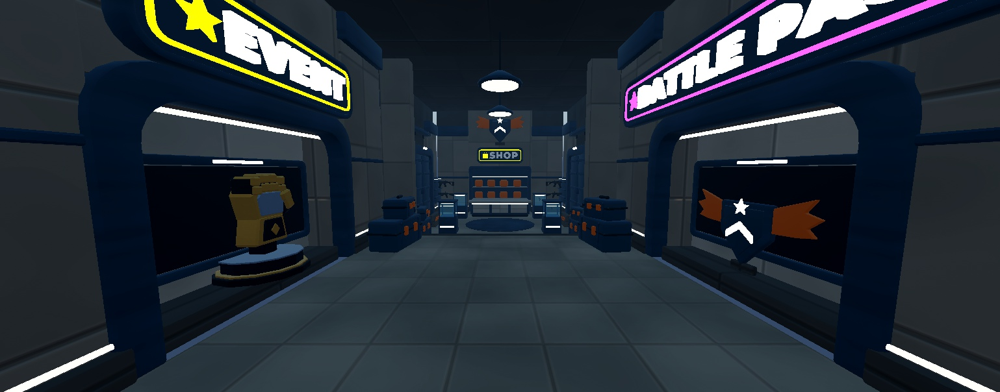
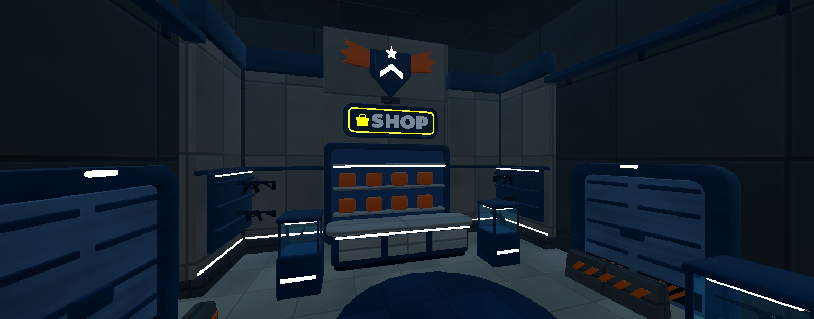
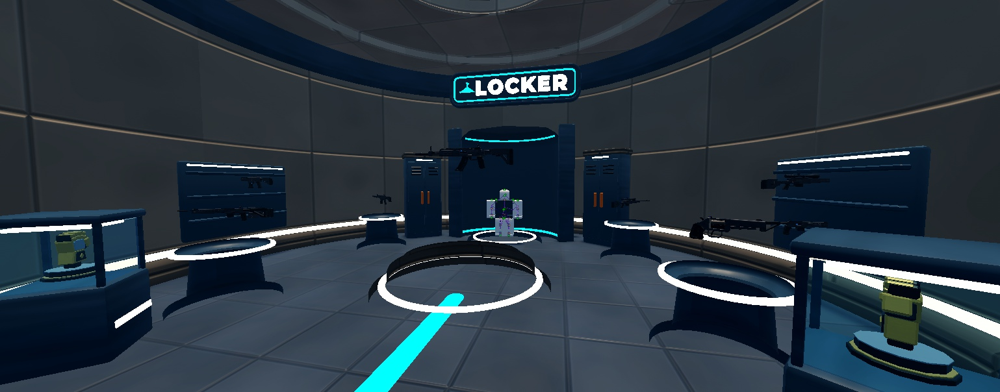
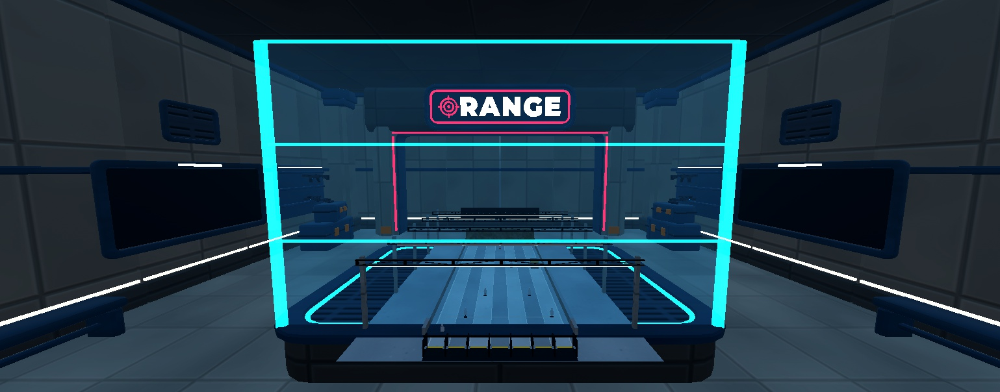
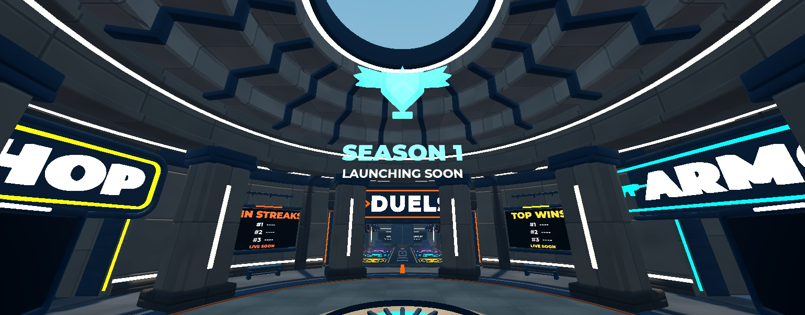

# Lobby Rebuild 2026-11-04 (lane A)

**Status (2026-11-05): built in the Lobby place, self-checked, waiting for the user's approval.** Style for the maps: [Lobby Style Guide](Lobby%20Style%20Guide.md). Range brainstorm: [Range Brainstorm](../01%20Design/Range%20Brainstorm.md).

## What happened tonight
1. A first rebuild went in a **bright pastel, flat-colour, open-roof hall** direction (compact, open Duels arena, 3D letter signs). The user saw it and rejected it: **too bright, no textures, dull, and not the bunker.** It is scrapped. It lives only as an archive in the Lobby place (`ServerStorage.Archive.StylizedHub_Scrapped_20261104`) and as the kit script `tools/blender/build_lobby_kit_stylized.py` (its 3D-letter sign builder and coplanar fixes are reusable).
2. Lessons kept from it: the compact plan with all activities in the first view worked; chunky 3D letters on panels read very well from spawn; spinning pad rings and light columns made the pads readable; a SurfaceGui must sit on its own part just in front of a screen mesh (on the mesh face it disappears).
3. **New direction from the user:** keep the **bunker, the same layout and the same idea** as before, just redone properly. Research first, a detailed plan, then the user approves before anything is built.

## Research findings (short)
Sources: two research passes (web summaries, not every page opened; marked where unverified).
- **RIVALS lobby:** queue pads grouped together, a Duel Zone plus a Play button, a big win-streak leaderboard, a weapons room with showcases, the range at one end ([allthings.how](https://allthings.how/roblox-rivals-jump-pad-all-jump-shard-locations-and-unlock-requirements/), [bloxodes](https://bloxodes.com/articles/rivals-beginner-guide)). Exact sizes and distances weren't verifiable.
- **Hub practice:** spawn facing the main activity, every destination with a landmark and its own light mood, zones marked by floor, light and ceiling height rather than walls; oversized hubs and long travel are the top complaint about Destiny's Tower ([GameRant](https://gamerant.com/destiny-2-tower-quality-of-life-changes-needed/), [Roblox guide-the-player wiki](https://redlib.hbubli.cc/r/RobloxDevelopers/wiki/tutorials/guide-to-guiding-players)). LihFolk: first station < 15 s walk, station to station < 10 s, one hero landmark visible from spawn.
- **Valorant look:** "illustrative" balance of realism and cel animation; environments use **tiling textures and trim sheets**, simple values without heavy contrast, detail kept above head height; a few textures do a lot ([Riot: map art](https://playvalorant.com/en-us/news/dev/the-art-of-valorant-map-environments), [Inverse](https://inverse.com/gaming/valorant-art-style-interview-moby-francke), [80.lv](https://80.lv/articles/vibrant-valorant-environment-made-with-blender-substance-3d-painter-unreal-engine)).
- **Stylized texture practice (Overwatch / Valorant-like):** paint the shape into the albedo (lighter bevel edges, darker corners, a soft vertical gradient, a few big stains), keep micro-noise low, let **lighting** carry the contrast ([80.lv Overwatch](https://80.lv/articles/overwatch-technical-overview/?amp=1), [Polycount](https://polycount.com/discussion/comment/2804875)).
- **Roblox:** MaterialVariant (colour + normal + roughness, StudsPerTile) for tiling surfaces; SurfaceAppearance follows mesh UVs and suits trim sheets and hero props; keep maps at 1024 or less (the docs disagree on the hard limit) ([texture specs](https://create.roblox.com/docs/art/modeling/texture-specifications.md), [DevForum](https://devforum.roblox.com/t/upload-custom-materials-in-the-new-material-service-beta/1583158/460)).
- **Bunkers that don't feel dull:** dim cool base plus **warm light pools** at doors, desks and pads; emissive signage; hot/cool rim light; motion (fans, screens, lifts, steam, dust) ([80.lv light and dark](https://80.lv/articles/sci-fi-environment-building-light-and-dark/)).

## User clarifications on approval (2026-11-04)
- The aim was always a **simpler, lower-poly version of the same bunker layout, made more compact**: shorter wings, **fewer things** overall.
- **Not cartoony.** A professional game look with a **tactical feel, but not fully tactical**: clean, grounded, well made.
- **Smooth rounded corners, done properly.** Criticism of the scrapped kit: corners were "one rounded box with a slightly shorter rounded box stacked on it". Every piece needs a designed profile (see Modelling standard).
- Fun, simple, made really well; good research on lobbies; looks better **and performs better**.

## The plan: "Sunwell Bunker, redone"
Same concept: an underground bunker hub, a round **spawn rotunda under a skylight sunbeam**, an outer ring you can slide around, **four wings in the same directions** (Duels north, Market west, Weapons + Locker east, Range south). What changes is **size, look and the four wing interiors**, following the user's earlier notes (too big, separated queue bays, long Market, complicated Range entry, tactical stencil signs, few effects).

### Look (stylized, textured, grounded)
| | Before (tactical) | Scrapped (pastel) | Plan |
|---|---|---|---|
| Shapes | realistic, sharp, detailed | blobby, toy, stacked rounded boxes | **lower poly, professional:** designed profiles with a bevel hierarchy, recessed seams and inset panels, rounded frames and portals, no greebles (see Modelling standard) |
| Surfaces | realistic concrete/oak textures | flat colour | **stylized textures:** painted, low-frequency, light bevel edges, darker corners, soft vertical gradients |
| Palette | grey / black, dark | white + candy | **mid-value and rich:** warm concrete, teal-slate steel, rust-ochre trims, one accent per wing |
| Light | moody, dark wings | flat daylight | **cool base + warm light pools**, the sunbeam over spawn, coloured rim light per wing |
| Signs | stencils on flat panels | candy 3D letters | **3D letters in a bold condensed face** (not a cartoon font) in beveled sign boxes with a lit edge: an industrial sign, clean and confident |
| Motion | little | spinning props | fans, screens, pad rings, light columns, steam, dust, rare glitch flickers |

**Palette (starting values, tuned under Roblox lighting at the style board):**
| Use | Hex |
|---|---|
| Concrete walls (warm) | `#9A8F82` |
| Lower panels, frames, steel (teal-slate) | `#2F4250` / `#2B3A45` |
| Trims, rails, hazard bands (rust-ochre) | `#B8672E` |
| Floors (sand concrete, large tiles) / ring floor | `#8C7F6B` / `#34404A` |
| Rock (warm and cool colour bands, big flat facets) | `#5E5751` |
| Warm lamp / cool fill / sunbeam | `#FFB45A` / `#9CC8FF` / `#FFE2B8` |
| Wing accents | Duels `#FF5A36`, Market `#F2B33D`, Armoury `#3DD9F2`, Range `#FF4757` |
| Glitch accent (under 5% of any view) | magenta `#FF3DCB` |

**Textures:** 6–8 tiling sets at 1024 or less (stylized concrete, painted steel, rock, floor tile, oak, grating, painted trim), made by script like the current lobby textures (`tools/textures/make_lobby_textures.py`, re-tuned to large painted shapes instead of photo noise) and installed as **MaterialVariants**; hero kit pieces (portals, sign boxes, pads, counters) get a shared **trim sheet** baked in Blender with a SurfaceAppearance, the way the guns are textured. Roblox `Color` tints the variants per wing, so one texture set covers every area.

### Layout (compact: the same shape, about a third of the size)
Roblox studs, floor y = 0, spawn at the centre facing north (−Z). Walk 16 studs/s.
| Area | Now | Plan |
|---|---|---|
| Spawn rotunda | R44 (88 across), dome rim 54 | **R30** (60 across), drum 26, dome rim 38, skylight R11 with the sunbeam on the spawn dais (R9) |
| Outer ring | R44–68, 24 wide, 4 rock alcoves | **R30–44**, 14 wide, ceiling 20; rock outer wall with a warm light gap; 2 small seating nooks; slide lap ≈ 230 studs |
| **Duels** (north) | 230-long dark hall, 16 separate bays, Gauntlet chamber | **one open arena** through a 40-wide portal: x −40…40, z −44…−108, ceiling 26. Pads together on one floor: **1V1 ×3** in a centre ring, **2V2 ×2** west, **3V3 ×2** east, mode-coloured rings and light columns; spectator steps and a big queue board on the back wall; a shuttered "COMING SOON" door for 4V4 / Gauntlet. Mood: darker and cooler than the hub, warm pools on each pad cluster |
| **Market** (west) | 280-long winding rock street, 6 shops, cavern | **one short hall** x −44…−84, z −22…22, ceiling 24, through a 28-wide portal: a **Shop counter** (left) and the **Battle Pass wall** (back), one featured turntable in the middle. Warm gold light |
| **Weapons + Locker** (east) | round armoury R42, 8 chapels, hero gun, Locker apse | **round room R22** at x 66: hero gun on a centre plinth, 4 gun turntables, the **Locker** apse at the back (mannequin preview). Cool cyan-white gallery light |
| **Range** (south) | ramp down, viewing gallery, scale model, two gates | **a 14-deep vestibule** behind the south portal ending in one glowing **ENTER RANGE** door (a shimmering portal surface). The real range (RangeFar) is unchanged |
| Footprint | about 550 × 600 | about **176 × 176** |

| From spawn to | Distance | Walk |
|---|---|---|
| any wing portal | ≈ 30 | 2 s |
| nearest queue pad / farthest pad | ≈ 55 / 85 | 3.5 / 5.5 s |
| Shop counter, Battle Pass wall | ≈ 70 | 4.5 s |
| Locker | ≈ 80 | 5 s |
| ENTER RANGE door | ≈ 45 | 3 s |

**First view from spawn:** the DUELS sign over the open arena portal, the pads and their light columns behind it, two leaderboards on the rotunda piers left and right. Turning: SHOP / BATTLE PASS west, WEAPONS / LOCKER east, RANGE south, each portal with its own sign box and accent light.

### Effects and motion (client-only, tag-driven, asleep when far)
Sunbeam (Beams + bright floor hot spot) with dust over spawn; ceiling fans in the ring vents; spinning pad rings, light columns and sparkles per mode; leaderboards, queue board and Battle Pass wall with moving content; hero gun and Locker turntables; steam puffs from arena floor vents; neon signs with a soft pulse and a rare magenta glitch flicker; a shimmering Range door; one slow moving landmark per wing (for example a cargo lift in the Market, a rotating gun rack in the Armoury).

### Quality rules
- **No z-fighting or visible overlaps:** the Blender coplanar audit on every kit (it now also catches overlapping triangles inside a mesh), plus a new Studio audit (`tools/studio/lobby/AuditOverlaps.luau`) over all visible parts: zero same-direction coplanar overlaps, no visible interpenetrations. Joins are hidden inside a covering piece, never on a shared face.
- Collision from simple invisible parts; decor never collides. Tags per the World → UI contract: `LobbySpawn`, `LobbyQueue` (+ `Mode`), `LobbyShop`, `LobbyBattlePass`, `LobbyLocker`, `LobbyRangeEntrance`. `RangeReturnPoint` in front of the Range door.
- Budget: about 20 local lights (2 shadowed), textures at 1024 or less, phone check.

### Phases and approval gates
1. **This plan:** the user approves or edits it.
2. **Style board (gate):** one rotunda bay, a Duels pad with its sign, the Market counter and a sign box, rendered in Blender **and** placed in Studio under the real lighting, with two sign-font options. The user approves the look before the full build.
3. **Blockout** of the compact layout in Studio (plain parts, built beside the current lobby so nothing is demolished until it passes): walk it, screenshot every area from spawn, mid and close, and **write a critique against the reference set** below in this note (what reads, what doesn't, what changes). Only then demolish and build.
   - Reference set: the user's RIVALS lobby screenshots (`01 Design/RivalsMapConcepts/`), the current bunker's final shots (`02 Art/References/lobby/final/`, what to keep from the concept), the scrapped attempt's lessons (above), and the Valorant / Overwatch texture references in the research list.
   - Checks: every wing sign readable from spawn within one camera turn; walk times in the table above; one clear focal point per view; pads readable as one group; no dead floor between areas.
4. **Kit + textures**, import, assemble area by area, screenshot and iterate.
5. **Lighting and effects pass**, audits (zero overlaps), save the place, `.rbxm` backups, notes and the test checklist.

## RIVALS reference study (2026-11-04, after approval)
Sources: the user's RIVALS lobby screenshots (`01 Design/RivalsMapConcepts/`) and frames from a RIVALS lobby walkthrough video (YouTube "All secret room in Roblox Rivals lobby").
- **Duels is a long open hall, not bays:** a central walkway with white chevrons and yellow / purple edge lines, pads set flush into the floor on **both sides** (concentric-ring graphic, coloured outline), a big framed count screen ("0/1") on the wall behind each pad, slanted "1v1" tabs hanging overhead. Nothing separates the pads, so the whole hall reads as one space.
- **Structure, not low poly:** chunky angled buttresses and frames, recessed panels, ribbed ceilings with light strips, framed doorways. Main surfaces carry a soft texture (stone, panel), many parts are just clean smooth plastic.
- **Signs:** neon-outline graphics with an icon (WEAPONS with a rifle outline, SHOOTING RANGE with a target, DUELS between two curved arrows). Bold, readable, a little playful.
- **Spawn:** a round grate platform with a glow, big leaderboards and a season banner around it, wings left and right.
- **Range interior:** bright light-grey panelled room, red / white target graphic on the floor, cove-lit ceiling.
- Light: dark-to-mid base with strong coloured accents (purple, yellow, cyan, orange) and warm practical lights.

**Change to the plan from this (user, 2026-11-04):** Duels stays a **longer hallway, but open and connected** like RIVALS (not the square arena). Not too low poly: structure and texture where it helps, clean smooth plastic elsewhere; a little more rounded and fun, professional.

## Blockout (phase 3) and critique
Built beside the lobby at x + 700 (`Workspace.LobbyBlockoutV2`, `tools/studio/lobby/Blockout_V2.luau`): rotunda R30 with 8 piers, drum and stepped dome to a R11 skylight; ring R30–44 (ceiling 22) with portals N 40 wide, W / E / S 28 wide; **Duels hall 44 × 92 × 28** (walkway 10 wide with chevrons, pads both sides: 1V1 12 × 12 at z −54 and −68, 2V2 14 × 14 at −84, 3V3 16 × 16 at −102, count screens behind, buttress + truss every 19, a 4V4 / Gauntlet "soon" wall at the end); Market hall 40 × 44; Armoury R22; Range vestibule 28 × 16 with the door. Footprint about 180 × 200 (was about 550 × 600).

Critique against the references:
- **Works:** from spawn the DUELS sign sits dead centre in the north portal and the whole hall (pads, screens, end wall) reads through it, like the RIVALS spawn → Duels view. Every pad is visible from the hall entrance. Walk: spawn → nearest pad ≈ 54 (3.4 s), farthest ≈ 105 (6.5 s); Shop / Armoury / Range ≈ 45–70.
- **Weak:** the piers (4 wide) look thin and the colonnade reads as a fence, so they need to be chunkier, with framed portals on the four axes. Market and Armoury are 90° to the side (as in the old design and in RIVALS), so floor guide lines from the dais to each portal, plus portal signs lit in the wing colour, must do the wayfinding. The ring is plain, so it needs rhythm (ribs, light slots, vents with fans). The hall needs the RIVALS details: pad screens, hanging tabs, edge lines, warm pendant lights.
- **Decision:** keep this layout for the build, with chunkier piers (6 × 6), framed axis portals and guide lines.

## User feedback on the blockout (2026-11-04, before bed)
Overall structure approved. Changes:
- **More depth and levels:** go down a few steps into Duels, up a bit into another wing; vary heights and spacing so it isn't one flat plane.
- **Market goes deeper, RIVALS-style:** step down; on the **left an inset niche showing the current Event**, on the **right an inset niche for the Battle Pass**; then down again into a **small entrance hall that splits four ways**, with a **seasonal centrepiece on the wall** (RIVALS uses a gargoyle; ours is an original piece that changes per season) and **decorative industrial bunker doors** (not functional, just cool).
- **Range:** a **larger box room** with the **scale model of the range inside a blue sci-fi wire / hologram cage**; walking further in teleports you to the range.
- **Locker:** needs to look better and more professional.
- The user is asleep: build it, run the checks, send screenshots to the main chat for a comparison pass; the user gives final approval on waking.

### Levels and layout v3 (supersedes the blockout numbers where they differ)
| Area | Floor | Shape |
|---|---|---|
| Rotunda, ring | 0 (spawn dais +1) | R30 rotunda, R30–44 ring |
| Duels hall | **−3** (three wide steps inside the portal, z −44…−50) | 44 × 90, z −50…−140, ceiling at 25 (28 above the floor) |
| Market, niche hall | **−2** (steps x −44…−48) | x −48…−72, 28 wide; Event niche south, Battle Pass niche north |
| Market, shop cross | **−5** (steps x −72…−76) | x −76…−104 cross hall: Shop counter west, industrial doors north and south, seasonal centrepiece on the back wall |
| Armoury + Locker | **+2** (steps up inside the portal) | R22 room at x 66; Locker bay at the back |
| Range room | 0 | 48 × 40 (x −24…24, z 46…86); caged scale model in the middle, teleport threshold at the back |

## Questions for the user (answered 2026-11-04: compact yes, Duels a long open hall, rest as recommended)
1. **Size:** compact as above (recommended), or keep the original sizes?
2. **Duels:** one open arena with all pads together (recommended, from your earlier feedback), or the original long hall of bays?
3. **Weapons wing:** keep a small round armoury with the Locker (recommended), or fold the Locker into the Market and drop the armoury?
4. Anything from the old build you particularly liked and want kept as it was (for example the coffered dome, the oak, the rock)?

## Build result (2026-11-05)

More in `References/lobby/rebuild-20261104/` (spawn looking west and south, the rotunda hologram, the Armoury exit).

### Layout as built (Roblox studs, hub centre 0,0,0, spawn faces north)
| Area | Floor | Built |
|---|---|---|
| Rotunda | 0 (dais +1.2) | R30, 8 notched piers with warm light slots, drum with cornice and cove light, coffered dome with 16 ribs, oculus R11 with the sun on the spawn dais (round grate with a blue under-glow) |
| Ring | 0 | R30–44, ceiling 22 with a lit coffer band, 4 vent fans, 8 pilaster + rib frames, light gap at the wall foot, 2 leaderboards (NE / NW) seen through the colonnade, guide strips in each wing colour |
| Portals | 0 | N 40 wide (DUELS), W / E / S 28 wide (SHOP, ARMOURY, RANGE): chamfered jambs, reveal, accent edge light, neon-outline sign box on the header, threshold plate |
| Duels hall | −3 (3 steps) | 44 × 94, z −46…−141: walkway with chevrons and yellow / purple lines, pads on both sides (1V1 12² ×4, 2V2 14² ×2, 3V3 16² ×2) with glowing ring inlays and light columns, a count screen in the wall bay behind each pad, hanging mode tabs, buttresses, trusses with pendants, a blast door with "4V4 / Gauntlet coming soon" screens at the end, steam vents |
| Market | −2, then −5 | Niche hall (x −46…−80): **Event niche on the left** (trophy + screen), **Battle Pass niche on the right** (season badge + screen), each with its sign. Steps down to the **shop cross** (x −86…−119): shop counter + shelf backdrop, SHOP sign, the **season crest** above, **industrial blast doors** north and south (decorative), a medallion floor |
| Armoury + Locker | +2 (2 steps up) | Round room R22 at x 73 with a ceiling light disc: hero rifle on a stepped plinth, 4 game guns on pedestals, and the **Locker bay**: lit backdrop with a neon outline, an R15 avatar on a turntable, 2 locker cabinets, LOCKER sign |
| Range room | 0 | 50 × 41, z 46…87: the **scale model of the range in a blue holo-wire cage** on a plinth, and the **RANGE gate** at the back (portal frame + shimmering surface): walk past the model into it |

Walk test (play mode, Humanoid:MoveTo): spawn → 1V1 pad 3.8 s, → 3V3 pad 4.2 s more, ring → shop counter 4.6 s; every leg reached. Footprint about 176 × 230 (was about 550 × 600).

### What changed and how it's built
- New kit **Bunker2** (54 pieces, 189 parts, 91k triangles, asset 99236623542589): `tools/blender/build_lobby_kit_bunker2.py` → `art-source/lobby/Kit_Bunker2.blend` → `export_lobby_kit.py -- Bunker2` → `upload_models.py --lobby Bunker2`, installed in `ServerStorage.LobbyKit` (KitGroup "Bunker2").
- Textures: 4 stylized MaterialVariants (`Bunker_Concrete`, `_Floor`, `_Metal`, `_Grate`) from `tools/textures/make_lobby_textures_v2.py`, set by `tools/studio/lobby/Materials_V2.luau`.
- Build: `tools/studio/lobby/Build_Bunker2.luau` (re-runnable; clears the old hub, keeps `RangeFar`), lighting `Lighting_Bunker2.luau`, motion `art-source/lobby/scripts/AmbienceClient_V2.luau` (installed as `Workspace.Lobby.Ambience.AmbienceClient`; master copy in `ServerStorage.LobbyTools`). Run order: Materials_V2 → kit install → Lighting_Bunker2 → Build_Bunker2.
- Tags (World → UI contract): `LobbySpawn` 1, `LobbyQueue` 8 (attributes `Mode` 1v1 / 2v2 / 3v3 and `PadId`), `LobbyShop` 1, `LobbyBattlePass` 1, `LobbyLocker` 1, `LobbyRangeEntrance` 1 (trigger box in the Range gate). `Workspace.Lobby.Hub.Markers.RangeReturnPoint` at (0, 0.5, 52) facing the hub; `Greybox.RangeFar.RangeArrivalPoint` unchanged. Tags were stripped from the archives in ServerStorage, so server-side `GetTagged` only sees the live hub.
- Budget: 858 MeshParts on 330 unique meshes, 253 Parts, 25 PointLights (none shadowed), 13 particle emitters, 8 beams, 14 SurfaceGuis. Visual meshes never collide; collision is invisible boxes.

### Checks
- **Kit:** Blender coplanar audit **0 findings** (19 fixed: a self-crossing dome-rib outline, shared back planes, bevel overlaps on near-sharp corners, self-crossing icons and pilaster outlines, overlapping glyphs).
- **Build:** `AuditOverlaps.luau` started at 200 candidates. Every real one was fixed (stair landings level with floors, threshold plates level with landings, a sign inside the shelves, the niche band under the niche ceiling, plinth tops level at corners, doubled wall faces). The 73 left are box approximations checked by hand as hidden: lathe-skin and hollow-ring bounding boxes, wall-module corners buried in full-size piers and ceiling slabs, slab sides below floors.
- Routes: floor rays every half stud along every route, no holes; chest-height blockers only where a straight test line passes through a pier or plinth.
- Play test: spawn on the dais facing north, all routes walkable, Output clean (only the known 203785492 plugin warning).

### Open questions for the user
1. Look: is this the right balance (structured, textured walls, clean trims, readable, not dark)? Brighter or darker, warmer or cooler?
2. Duels: 4 bays with 8 pads (1V1 ×4, 2V2 ×2, 3V3 ×2). More pads per mode, or 4V4 bays now?
3. Locker: lane B can swap the default avatar for the player's own (HumanoidDescription). OK?
4. Seasonal centrepiece: the shop crest is the swap slot (`SeasonCentrepiece`, attribute `Season`). Our own statue next season?
5. Range: the gate teleports to the existing real range (RangeFar). Pick a brainstorm option for its rebuild.

### Not done / known limits
- **`.rbxm` backups weren't written:** the Studio MCP blocks HTTP to localhost (the old `receive_server.py` route). The build is fully reproducible from the committed scripts and the uploaded kit; the pre-rebuild Lobby and the scrapped pastel hub are archived in `ServerStorage.Archive`. To export by hand: right-click `Workspace.Lobby` → Save to File → `art-source/lobby/Studio/Lobby_Bunker2_20261105.rbxm`.
- **The place may not be saved yet** (lane B was in a playtest at the end): save it with File → Save to Roblox (not Publish).
- StyLua and selene are blocked on this PC by Windows Application Control, so the Luau files are hand-formatted to the house style.
- The light shafts were removed (they read as grey sheets); the sunbeam is the real sun through the oculus, plus dust.

## Pass 2: mood, density and scoring (2026-11-05)
Triggered by the core chat's side-by-side comparison with the user's RIVALS screenshots. Their verdict: the layout reads, and the gap is mood and density (flat even light, small dim signs, no spawn centrepiece, empty rooms, an unfinished Locker, unreadable screens). The work then followed the vault rule (`gauntlet-vault` skill): LihFolk lookups, the `lihfolk-worldbuilding`, `roblox-blender-modeling` and `roblox-asset-import` skills, and scoring with `lihfolk:quality-score`.

**LihFolk notes used:**
- *Case Study - Rivals*: the lobby is the matchmaker, pads instant and visible, spectating is free content.
- *Lobby and Hub Design*: busy edges with clear paths, the spend station on the way out, pad space of about 4 studs per player.
- *Level Design Principles - Flow Sightlines and Landmarks* and *Teaching Through Level Design*: light the objective, not the scenery; one landmark per district; one beam per objective.
- *Colour Scripts and Value Structure for Untextured Art*: floors mid-dark, walls one band away, interactables lightest.
- *Stylized Lighting Recipes*: bloom threshold 1.2-2.
- *Light Sources and Shadows*: about 8-12 visible local lights on phones; tag and disable, don't delete.
- *Bevels Chamfers and Edge Highlights Without Textures*, *Shape Language and Silhouette Testing*: the kit gate and render review.
- *Juice on a Budget - Mobile and Low-End*: decor effects asleep when far.
- Skills: the modelling gate (A1-A18) and the V1-V9 render review on representative kit pieces. The pier scored about 17/18. The portal was borderline at 14/18 and was made chunkier with buttress-style framing.

**What changed:**
- **Kit pass 2** (63 pieces, 81k triangles, still 0 coplanar findings): hard cases, wall vents, cable trays, weapon racks, lit glass cases, benches, hazard barriers and a curved **Locker alcove**. The sign letters were rebuilt without curve bevels (they self-intersected), and the n-gons were fixed.
- **Light and value:**
  - Darker base: Ambient 58,62,74, exposure −0.1, haze 2.0, bloom threshold 1.3. Concrete is one value band darker.
  - Every wing's accent colour is now a light at its portal, and the pads light their bays.
  - Key lights on the shop counter, the hero rifle, the range model and the locker avatar.
  - The sun drops straight onto the spawn dais (latitude 24, noon).
  - Lights are culled on the client beyond 120 studs.
- **Signs:** the portal signs are 1.8× and hang into the doorway, with **glowing Neon letters** on every sign.
- **Spawn centrepiece:** a hologram emblem plus a two-sided "SEASON 1 · LAUNCHING SOON" banner high over the dais (above the sightline to Duels), holo sparkles, and two board stands behind the dais.
- **Set dressing:**
  - Ring: benches, case stacks, vents and cable runs.
  - Duels: cases, benches and a barrier at the sealed door, plus ceiling light strips.
  - Market: case stacks framing the shop steps.
  - Shop: four lit glass cases with game guns, racks and barriers in front of the decorative doors (now smaller and steel-painted), and a lighter floor.
  - Armoury: racks, glass cases, an exit screen and a guide strip.
  - Range: wall screens, racks and cases.
- **Scale:** display rifles about 4 studs, pistols 2.2-2.4, hero rifle 6.5 (it had been 14 and covered the LOCKER sign).
- **Screens:** bigger type, more glow and outlines. Each is readable from 15-20 studs.

**Before / after (same angles):**
| Area | Before (pass 1) | After (pass 2 + 3 fix rounds) |
|---|---|---|
| Spawn | evenly lit grey-beige, cyan disc only, small plaques | dark-to-mid, hologram emblem + SEASON banner, big neon signs, boards on stands |
| Duels | clean but bare walls and ceiling | ceiling strips, dressing at the end, (light pools not visible in captures) |
| Market | sparse, one counter in an empty room | lit glass cases, racks, barriers, smaller steel doors, case stacks framing the steps |
| Armoury | oversized guns, hero rifle over the sign, flat backdrop | believable display scale, curved lit Locker alcove, exit cue |
| Range | cage only | wall screens, racks, calmer cage glow |

**Quality score** (LihFolk world rubric W1-W6; 3 blind reviewers per round with different lenses; median per criterion):
| Area | First | Final | Rounds | Result |
|---|---|---|---|---|
| Spawn rotunda | 8.75 | **9.17** | 2 | pass |
| Duels hall | 8.75 | **8.75** | 2 | pass |
| Armoury + Locker | 5.83 | **9.17** | 2 | pass |
| Market | 8.75 | **8.33** | 3 | below bar: draft |
| Range room | 8.33 | **8.33** | 3 | below bar: draft |
Hard gates pass for every area. Overlap audit clean; every route walked in play mode (spawn → pads, Battle Pass niche, shop counter, Range gate, Locker); spawn safe; Output clean; decor non-colliding; budget: about 1,540 parts, 31 lights (none shadowed). Results are logged in `.lihfolk/ledger.jsonl`.

**Blocking criterion for Market and Range:** W4 lighting (1 of 2: "tuned, not striking"; reviewers asked for warm and coloured light pools). Fix round 3 strengthened exactly those lights, but **local lights don't render in Studio MCP screen captures at all**: a brightness-10, range-40 red test light left no trace. So none of the pools were visible to the reviewers, and the same bias pulls Duels' W4 down. Needed: the user checks in play mode with `Lighting.Technology = Future` (set by hand; scripts can't) and a mid or high graphics quality. If the pools show, these two areas very likely clear the bar. If they don't, the next fix is emissive (Neon floor and edge glows), which does show in captures.

**Reviewer spread:** Market's individual scores ran 6.3-8.75, so it was re-checked against the evidence. The low score came from "blank navy cabinets" (the decorative blast doors), which were then shrunk and repainted.

## What the user should test tomorrow
- [ ] Spawn: the first view (DUELS through the north portal, leaderboards left and right, sun on the dais). Turn around: RANGE, then SHOP and ARMOURY at the sides.
- [ ] Walk the ring once and slide; check nothing snags at the piers, portals or thresholds.
- [ ] Duels hall: go down the steps, stand on each pad, read the screens and hanging tabs. Does it feel like RIVALS (open, connected)?
- [ ] Market: Event niche on the left, Battle Pass niche on the right, steps down to the shop cross with the crest and blast doors.
- [ ] Armoury: steps up, hero rifle and display guns spinning, the Locker bay with the avatar.
- [ ] Range room: walk past the caged scale model into the RANGE gate (the teleport is lane B's code).
- [ ] Look for any flicker (z-fighting), gaps showing the sky, or floating pieces; note where.
- [ ] Phone / low graphics: frame rate in the Duels hall and at spawn.
- [ ] **Lighting check (blocks two scores):** Lighting → Properties → set `Technology` to **Future**, then play at a mid or high graphics quality. Do you see coloured light pools at each portal, on the pads, the shop counter and the range model? (They don't show in Studio MCP screenshots.)
- [ ] Spawn hologram and SEASON banner, the big neon portal signs, and the boards behind the dais.
- [ ] Set dressing density: busy enough, or cluttered anywhere?
- [ ] Approve the style (or not) before it's used for the match maps: [Lobby Style Guide](Lobby%20Style%20Guide.md).

## Notes for the other lanes
- Tags, attributes and the RangeReturnPoint are listed under "What changed" above; code against tags, not paths.
- Pads are flush with the hall floor (y −3); each `QueueZone` is a 5-tall non-colliding box over its pad (CanTouch + CanQuery).
- Screens are SurfaceGuis on `ScreenSurface` parts (pad screens show "0 / N"); lane B can drive the counts from the `ScreenSurface` inside `PadScreen_<PadId>`.
