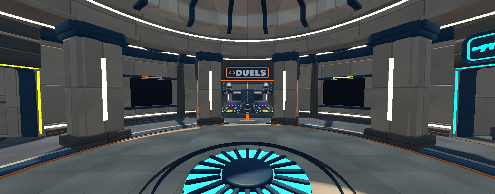

# Lobby Style Guide: "Sunwell Bunker" look (2026-11-05)

The visual language the Lobby was rebuilt in, written so the **match maps** can be rebuilt in the same style later (user, 2026-11-04: "use that theme ... when it recreates the maps"). Status: built in the Lobby, **waiting for the user's approval** on waking; don't start on the maps until they approve it. Lobby result and screenshots: [Lobby Rebuild 2026-11-04](Lobby%20Rebuild%202026-11-04.md).

## In one line
Grounded, professional, **tactical but not fully tactical**: clean structured architecture with soft rounded bevels and designed profiles, painted low-frequency textures on big surfaces and clean smooth plastic on trims, a mid-value palette with teal-slate structure and one bright accent per area, and lighting that does the contrast. A little rounded and fun, never toy-like or candy-bright.

## Shapes and modelling (the part that makes it look professional)
- **Every piece has a designed profile**, never "a rounded box with a smaller rounded box stacked on it". Use notched or stepped cross-sections (piers with notched corners and a recessed light slot), **stepped plinths, collars and caps with a different shape at each tier** (square plinth → notched shaft → collar → octagonal cap), cornices and string courses on lathed walls, and **picture-frame rings with rounded inner corners** for every opening, screen and sign.
- **Bevel hierarchy:** primary (architecture) 0.3–0.8 with 2–3 segments, secondary (frames, trims) 0.1–0.15, tertiary (strips, letters) 0.03–0.05. Rounded *openings* and frames, chamfered *structure*.
- **Depth through layering:** inset screens and recesses (0.3–0.5 deep), proud ribs, kick plates, light gaps at the foot of walls, reveals inside doorways. Something should always step in or out.
- Lower poly but not toy: 200–3,000 triangles a piece, round things lathed at 64 segments, no greebles.
- Built by script in Blender (`tools/blender/build_lobby_kit_bunker2.py`, helpers `ring_prism`, `frame`, `u_frame`, `lath`, `chamfer_path`, `text_mesh`). Front faces Blender −Y, origin bottom centre, 1 unit = 1 stud.

## Surfaces
| Use | Material | Variant | Colour |
|---|---|---|---|
| Walls, piers, panels | Concrete | `Bunker_Concrete` (8-stud cast panels, calm tone, light seam edge) | `#A39787` warm concrete, `#C9BEAE` light (dome), `#625C55` dark (plinths) |
| Floors | Slate | `Bunker_Floor` (4-stud tiles) | `#8C8070` sand, `#4E5257` ring, `#454B52` hall |
| Structure, frames, ribs, trusses | Metal | `Bunker_Metal` (soft brushed strokes) | `#34495A` teal-slate |
| Plain trims, rims, sign plates | SmoothPlastic | none | `#2F4250` slate, `#1E2329` dark |
| Hazard and kick bands | SmoothPlastic | none | `#B8672E` rust-ochre |
| Pads, vents | DiamondPlate | `Bunker_Grate` | `#3A434C` |
| Accents (thin strips only) | Neon | none | per area, see below |

- Variant colour maps are near-neutral greys, so `BasePart.Color` sets the hue and one texture serves every area (`tools/textures/make_lobby_textures_v2.py`, `tools/studio/lobby/Materials_V2.luau`).
- **Not everything needs a texture:** trims, frames, signs and props are clean SmoothPlastic. Textures go on the big surfaces only.
- Keep texture contrast low (big blotches read as dirt at wall scale); let light make the contrast.

## Colour and accents
- Base: warm concrete, teal-slate structure, sand floors. Mid-values, never pastel-bright, never grey-black.
- **One accent per area:** Duels orange-red `#FF5A36` (pads by mode: 1V1 `#FF7A2F`, 2V2 `#27B7FF`, 3V3 `#A15CFF`), Market gold `#F2B33D` (Battle Pass purple `#9B5CFF`), Armoury cyan `#3DD9F2`, Range red `#FF4757`, holograms `#4FC8FF`.
- Practical light strips (coves, slots, pendants) use warm white `#FFDDB0`, not orange: Roblox Neon turns `#FFB45A` into saturated yellow.
- Glitch magenta `#FF3DCB` only as a rare flicker (sign ghosts), well under 5% of any view.
- Floor wayfinding like RIVALS: yellow and purple edge lines, white chevrons, glowing guide strips in each area's colour.

## Signs
3D letters in **Montserrat Black** (OFL, ships with Roblox) with a white face, set in a slate sign plate with a metal rim and a **neon outline tube plus a neon icon** in the area's colour (DUELS «», SHOP bag, RANGE target, ARMOURY rifle, LOCKER hanger, EVENT / BATTLE PASS star). Bold, readable, slightly playful; no stencils. Signs sit on portal headers so they read from the spawn.

## Light
Underground but readable: a near-overhead sun through a skylight onto the focal point, a cool base (Ambient `84,86,96`, OutdoorAmbient `108,108,116`, Brightness 2.2, exposure 0), warm pools from shadowless PointLights at portals, pendants and counters, coloured spill at each area entrance, soft bloom (threshold 1.6), a slightly warm grade (saturation +0.16). About 25 local lights for the whole hub, none shadowed. `tools/studio/lobby/Lighting_Bunker2.luau`.

## Motion and effects (client-only, tag-driven, asleep beyond 160 studs)
Fans in ceiling vents, spinning display guns, turntables and badges, bobbing hanging signs, breathing neon (pad rings, sign tubes, beacons), rare magenta glitch ghosts on hero signs and blinking holo lines, sweeping gradients on screens, sparkles and soft light columns on interactables, dust in the sunbeam, steam puffs. `art-source/lobby/scripts/AmbienceClient_V2.luau` (tags `LobbySpin`, `LobbyBob`, `LobbyPulse`, `LobbyGlitch`, `LobbyScroll`).

## Quality rules
- **No z-fighting:** no two surfaces facing the same way in one plane. Bases sink 0.1 into floors; stair landings and thresholds sit 0.08 proud; layered faces are at least 0.1 apart; joins hide inside a covering piece. Check every kit with `tools/blender/audit_lobby_coplanar.py` (0 findings) and every build with `tools/studio/lobby/AuditOverlaps.luau`.
- Lathe surfaces: never recalculate normals on open lathe shells (it flips walls inside out).
- SurfaceGuis sit on their own part just in front of a screen mesh, never on the mesh face.
- Collision from simple invisible parts; decor never collides. Walk every route (floor rays and a play test).

## For the match maps (suggested, not decided)
Keep the same kit language and materials, with a different base hue and accent per map so maps stay distinct; gameplay surfaces stay calm (textures on walls and floors, clean trims at cover edges), and accents only on objectives and routes. The existing per-map kits (`tools/blender/build_map_kit_*.py`) would be redone with the Lobby helpers.
