# Lobby V3 Rebuild (started 2026-11-09)

A full rebuild of the Lobby, taken in steps with the owner. Built live in **Blender MCP** (the owner's open Blender, not background Blender), reviewed from renders, imported only when a step is approved. Older lobby notes ([Lobby Rebuild 2026-11-04](Lobby%20Rebuild%202026-11-04.md), [Lobby Kit](Lobby%20Kit.md), [Lobby Style Guide](Lobby%20Style%20Guide.md)) describe the lobby this replaces.

**Status (2026-11-10, morning):** the whole V3 lobby is **in the Lobby Studio place** with collision, lights, gameplay anchors, signs, a centrepiece and a first set of props. Walk and camera tests pass. Self-rating **7.5 / 10**. **The place is not saved** (Ctrl+S in Studio), nothing is published, no game code changed, nothing committed. The old lobby is whole in `ServerStorage.Archive.Hub_Bunker2_preV3`.

**In Studio now:**

| | |
|---|---|
| 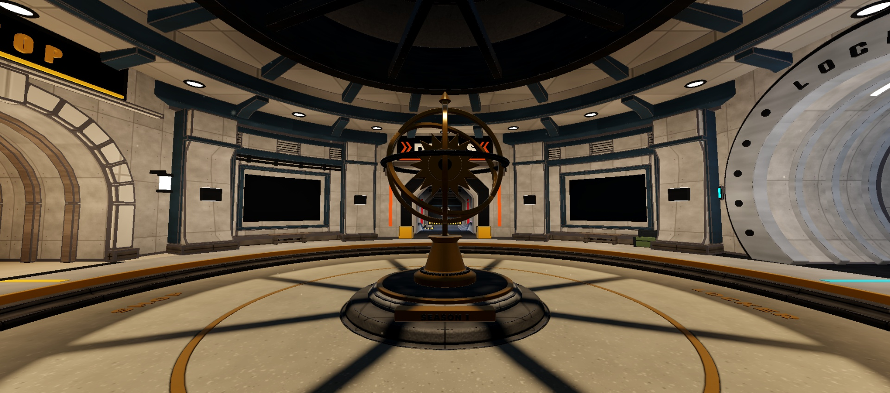 | 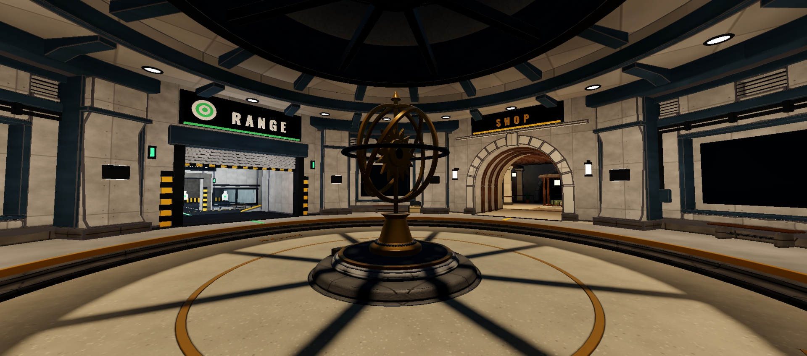 |
| 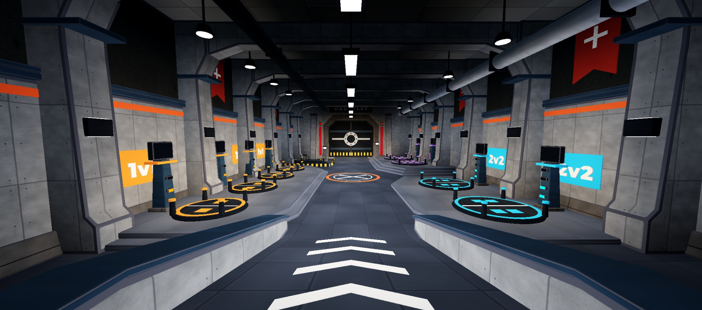 | 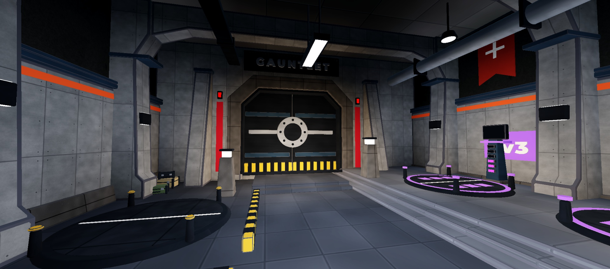 |
| 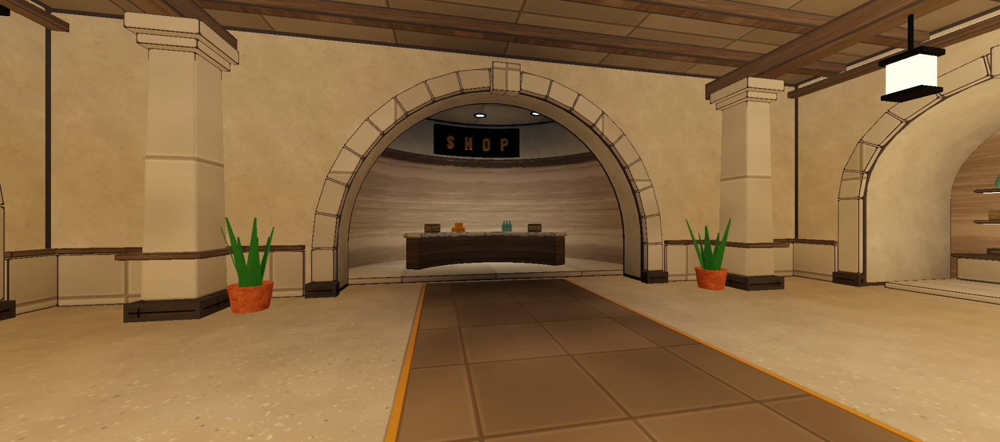 | 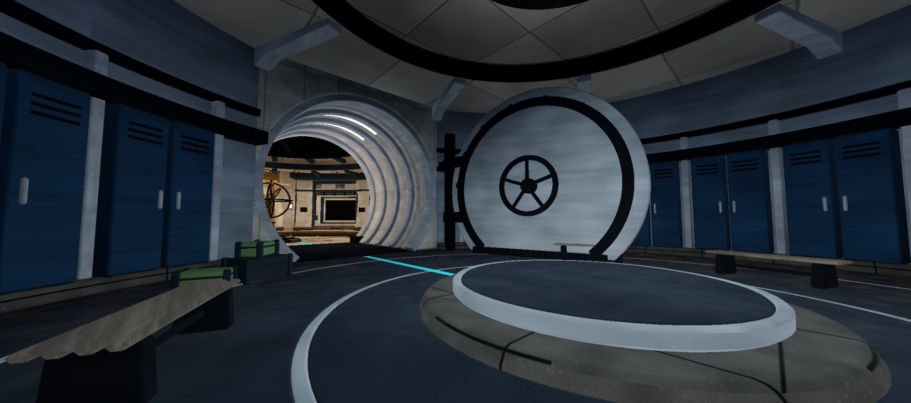 |

More in `References/lobby/v3/studio/`. **Blender renders of the bare shell (step 1):**

| | |
|---|---|
| 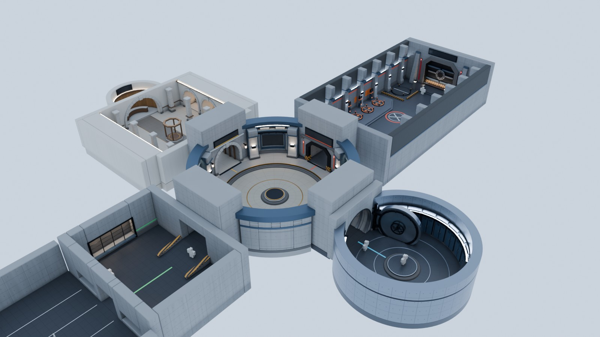 | 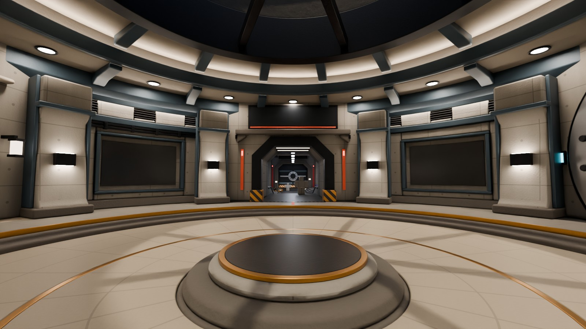 |
| 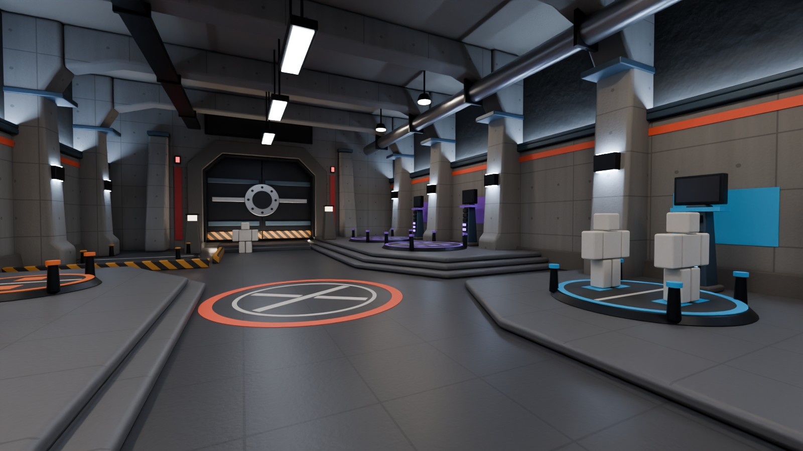 | 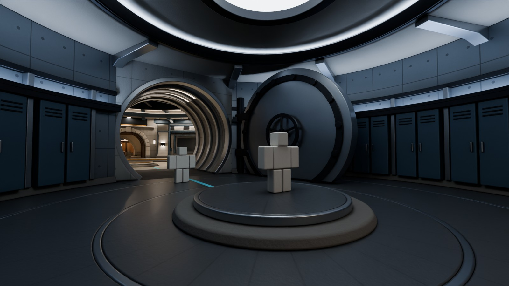 |
| 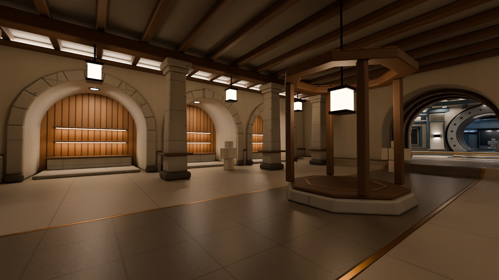 | 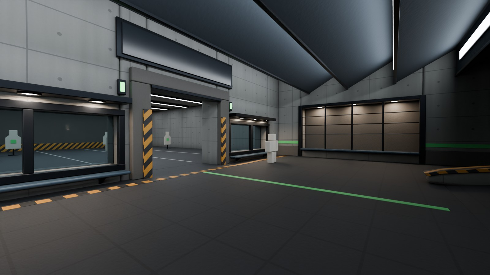 |

All renders: `vault/02 Art/References/lobby/v3/` (`00_plan`, `00_birdseye`, `01`–`03` hub, `04`–`06` Duels, `07`–`08` Market, `09`–`10` Vault, `11`–`12` Range). The white block figures are 5.2-stud scale dummies, not part of the lobby.

## Why (owner's notes, 2026-11-09)
- Walls vanish when the camera zooms out; you can zoom past them. Locker hero plinth and pedestals are see-through. See-through wall parts in the round hub.
- Overlapping parts on signs and other areas.
- Signs all look the same and aren't special. Same for the win-streak boards and the "Season 1 launching soon" centrepiece.
- Guns rotated wrong, weapon racks look bad.
- Everything has the same vibe: no texture, no life, "looks AI made".
- Duels: floating signs, empty parts, nothing special.
- The overall structure (hub with rooms off it) is good.

**More notes while building:**
- RIVALS has soft edges and looks fun. Ours is more tactical, so less soft, but no sharp boxy corners.
- Hub more compact, the central light zone bigger, better entrances.
- Compress-and-release entryways, some different from others (gates).
- Duels: a small doorway, down a ramp with arrows, then a much bigger room. Queue pads not fully symmetrical, and nicer.
- Shop a bit larger, with bigger wall recesses and more to it. Range and props need upgrades (props later).
- Common AI-build faults to avoid: overlapping parts, parts facing the wrong way, **too much neon, glitch parts, blocky shapes**. The target is a professional lobby.
- After the first Duels draft: **too close to RIVALS**. Change it, and make the queue pads different and more fun.
- End every build with a self-review, a rating and geometry checks.

## Measured causes (Studio, 2026-11-09)
- **Camera through walls:** the visible walls are one-sided MeshParts with `CanCollide` off (Shell: 14 of 197 collide), and the real collision is a separate `Collision` folder of 160 parts at Transparency 1. Roblox's Zoom camera only stops at parts that are opaque **and** collidable, so it ignores both layers. `CameraMaxZoomDistance` is 128. (LihFolk: *Camera Obstruction Handling - Occlusion Modes, Fades and Collision*.)
- **See-through from outside:** one-sided meshes with culled back faces, no outer skin.

## Rules for V3
1. Every wall, floor and ceiling is a **closed solid with real thickness** (walls 3+ studs), and the **visible mesh is the collider** (opaque, `CanCollide` on) so the camera stops at it. No invisible collision layer for architecture.
2. The shell is sealed: no gap to the void anywhere a camera can reach. Ceilings are at least 3 character heights.
3. No coplanar overlaps: pieces sit side by side or are sunk at least 0.1; nothing floats (signs get real mounts built into the architecture).
4. Each wing has its **own shape language, material set and accent**, and later its own sign type.
5. Surfaces carry real detail: formwork seams, tie holes, stains, trims. Big soft edges on structure (0.35 to 0.5), small ones on trims.
6. **Light comes from fixtures, not neon.** Hidden coves, wall lights that wash up and down, recessed can lights, lanterns, high-bay lights. Wing colours are **paint**; the only coloured lights are small signal lamps.
7. No glitch parts. No moving parts or code in the early steps (owner's call).

## Owner's decisions (2026-11-09)
| Question | Answer |
|---|---|
| Theme | Keep the underground **Sunwell Bunker**, done properly: each wing its own architecture and materials |
| Floor plan | Same four wings, **free to reshape and resize** (pads and zones re-placed later) |
| Extra space | A **Gauntlet event gate** (future 16-player event) |
| First renders | The **full shell, lit**: architecture, materials, light. Signs, centrepiece and props are stand-ins |

## Layout as built (Blender: X east, Y north, Z up; 1 unit = 1 stud; Roblox Z = −Blender Y)
| Area | Shape language | What is there | Materials | Accent (paint) |
|---|---|---|---|---|
| **Hub: the Sunwell** | Drum and stepped ceiling | R 38 (was 44). Ring walk at 0, three steps down to a sun court at −1.5 (R 25) with a centre plinth for the centrepiece. Light well R 20 (was 11) with a spoked steel grille. Eight battered piers with up/down wall lights, four wall niches (boards later), vents, conduits on two walls only. Four gatehouses, 13.5 deep, each a different gate | Board-formed concrete, teal-slate steel, pale floor, brass inlay | Warm white light |
| **Duels (north)** | Heavy frames, terraces on the diagonal | Blast gate 14 × 12 (chamfered) → landing → **arrowed ramp** down 4 studs → hall 56 × 112 × 28 high. Duel rings on terraces of different heights: west terrace 4 × 1v1, east platform 2 × 2v2, north-east dais 2 × 3v3, north-west floor the fenced future 4v4. Streak wall and trophy plinth beside the ramp. Ends at the **Gauntlet gate** with blast fins, on the spawn axis | Dark honed floor, concrete dado, dark rock above, steel | Orange-red `#FF5A36`; gate crimson `#B3262E` |
| **Market (west)** | Round arches and timber | Stone arch 16 wide → two steps down → hall 56 × 60 with a stone colonnade (nave and two aisles), oak joists, lanterns. North side: three shop alcoves with counters and lit shelves. South side: the grand Battle Pass alcove and a small Event alcove. Market island under a timber canopy. Shop apse (R 15) with the counter | Plaster, pale stone, oak, brass | Gold `#F2B33D` |
| **Vault: Locker (east)** | Circles | Round vault mouth (R 10, steel collar, ribbed tube) → circular room R 26. The **vault door stands open** inside. Locker bays round the wall, a hero display recess opposite the door, centre platform for the avatar, a big round ceiling lamp | Steel panels, blue lockers, dark floor | Cyan `#3DD9F2` |
| **Range (south)** | Sawtooth and angles | Roll-up shutter gate 18 × 12 → ramp down 2 → firing-line room 56 × 40 with dark sawtooth ceiling baffles, wall fins on one side, a caged armoury recess on the other. End wall: the range gate between two viewing windows, with lanes and targets beyond the glass | Raw concrete, rubber floor, hazard paint | Green `#58E07A` |

**Duel rings (not RIVALS pads):** a round ring with a sloped steel base, a mat, stance marks for each player on two facing sides, four short posts, and a **tote pylon** whose slot lamps fill as players join. A painted mode block on the wall behind (stand-in for the numeral). No leaning wall screens, no lane lines; one face-off emblem on the open floor.

Anchors the code needs (re-placed at import, names and tags unchanged): `LobbySpawn`, 8 × `LobbyQueue` (`Mode`, `PadId`), `LobbyShop`, `LobbyBattlePass`, `LobbyLocker`, `LobbyRangeEntrance`, `Hub.Markers.RangeReturnPoint`, `PadScreen_<PadId>`, `SeasonCentrepiece`.

## Geometry checks (`lv3_audit.py`, 2026-11-10)
| Check | Result |
|---|---|
| Open edges, zero-area faces | 0 and 0 across 1,695 solids / 40,861 faces |
| Floating solids (nothing within 0.06 studs, not passing through another solid) | **0** |
| Sealing: 2,500 rays from each of 15 points (every room, every gate tunnel) | **0 leaks** (only the light well opens to the sky) |
| Coplanar faces of different solids, same facing, overlapping | 28 pairs left, each checked by hand: all are contact faces nobody can see (bases resting on floors, backs against walls, tops under the ring beam). 305 more were found hidden by the ray test. **No visible z-fighting found** |

Found and fixed by the audit: the Vault floor overlapping the mouth floor, piers standing 0.6 off the rock wall, pilasters inside the hero recess, the crossed floor slashes, tote colour bands, window frames level with the sill, the shutter housing level with the tunnel ceiling, dado corners in the Market, lamps on the wrong face of the tote pylons.

Limits of the check: it tests flat axis-aligned faces only (curved faces by eye in the renders), and the "can it be seen" test is a ray, so the last 28 were judged by hand.

## Self-review (Claude, 2026-11-10)
| Area | Score | Why |
|---|---|---|
| Hub | 7.5 | Four clearly different gates, strong light well, calm professional light. Still bare: empty plinth, plain floor, blank niches |
| Duels | 7.5 | Compression then release works, own identity, the gate reads from the door. Walls between piers are plain; painted mode blocks are stand-ins |
| Market | 7.5 | Colonnade, alcoves and island give depth. Warm but a little even in tone |
| Vault | 8 | The open vault door is the best single piece. Hero recess is still an empty frame |
| Range | 6.5 | Clear and moody but the plainest room |
| **Overall** | **7.5** | A sound, sealed, good-looking shell. Not a finished lobby |
| **In Studio, with signs and props** | **7.5** | Reads as one designed place with five different rooms; the signs and the centrepiece work. Held back by empty boards, simple surfaces and no gun displays |

What keeps it from 9+: no signs, centrepiece or props yet (by plan); surfaces need a wear and decal pass at close range; the Range needs one strong idea; the renders are Blender Cycles with procedural materials, so **the Roblox look is unproven** until the first area is imported with baked textures or MaterialVariants. Not done: a walk test, a blind review, a triangle budget per exported piece.

## In Studio (2026-11-10, overnight)
The owner asked for the shell to go into Studio and for the work to carry on (quality, then props; no scripting).
- **Pipeline:** `lv3_export.py` (in Blender MCP) writes `art-source/lobby/Exports/V3_<Area>.fbx` and JSON data into `src/lobby/server/V3Build/` (rides in over the lobby Rojo session). `python tools/opencloud/upload_models.py --lobby --group 11116787 V3_Hub V3_Duels V3_Market V3_Vault V3_Range` uploads them (asset ids in `art-source/lobby/Exports/assets.json`). `tools/studio/lobby_v3/Build_V3.luau` builds through the Studio MCP (it and the data now arrive as the uploaded `V3_Data` model, see the second pass below): `archive()`, `visual(area)`, `collision(area)`, `lights(area)`.
- **Old lobby:** moved whole to `ServerStorage.Archive.Hub_Bunker2_preV3`. New one is `Workspace.Lobby.Hub` (attribute `V3`), one folder per area with `Visual`, `Collision`, `Lights`, plus `Anchors` and `Markers`.
- **Collision (changes rule 1):** the visible meshes do not collide. Players and the camera stop at **opaque collider parts just inside the visible solids** (0.05 to 0.17 studs, enough to clear each material's rounded edge) (boxes, wedges, cylinders generated from the same builder calls). Invisible colliders would not stop the camera, and mesh collision can't be set from the MCP.
- **Anchors re-placed** (cloned from the old lobby, same tags and attributes): `LobbySpawn` on the sun court facing the Duels gate, 8 `QueueZone` on the duel rings, `ShopZone` at the apse counter, `BattlePassZone` in the grand alcove, `LockerZone` on the Vault platform, `RangeEntrance` in the range gate, `Markers.RangeReturnPoint`.
- **Checked in play mode:** the character stands at the right height at 13 points in every room; a floor ray scan of every room finds only hairline gaps (under 0.2 studs) where round floor rings meet; with the camera forced to zoom 110 it stays inside a room at 8 test spots.
- **Lighting set for V3:** Ambient 38,39,44; OutdoorAmbient 72,74,80; Brightness 3; Exposure −0.55; EnvironmentDiffuse 0.2 / Specular 0.45; ColorCorrection saturation 0, contrast 0.08; Bloom 0.45 / 18 / 1.7; Atmosphere density 0.2, haze 1. 94 local lights tagged `LobbyLight`, none shadowed. (Before: the values in `tools/studio/lobby/Lighting_Bunker2.luau`.)
- **Materials:** existing variants (`Lobby_ConcreteBoard`, `Bunker_Concrete`, `Lobby_ConcreteDark`, `Lobby_ConcretePolished`, `Lobby_Terrazzo`, `Bunker_Floor`, `Bunker_Metal`, `Lobby_Rock`, `Lobby_Oak`), Plaster, SmoothPlastic for paint, Neon only for lamp diffusers. Table in `lv3_export.py` (`LOOKS`).

## Signs, centrepiece and props (2026-11-10, `lv3_props.py`)
Every wing has its own sign type, all real 3D letters (fonts that ship with Roblox, OFL):
| Where | Sign |
|---|---|
| Duels gate | cream **DUELS** in Montserrat Black with orange chevrons on the blast-gate plate |
| Shop gate and shop apse | brass **SHOP** in Oswald on the stone arch, and again curved round the apse wall |
| Locker gate | steel **LOCKER** letters set round the top of the vault collar |
| Range gate and firing room | white **RANGE** with a green target roundel; **FIRING RANGE** over the range gate |
| Gauntlet gate | steel **GAUNTLET** over the sealed doors |
| Duel rings | **1v1 / 2v2 / 3v3** on the colour block behind each ring |
| Hub floor | wing names in brass on the sun court, read from the centre |
| Other | **WIN STREAKS** over the streak board, **BATTLE PASS** and **EVENT** in their alcoves, **SEASON 1** plaque |

- **Centrepiece:** a brass armillary (three rings, a steel horizon ring, a sun emblem at the centre) on the hub plinth, in the light well. No moving parts yet.
- **Props:** benches (hub, Duels, Vault, Range), hard cases in stacks, a trophy on the streak plinth, six banners on the Duels rock walls, barrels, crates, sacks, bottles and jars on the Shop shelves, potted plants, goods on the shop counter and island, display stands in the Vault hero recess, sandbags, ammo boxes and a target rack in the Range.
- **Hazard marks** are real black and ochre bands (paint patterns do not survive the import).
- **Dust** in the hub sun shaft (the old lobby's `SunwellDust` emitter, moved and widened).

## Second pass after the owner's notes (2026-11-10, daytime)
The owner's notes: overlapping parts, the vault door sitting in the ground, bland 3D text, a shop that sells bottles for no reason; wants it more professional and some scripted motion.

| Note | Cause | Fix |
|---|---|---|
| "Overlapping parts": dark lines along edges everywhere | The hidden collider boxes were inset only 0.04, so their corners **poked out through the rounded edges** of the visible meshes | The inset now follows the bevel (0.3 x width for two-segment bevels, 0.5 x for one), set per material in `lv3_core.B`. Checked in Studio: the lines are gone |
| Vault door in the ground | The ring on the door face was a full circle that ran below the floor | The ring stops above the floor, the door rests on a steel sill, and the hub-side collar has steel shoes where it meets the floor |
| Bland 3D text | Single flat letters on a dark plate | Signs are **two layers** (a larger coloured back layer and a bright face), with hooded lamps over the gate signs; the Shop signs sit on timber boards with brass frames |
| Shop goods | Bottles, jars, barrels and sacks had nothing to do with the game | Removed. The three shop alcoves are now **SKINS** (rifles in three finishes on a pale board), **CASES** (cases with rarity bands on lit shelves) and **SIDEARMS** (pistols on a board); hard cases and crates on the floor |
| Motion | none | The armillary's two ring sets turn against each other and the sun turns in the middle; the featured case on the shop island turns on a brass turntable. Driven by the **existing** lobby ambience script (tag `LobbySpin`, attribute `SpinSpeed`): no new code. Moving groups have no colliders |

Also changed: the build data no longer rides in over Rojo (the Rojo plugin stopped syncing after a play test). `tools/studio/lobby_v3/upload_data.py` packs the JSON and the build tool into one model asset (`V3_Data` in `assets.json`); Studio loads it into `ServerStorage.V3Data`. The temporary `src/lobby/server/V3Build/` folder is gone. Data files: `art-source/lobby/Exports/V3Data/`.

Checked in play mode after the rebuild: ring groups turn (9, -14 and 22 degrees a second), the featured case turns, the character stands correctly by the vault door.

## Third pass: the hub, stylized (2026-11-10, evening)
The owner's notes on the hub: textures dull and too realistic (wants the cartoon-tactical mix), the armillary too realistic, sign fonts basic (showed RIVALS' neon signs as the bar; some neon is fine on signs), props too realistic with sharp corners, benches not liked. Geometry and symmetry are good. The wall screens by the benches will be the leaderboards. Work on the hub first, then the wings one at a time.

**Owner's choices:** clean stylized surfaces; a giant gauntlet trophy as the centrepiece; neon outline letters with an icon for the signs; brighter and more colourful.

| What | Now |
|---|---|
| Surfaces (hub only, `LOOKS_AREA["Hub"]` in `lv3_export.py`) | No realistic variants. Plaster for walls, floors and ceiling (cream `#C6BEAF`, sand court `#D8CBB0`, grey walk `#A9ADB2`), SmoothPlastic for trims (navy `#2B4F6C`, slate `#465465`, dark `#222932`) and gold `#D39A33`. Thin modelled panel lines on the drum walls |
| Wing colour at each gate | The two piers flanking a gate wear that wing's colour (cheeks and a shoe), and three painted arrows on the floor point at the gate |
| Signs | Slanted **outlined tube letters** (Montserrat Black, sheared, Neon) on a dark plate with a wing-coloured rim, each with its own plate shape and a white icon: Duels a slanted bar with crossed swords, Shop a pill with a bag and a star, Locker an octagon bar with a padlock (mounted over the vault collar), Range a cut-corner bar with a round target. A small coloured light sits at each sign |
| Centrepiece | A chunky gold **gauntlet fist** on its cuff (steel bands, a glowing band, studs on the knuckles, a gem on the back of the hand), about 12 studs tall, turning at 8 degrees a second (`LobbySpin`). A hidden static core stops players walking through it |
| Benches | Rounded block legs, a thick blue pad and a low padded back, under the four leaderboard screens |
| Hard cases | Softer edges and brighter colours |
| Lighting (whole place) | Exposure -0.7, Ambient 58,58,62, saturation 0.04, bloom 0.6 / 22 / 1.4; hub lights x1.05 |

Checked in play mode: the gauntlet turns, the player is stopped 3 studs from its centre, a character stands on a bench.
Honest notes: the gauntlet is still blocky up close; the tube letters are thin from across the hub; the wing halls (Duels, Shop, Locker, Range) still have the earlier, more realistic surfaces and the old sign style inside.

## Fourth pass: the hub, neutral and tactical (2026-11-10, late)
The owner's notes on the third pass: sign emblems not liked; signs too close to RIVALS' and the tube letters looked broken; too much colour (RIVALS' lobby has no coloured walls, it is cave-like; wants tactical mixed with the stylized look); the floor arrows overlapped; floor text unchanged; overlapping parts; the Market lamp, the Duels gate head (`GateDuels_ConcreteDark`) and other bits looked unprofessional. "Don't cut corners."

| What | Now |
|---|---|
| Palette | **No colour on walls.** Grey-green plaster walls `#767970`, darker ceiling `#62655E`, charcoal trims `#353B42` / `#3F444A`, dark walk `#5F6266`, sand court `#9E998C`, muted metal gold. Wing colour appears only in the sign, two small signal lamps and nothing else |
| Signs | No pictograms, no tube letters. A steel-framed dark plate, **solid slanted cream letters with a glowing halo behind them**, a light bar under the word and three slanted paint stripes. Plate outline differs per wing (slanted bar, cut-corner bar, pennant with a notch) |
| Floor | The coloured arrows are gone. Each gate has its name **stencilled in white** on the walk with one small chevron; the brass names on the court are gone |
| Duels gate head | Two dark pilasters on plinths now carry a header that sits on the steel frame (was a floating beam on two brackets); slim lamp housings with a small signal lamp |
| Shop gate | Six-sided lanterns on braced brackets (were plain boxes); the loose cornice strip is gone |
| Pier lights | Half-round up/down wall lights (were black boxes) |
| Trophy | Metal gold and gunmetal instead of bright yellow plastic |

Overlap check on this build: 0 floating solids, 0 leaks; no visible coplanar overlaps left in the hub outside the hidden contact faces (ceiling slab over gatehouses, bases on floors). The sign letters, halo and plate are layered 0.1 apart.

## Locker, second version (2026-11-11)
The owner approved the hub "for now" and moved on to the Locker. Notes: the open vault door overlapped a bench, sat in the floor and closed the room in; wants RIVALS-style **in-wall gun displays**, a clean look, smoother and a little more fun; benches not liked; crates are stand-ins; the real gun models are in the match place; later added: nice visual effects and hologram-looking things.

**Owner's choices:** door rolled aside on the hub side; all 18 guns shown by class. The centre was left open ("no equipped gun, you own every gun and change skins; maybe the Vandal, maybe the player, maybe rotating guns"), so I chose the **Vandal turning over a projector** for now. Cycling through guns or showing the player needs code and is parked.

| What | Now |
|---|---|
| Vault door | Gone from the room. A rolled-aside door in the tunnel was tried and removed the same day (see the polish notes below) |
| Wall | Seven recessed display bays (30 degrees each, 15-degree piers between): steel frame, pale back panel so dark guns read, a slanted cabinet below, a steel header with the class name and a hidden light strip. Classes: Rifles (opposite the door), SMGs, Shotguns, Snipers, Heavy, Sidearms, Melee |
| Guns | The **real models**: `Build_V3.guns()` loads each gun's uploaded asset and applies part positions and looks from `tools/studio/rojo/BuildData/<Gun>.json` (same rule as `WeaponBuilder.luau`), scaled 1.7 to 3 and set down on a steel rail. 18 on the wall, plus the Vandal at 2.6x in the middle. In `Hub.Vault.Guns` |
| Centre | Stepped platform, a projector pedestal with a glowing lens (breathes through `LobbyPulse`), the Vandal turning (`LobbySpin`, slow bob), two tilted ForceField hologram rings turning the other way, motes rising (one ParticleEmitter, rate 9), a spot on the gun. An invisible keep-out cylinder stops players climbing into the hologram |
| Look | SmoothPlastic cool greys, bigger soft edges, cyan only in the hologram, the lens and the floor line. No benches, no lockers. One stand-in case stack by the door |
| Lights | 9: one fill, one hero spot, one point light per bay, none shadowed |

Checked in play mode: walked through the tunnel past the door edge, the hero gun and rings turn, a lap past all seven bays stands on the floor. Before the keep-out was added the player could climb onto the projector; not re-walked after.
LihFolk notes used: *Materials MaterialVariants and SurfaceAppearance* (ForceField for holograms), *Particle Emitters In Depth* (LightEmission 1, LightInfluence 0), *Light Sources and Shadows* (decoration lights unshadowed, 8 to 12 visible), *Lighting Untextured Art in Roblox* (value contrast behind props), *Vehicle Spawner and Garage* (display copies carry no scripts).
Open: the Melee bay holds one knife and looks empty; the hero display does not yet react to the player; wall guns are static (skins can swap in later); a white wire box showed round the hologram in the Studio edit view (the invisible keep-out) and should not show in play.

### Locker polish (2026-11-11, later)
- **Vault door removed.** The owner found the rolled-aside door "an eyesore, like something coming out of the wall". The tunnel is now just the round steel collar and ribs. Decision: no vault door in the lobby.
- **Glass fronts** on all seven bays (owner: guns behind glass you can't walk through). The glass mesh does not collide; invisible box colliders follow it (collider kind `Y`), because an opaque collider would show through. The Range windows use the same rule now.
- Touches: a thin cyan paint line on each cabinet, a larger knife in the Melee bay.
- Collider kinds in the build data: `B` box, `W` wedge, `C` cylinder (opaque, hidden inside meshes); `X` invisible cylinder and `Y` invisible box (keep-outs and glass only, never walls).
- Play test: walked the tunnel on both sides; walking at the projector stops 3.5 studs from the centre; walking and jumping at three bays is stopped at the glass; the Vandal and the rings turn.

## Duels, second version (2026-11-11)
The owner's notes: the queue pads were not good (too small for two players, not professional), wants the RIVALS idea of pads with hologram boards (the look now, function later), a longer hall with many pads, the Gauntlet space looked off, blocks and textures below standard, basic text. Added while building: the lighting was bad, corners unlit.

**Owner's choices:** two team pads plus a hologram board per station; dark hall where pads and holograms glow; wide tech lettering; the Gauntlet end as an arena portal with a hologram.

| What | Now |
|---|---|
| Hall | 52 wide, **194 long** (was 112), 26 high. Dark neutral walls, piers and floor (`LOOKS_AREA["Duels"]`); no terraces. Entry unchanged: blast gate, landing, arrowed ramp down 4 |
| Stations | **Nine**, in bays between rounded piers; the east bays are staggered half a bay against the west ones. West: 1v1 A, 2v2 A, 1v1 C, 2v2 B, 3v3 B. East: 1v1 B, 3v3 A, 1v1 D, 4v4 A (locked, grey pads, "SOON") |
| Team pads | Two per station, side by side, set in a steel frame: team A orange `#FF6A3D`, team B blue `#2A86FF`, with our own dark emblem (octagon ring, diamond, two bars). Sizes: 1v1 9 x 8, 2v2 11 x 9.5, 3v3 11.5 x 12, 4v4 11.5 x 13.5 studs each |
| Hologram boards | One per pad over a projector cabinet: translucent blue pane, bright frame, a header with the slot count ("0/1") and team, one portrait box per player, "WAITING". **Static meshes for the look**; the live version will be a SurfaceGui later |
| Lettering | Builder Extended Bold (ships with Roblox): mode name on a steel header beam over each bay with a soft blue glow, station letter at the end |
| Gauntlet end | A raised stage (two steps) with a framed, sealed portal: dark panel, a hologram emblem and "COMING SOON" floating in front (breathes through `LobbyPulse`), a halo-lit GAUNTLET sign, two light pylons |
| Corners | Win-streak board, sign and trophy beside the ramp; benches by the ramp and in both east nooks |
| Lighting | 71 lights, none shadowed: a spine down the aisle, a high fill light each side every 20 studs, a fill and a hologram glow at every station, a team-coloured light over every open pad, lights in every nook and corner. `Lighting.Ambient` raised to 66,66,72 (whole place) |
| Queue zones | 16 `LobbyQueue` zones (one per open team pad) with `Mode` and `PadId` (`1v1_AW`, `1v1_AE`, ...). The queue code only reads `Mode`, so every open pad opens the queue menu. Each pad has an invisible collider so feet stand on it |

Checked in play mode: walked hub -> tunnel -> ramp -> first pad; stands on pads of every size at the pad top; stage and corners stand on the floor; all 16 zones have a prompt; with the camera forced to zoom 110 it stops at the hall's end wall.
Open: both team pads of a station still open the same solo queue (team sides need code); board text is static; blue pads render nearer cyan (Neon); the extra stations (1v1 C/D, 2v2 B, 3v3 B) are new pad ids.

## What is not done (next steps)
1. **Save the place** in Studio. `ServerStorage.V3Data` (build data, about 0.5 MB) can be deleted once the lobby is approved (`B.cleanup()`).
2. The four hub wall niches, the streak board and the Battle Pass board are **empty dark panels**: they need the owner's call on what they show (needs UI and code).
3. **Guns on display** (Vault hero stands, Range cage): use the real gun models, set at the right angle.
4. Surfaces use the old lobby's material variants. Custom textures per wing would lift it (concrete with wear, steel, oak).
5. 94 local lights and about 6,700 hidden collider parts: fine on PC, **not measured on a phone**.
6. No moving parts, sounds or ambience tags yet (owner's call: no scripting for now).
7. Studio screenshots through the MCP can come out half dark: the light only updates near the real viewport camera. Move `workspace.CurrentCamera` there and wait a few seconds first.

## Steps
1. ~~Layout shell, lit, in Blender~~ → renders. **Done.**
2. Owner's notes on the layout → fixes.
3. One area at a time to finished quality (hub first): surfaces, trims, sign, props, centrepiece.
4. Import: split into MeshParts (under 20,000 triangles each, one material each), textures, collision as in rule 1, anchors re-placed, camera test at max zoom from every room.
5. Lighting and ambience in Studio, then a walk test and an overlap audit.

## Files
- Builder (run through Blender MCP): `tools/blender/lobby_v3/` → `lv3_core.py` (builders, materials, lights), `lv3_hub.py`, `lv3_duels.py`, `lv3_wings.py` (Market, Vault, Range), `lv3_audit.py`, `lv3_run.py` (`build_all()`, `audit()`, `shots()`, `plan()`, `save()`).
- Blend: `art-source/lobby/LobbyV3.blend` (collections per area; each `*_Ceil` collection hides for roof-off views; `RenderShell` and the `*_Dummy` objects are render aids, not for export).
- Renders: `vault/02 Art/References/lobby/v3/`.
- Lobby Rojo server: `rojo serve lobby.project.json --port 34873`.

## LihFolk notes used
*Camera Obstruction Handling - Occlusion Modes, Fades and Collision*; *Lobby and Hub Design* (core radius 40 to 70, first station under 15 s, no loiter nodes on the spawn axis, pads off the return flow); *Level Design Principles - Flow Sightlines and Landmarks* (landmark 3 to 5 degrees from spawn, thresholds change two cues at once, compression under 5 s then release, ceilings 3 character heights); *Modular Environment Kits*; *Parts Unions and MeshParts* (20,000 triangles a mesh, offsets against z-fighting); *Modeling in Blender for Roblox* (texel density, one material per mesh); *Case Study - Rivals* (pads are physical matchmaking; our rings keep that but not the look). Skills: `lihfolk-worldbuilding`, `roblox-blender-modeling`.

## Log
- **2026-11-09:** owner's notes taken, causes measured in Studio, decisions made, plan written. Lobby Rojo server on port 34873.
- **2026-11-11 (later):** Duels rebuilt: 194-stud dark hall, nine stations with paired team pads and hologram boards, Gauntlet portal stage, 71 lights, 16 queue zones.
- **2026-11-11:** Locker rebuilt: door rolled aside in the hub tunnel, seven lit in-wall bays with the 18 real guns by class, hologram projector with the Vandal turning.
- **2026-11-10 (late):** hub fourth pass: neutral tactical palette, halo-lit solid-letter signs, stencilled floor names, rebuilt Duels gate head, proper lanterns and wall lights.
- **2026-11-10 (evening):** hub restyled to the owner's choices: clean stylized surfaces, wing-coloured piers, neon outline signs with icons, gauntlet trophy, new benches, brighter light.
- **2026-11-10 (day):** second pass: collider inset follows the bevel (dark edge lines gone), vault door sill, layered signs with lamps, shop goods replaced with skins, cases and sidearms, armillary and featured case turn through the ambience tags, build data moved to an uploaded model.
- **2026-11-10 (night):** shell exported, uploaded and built in Studio; collision from the builder; anchors re-placed; lighting set; walk and camera tests; signs, centrepiece and props built, exported and imported; hazard bands; looks tuned in Studio and written back to `lv3_export.py`.
- **2026-11-10:** shell built in Blender MCP: hub, four gatehouses, Duels (reworked once after "too close to RIVALS"), Market (reworked once: colonnade, island, fitted alcoves), Vault, Range. Audit clean. 14 renders. Blend saved.
