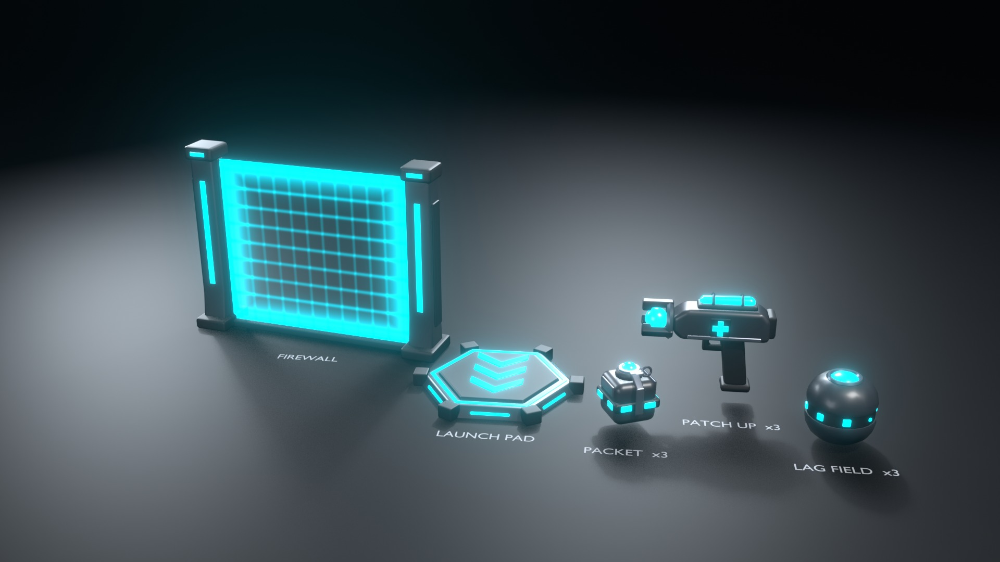

# Mod Props

The Blender models for the Mods, in the Mod look decided on 2026-10-26 ([Mod System](../04%20Tech/Mod%20System.md) → "Art: the Mod look"): stylized, chunky, slightly cartoony shapes; a matte charcoal shell; big emissive energy parts in the team colour. Guns stay realistic; these don't.

**Status (2026-10-26):** approved (handler review, both team colours), exported and **uploaded** to Open Cloud (group 11116787). The Studio build is prepared but not run: the code session builds them into `ReplicatedStorage.Abilities` in its Stage 3. Asset ids, exact build steps and the names code should use: [`art-source/abilities/README.md`](../../art-source/abilities/README.md).

Renders: `References/mods/` → `patch-up.jpg`, `packet.jpg`, `launch-pad.jpg`, `firewall.jpg`, `lag-field.jpg`, `vfx-meshes.jpg`, `lineup.jpg` (ally cyan), `lineup-enemy.jpg` (the same props in the enemy tint). In the lineup the handheld and thrown props are scaled up 3×.

## Conventions (what the importer can rely on)
- **Axes:** the same as the guns: Blender +X forward, +Z up, +Y left, 1 unit = 1 stud (so the gun exporter's axis handling applies).
- **Origins:** handheld props at the grip (`Handle`), thrown props at their centre (`Handle`), placed props on the floor at the centre, facing +X.
- **Names:** one collection per Mod, named by its id (`PatchUp`, `Packet`, `LaunchPad`, `Firewall`, `LagField`; plus `ModVFX`). Objects are `<Mod>_<Part>`; the exporter strips the prefix. Locators are empties.
- **Energy parts** are separate objects named **`*_Energy`** that use only energy materials, so the game can tint them per viewer (ally cyan `#00E5FF`, enemy orange-red `#FF5A36`, magenta `#FF3DCB` for glitches). The build refuses to mix energy and shell materials in one part. `ModProps.get` already recolours every Neon part of a model in `ReplicatedStorage.Abilities`.
- **Materials** (each carries `rbx_material` / `rbx_color`): `Shell` charcoal `#2C2E35` SmoothPlastic, `Dark` `#16171B` SmoothPlastic, `Trim` gunmetal `#6E7480` Metal, `Energy` Neon, `EnergyGlass` Neon at 0.5 transparency (Firewall panel), `EnergyVFX` (VFX meshes). Multi-material shell parts are split on export into `<Part>_<Material>` (`Body_Shell`, `Body_Dark`…), like the guns.
- **Moving bits are their own parts** (no armature): Packet `Lever` and `Pin` (fly off on the throw), Launch Pad `Plate` (pops on a launch), Lag Field `Spinner_Energy` (spins), Launch Pad `Arrow1..3_Energy` (chase lights), Firewall `Panel_Energy` (builds up, flickers, shatters).
- **Budgets:** props ≤ 3K triangles, VFX meshes ≤ 1K each. All met.

## The props
| Mod | Model | Size | Tris | Parts | Locators |
|---|---|---|---|---|---|
| **Patch Up** | Pistol-grip heal device (viewmodel): housing with an energy vial on top, a medical cross on each side, three claws holding a glowing core at the front | 1.2 studs long | 2,832 | Grip, Body, Clamps, Claws, Core_Energy, Vial_Energy, Cross_Energy | `Handle` (grip), `LeftGrip` (pistol hold), `Emitter` (front of the core; the beam leaves along +X) |
| **Packet** | Rounded "data packet" cube with a dark belt and eight energy windows, fuse dome on top, spoon lever and pin ring | 0.4 studs (0.56 with fuse) | 2,412 | Body, Belt, Windows_Energy, Cap, Fuse_Energy, Lever, Pin | `Handle` (centre), `Fuse` (top of the fuse light) |
| **Launch Pad** | Low hex pad: charcoal base, dark corner bumpers, energy channel round a dark launch plate, three chevrons pointing the launch way, a light on each sloped side | 4.7 corner to corner, 4.1 flat to flat, 0.43 tall | 1,444 | Base, Plate, Rim_Energy, Arrow1_Energy, Arrow2_Energy, Arrow3_Energy, Side_Energy | `Top` (plate centre) |
| **Firewall** | Two chunky emitter pylons on wide feet with a low sill (frame), energy strips, one translucent panel | 8 × 6 studs (panel 6.24 × 5.29) | 1,380 | Frame, Frame_Energy, Panel_Energy | `Center` (middle of the panel) |
| **Lag Field** | Orb: two charcoal caps with glowing lens domes top and bottom (reads however it lands), trim bezels, a dark belt with a ring of eight shrinking dots (a "buffering" spinner) | 0.64 studs | 2,720 | Caps, Bezels, Core_Energy, Spinner_Energy | `Handle` (centre) |

**Firewall panel in game (handler, 2026-10-26):** L1 blocks bullets, **not vision**, so the panel is see-through: Neon at **Transparency 0.5** with a tinted grid Decal on each face (`art-source/abilities/Textures/FirewallGrid.png`, 10 × 10 cells and a glowing rim, white on transparent, made by `tools/vfx/make_mod_textures.py`, Decal 74639457803541). B2 Burn Wall is the vision-blocking variant (opaque, in code). The panel also has 0–1 UVs on both faces (u across, v up) if a scrolling texture is wanted later.

## VFX meshes (`ModVFX`)
Unit-sized for code to scale. UVs suit a scrolling texture: **U runs once around** (the seam is welded, so it tiles), **V runs along the effect**. They're single-sided: set `MeshPart.DoubleSided` where both faces show.
| Mesh | Shape | Tris | V runs | For |
|---|---|---|---|---|
| `Shockwave_Energy` | Flat ring, radius 0.7 → 1.0, soft raised profile | 512 | inner → outer edge | Packet blast, Air Strike slam, landing |
| `Dome_Energy` | Open hemisphere, radius 1 | 736 | base → top | Lag Field zone, Zero-G zone |
| `Sphere_Energy` | Full sphere, radius 1 | 720 | bottom → top | Freeze Frame bubble, blast flash |
| `ScanRing_Energy` | Vertical band, radius 1, 0.25 tall, flaring out | 256 | bottom → top edge | Ping pulse |

## Files and commands
Everything is built by script; re-running a script rebuilds its `.blend` from scratch, so change the numbers in the script, not the file.
- **Kit:** `tools/blender/modkit.py` (materials, shapes, assembly, check-render stage; reuses `gunkit.py`'s geometry helpers).
- **Builds:** `tools/blender/build_mod_patchup.py`, `build_mod_packet.py`, `build_mod_launchpad.py`, `build_mod_firewall.py`, `build_mod_lagfield.py`, `build_mod_vfx.py` → `art-source/abilities/<Mod>/<Mod>.blend` (VFX: `art-source/abilities/VFX/ModVFX.blend`).
  `blender --background --factory-startup --python tools/blender/build_mod_<name>.py -- --render` (Blender 5.2; `--render` writes the check render).
- **Lineup:** `blender --background --factory-startup --python tools/blender/render_mods.py` (both tints).
- **Export:** `blender --background --factory-startup --python tools/blender/export_mods.py -- [Mod ...]` → `art-source/abilities/Exports/<Mod>.fbx` + `<Mod>.json` (parts with material, Roblox look, energy flag, tris, centre, size; locators; props).
- **Upload:** `python tools/opencloud/upload_models.py --abilities --group 11116787 [Mod ...]` → `art-source/abilities/Exports/assets.json` (re-uploads add a version). Done 2026-10-26: PatchUp 113169378873162, Packet 137524485912802, LaunchPad 82834892217235, Firewall 91482638324310, LagField 134077650766119, ModVFX 130699290674585.
- **Build (prepared, not run):** `python tools/studio/make_ability_build_data.py` → `tools/studio/abilities/BuildData/`, then `tools/studio/abilities/AbilityBuilder.luau` (same pattern as WeaponBuilder) builds each model into the Studio-owned **`ReplicatedStorage.Abilities`** with `.rbxm` backups in `art-source/abilities/Studio/`. Steps in [`art-source/abilities/README.md`](../../art-source/abilities/README.md). Rojo can't sync MeshParts, so these never go under `assets/`.

## Render setup
Dark studio, EEVEE, **Standard** view transform (AgX washed the bright cyan out to white; Standard is also closer to Roblox Neon), compositor bloom, energy emission 2.0. The check renders are made from the same `.blend` files, so they show exactly what will be exported.
