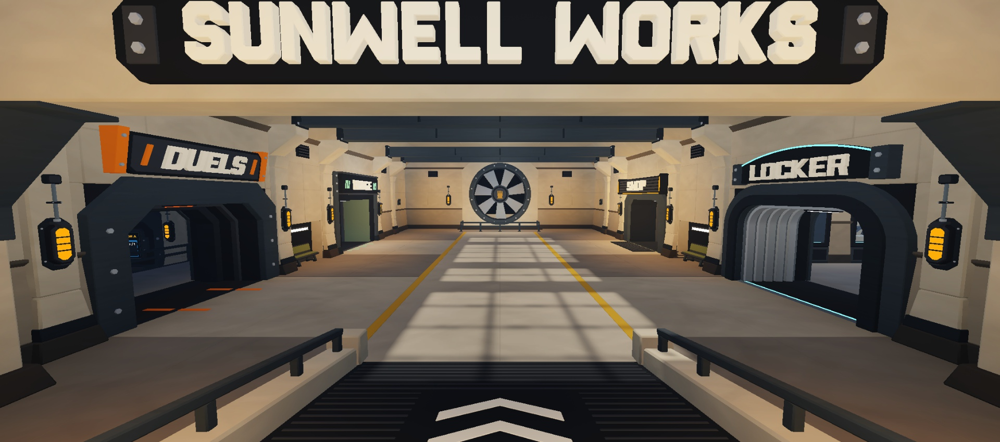
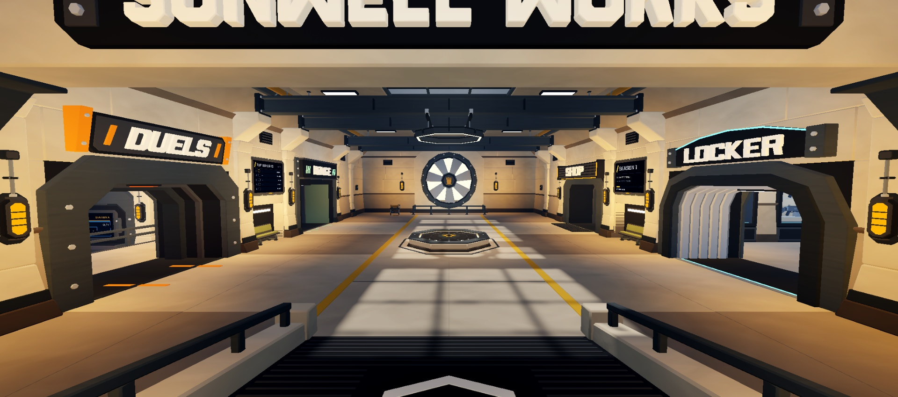
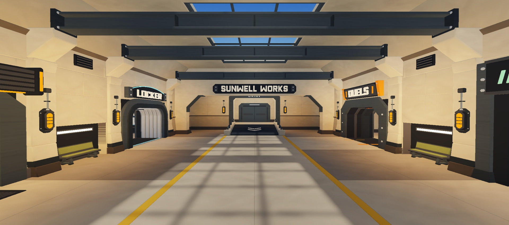
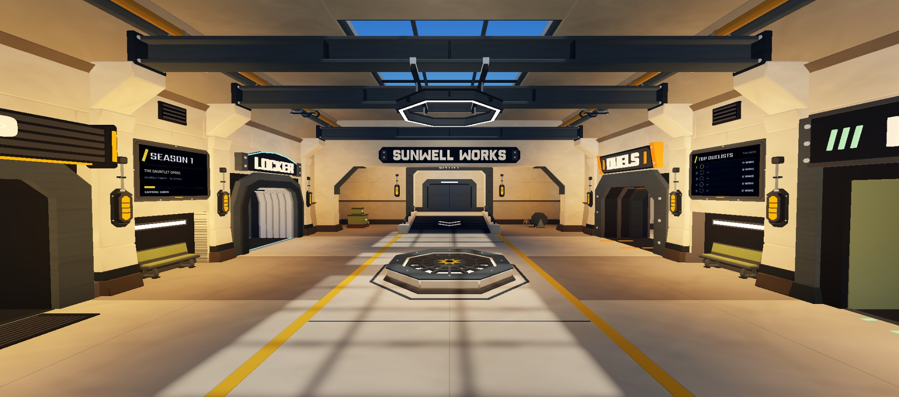
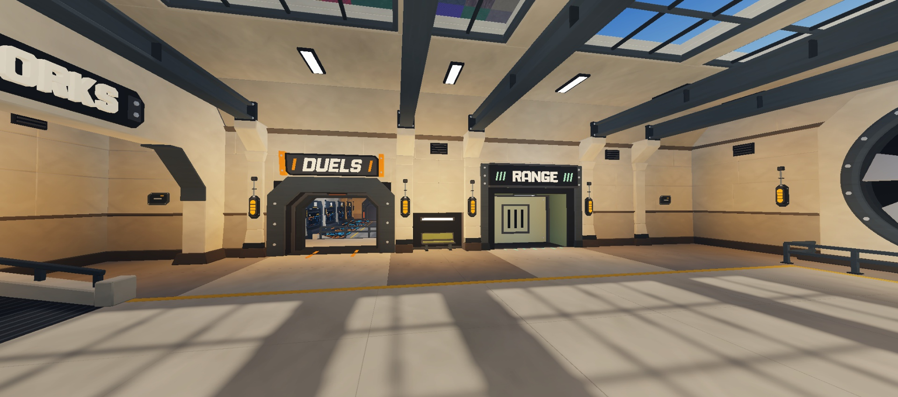
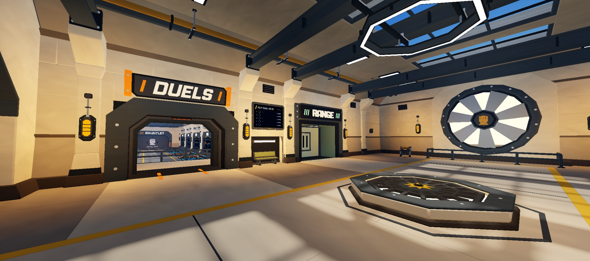
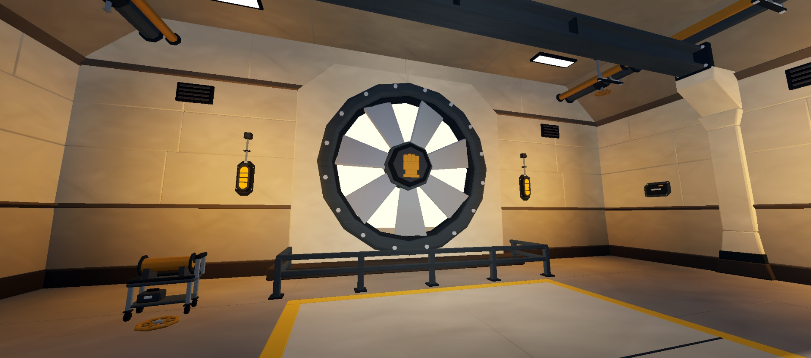
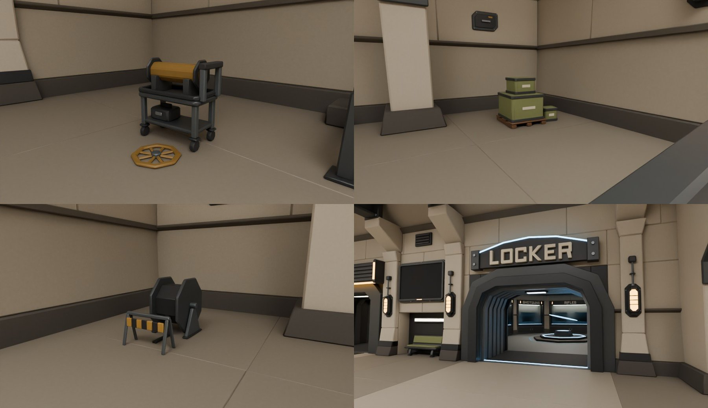

# Sunwell hub upgrade (started 2026-11-12)

The sixth pass on the Sunwell Works main hall (the hub), after the owner asked to "improve the hub again" with the vault's building research, aiming at 9-10. Loop: review → plan → build → grade → repeat. The hall and wings live in `Workspace.SunwellStaging` in the Lobby place; build history: [Sunwell Works Build](Sunwell%20Works%20Build.md).

## Baseline (review before changing anything)
Captures from Studio at the spawn, reverse, side and the three wings.

| Rubric ([Map Quality Standard](../01%20Design/Maps/Map%20Quality%20Standard.md) §6) | Weight | Grade | Why |
|---|---|---|---|
| Composition and focus | 3 | 1 | One long symmetric corridor; the turbine is the only focus and reads small from the spawn (about 1/9 of the frame); the 24-stud walk and both side fields are empty for 80 studs |
| Navigation and landmarks | 3 | 2 | Four doorways read at once, floor lines lead to the turbine |
| Style cohesion | 2 | 1 | Built before the faceted hard rules: smooth turbine ring (72 segments), round bench bends, round Locker collar and shutter; one skylight shows a patchy rainbow texture |
| Lighting and atmosphere | 2 | 1 | Even cream everywhere; ceiling and haunch as light as the walls, so the room has one value band; skylight sun pattern is the only contrast |
| Detail balance | 1 | 1 | Lower walls dressed; upper walls, haunch and floor bare; no story props |
| Avatar scale | 1 | 2 | Doors, rails, benches right for R15 |

**Baseline: 16 / 24 = 6.7.** Wings for reference: Duels about 7.5, Locker about 7 (round pedestal and ceiling light break the rule), Shop about 7.

## What the research says (sources)
- **RIVALS lobby** (our UI video frames `References/ui/video-frames/rivals-pc/*lobby*`): the spawn stands on a lit floor medallion, big screens (win streaks, codes) frame that space at and above eye level, set dressing (crates, cases, plants) sits at the wall feet, a ceiling structure carries lights. The middle of the room is the social stage.
- **LihFolk *Lobby and Hub Design*** §1, §8: rank the hub's jobs (queue first for us); social nodes are a centrepiece with a ledge to stand on, boards with standing room off the main flow, where people pass. Mistake: loiter nodes on the spawn line.
- **LihFolk *What Craft Looks Like*** §5: light as wayfinding, environment identity readable from one frame, spend detail where the camera looks.
- **Map Quality Standard** §3: one landmark in the first frame, 65/25/10 shape hierarchy, story groups (odd counts, at walls and corners, nothing in the path), value bands, ceiling darker than the walls, Neon as the single hot spot with a real light beside it.
- **gauntlet-build-style** §0: no round curves (6-12 flat facets, more for heroes), no blunt ends, every junction a transition.
- **lihfolk-worldbuilding** §3: one hero, 2-4 primary forms framing it, leading lines, three reads (silhouette, blurred colour, light).

## Plan
**Pass A: the heart of the hall**
1. **The Sun Well** (the hall's namesake) at the mid-hall cross axis (y 53, between the bench bays, under a skylight): an octagonal faceted kerb you can sit or stand on, a stepped grated well with a warm lit water channel below, a cast collar with fixings. Low (kerb 1.2), so the turbine stays in the spawn frame. The social node and the composition's middle beat.
2. **Two big boards** (SurfaceGui, UI theme direction) high over the bench bays, leaning out a little: the win streaks and the season / news board. Boards frame the Well, standing room in front, off the spawn line.
3. **Pipe racks on both haunches**: two faceted pipes (8-sided) with saddle clamps, flanges at the joints and a valve wheel near the turbine; they run the hall's length, lead the eye to the turbine and give the upper zone a hydro-station identity.
4. **Value structure**: darker ceiling and haunch, a warm backlight behind the turbine blades so the rotor reads as a silhouette, lower fill, warm pools at the Well and the doorways. Fix the skylight glass.

**Pass B: cohesion and story**
5. Facet the turbine (16-sided ring and discs, faceted hub), the benches (chamfered bend, no round fillets), the Locker collar and shutter.
6. Story groups at the wall feet (odd counts, never in the walk): a maintenance cart with a pipe section and a tool case by the turbine rail; crates and a cable reel by the entry bays.
7. Floor: slab joints and drain grates along the walls, an inlay ring round the Well.

**Pass C: polish** from the grade.

Each pass: audit (0 leaks, 0 floating), captures, walk, grade against the rubric. Target ≥ 9 (22 / 24).

## Results

| Before | After |
|---|---|
|  |  |
|  |  |
|  |  |

| | |
|---|---|
|  |  |

### Pass A (the heart of the hall)
- **Sun Well** (`sw_hub.sun_well`): octagon, 1.15 scale, battered dark shoe, cast kerb, gunmetal coping to sit on (1.5) with eight fixings, a pale light channel under the coping lip, a glowing well floor under a 16-rib radial grate with a middle ring, a hub plate with the ochre Sunwell star. Deck you stand on at 1.3 (invisible colliders, two crossed squares = the octagon), a flush dark inlay ring on the floor. Two warm lights.
- **Sun ring** (`sun_ring`): an octagonal ring luminaire over the Well at 19.4-20.5, hung on rods from two spreader bars clamped under the crossbeams either side; downlight strip, eight fins, a spot down onto the Well. It sits above the sightline from the spawn to the top of the turbine, so it frames the landmark.
- **Boards** over the bench bays (8.7 x 5.7): TOP DUELISTS (weekly leaderboard) and SEASON 1, new SurfaceGui layouts in the UI theme direction (slash mark, gold for the one act-now thing, avatar circles). All boards now use Sarpanch + Titillium Web instead of Gotham.
- **Pipe racks** (`pipes`): an 8-sided gunmetal main (r 0.8) and an ochre line (r 0.45) along both haunches, sitting on the crossbeams with saddles and straps, trapeze hangers between the beams (a rod to the ceiling, a wedge bracket to the sloped haunch), joint flanges, collars through the SUNWELL frame, flange plates into the end walls, an octagonal valve with a hand wheel by the turbine. The ochre line repeats the floor lines up high and leads to the turbine.
- **Turbine**: 16-sided ring, surround and backing, 8-sided hub; a pale daylight disc behind the blades so the rotor reads as a silhouette (first try was yellow and read like a prize wheel).
- **Values**: ceiling and haunch one band darker (`Ceil` #837D72).

### Pass B (cohesion and story)
- **Faceted rule** carried to what was still round: Locker doorway collar, sleeve ribs and casing (two flat facets per corner), the Locker's arched sign plate (four plates), the Locker pedestal, hologram ring and floor line (octagons, the hall's new motif), the Locker ceiling light (chamfered), the bench sleds.
- **Story groups** (odd counts, at the walls, out of the walk): turbine maintenance (a service cart with a spare ochre pipe spool on V chocks, a tool case, and the hand wheel taken off the left valve lying on the floor; the valve above has only its stem); supplies at the arrival (pallet, olive crates, 1.4x); cable work (cable drum on cradle stands, a striped A-frame barrier, 1.25x). Invisible colliders, scaled correctly (the collider builder ignores frame scale; `_col` applies it).
- **Floor**: expansion joints across the walk, clear of the Well's inlay.
- **Lighting** (`Build.SUNWELL_LIGHTING`, `use("Sunwell")`): ambient 64,64,66, outdoor 92,94,102, brightness 2.6, exposure -0.5, wall lamps 2.4 at range 13 (warm pools), ceiling panels 0.3, a neutral `HubGrade` colour correction (contrast 0.12, `use("V3")` turns it off), Atmosphere haze 0.6 (set live, not restored by `use("V3")`).
- **Skylight glitch**: the owner's "Texture Pack" swatch slab floated 74 studs up over the Duels wing and showed through the skylights. Moved 3,000 studs south (not deleted); its old pivot is in its `OriginalPivot` attribute.

### Checks
- Blender audit after each pass: 0 leaks, 1 floating (the Locker hologram ring, on purpose); the new coplanar pairs are same-material grate faces inside the Well and pipe ends against the end walls (hidden).
- Play mode: you stand on the Well deck at 1.3 and on the kerb; the cart, crates and drum stop you and carry you on top; the walk is level.
- Hub triangles 24,692 (largest mesh 6,168); 18 meshes, 5 lights, 9 colliders.

### Self-grade after pass B, and the blind review that corrected it
My grade was 22 / 24 = 9.2. **Three blind reviewers** (environment artist, level designer, generalist; images 01-05 only) gave 6.3, 5.4 and 7.5. **Median per criterion: W1 1, W2 2, W3 1, W4 1, W5 1, W6 1 = 15 / 24 = 6.3.** I graded too kindly, so from here the blind median is the grade.

Their shared points:
1. The turbine's white backlight blew out and read as a hole.
2. A large empty floor sat in front of every view.
3. The props looked toy-sized and sparse.
4. The walls were flat.
5. The ring still read as round from far away.
6. The spawn shot was cropped by the lintel.

On point 6, my camera was under the lintel, not where the player's camera sits. They also asked for "one accent", but the four wing accents are the owner's design and stay.

### Pass C (from the blind review)
- **Turbine**: a 12-sided ring (facets read from the spawn), a dark shadow band inside it, thicker vanes with a dark spine, vanes darkened to gunmetal (`Blade` #4F555B) against a warm amber intake (`E_Intake` Neon #8E7B60; the first try at #8F6E48 rendered bright orange, because Roblox Neon boosts saturation), a bolt on each corner, a warm spot making a pool on the floor in front of the rail.
- **Sun glow**: the Well floor, light channel and the sun ring's strip use the same warm colour as the intake (the pale strip read as a white neon outline). One warm "sun" accent ties the Well, the ring and the turbine together.
- **Floor**: a steel threshold plate where the ramp lands (tread ribs, a slanted ochre and charcoal hazard edge), slab joints across the walk and down its middle, and the walk laid as a checker of two close shades (`Walk2`).
- **Props**: larger (cart 1.25x, crates 1.6x with corner battens, cable drum 1.45x). A fourth group, **pipe stock** by the turbine's right side: a two-stand rack with gunmetal and ochre pipe lengths, two spare flanges stacked on the floor, a tool box.
- Evidence is now shot from the player's real camera (spawn inside the alcove at height 9.5).

**Blind review round 2** (`r2-*` captures): 7.9, 5.0, 6.7. **Median W1 1, W2 2, W3 1, W4 1, W5 1, W6 2 = 16 / 24 = 6.7** (+0.4). All three named the same gaps:
1. The frame was still one beige-orange value band.
2. The foreground floor was still dead space.
3. The yellow lines led only to the turbine, not to the doors.
4. The plain wall behind the turbine.
5. Cylinders that still read round (the prop pipes).

### Pass D (round-2 notes)
- **Value structure** (tested live, then in `LOOKS`): wall infill `#A39B8C` under the cast pilasters and corbels (they stay `#BDB5A5`, so the structure reads), wainscot `#7E776C`, ceiling `#716C62`, side floors `#6C665F` (the walk is now a lit lane). Shade cooler: OutdoorAmbient 90,95,108, ColorShift_Top 255,248,238. These looks are global, so the wings darken by the same step.
- **Route cues**: three flush chevrons per doorway across the side field in the wing's colour (Duels orange, Locker blue, Range mint, Shop amber), pointing from the walk to the sill. Floor joints frame each approach band, and a joint runs down each end field.
- **Turbine frame**: a dark 12-sided plate round the ring, so the landmark is framed against the cast surround. Four diagonal gussets were tried and removed (they read as loose dashes).
- **Prop pipes** are 6-sided (the 8-sided ones read round across the hall).

**Blind review round 3** (`r3-*`): 7.5, 6.3, 7.9 (mean 7.2, up from 6.5). **Median W1 1, W2 2, W3 1, W4 1, W5 1, W6 2 = 16 / 24 = 6.7** (no change on the median).
- Navigation is now 2 from every reviewer.
- What holds the median at 1:
  - the crossbeams were plain boxes with blunt ends meeting the corbels;
  - the walk still read as empty;
  - the value range was still narrow;
  - the long wall bays were bare.

### Pass E (round-3 notes)
- **Crossbeams**: flanges with cut ends, and a knee brace at each end (a gusset plate from the corbel's face up under the beam, with a flange along its sloped edge), so the beam meets the corbel with a transition (`sw_hall.structure`).
- **Walk motif** (`sw_hub.walk_motif`): a dark border band inside each ochre line, and dark chevrons inlaid in the walk. Three run from the threshold to the Well, three from the Well to the turbine, carrying the ramp's chevrons through the hall.
- **Walk a step deeper** (`Walk` #978F82, `Walk2` #8E877A), so the skylight sun patches carry the light.
- **Warmer glow**: the Well, ring and intake are a step brighter (#9C8666). The turbine floor spot is 2.6, the Well downlight 1.7.
- **Route chevrons** are 4.2 long (were 2.8).
- **Wall conduit** in the entry and turbine bays: two runs on stand-off clips at mid height, a junction box at each end. The entry run stops at the SUNWELL frame.

**Blind review round 4** (`r4-*`): 7.5, 7.9, 6.7 (mean 7.4). **Median W1 1, W2 2, W3 1, W4 1, W5 1, W6 2 = 16 / 24 = 6.7.**

## Where it stands (stop rule)
The Map Quality Standard's stop rule applies: two rounds in a row gained under 0.3 on the median, so the loop stops here. **This is a draft, not a pass: the blind median is 6.7 / 10** (baseline 6.3). The mean of the three reviewers rose every round: 6.4 → 6.5 → 7.2 → 7.4. Navigation and scale are at 2 from every reviewer. One reviewer gave style cohesion a 2.

A last lighting test (ambient down to 44,45,50, brightness 3.0) made no visible difference in the captures, so it was rolled back. The hall's light comes mostly from the skylight sun and the local lamps.

**What holds it back** (all three reviewers, round 4):
1. **Lighting (W4):** the hall is one warm beige value band. The walls, floor and ceiling sit within a narrow range, and the back corners go muddy. Small value tweaks no longer move it. It needs a lighting design decision from the owner: a cooler, darker shade side with the sun and lamps as the only warm light, or a coloured key per zone. The owner approved the current warm look on 2026-11-12, so this is their call.
2. **Composition (W1):** the spawn frame is busy (header sign, four wing signs, two boards), and the long floor between the Well and the turbine is still open. Options: a lower SUNWELL lintel sign, or a second floor feature near the turbine rail (a sunken grate or a maintenance pit, both on the walk's centre line).
3. **Cohesion (W3):** the benches are the last plain boxes (olive pads read off-palette); the Range closure is a flat green panel; the big wall slabs read flat up close.
4. **Detail (W5):** the alcove walls beside the spawn are bare.

**Next list** (in order): faceted charcoal benches with amber pads; a Range closure with the shutter-cassette detail; a lighting direction test with the owner (two or three Studio captures to pick from); alcove wall dressing; a turbine-side floor feature.

**Walked after pass E** (play mode): you stand on the Well deck at 1.4. The crates, drum, cart and pipe stock stop you and carry you on top. The floor marks and the threshold plate are flush. Walking the centre line from the threshold to the turbine rail takes 4.7 s.

**Not done:** phone aspect and low-graphics checks. The place is not saved and nothing is published.

## Round 2 (2026-11-13): standalone pieces, lighting, glitch audit, section polish
Owner's notes:
1. Meshes were combined, so moving a case, a wall part, a prop or a light moved other things too. They must be standalone.
2. Pick the lighting direction (my call).
3. Keep raising the quality of every section, with a full glitch audit.
4. Leave the screen and billboard UIs and the placeholder cases for later.

**Standalone pieces** (details: [Sunwell Works Build](Sunwell%20Works%20Build.md) → Standalone pieces):
- 309 pieces. Each is a clickable Model holding its meshes, invisible colliders and lights. A piece with sub-pieces is a Folder.
- 102 identical pieces share one uploaded mesh.
- Checked: moving one doorway lamp moved its 6 meshes and its light, nothing else. 0 loose meshes; all 101 lights and 344 colliders sit inside their pieces.

**Glitch audit** (Blender geometry audit, 74 coplanar pairs read one by one):
- Two real z-fights fixed:
  - pad bolts sat half inside the glowing light channel (moved onto the tray margin);
  - the bench-bay piers' steel shoes shared a face with the cast pier (shoe now 0.06 proud).
- The rest are hidden contact faces, faces inside walls or under floors, or same-colour pairs.
- Still: 0 leaks; 1 floating part (the Locker hologram ring, on purpose).

**Lighting (my call: a cooler, darker shade).** A test with every Lighting value at zero, then lamps only, found the cause of the "one warm beige band": the 101 local lights lit the hall almost fully. The twelve range-36 ceiling fills flooded every surface with the same warm light. Now:
- the sun through the skylights is the key;
- ceiling fills are cool and tight (0.22, range 22);
- wall lamps make warm pools;
- the shade is cool: Ambient 46,52,64, OutdoorAmbient 84,94,116, EnvironmentDiffuse 0.25, Brightness 3.4, Exposure -0.1, warm ColorShift_Top 255,232,200; grade contrast 0.14.
- Opal lenses are a lit grey (#D8D0C4), not a white blowout.
- Wing fills are halved: Shop 0.32 r20, Locker 0.42 r26, Duels 0.6 r26.

**Section polish:**
- Benches: dark leather pads (`SeatPad`) with a cushion seam; the olive pads read off-palette.
- Range closure: a ribbed shutter in two bolted guides, with a bottom bar, a pull and a mint status lamp (was a flat green panel).
- Spawn alcove: a recessed service panel (vents, access hatch, status lamp) and a wall lamp on each side wall.
- Locker floor: an inlaid border band and slab joints from the platform to the far corners.

**Blind review round 5** (`r5-*`): 6.3, 8.3, 6.3. **Median W1 2, W2 2, W3 1, W4 1, W5 1, W6 1 = 18 / 24 = 7.5** (from 6.7). Rooms (median): hall 8, Duels 6.5, Shop 5.5, Locker 5.5. Their shared notes:
- the wings had flat slab ceilings, blown-out ceiling panels and no light pools;
- the Locker read navy and cyan;
- the Duels wall above the ramp was blank;
- there was no avatar in the shots for scale.

### Pass G (round-5 notes)
- **Soffits with a lit cove** in the Locker and Shop (`S.soffit`): a dropped ring 3 wide round the ceiling, a lip, a warm strip behind it and six warm lights. The ceilings read as coffers.
- **Pools, not washes:** ceiling panels are spotlights (angle 80) instead of range-20 point lights, and the Locker centre fills are spots onto the platform. Lens Neon `#7E7870`: Roblox Neon clips lighter colours to white.
- **Locker palette:** warm fills, neutral glass (the blue glass tinted the bays cyan), warm bay sill strips. The cool blue stays on the floor ring and projector only.
- **Duels:** the service pipes run the whole ramp wall, and there is a lamp on the deck wall.
- **Turbine:** warmer, brighter intake and a warm glow on the rotor face. **Range doorway:** neutral lining and a mint task light.
- Sun Brightness 3.1 (3.4 read hot on the floor).
- Evidence now includes R15 stand-ins (5.5 studs), placed for the captures and removed afterwards.

**Blind review round 6** (`r6-*`, part of pass G): 6.3, 7.9, 6.7. **Median W1 2, W2 2, W3 1, W4 1, W5 1, W6 2 = 19 / 24 = 7.9.** Rooms (median): hall 8, Duels 7, Locker 6, Shop 5.5. The rest of pass G (spot pools, darker lenses, warm sills) came after this round and has not been reviewed yet.

**Score history (blind median / 10):** 6.3 baseline → 6.7 → 6.7 → 6.7 → 7.5 → 7.9.

**Next list** (from round 6, all three reviewers):
1. **Shop** (weakest, 5.5):
   - the walls are plain boxes: pilasters or panel breaks on the north and south walls;
   - the counter front could carry more depth;
   - a warmer floor value round the counter.
2. **Locker** (6): wall panels between the bays need trim and chamfers. A hero object with contrast on the platform: the Vandal hologram is there but reads small.
3. **Duels ceiling:** flat planes between the skylights; a soffit or coffers like the wings.
4. **Hall reverse view:** the entry end is a small sign over a grey door. Give the arrival gate more presence (a lit frame, a sign of its own).
5. Range and Shop doorways read close to each other in silhouette from the far end.
6. Later (owner): screens and boards, cases, final props.

**Blender:** the Blender MCP bridge stopped answering mid-session (the add-on still listens on 9876). Builds and exports since then ran in a **background Blender on a copy** of the .blend. The owner's open `SunwellWorks.blend` is behind the code until `sw_run.build_all()` is run in it again; the builders rebuild everything from code.

## LihFolk and project notes used
*Lobby and Hub Design* (§1 hub jobs, §8 social nodes, §10 mistakes); *What Craft Looks Like on Roblox* §5 (light as wayfinding, detail where the camera looks); *Case Study - Rivals* (duel-first lobby); the `lihfolk-worldbuilding` skill (one hero, primary forms framing it, leading lines, three reads); [Map Quality Standard](../01%20Design/Maps/Map%20Quality%20Standard.md) (§3 hard rules, §6 review loop and stop rule); [Style Bible](Style%20Bible.md); the `gauntlet-build-style` skill (§0 no round curves, no blunt ends); `gauntlet-ui-style` (board fonts and the slash mark); the RIVALS lobby video frames in `References/ui/video-frames/rivals-pc/`.

## Rollback
Everything is in `Workspace.SunwellStaging`. `Build.use("V3")` puts the V3 lobby back and turns off the `HubGrade` colour correction (the Atmosphere haze 0.6 stays). The owner's "Texture Pack" model was moved 3,000 studs south; its old pivot is in its `OriginalPivot` attribute.
