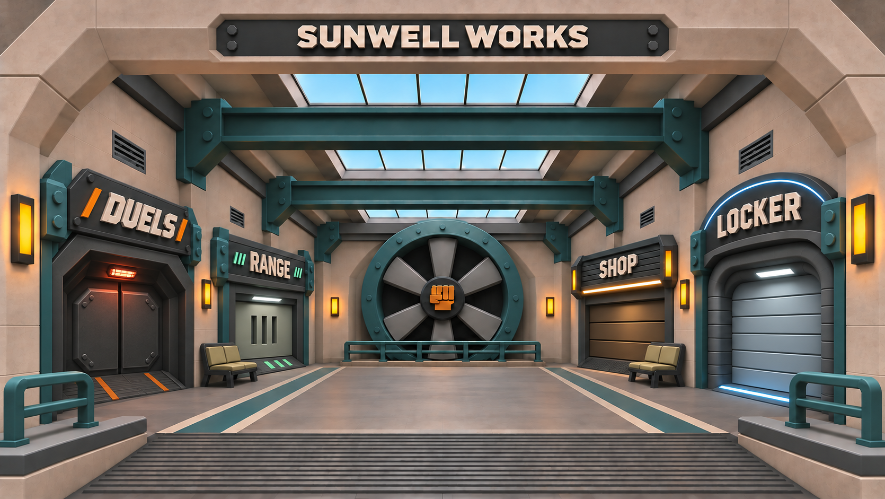
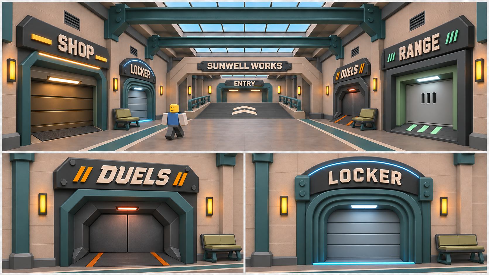
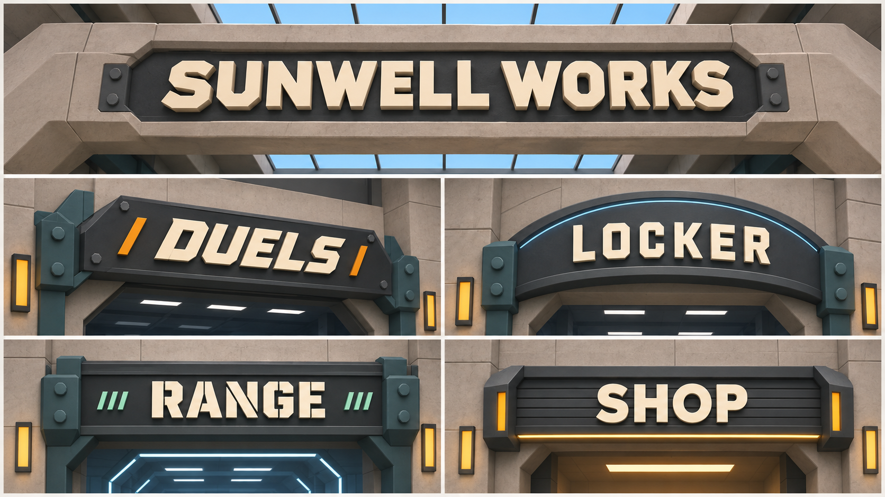
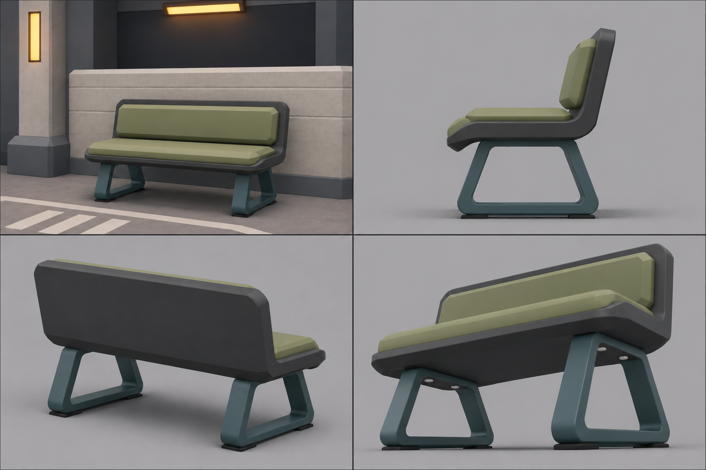
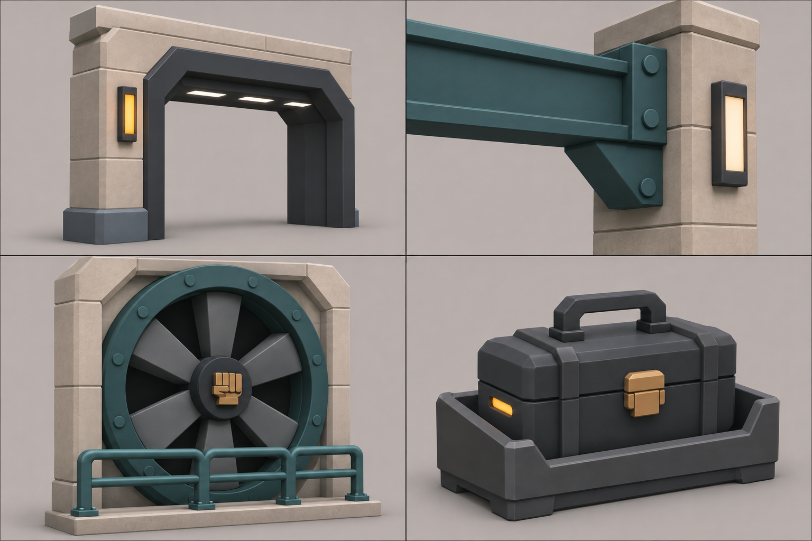
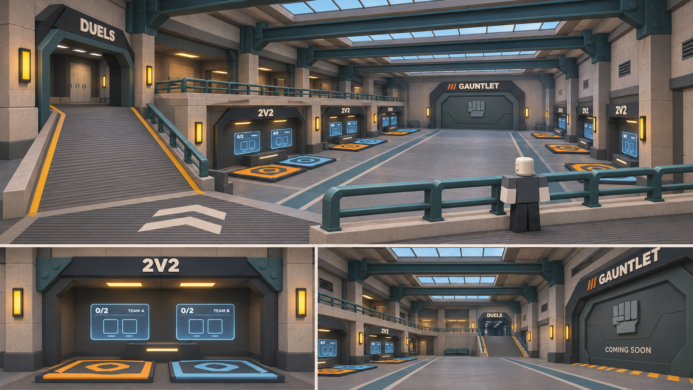
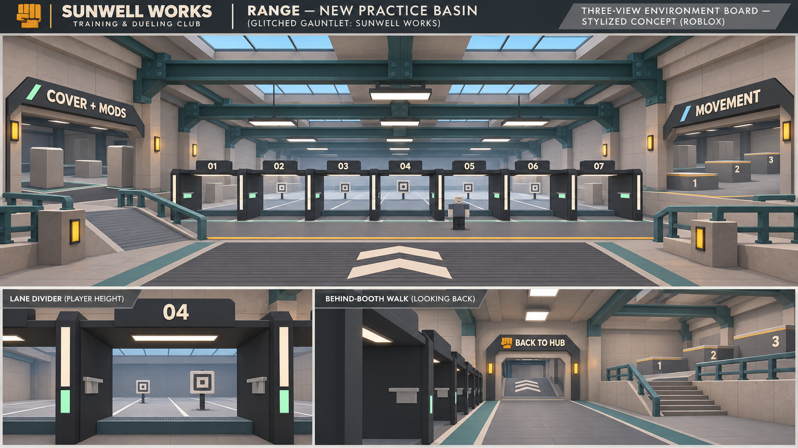
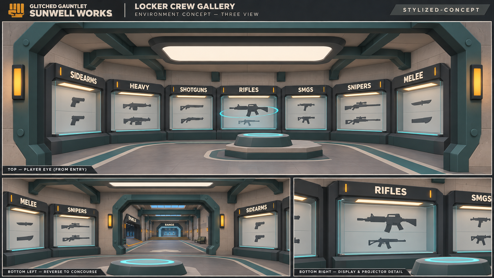
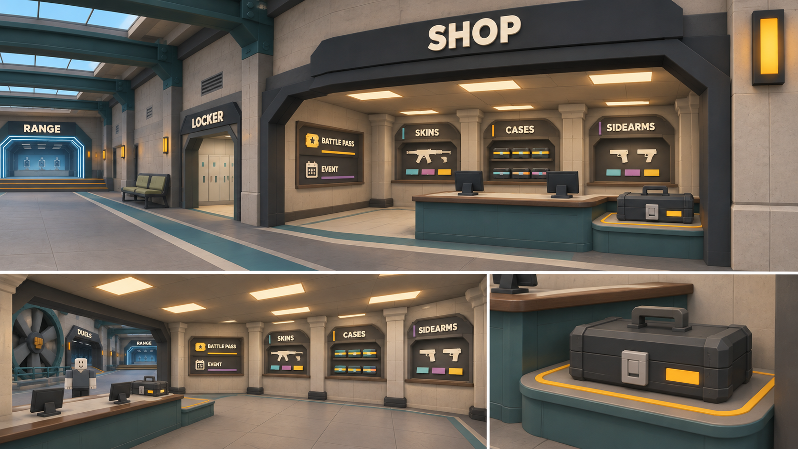

# Sunwell Works lobby reference pack

**Glitched Gauntlet · Main lobby concept · November 2026**

[Copy-ready Fable prompt](Sunwell%20Lobby%20Fable%20Prompt.md) · [Picture scores](References/lobby/sunwell-works/Visual%20Review.md) · [15 Studio captures and cameras](References/lobby/sunwell-works/Studio%20Views.md) · [ImageGen prompts](References/lobby/sunwell-works/Generation%20Prompts.md)

Sunwell Works is a former underground hydro station converted into a duel and training club. The rectangular concourse has a centered arrival, steel crossbeams and a decommissioned turbine mounted on the far wall. Broad painted shapes, shallow formwork seams and moderate bevels keep it recognizably Roblox. The same charcoal frames, petrol-blue steel and real light housings tie the space together.

## Phase 1 · Main hall and entrances

From spawn, Duels is near left and Locker is near right. Range and Shop sit farther along the opposite walls. Keep the big architecture balanced around the clear central walk and the turbine. The floor plan's 68 × 112 studs and 16-stud portal widths are suggested blockout dimensions. Check distance and scale with R15.

Give each short threshold its own approach and sign. Base wall bays, roof ribs, bench niches and rails establish symmetry. The inner silhouettes, light and floor cues establish the destinations.

### Dimensional signage

| Opening | Sign and approach |
| --- | --- |
| **Entry** | Cast block lettering recessed into the entrance lintel, with two balanced mounting points. Keep the title's scale secondary to the turbine once inside. |
| **Duels** | Leaning athletic ivory letters in a deep blast-frame head with one orange wedge bracket on either end. Run two short orange guide inlays into the opening, perpendicular to its sill. |
| **Locker** | Upright square letters in a shallow arched plate. The rounded steel sleeve, fitted ribs and thin cool-blue sill bar read as a vault threshold. |
| **Range** | Chunky ivory stencil letters fitted into a shutter cassette. A few mint calibration marks in the sill identify the threshold. |
| **Shop** | Broad ivory letters on a low ribbed valance, small vertical amber end caps and a warm light wash. A short dark mat leads in. |

Start with letters around 1.5–1.8 studs high at the wing portals. Test the wordmarks across the hall and at phone aspect. Use large stems and clear counters. Keep the central floor visually quiet. A directional mark should point to a route a player can take.

### Bench and shared props

The bench is one continuous formed graphite seat-and-back shell, two inset olive-slate pads, and two hollow steel sleds on rubber feet. The broad radius belongs in the seat-to-back bend. Smaller edge breaks hold the rest of the shape. Start around 6.5 studs wide, 2.25 deep and 1.7 at the seat. Check that a pair of R15 avatars can sit and that the support reads from underneath and behind. The turbine shroud, guardrail, portal casing and lamp all use the same approach to thickness, mounts and contact.

Build this phase through the four finished thresholds. Give each lined reveal 7–9 studs of depth as a starting point and recess its temporary closure beyond the inner frame. Treat the four closed panels as visible staging art. Use a seamed blast door in Duels, a cool segmented shutter in Locker, a square vented panel in Range and a warm horizontal shutter in Shop. Show the complete hall in Studio before committing to any wing layout. Use the phase plan for doorway order, the signage sheet for the lettering and the hall views for the four temporary closures. Details in the perspective art are starting points for the greybox.

## Wing concepts for the next review

The four boards carry Sunwell Works into the rooms. Use them to discuss the later layout. Their background views of the concourse come from the earlier study. The phase plan and sign sheet show the current hall.

### Duels

The old hall is a long, level row of pads. Turn Duels into a wider turbine floor with a raised arrival edge and a short ramp down one side. From the overlook, the closest pads sit in the foreground, a structural bay frames the middle, and the sealed **GAUNTLET** bulkhead holds the far corner. The floor has a clear center walk and an upper viewing edge where players can pause out of traffic. Use a flush view rail, a deep column base and inset utility bays for foreground texture. Keep the end gate visible from the entry.

Give each station two separate deck surfaces with small orange A and blue B light lips and clear slot marks. Place low status panes on one grounded projector rail. Group the stations in staggered banks around the floor. The build target is the live set of eight open stations and one grey, locked 4v4, with clearance checked for the widest pads. [Current ramp and hall](References/lobby/sunwell-refresh/studio/09-duels-entry.jpg) · [Current pad scale](References/lobby/sunwell-refresh/studio/10-duels-station.jpg)

### Range

Let players see the whole service basin from a slightly raised ready deck, then descend to the practice side behind the lane booths. Put a straight bank of booths ahead, cover and Mod practice to the left, and a short staggered movement route to the right. Use the deck behind the booths to reach each practice area and return to the hub. A bright end wall, interrupted ceiling ribs and colored threshold marks make distance and direction visible at a glance. A booth is a few good shapes: a thick standing divider, recessed task light, tactile sill and one distance or lane header.

The old V3 lobby has a preview room and a separate `RangeFar` shell. Sunwell Works proposes one walkable visual route with real floor transitions. Keep the existing Range menu and audit the current arrival/return markers when staging the new plan. The current checked-in menu still describes the Range as a future opening. [Current ready room](References/lobby/sunwell-refresh/studio/12-range-ready-room.jpg) · [Current practice lanes](References/lobby/sunwell-refresh/studio/14-range-far-lanes.jpg)

### Locker

Move the best part of the existing Locker into a compact U-shaped crew gallery. Keep the seven glass-front class bays, all 18 project display models and the turning Vandal as the hero. Use the shared graphite frames, warm-neutral case backs and slightly eased glass cassettes. Set the low projector slightly off the walk line and keep an open lap around it. A cyan orbit and task light give the display its identity. Use the real V3 game models and class assignments to fill the bays. [Current Locker threshold](References/lobby/sunwell-refresh/studio/04-locker-threshold.jpg) · [Current reverse angle](References/lobby/sunwell-refresh/studio/06-locker-reverse.jpg)

### Shop

Treat the Shop as the station supply desk. A wide opening shows an inset counter and a featured hard case from the concourse. Give Skins, Cases and Sidearms shallow, lit wall bays with clear silhouettes. Put Battle Pass and the Event display on the quieter return wall. Keep the shell in concrete and painted steel. Use amber lighting, a dark timber hand-contact surface and small brass fittings as the room's warm details. Give the case a legible lid seam, one sturdy handle, a seated latch and an inlaid rarity strip. [Current Shop entrance](References/lobby/sunwell-refresh/studio/07-shop-from-arch.jpg) · [Current alcoves](References/lobby/sunwell-refresh/studio/08-shop-alcoves.jpg)

## Roblox style targets

| Decision | Direction |
| --- | --- |
| Shape | Large recognizable silhouettes and broad planar faces. Start around 0.30–0.45 studs at major concrete corners, 0.04–0.10 at prop edges and one or two bevel segments. Use larger curves where a real form turns, such as the bench shell and Locker sleeve. Check each edge at gameplay distance. |
| Palette | Warm light grey concrete, charcoal joints and dark desaturated petrol enamel. Use off-white wayfinding. Amber marks the Shop, cool blue the Locker, mint the Range, and orange/blue identify Duel teams. Keep wall colors quiet. |
| Texture | Shallow panel reveals, a few board-form bands, rubber tread grooves and selected wear at handles and sill edges. Keep large surfaces matte and low frequency. |
| Light | Soft, broad neutral fill with clean contrast at openings and under the viewing edge. Use believable opal fixtures. Make signs, floor edges and prompts readable on low graphics. |
| Scale | Build around R15 and the normal third-person camera. Use the same wide shot, corner view and close prop view to judge each zone. |

The images are art references. Use the layout above, the live interaction counts, and a measured greybox to set footprints, proportions and wayfinding. Use project assets for anything represented by simplified display items.

## References and methods

| Reference | How it applies to Sunwell Works |
| --- | --- |
| RIVALS lobby | Walk-up stations and large mode words tell the player what to do from across the room. Use the same speed of recognition in an original split-level hall. [Official experience](https://www.roblox.com/games/17625359962/RIVALS) · [Nosniy launch trailer](https://www.youtube.com/watch?v=rqjR_IrJPac) · [Lobby and range screenshots](https://www.sportskeeda.com/roblox-news/how-play-roblox-rivals) |
| RIVALS Arena, Docks and Station | Arena's separated cover masses, Docks' industrial landmarks and Station's strongly themed architecture suggest three distinct jobs for the kit. Keep near forms clear, give each route a landmark and make the structural family recognizable. [Arena gallery](https://robloxrivals.fandom.com/wiki/Arena) · [Docks gallery](https://robloxrivals.fandom.com/wiki/Docks) · [Station gallery](https://robloxrivals.fandom.com/wiki/Station) |
| RIVALS lobby practice | Targets and practice zones are visually distinct from the approach. Bring that clarity to the Range's arrival deck and three branches. [Shooting Range (Lobby)](https://robloxrivals.fandom.com/wiki/Shooting_Range_%28Lobby%29) |
| Arsenal | Preserve clear Roblox proportions and read the big material blocks before small surface detail. [ROLVe's Roblox experience](https://www.roblox.com/games/286090429/Arsenal) · [LihFolk Arsenal teardown](../LihFolk/60%20High-Craft%20Game%20Teardowns/Teardown%20-%20Arsenal.md) |
| Pressure | Use a recognizable facility vocabulary across rooms, including repeated frames, service hardware and practical light. Give Sunwell a bright enough public route for a competitive hub. [Urbanshade's Roblox experience](https://www.roblox.com/games/12411473842/Pressure) · [LihFolk Pressure teardown](../LihFolk/60%20High-Craft%20Game%20Teardowns/Teardown%20-%20Pressure.md) |
| Super Golf! | Keep curves purposeful and easy to read next to flatter shapes, especially the bench bend and portal shoulders. [Nosniy Games' Roblox experience](https://www.roblox.com/games/4468711919/Super-Golf) |
| Niagara Parks Power Station and Tate Modern | Use real generator proportions, a single prominent piece of machinery and an overhead light seam to make the station believable. The Roblox renders set the level of stylization. [Niagara Parks generator hall](https://www.niagaraparks.com/attractions/niagara-parks-power-station/) · [Tate archive on the Turbine Hall](https://archive.tate.org.uk/Record.aspx?id=TG%2B12&src=CalmView.Catalog) |
| Roblox Creator Hub | Greybox the routes and heights first. Build one reusable structural bay with matching pivots, then assemble related room variants. [Environmental Art curriculum](https://create.roblox.com/docs/tutorials/curriculums/environmental-art) · [Modular environments](https://create.roblox.com/docs/tutorials/use-case-tutorials/modeling/assemble-modular-environments) · [Asset library and trim sheets](https://create.roblox.com/docs/tutorials/curriculums/environmental-art/assemble-an-asset-library) · [Choosing a Roblox art style](https://create.roblox.com/docs/tutorials/curriculums/user-interface-design/choose-an-art-style) |
| Modeling and level-design skills | Use the installed LihFolk worldbuilding, Blender modeling and import skills. The public World Builder skill's three-scale composition checklist is another reference for reviewing a room as structure, secondary masses and detail. [LihFolk V2 skills](https://github.com/lihfolk-cy/v2-vault) · [Roblox World Builder](https://github.com/benigeci/roblox-world-builder) · [Blender bevel manual](https://docs.blender.org/manual/en/latest/modeling/modifiers/generate/bevel.html) |

### Project evidence

- Live V3 decisions and hook names. [Lobby V3 Rebuild](Lobby%20V3%20Rebuild.md) · [Lobby design](../01%20Design/Lobby.md) · [Code Map](../04%20Tech/Code%20Map.md) · [Studio views](References/lobby/sunwell-works/Studio%20Views.md)
- Art, layout and QA. [Lobby Style Guide](Lobby%20Style%20Guide.md) · [Map Quality Standard](../01%20Design/Maps/Map%20Quality%20Standard.md) · [Range Brainstorm](../01%20Design/Range%20Brainstorm.md)
- LihFolk art and flow notes. [Lobby and Hub Design](../LihFolk/33%20Level%20Design/Lobby%20and%20Hub%20Design.md) · [Case Study - Rivals](../LihFolk/32%20Case%20Studies%20of%20Top%20Roblox%20Games/Case%20Study%20-%20Rivals.md) · [Bevels and Edge Highlights](../LihFolk/55%20Modelling%20Nuance%20and%20Readability/Bevels%20Chamfers%20and%20Edge%20Highlights%20Without%20Textures.md) · [Modular Environment Kits](../LihFolk/14%203D%20Modeling/Modular%20Environment%20Kits.md)
