# Sunwell Works build (started 2026-11-11)

The new Lobby, built from the [Sunwell Works reference pack](Sunwell%20Lobby%20Reference%20Pack.md) and the owner's [build prompt](Sunwell%20Lobby%20Fable%20Prompt.md). Modelled in the owner's live Blender (Blender MCP), imported into the open Lobby place (`71551303511506`) as a **staging copy**. The live V3 lobby in `Workspace.Lobby` is untouched.

**Status (2026-11-12):** in Studio (`Workspace.SunwellStaging`, 1,500 studs east of V3): the **main hall** and three wing interiors behind open doorways, **Locker**, **Shop** and **Duels**. **Range is on hold** (owner's call) and keeps its staged closure. Menu hooks are placed: 16 `LobbyQueue`, `LobbyShop`, `LobbyBattlePass`, `LobbyLocker`. Nothing is saved, published or committed.

**Fifth pass (2026-11-12, final check before the owner moves to other mechanics).** The owner's notes: glitched overlaps at the bench bays, the win-streak board's borders, overlap at the 4v4 station, glitching parts on the outside, and "make the fan spin with a very subtle whoosh". Textures and overall look approved; props and the Range come later.

| Note | Cause | Fix |
|---|---|---|
| Bench bays | Pilaster feet flared into the recess and the door casing; short stubs of wainscot and belt rail stuck out between them | The two piers beside each recess now fill the whole strip from the door casing to the recess edge and flare only outward; no wall stubs there |
| Board borders | A separate top rail, gussets and big cut corners | One even case with small chamfers, a bezel, a fixing at each side, a small status lamp (`sw_doors.display`) |
| 4v4 overlap | The GAUNTLET stage ran 9 studs out and under the nearest pads | Stage is 6.4 deep with cut front corners; pads start 0.8 beyond it |
| Outside | Two walls shared each corner block; end-wall and side-wall bases shared faces; the Shop and Locker walls shared a plane; bounding-box floor and ceiling colliders stuck out at the Locker's cut corners | Only the wall running into a corner continues behind the next; neighbouring wall tops differ by 0.03; end-wall prisms stop 0.1 short; Shop walls 3.9 thick; Locker floor and ceiling in stepped pieces |
| Fan | static | The rotor (seven blades, hub, collar) is its own group `Props.Visual.AnimFan`, tagged `LobbySpin`, 26 degrees a second about its own axis. The crest stays still in front. Sound: `SunwellStaging.Sounds.TurbineWhoosh`, Pro Sound Effects library loop 9125742262, volume 0.1, speed 0.72, 16 to 95 studs |

**Script change:** the lobby ambience script (`Workspace.Lobby.Ambience.AmbienceClient`, source `art-source/lobby/scripts/AmbienceClient_V2.luau`) now reads an optional `SpinAxis` Vector3 attribute; without it, things spin about world Y as before.

Checked in play mode: the fan turns 26.0 degrees in one second with its pivot fixed, the sound is loaded and playing; piers, bench recess, stage, gate and the 4v4 pads stop or carry the player correctly. Audit: 0 leaks, 0 floating (the Locker hologram ring floats on purpose), coplanar pairs down from 105 to 66, all contact or underside faces.

| | |
|---|---|
| 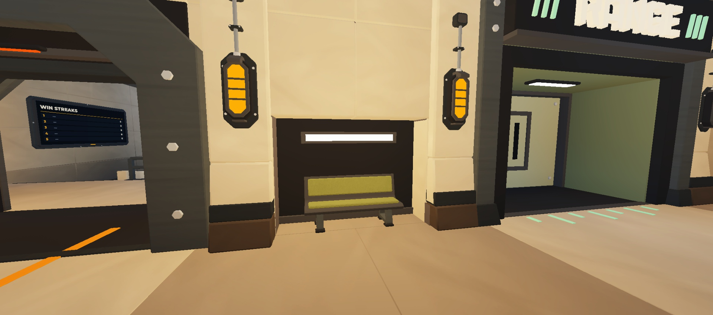 | 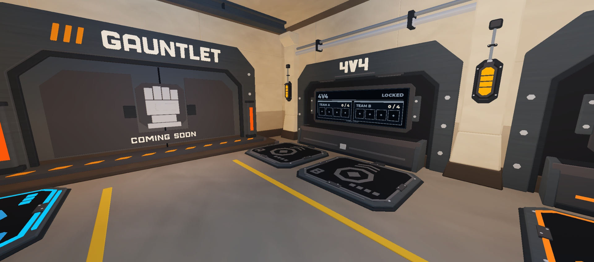 |
| 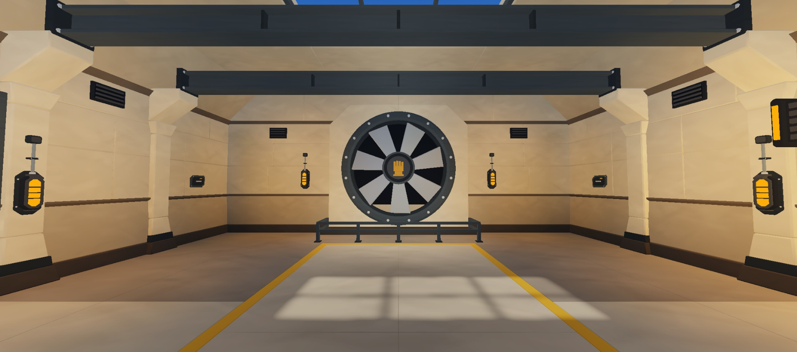 | 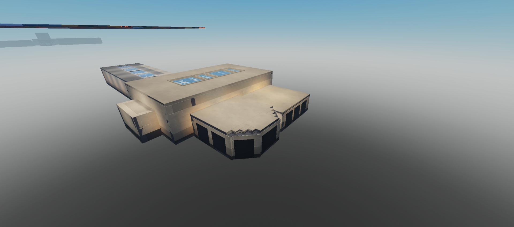 |

**Parked until the owner comes back to the lobby:** props, the Range interior, a per-wing lighting pass, live data on the boards (needs lobby UI code), prompt-to-menu test, phone and low-graphics checks, blind score, and moving the ambience script out of the V3 folder when Sunwell replaces V3.

**Third pass (2026-11-12, later): shape language and surfaces.** The owner's notes: fixtures were "simple rounded parts", joints between parts were not fluid, walls needed some texture (not realistic), the duel pads were dull; then RIVALS lobby screenshots as the reference, and "it can not be that simple".

| What | Now |
|---|---|
| Edges | Rounded bevels are gone from the kit: one-segment edges of 0.035 to 0.12 studs with weighted normals (`sw_run`), so forms read as flat facets |
| Walls | Battered wainscot (0.6 proud at the foot, leaning back to the wall), a sloped belt ledge, a facet crown that starts the haunch early; pilasters and piers with flared feet and heads and a steel shoe (`sw_hall.walls`, `sw_core.wall_seg`) |
| Wall lamp | Remodelled as a fitting: octagonal mount plate with fixings, housing, bezel with the lens set back behind three fins, visor block, gland, conduit, saddle clamp, junction box |
| Bays (Locker, Shop) | Cabinet and casing on one front plane with a shadow gap; the casing (sill, cheeks, header) is one continuous ring; cabinet doors with pulls; glass set back |
| Duel pads | Floor flange, gunmetal tray, light channel round a rubber deck held by four clamps, emblem, two chevrons, the team letter, one pip per player, a light lip, a cable duct to the console |
| Displays | Leaning silhouette (big cuts on two opposite corners), bolts only on real corners |
| Surfaces | Our own faint painted maps (`tools/textures/make_sunwell_textures.py` → `SW_Plaster`, `SW_Floor`, `SW_Steel`; about ±4% value, almost no bump, matte), made into MaterialVariants by `Build.materials()`. The owner's SteaveTech PBR pack was tried first and read **too realistic**. Specular down to 0.08, softer shadows |

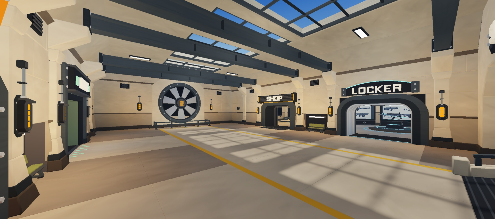

| | |
|---|---|
| 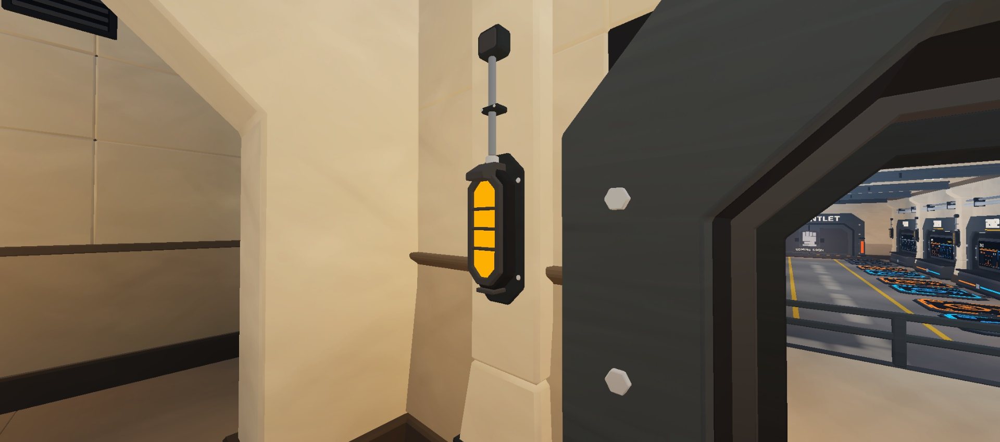 | 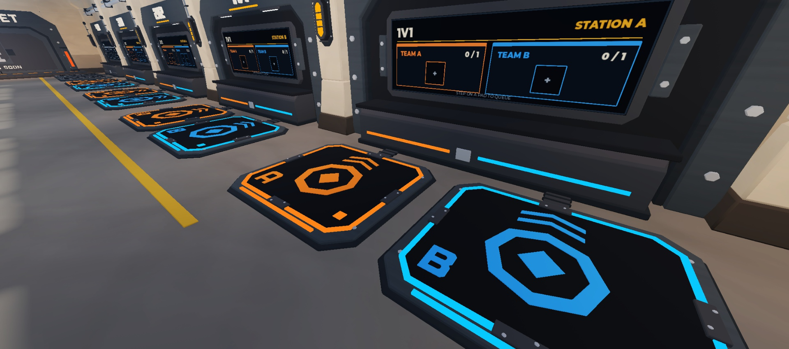 |
| 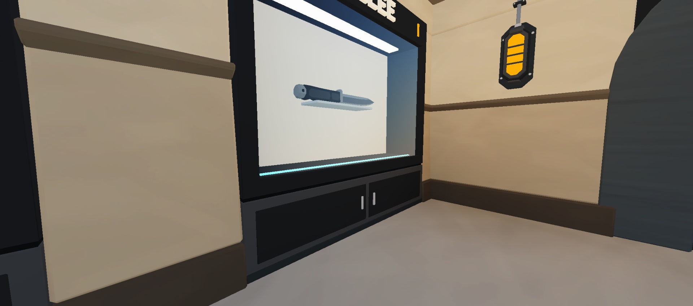 | 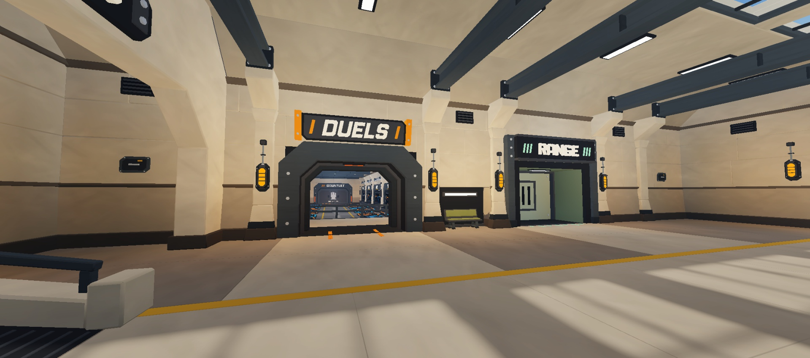 |

### Shape language (the rule for everything built from here)
Read from the owner's RIVALS screenshots and backed by outside sources (Riot's *The Art of VALORANT Map Environments*; Mellott and Klein on 80.lv / GamesArtist; LihFolk *Art-Direction Nitpicks*, *Hard-Surface Modeling*):
1. **Facets, not rounded boxes.** Silhouettes come from planar cuts, tapers and leans. Bevels are one segment and small; only lathes are round.
2. **Nothing is a plain upright box.** Walls batter 3 to 8 degrees, piers flare at foot and head, frames are chamfered or trapezoid, braces sit at 30 or 45 degrees.
3. **Every junction has a transition**: a plinth, collar, flange, bracket or a recessed shadow gap. Parts that meet share a plane or are clearly stepped. Bolts only where something is fixed.
4. **Build it the way it would be made**: mount plate, housing, bezel, lens; flange, tray, deck. One continuous piece where a real part would be one piece.
5. **Big, medium, small**, with quiet areas; detail sits at eye level and above, and clusters at edges and joints.
6. **Surfaces are flat colour with faint low-frequency variation.** No fine grain, no visible bump, nothing glossy.
7. Carried through on 2026-11-12 (fourth pass): station consoles (leaning front, cut top edge, end cheeks, kick), the Shop counter (leaning front with fins that follow it, end cheeks, chamfered timber top), the SUNWELL frame (flared plinths, a steel liner under each shoulder), Range posts (flared feet). Lighting: ambient down to 80,78,76 with the wall lamps up (1.25, range 16) so they make warm pools; station board text larger.
8. Still the older shapes: the Duels, Shop and Locker door casings (already chamfered or round by design), benches, the turbine surround. Not yet done: a stronger RIVALS-style light pass per wing, more props.

**Walked in play mode after the fourth pass:** ramp, both hall walls, a pilaster, the turbine wall and rail, the Duels doorway, a console and a pier, the Shop counter, cabinets and north wall, a Locker bay. Players stop at the foot of the leaning walls and the leaning counter (invisible stops along the foot, because a humanoid steps up anything lower than its hip height) and stand on the floor everywhere tested.

| | |
|---|---|
| 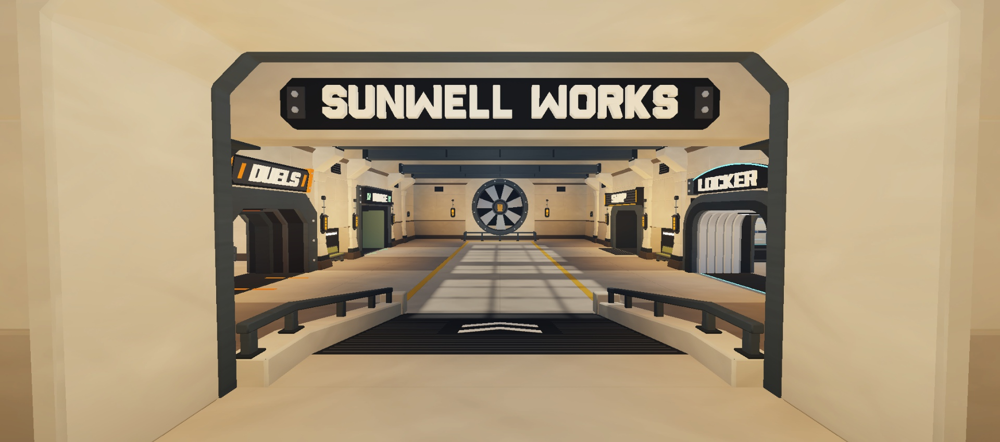 | 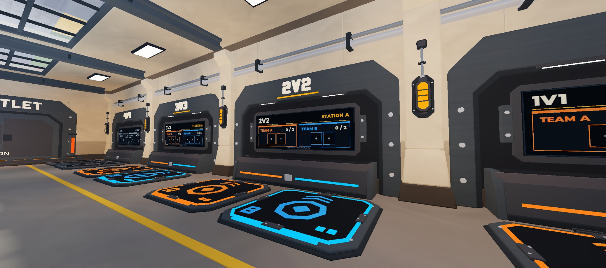 |
| 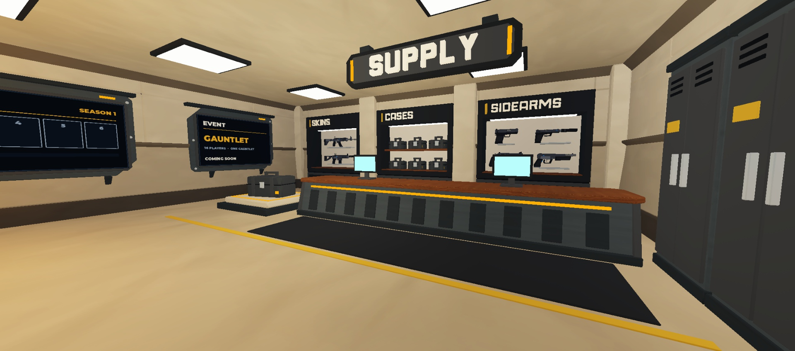 | |

Gotcha found: Studio MCP captures show SurfaceGui screens black and local lights off when the real viewport camera is far away. Move `workspace.CurrentCamera` into the room and wait before capturing.

**Second pass after the owner's notes (2026-11-12):** structures and lamps too simple, mixed colours in the Shop, Duels plain with poor mesh holograms, pads out of order and of mixed sizes, pads lying over the floor lines, walls without character.

| Note | Now |
|---|---|
| Lamps and boards too simple | One fixture kit (`sw_doors.sconce`, `sw_doors.display`): caged bulkhead lamp on a chamfered backplate with a hood and a conduit up to a junction box; framed displays with a bezel, top rail, status lamp, gusset brackets and bolts |
| Holograms | Gone. Station boards, the Battle Pass and Event boards and a win-streak board are **SurfaceGui screens** (`Build.screens()`, rows in `SW1Data/Screens.json`): mode, station letter, two team panels with slots. Static layouts; live data needs lobby UI code |
| Pads | All team pads are 10 x 9, team colour plate set in a dark slab, in **mode order** along each wall: north 1v1 A, 1v1 B, 2v2 A, 3v3 A, 4v4 (locked); south 1v1 C, 1v1 D, 2v2 B, 3v3 B. They end 2 studs short of the centre-walk lines |
| Duels plain | Skylight in every bay with crossbeams on corbelled piers, service pipes with clamps along both walls, a console with team footlights under every display, light pylons and a crest plate on the GAUNTLET gate, a win-streak board over the ramp |
| Shop colours | One accent (amber / ochre). Bays show real guns (two rifles, four sidearms) on pale backs; a hanging SUPPLY sign hung above the bay headers' sightline; supply cabinets on the near wall; ribbed counter front and a rubber mat |
| Walls | Trim hierarchy everywhere (`sw_core.wall_seg`, `sw_hall.walls`): dark base course, a darker wainscot course, a belt rail, a crown under the ceiling. In the hall, **pilasters frame each doorway and the bench bay**; they carry the corbels and beams (now at y 21.4, 46.6, 59.4, 84.6, 97.4) and the wall lamps. Service hatches low in the end bays |

Checked in play mode before the wall pass: Locker, Shop and Duels walk correctly (collar, platform steps, bay fronts, counter, deck rail, ramp, pads, gate, 795 floor rays with no holes). **Not re-walked after the wall pass. Still open:** prompts opening the menus, phone and low-graphics checks, blind score, screen text is small on the station boards, Locker has no props beyond the displays.

| | |
|---|---|
| 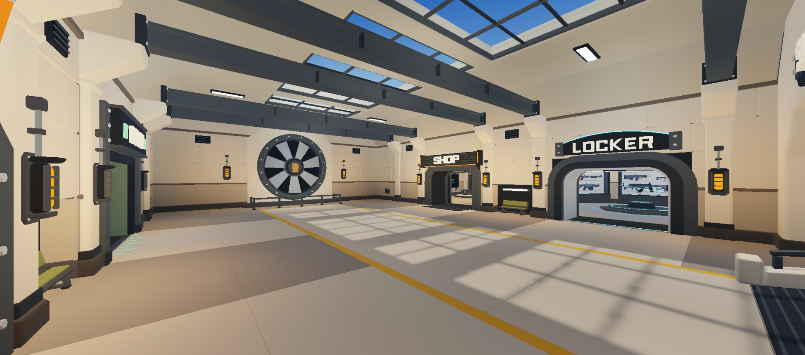 | 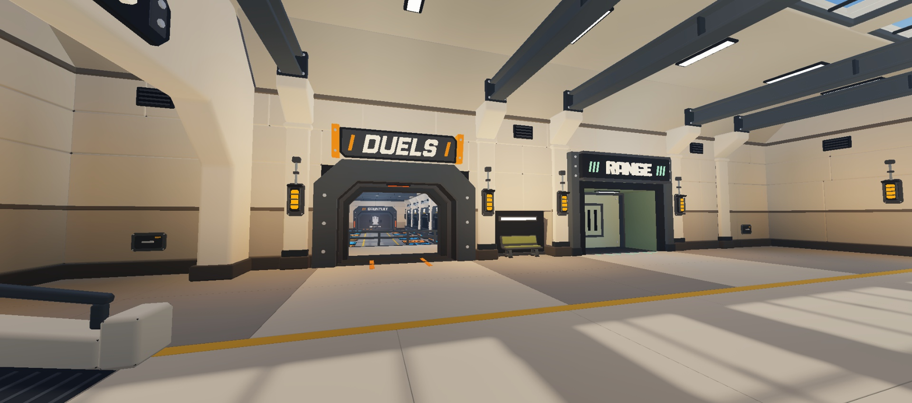 |
| 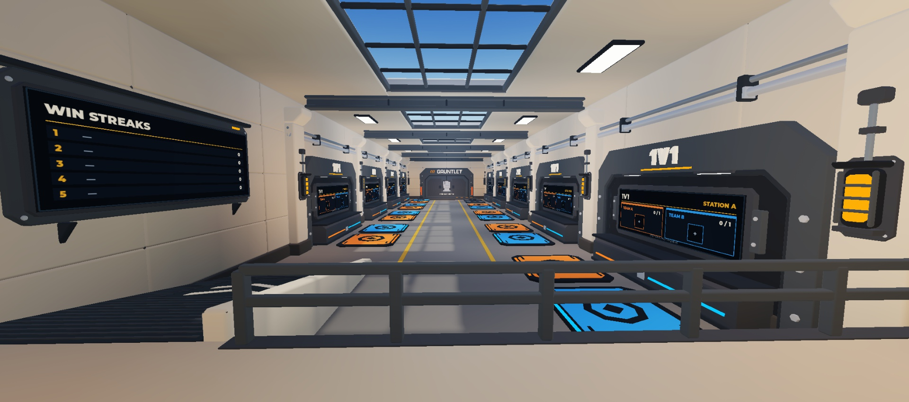 | 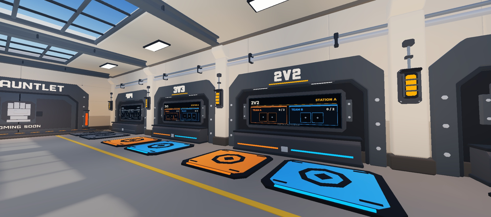 |
| 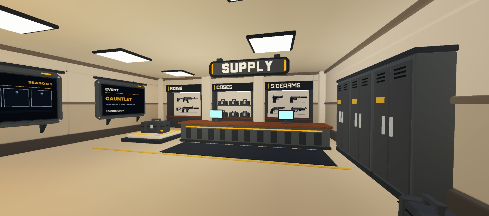 | 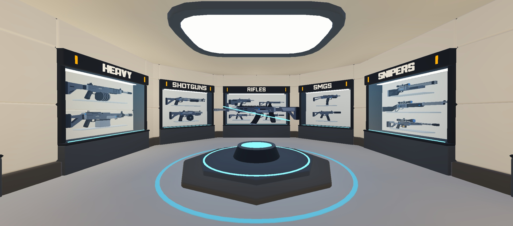 |

First pass captures (hall before the wall pass):

| | |
|---|---|
| 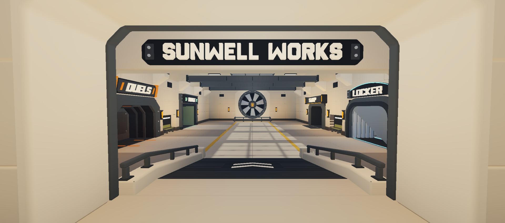 | 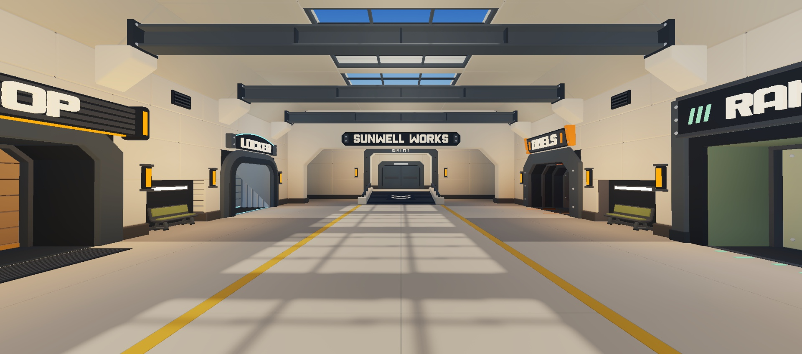 |
| 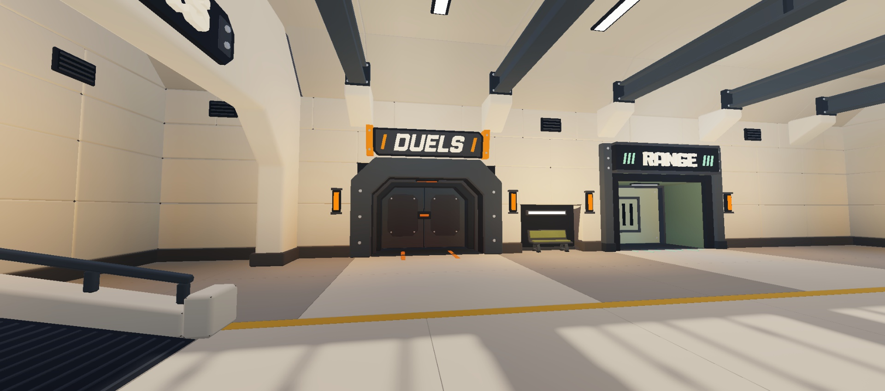 | 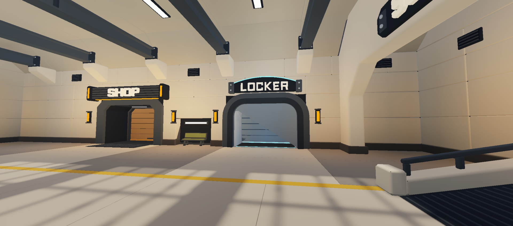 |
| 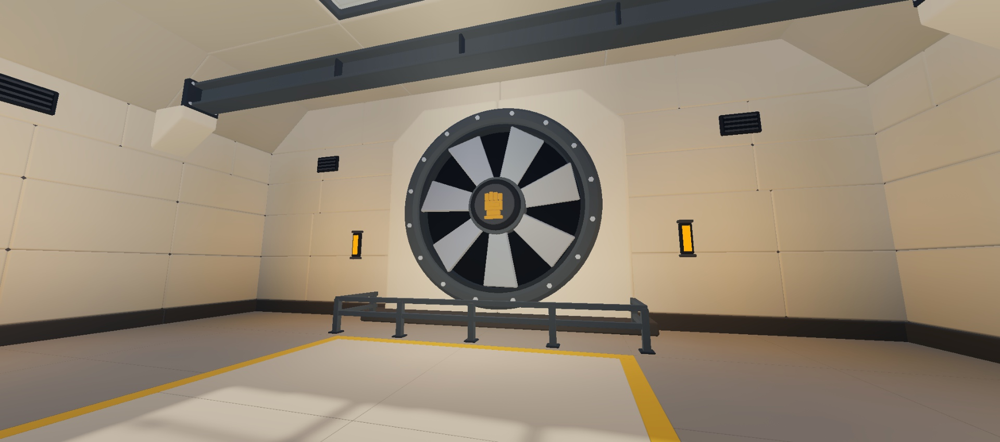 | 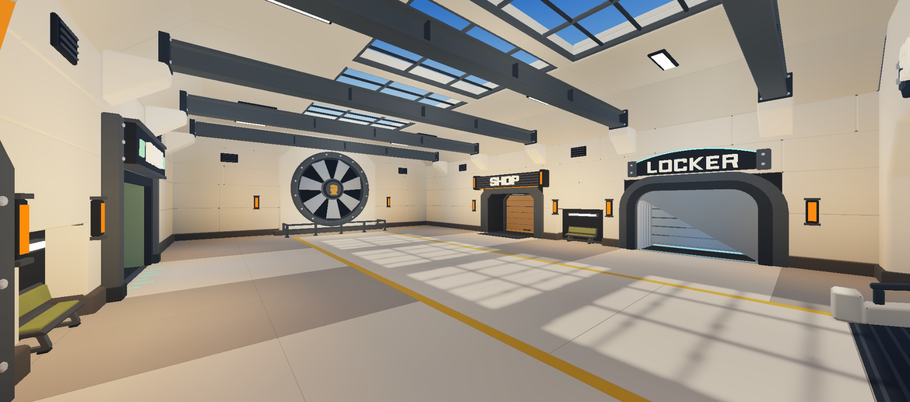 |

## How to look at it, and how to roll back
- Press Play in the Lobby place: you spawn on the arrival landing of the new hall. The staging spawn is on and the V3 spawn is off.
- **Back to V3** (Edit mode, command bar): `require(game.ServerStorage.SW1Data.Build:Clone()).use("V3")`. This turns the V3 spawn back on, the staging spawn off and restores the lighting recorded before the switch. `use("Sunwell")` switches again.
- To remove the staging build: delete `Workspace.SunwellStaging` and `ServerStorage.SW1Data` after `use("V3")`. The greybox is parked in `ServerStorage.Greybox`.

## Live scene recorded before staging (2026-11-11)
- `Workspace.Lobby`: `Hub` (6,917 instances: Hub 2,900, Duels 471, Market 1,361, Vault 1,844, Range 309, Anchors 21, Markers 1, FX 2), `Greybox` 161, `Art` 1,275, `Ambience` 1. StreamingEnabled on. `ServerStorage`: `LobbyKit`, `Archive` (old hub), `LobbyTools`, `V3Data`.
- Tags in the Workspace: `LobbySpawn` 1 (a SpawnLocation at `(0, -1.4, 14)`, `Hub.Anchors`), `LobbyQueue` 16, `LobbyShop` 1, `LobbyBattlePass` 1, `LobbyLocker` 1, `LobbyRangeEntrance` 1, `LobbySpin` 4, `LobbyPulse` 3, `LobbyLight` 143.
- Lighting found: Ambient and OutdoorAmbient 70,70,70; Brightness 3; ClockTime 14.5; exposure 0; EnvironmentDiffuse 1 / Specular 1; LightingStyle Soft; Atmosphere density 0.3, offset 0.25; Bloom 1 / 24 / 2. (This is not the V3 note's set; `Lighting.LightingPreset` = DefaultGraphics.) Camera zoom 0.5 to 128.
- Lobby code is tag-driven only: no script reads `LobbySpawn` or `Workspace.Lobby.Hub` by path (`src/lobby/client/Controllers/WorldPrompts.luau` hooks `LobbyQueue` by `Mode`, `LobbyShop`, `LobbyBattlePass`, `LobbyLocker`, `LobbyRangeEntrance`; `PadId` is read nowhere).

**Hooks for the wings** (same tags and attributes as V3, re-placed when each wing is built): Duels → 16 `LobbyQueue` zones (`Mode`, `PadId`); Shop → `LobbyShop`, `LobbyBattlePass`; Locker → `LobbyLocker`; Range → `LobbyRangeEntrance` plus `Markers.RangeReturnPoint` (on hold).

## Greybox findings (walked first, as asked)
- 68 x 112 x 28 hall proportions are right; spawn to the Duels sill takes about 5 s, to the far doors about 7 s.
- A deep arrival tunnel made the first view a slot: the alcove is now 10 deep and the spawn stands near its mouth.
- 1.7-stud door letters were small across the hall: they are 2.0 to 2.3 now; the lintel letters 2.5.
- The lintel sits at z 16.5 to 22 so `SUNWELL WORKS` is inside the frame from the spawn camera without tilting.

## Hall as built (Blender: X east, Y forward from the entry = Roblox −Z, Z up)
| Part | What |
|---|---|
| Shell | Interior x ±34, y 0 to 112, floor 0, walls to 22, haunch to a ceiling at 28. Walls are coursed blocks (joints from small bevels), a dark base course, four skylights (24 x 17, mullions, glass) on the centre line. Five crossbeams on corbels under the roof ribs (y 24.5, 43.5, 62.5, 81.5, 100.5), clear of every doorway sign |
| Arrival | Alcove behind the entry wall (floor +3, sealed arrival gate), landing, a 16-stud ramp (10.6°) with tread ribs and two chevrons pointing into the hall, cheek walls with rails |
| SUNWELL WORKS frame | Cast frame across the hall at y 13.5 to 16.5 (legs, chamfered shoulders, lintel), the sign on both faces: chunky block letters 2.5 high, 0.5 deep, on a dark plate with two bolted mounts |
| Floor | Clear centre walk 24 wide between two ochre lines that run to the turbine rail; lighter approach bands to each doorway; darker side fields |
| Doorways | Clear 16 x 11, reveal 7.6 deep to a recessed closure. **Duels** (near left): chamfered blast frame, seamed blast door, leaning plate with italic letters clamped by two orange wedge brackets, two orange floor inlays, orange task light. **Locker** (near right): rounded steel collar with five fitted ribs, segmented shutter, arched plate with upright letters, cool-blue sill line. **Range** (far left): shutter cassette on two posts, stencil letters, mint ticks on the sign and in the sill, square vented panel. **Shop** (far right): low ribbed valance with vertical amber end caps and a warm strip, broad letters, warm slatted shutter, dark entry mat |
| Turbine | Cast surround, bolted ring (21.9 across), seven still blades, hub with a bronze Gauntlet fist crest, plinth and a low rail 9 studs in front |
| Benches | One per side in a recess between the doorways: formed shell, two olive pads, two sleds on rubber feet, 6.5 x 2.25, seat at 1.7; an opal bar above |
| Lettering | Our own parametric block face (`sw_core.glyph`): chamfered cast (lintel), sheared (Duels), squared (Locker), stencil with bridges (Range), rounded and wide (Shop). Real depth, bevelled, sunk 0.05 into their plates |
| Lights | 41 unshadowed local lights (wall lights, task lights, opal ceiling panels) plus daylight through the skylights. Lighting set: Ambient 92,90,88; OutdoorAmbient 118,118,122; Brightness 2.2; ClockTime 12.4; latitude 8; exposure −0.6; EnvironmentDiffuse 0.35 / Specular 0.3 |

**Palette after the owner's note (no blue-teal steel, no concrete texture):** everything is SmoothPlastic colour blocks. Walls `#A69E90`, cast frames `#B0A899`, ceiling `#938D80`, walk `#989083`, side floor `#736D65`, base course `#3F3D3A`, structural steel gunmetal `#3E4347` / `#2B2F33` (the code still calls it `Petrol`), plates charcoal `#232528`, letters cream `#EDE2CA`, walk lines ochre `#A8802F`, lamps amber Neon `#EA7A0A`. Wing colour only in signs, small lamps and floor cues: Duels orange, Locker cool blue, Range mint, Shop amber.

## Checks
| Check | Result |
|---|---|
| Geometry audit in Blender (`sw_run.audit()`, the V3 audit with Sunwell probe points) | 0 floating solids, 0 leaks from 11 probe points (2,500 rays each), no visible coplanar pairs (the 9 left are contact faces against walls or undersides). 6 open edges in letter meshes (zero-width seams, not visible) |
| Triangles | Hall 24,004, Doors 16,076, Props 18,540; largest mesh 6,160 |
| Overlap fixes after the owner's note | Beams moved off the doorway axes (the Duels sign had a corbel and beam right above it), Duels plate lifted clear of its casing and clamped beside (not through) its brackets, landing no longer shares a face with the cheek walls, Range cassette lips no longer cut into the cassette, closure colliders moved behind the closures so no grey shows through seams, vents removed from above the signs |
| Walk in play mode (R15, 5.44 tall, speed 16) | Stands at the right height everywhere; all four reveals stop the player at the closure; the turbine rail stops the player 10 studs from the wall; alcove walls stop the player; the player can hop onto a bench and onto the ramp cheeks (harmless) |
| Camera | Forced to zoom 110 at mid-hall it stays inside the shell. Not tested: looking straight down from under a skylight (glass does not stop the camera; the roof outside is plain) |
| Not done | Blind review score; phone device test (captures are at 2.26 : 1, close to phone aspect); low-graphics check; wear marks |

Self-rating of the hall after the fixes: **8 / 10**. Strong first view, clear doorway reads, real signs, one landmark. Held back by plain upper walls and an empty middle (the owner plans more for the centre later).

## Standalone pieces (2026-11-13)
Owner's note: meshes were merged (one mesh per material per area), so moving a case or a lamp moved everything of that material. Now **every object is a piece**: in Blender, geometry is built inside `with S.grp("Lamp", M, inst=True):` (`lv3_core.grp`), which gives it its own objects. In Studio each piece is a **Model you can click and move on its own**, holding its meshes, its invisible colliders and its lights; a piece with sub-pieces (a doorway with its lamps and sign) is a Folder holding its Model and the sub-pieces' Models. 309 pieces, 0 loose meshes.
- **Identical pieces share one mesh** (`inst=True` and the same shape in the piece's own frame): 102 of them (lamps, ceiling lights, pads, piers, beams, vents, cabinets, cases) are clones of a prototype's meshes, so the upload stays at 7 FBX files and Roblox can batch them. Attribute `SharedWith` names the prototype.
- Studio: `require(Build).rebuild()` builds all areas in order (meshes, then colliders, lights, screens, guns, anchors, sounds). Piece attributes: `PiecePath` on Models, `PieceFolder` on Folders.
- Rule for new work: never build visible geometry outside a `S.grp(...)`; the export reports loose objects.

## Pipeline (reuses the V3 method)
1. Build: `tools/blender/sunwell_p1/` → `sw_core.py` (palette, frames, lettering), `sw_hall.py`, `sw_doors.py`, `sw_props.py`, `sw_run.py` (`build_all()`, `audit()`, `shots()`, `save()`), `sw_export.py`. It imports the V3 solid builder (`tools/blender/lobby_v3/lv3_core.py`). Blend: `art-source/lobby/SunwellWorks.blend`.
2. Export: `sw_export.run()` writes `art-source/lobby/Exports/SW1_<Area>.fbx` and `SW1Data/*.json`.
3. Upload: `python tools/opencloud/upload_models.py --lobby --group 11116787 SW1_Hall SW1_Doors SW1_Props SW1_Locker SW1_Shop SW1_Duels`, then `python tools/studio/sunwell_p1/upload_data.py --group 11116787` (packs the JSON, the asset ids and `Build_SW1.luau` into the `SW1_Data` model).
4. Studio (Edit, through the MCP): load `SW1_Data` into `ServerStorage.SW1Data`, `require(Build)`, then `visual(area)`, `collision(area)`, `lights(area)` for Hall, Locker, Shop, Duels (Doors and Props have no lights), `guns()`, `anchors()`, `screens()`, `sounds()`, `materials()`, `spawn()`, `use("Sunwell")`. Wing builders: `sw_locker.py`, `sw_shop.py`, `sw_duels.py`; `sw_run.WINGS` lists the built wings (their doorways lose the closure). `relook(table)` recolours without a re-import.
- Collision: visible meshes never collide. The shell has a hand-placed sealed core (floor, walls, roof, base courses); ramp, landing and cheeks record their own; rails, benches, glass and the turbine keep-out are invisible boxes.

## LihFolk notes used
*Lobby and Hub Design* (spawn faces the centrepiece, first station under 15 s, benches off the spawn line); *Level Design Principles* (landmark size from the spawn, compression then release); *Modelling to the Roblox Camera and Player Scale* (letter size by distance, test at phone aspect); *Camera Obstruction Handling* (Zoom ignores transparent or non-colliding parts); *Bevels Chamfers and Edge Highlights Without Textures*; *Modular Environment Kits*; *Light Sources and Shadows* (Neon needs a real light beside it, decoration lights unshadowed); *Exporting and Validating Models for Roblox*. Skills: `gauntlet-vault`, `lihfolk-worldbuilding`, `roblox-blender-modeling`.

## Log
- **2026-11-12 (fifth pass):** bench-bay piers, quieter display frames, GAUNTLET stage clear of the pads, exterior overlaps removed, the turbine turns with a soft whoosh (ambience script gained `SpinAxis`).
- **2026-11-12 (fourth pass):** shape language carried to consoles, counter, SUNWELL frame and Range posts; lamp pools and lower ambient; larger board text; invisible stops at the foot of battered walls; walk test repeated.
- **2026-11-12 (later):** third pass: crisp one-segment edges with weighted normals, battered walls and flared piers, remodelled lamp, one-piece bay casings, duel pads as equipment, our own faint textures (the PBR pack read too realistic), softer specular. Shape-language rules written down.
- **2026-11-12:** second pass on the owner's notes: fixture kit, SurfaceGui screens, Duels rebuilt (ordered uniform pads, skylights, pipes), Shop on one accent, wall trim hierarchy and hall pilasters. LihFolk notes used: *Art-Direction Nitpicks* (a transition piece at every junction, 5-15% asymmetry), *Colour Scripts and Value Structure for Untextured Art* (3-5 value bands), *Spending Triangles Where the Camera Looks* (quiet panel middles, busy edges), *Hard-Surface Modeling*.
- **2026-11-11:** greybox walked; hall, thresholds, turbine, benches and signs built in Blender, imported, walked. Owner's first notes applied (overlaps, palette, flat surfaces). Wing interiors started (Locker, Shop, Duels); Range on hold.
