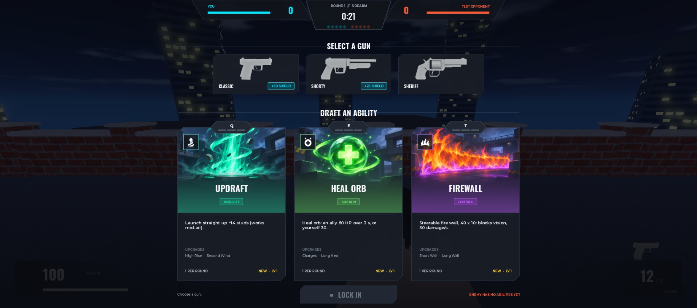

# UI Art Brief (ChatGPT)

Art for UI v1 ([UI Design](UI%20Design.md)) made with ChatGPT's image generation, 2026-11-03. The game swaps it in through `Config/Theme` and `Config/Mods` `icon`. Everything must be original: no Valorant, RIVALS or other game characters, logos or ability art.

## Where files go
`art-source/ui/chatgpt/icons/<Id>.png` and `art-source/ui/chatgpt/cards/<Id>.png`, with these ids:
Dash, Updraft, Molly, Firewall, Frost, Recon, HealOrb, Stim, Recall.

## The prompt sent to ChatGPT

> I'm making UI art for my Roblox shooter (this folder: GlitchedGauntletGame). The style is Valorant's clean tactical UI mixed with RIVALS' chunky, bright Roblox feel. Everything must be original, so no characters, logos or ability art from Valorant, RIVALS or any other game.
>
> **1. Ability icons (9).** One PNG each, 512×512, **transparent background**. A flat, solid **white** glyph (no colour, no gradient, no outline, no text), bold and simple enough to read at 40 px, centred with about 12% padding. All 9 share one consistent style: thick shapes, a few sharp angles, Valorant ability-icon feel.
> - Dash: a quick forward dash (speed streaks plus a forward chevron)
> - Updraft: a burst of wind launching straight up
> - Molly: an incendiary canister with a flame
> - Firewall: a curved wall of fire
> - Frost: an ice crystal burst that slows
> - Recon: a sensor dart with scan rings
> - HealOrb: a glowing orb with a plus
> - Stim: a beacon with an energy bolt
> - Recall: an anchor point with a return arrow
>
> **2. Ability card art (9).** One PNG each, **1024×768** (4:3), no text, no UI, no characters. A stylised, painterly game-key-art close-up of the ability's effect against a dark, moody, slightly blurred arena background, lit in the ability's colour, with the subject in the upper middle and the bottom third dark (text sits there):
> - Dash `#2BD9A8` teal, Updraft `#2BD9A8` teal, Molly `#FF7A3D` orange, Firewall `#C15CFF` purple-magenta with orange fire, Frost `#C15CFF` violet and icy blue, Recon `#4C8DFF` blue, HealOrb `#6BE36F` green, Stim `#FFC53D` yellow, Recall `#8E7CFF` violet.
>
> Save them as `art-source/ui/chatgpt/icons/<Name>.png` and `art-source/ui/chatgpt/cards/<Name>.png` (names: Dash, Updraft, Molly, Firewall, Frost, Recon, HealOrb, Stim, Recall). Do the icons first. If you can't save files, show them here and I'll download them.

## Result
Completed: all nine icons and nine cards saved under `art-source/ui/chatgpt/`, using the exact ability IDs above. Icons verified as 512x512 RGBA PNGs with pure white glyphs, transparent backgrounds and approximately 12% padding. Cards verified as 1024x768 PNGs. `art-source/ui/chatgpt/Preview.png` provides a contact sheet. Artwork only; Roblox asset upload and in-game wiring are separate steps.

**In game (2026-11-04):** `python tools/ui_chatgpt.py` made white 256 px icons and 760 × 600 card art (cut corner, bottom fade) in `art-source/ui/chatgpt/out/`; all 18 uploaded and wired: icons in `Config/Mods` `icon` (draft, HUD slots, kill feed), card art in `Config/Theme` `CARD_ART`. With art, a new-ability card shows the picture on top and its icon in a small badge in the corner (the big centred icon covered the picture's subject). Checked in a Studio draft:

Note: ChatGPT's desktop app refused Claude's clicks (Windows UIPI, likely run as administrator), so the user pasted the prompt by hand.

## Card art v2 + the free pack (2026-11-17)
The owner: the v1 cards are "a bit too realistic", they "don't really fit the vibe"; they want a cooler, cleaner, less fancy look that shows what each power does without looking Roblox-blocky, plus cards for the three new Mods (Shock Dart, Flash, Roller). Then: "they all need their own kind of theme... the background should be more simple, like a simple backdrop... so they all look exactly the same... and should look like our new abilities."

### The theme: "Gauntlet Stage"
One backdrop behind all 12 cards, made by us so it is exactly the same on every card: `art-source/ui/chatgpt/card_backdrop.png` (1024 x 768, `tools/ui/make_card_backdrop.py`).
- A dark slate room: a gradient from slate `#2A313B` at the top to charcoal `#14181E`.
- Two staggered plates in our UI shape language: a darker one at the back with its top-left corner cut, and the front panel with one 45° cut on the top right, a lit top edge and a hairline.
- A faint diagonal slash across the front panel (the brand mark) and a faint floor grid.
- A soft neutral pool of light on the floor where the subject stands.
- The bottom 35% fades to `#12151A` for the card's text.
- No colour of its own: each card adds only its subject and that power's coloured light. `card_backdrop_example.png` shows a sample orange light on it.

### Matching our abilities
`art-source/ui/chatgpt/card_refs/` (`tools/ui/make_card_refs.py`): for each Mod, its real model captured clean in Studio and its in-game effect, side by side and labelled. `All.png` puts the 12 on one sheet; the sources are in `card_refs/src/`. ChatGPT redraws these in the clean stylised look, so the shapes, colours and effects match what players see in game. Dash and Updraft have no model, only their wind strokes. Firewall shows only its wall.

**What changes from v1:**
- Painterly brushwork, detailed arena buildings and busy particles become clean cel-shaded subjects on one fixed backdrop.
- One hero subject per card, showing the power in action, readable at draft-card size.
- Subjects and colours come from the in-game models and effects (the reference sheet), not guesses.
- Our faceted shape language: angular, chunky, not cubes.
- A style lock: Molly is made first as the style master; once the owner likes it, the other 11 match it.
- Part 2 makes ChatGPT icons for the three new Mods (they use stand-ins today).

**Pipeline when the images come back:**
1. `art-source/ui/chatgpt/cards_v2/<Id>.png` and `icons/<Id>.png`.
2. `python tools/ui_chatgpt.py` (now 12 ids; it reads cards_v2 first) writes `out/`.
3. Upload with `tools/opencloud/upload_asset.py --type Decal` and resolve the image ids.
4. Wire them up: `Config/Theme CARD_ART` (draft cards, the match-end screen) and `Config/Mods` `icon` (draft, HUD slots, kill feed, status tray).

### The prompt
Attach `card_backdrop.png` and `card_refs/All.png`. Then paste the text below. If a card drifts from the set, attach that power's own sheet (`card_refs/<Id>.png`) and ask for a redo.

> I'm remaking the ability card art for my Roblox shooter. There are 12 cards, one per ability. They must look like one matching set, and each card has to show clearly what its ability does. Everything must be original: no characters, logos or ability art from Valorant, RIVALS, Overwatch or any other game.
>
> I've attached two images:
> 1. card_backdrop.png: THE BACKGROUND FOR EVERY CARD. Use it exactly as it is, the same on all 12: same size, same plates, same floor, same framing. Don't redraw it, restyle it, zoom it, add scenery or change its colours. On top of it, add only the ability's subject and that ability's coloured light.
> 2. All.png: our real in-game abilities. For each one it shows the model and what the effect looks like in game. Draw OUR versions: the same shapes, parts, colours and effect type, redrawn in the style below. These are game screenshots, so leave out the screenshot look: no sky, no arena, no gun or hand, no HUD, no plastic Roblox look.
>
> STYLE (identical on all 12)
> - Clean stylised game illustration: bold graphic shapes, crisp edges, cel-shading with 2-3 flat tones per surface, a thin bright rim light, and one soft glow on the energy only. Think simplified modern hero-shooter splash art.
> - Not painterly or photoreal: no brush texture, film grain, tiny details or busy particle clouds.
> - Shapes are angular and faceted (cut corners, flat planes, sharp tapers), solid and chunky, but NOT Roblox-blocky: no plain cubes, no studs, no LEGO look.
>
> LAYOUT (identical on all 12)
> - One hero subject, the ability in action, standing on the backdrop's floor in the pool of light, centred, in front of the cut-corner panel. Seen from a slight 3/4 angle a little above, like the reference model shots.
> - Same scale on every card: the subject fills about the middle half of the width, and its top stays inside the panel.
> - The effect may spread across the floor and rise into the panel, but the bottom 35% of the image stays dark and empty for the card's text.
> - The ability's colour lights the subject, the floor around it and the panel behind it. That's the only saturated colour on the card.
> - No text, numbers, UI, frames, borders, people, hands, or weapons held by anyone.
> - 1024 x 768 PNG (4:3), the same size as the backdrop.
>
> THE 12 CARDS (name: what to show, then its colour)
> 1. Dash: there's no object, just the wind. A burst of speed racing across the floor from left to right: long sharp white wind strokes like the ones in the reference, two or three fading after-image chevrons, a few flecks kicked off the floor. White with sky blue #5BC8FF.
> 2. Updraft: the wind again. A tight column of the same sharp wind strokes blasting straight up from a small hexagonal ring on the floor, a few angular flecks lifted inside it. White with sky blue #5BC8FF.
> 3. Molly: our canister (a squat charcoal body with orange side panels and a small cap) landing on the floor and bursting into a wide round pool of angular flame tongues, like its in-game fire pool. Orange #FF7A2E with a hot yellow core.
> 4. Firewall: a long, low wall of angular flame tongues crossing the floor at a slight angle, red-orange at the top, yellow at the base, like the reference. A scorch line runs along its base. Orange-red #FF5A2E with hot yellow.
> 5. Frost: our canister (a tall white body with ice-blue window strips and a black cap) shattering into a burst of big pale-blue ice crystals rising from the floor, with a flat frost star spreading across the floor around them. Icy blue #7FD6FF and white.
> 6. Recon: our bow (a slim dark recurve bow) and its glowing sensor dart stuck in the floor. A flat cyan ring of scan light spreads out across the floor from the dart, and two red diamond markers float where enemies are spotted. Cyan #2FD3E6, markers red #FF5A4E.
> 7. HealOrb: our orb, floating: a glowing teal-green core inside two or three thin curved bands of light orbiting it at different angles, and a few healing motes rising. Green #5EE09A with teal.
> 8. Stim: our beacon (a small charcoal unit on short splayed legs, with a yellow-black hazard plate and a glowing yellow coil on top) projecting a flat glowing ring on the floor around it, with upward chevron arrows rising inside the ring (a speed boost). Yellow #FFC83D.
> 9. Recall: our anchor beacon (the same small legged charcoal unit, topped with a glowing violet crystal) on the floor. A glowing trail loops back to it like a rewind arrow, with broken light fragments being pulled in. Violet #9B6BFF.
> 10. ShockDart: our bow and its bolt with a glowing amber tip, striking the floor. A bright lightning strike cracks down onto the impact, and jagged electric arcs crawl out across a flat glowing ring on the floor. Electric blue #5EC4FF with amber #FFB547.
> 11. Flash: our flare canister (a tall charcoal body in stacked sections, a glowing gold cap and a cyan light band) bursting in mid-air into a blinding starburst: a white-gold core and long pale light rays fanning out across the panel. Keep the card mostly dark around the rays. Gold #FFF0B8 core, pale cool teal #BFE6D6 rays.
> 12. Roller: our bot rolling fast toward the camera, about to blow: a charcoal body between two big chunky tread wheels, two angry slanted glowing orange eyes, a yellow-and-black hazard stripe on its chin and a thin antenna with a cyan tip. A trail of sparks and fire behind it. Fire orange #FF6A1A and hazard yellow #FFC83D.
>
> HOW TO MAKE THEM
> - Make Molly first and show it to me. That's the style master. Once I say it's good, make the other 11 one at a time to match it exactly: the same backdrop, scale, camera, rendering style and level of detail.
> - If one comes out more detailed, more realistic or with a different background than the others, redo it.
> - Name each one exactly: Dash, Updraft, Molly, Firewall, Frost, Recon, HealOrb, Stim, Recall, ShockDart, Flash, Roller.
>
> PART 2: three new icons, matching the style of my existing ability icons. Each is a 512 x 512 PNG on a transparent background with one flat, solid white glyph: no colour, no outline, no text, thick shapes with a few sharp angles, readable at 40 px, about 12% padding.
> - ShockDart: a bolt with a lightning zigzag beside its head.
> - Flash: a short canister bursting into a starburst.
> - Roller: a small two-wheeled bot with angry slanted eyes.
