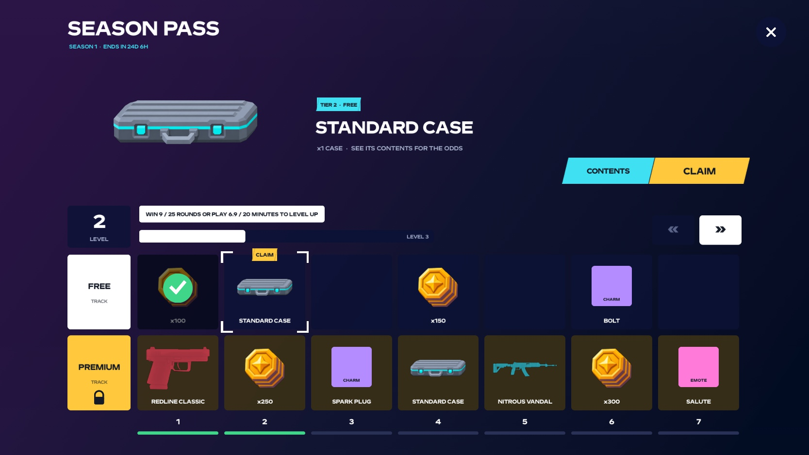
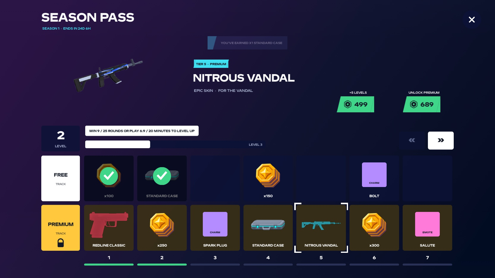
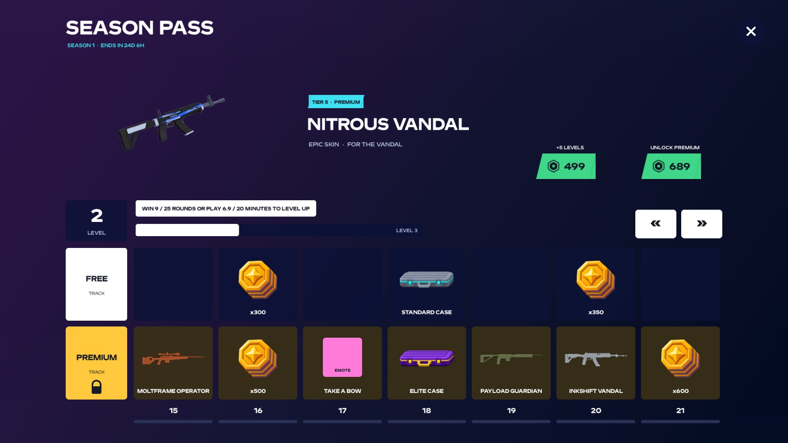

# Season Pass (Battle Pass) screen (2026-11-16)

Owner's brief (RIVALS screenshots of its season pass, item view, odds, claim toast, season bundle):
- **Season levels**, reached by playing this season (separate from your game level). The rule is decided later; the screen says "win X rounds or play Y minutes".
- **A free track and a paid (premium) track.** No deluxe bundle for now.
- Clicking a reward shows it big with its actions (claim, contents for a case, unlock / skip).
- **UI only for now:** no economy (no saving, purchases or real levels).

## Built

Code:
- `tools/studio/BuildBattlePass.luau` builds `StarterGui.BattlePass` (Studio).
- `client/Controllers/BattlePassController` runs it as Router "BattlePass" (the bar's PASS, and the Shop's Season Pass card and VIEW).
- Data: `lobby/shared/SeasonCatalog` (the 30 tiers); the player's state is the `Season` StringValue (server `SeasonService`), redrawn on every change. CLAIM → `SeasonRequest`; UNLOCK PREMIUM / +5 LEVELS → `RobuxRequest` (2026-11-27). The header shows the season end once `Config/Season.STARTS_AT` is set.
- Shown when `Release.BATTLE_PASS_OPEN`, or in Studio with the Workspace attribute `BattlePassTest = true` (`SeasonCatalog.screenOn`).
- Case odds: shared `client/Util/OddsList`; the Shop uses it too now.
- Phones: the canvas uses the shared Fit scale (fits any screen, but about 0.36x on a 390 px-tall phone). No phone layout yet (needs `PhoneBoost` / Phone* attributes, set in Studio's device emulator).

- **Look:** the Shop's (violet wash over the blur, dark navy plates, slanted plates, drawn-X close, no back panel).
- **Top: the picked reward, big.**
  - A skin turns in **3D** (`Util/ItemStage`: drag, wobble). A case or coins shows its picture; a charm / emote shows as a coloured card.
  - Then a tier chip ("TIER 5 · PREMIUM"), the name, and a line ("EPIC SKIN · FOR THE VANDAL", "x1 CASE · SEE ITS CONTENTS FOR THE ODDS").
  - The actions that apply:
    - **CONTENTS** (a case: the same odds panel as the Shop);
    - **CLAIM** (gold, the act-now thing);
    - **+5 LEVELS** (499);
    - **UNLOCK PREMIUM** (689).
- **Middle:**
  - the season **LEVEL** box;
  - what levels you up, as a white tip over the bar;
  - the bar to the next level;
  - **« »** page arrows (dim at the ends).
- **Bottom:**
  - **FREE** (white) and **PREMIUM** (gold, a drawn lock until owned) badges; clicking PREMIUM shows the premium pass;
  - **7 tiers a page** (30 tiers, 5 pages), a cell per track: free cells navy, premium cells dark gold.
    - Coins show the coin stack; cases their art; skins the gun's icon in the line's colour; charms / emotes / Mods a coloured swatch.
    - A reached, untaken reward has a gold **CLAIM** tag; a taken one is dimmed with a green tick.
    - The picked cell gets the four-bracket selection frame.
  - Tier numbers with a bar each, **green once reached**.
- **Opens on** the first reward waiting to be claimed (else the next tier), on its page.
- **CLAIM** ticks the cell and toasts "You've earned x1 STANDARD CASE". This happens **on this screen only**; nothing is saved until the server owns progress.
- **Rules to keep** (LihFolk: Battle Pass and Season Design):
  - everyone is on the free track;
  - a late premium buyer gets the tiers already reached;
  - unclaimed rewards are granted at season end;
  - missions never need Robux.

Checked in Studio play:
- the bar's PASS opens it on tier 2's claimable Standard Case;
- CLAIM (tick + toast);
- the tier 5 premium Nitrous Vandal in 3D with +5 LEVELS / UNLOCK PREMIUM;
- paging to tiers 15-21.

No errors. Then the CONTENTS / CLAIM gap was widened and the 3D skin made bigger.

**Next (owner's call):** how season levels are earned (wins, minutes, or both); the real rewards (charms and emotes need to exist); the economy (server progress, claims, premium purchase as a developer product per season, skips).
