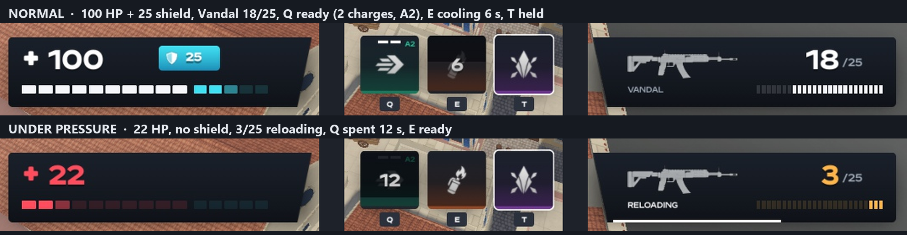

# Combat HUD mockup: health, ammo, Mods (draft 1, 2026-11-14)

**What this is:** the next sections of the UI overhaul after the [top bar](UI%20Top%20Bar%20Draft.md): health + shield (bottom-left), ammo (bottom-right) and the Mod slots (bottom-centre), in the top bar's v2.2 language.

**Status (2026-11-14): approved and built in Studio** ("I really like the plus part of the health bar"). Owner's open questions answered by default: segments, round ticks, role glow, no Mod names.
- Layout: `StarterGui.BottomHud` (Studio-owned; backup `tools/studio/BuildBottomHud.luau`). Behaviour: `src/client/Util/BottomHud.luau`, fed by `HudController` (health, shield, weapon, ammo, reload, spectating) and `ModHudController` (each slot), so every caller and all the logic stay where they were. On desktop the old health/ammo panels and Mod slots hide; **phones keep the old HUD** until the mobile pass. The Mod hint/status lines still come from the old ModHud.
- Checked in a live 1v1: shield chip per gun (Ghost/Stinger +25), mag ticks per gun (13, 20), drafted Mods fill in with their role colour, empty slots dim, low health red at 22, damage chip; it sits behind the draft screen. Not checked live: firing/reload ticks, Mod cooldown, held/denied, spectating.
- Next (owner, same day): a **weapon hotbar** showing the other loadout slots, after a RIVALS sample (not to copy).

The mockup notes below describe the design.

Full screen with the top bar: [capture](References/ui-overhaul/2026-11-14-combat-hud-mockup-full.jpg).

**Where:** match place, `StarterGui.CombatHudMockup` (**Enabled is off** so it doesn't sit over the real HUD in playtests; tick Enabled to see it in Edit mode). It's left in the "under pressure" state. Figma was not used: the Starter plan's MCP limit is still reached, so the mockup is in Studio with the real fonts and icons.

## The design
Shared with the top bar: dark plates `1A202A` with a top-lit gradient, radius 6, **the inner end slanted toward the screen centre** (same flat cap images + gradient), Builder Extended numbers with a soft drop shadow, one soft shadow under each piece, team cyan for your own shield.

**Health (bottom-left, 416 × 96):**
- Plus icon + the health number (Builder Extended ExtraBold 46).
- **Shield chip** in the ally gradient with a shield icon and the value; hidden at 0 shield.
- **Segmented bar:** 10 white segments (10 HP each) + up to 5 cyan shield segments after a small gap (shield max 50), so effective health reads at a glance. Partial segments show at half strength.
- Low health (< 35%): number, icon and segments turn danger red `FF4D5E`.
- To add when built: the damage "chip" (lost segments flash, then drain), a hit shake, heal fill-up.

**Ammo (bottom-right, mirrored):**
- Gun silhouette (`Theme.GUN`) inside the plate (it no longer floats above it), gun name under it.
- Mag count big + `/25` small (no reserve ammo in the game).
- **One tick per round** (mags up to 30; bigger mags like Odin/Ares would use a thin fill bar instead); spent rounds dim.
- Low (≤ 25%): number and ticks amber `FFB547`; empty: red. **Reloading:** the label reads RELOADING and a white bar fills along the bottom edge (shell-by-shell reloads use the same bar).
- Knife: numbers and ticks hidden, name shows the knife.

**Mods (bottom-centre):** three 80 px cells, 12 px apart.
- Dark cell with a **role-colour glow rising from the bottom** (Mobility green, Damage orange, Control purple, etc., from `Theme.ROLE`) and a role-colour **ready line** along the bottom (grey while cooling).
- Icon 46 px; **charge pips** along the top (shown when a Mod has more than 1 charge); **level tag** top-right (`A2`, `G3`; none at L1).
- **Cooling:** a dark curtain that lifts as it recharges + the seconds in the middle; the icon dims.
- **Held:** white outline (and a small scale-up when built).
- **Key cap** under each cell (dark chip, white letter): readable on any floor, unlike the old grey letters.
- To add when built: ready flash when a charge returns, denied shake, active-effect bar, the hint and status lines above the slots, empty slot look.

## Built from
- Feature inventory of today's HUD: `HudController.luau` (health 263-340, ammo 203-261), `ModHudController.luau` (slots 585-661); max HP 100, shield 0/25/50, mags 2-100, up to 3 charges.
- Owner taste: [UI Top Bar Draft](UI%20Top%20Bar%20Draft.md) (bold, clean, cells, Builder Extended, no hairlines), [UI Overhaul Research](UI%20Overhaul%20Research.md) §1b (old HUD: boxes behind numbers, unreadable captions, square Mods with tiny keys), [Valorant UI](../03%20Research/UI%20References/Valorant%20UI.md) and [Rivals PC UI](../03%20Research/UI%20References/Rivals%20PC%20UI.md) (fixed slots: health bottom-left, abilities bottom-centre, ammo bottom-right).
- Icons: `tools/ui/make_hud_icons.py` → `art-source/ui/hud/` (health `118284450466320`, shield `122576084707248`, reload `98302355343891`).

## Open for the owner
1. Health as segments (drafted) or one smooth bar?
2. Round ticks on the ammo panel: keep, or just the numbers?
3. Mod cells: keep the role-colour glow, or neutral cells with only the ready line in colour?
4. Show the Mod name under the key cap (the old HUD did), or keep it clean?
