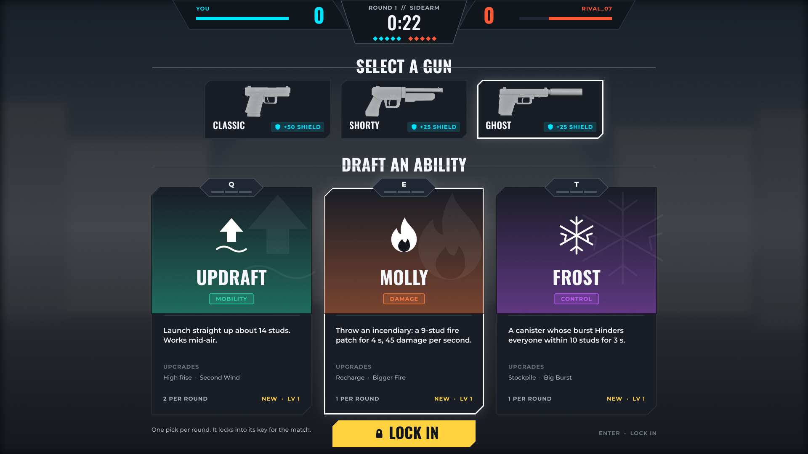
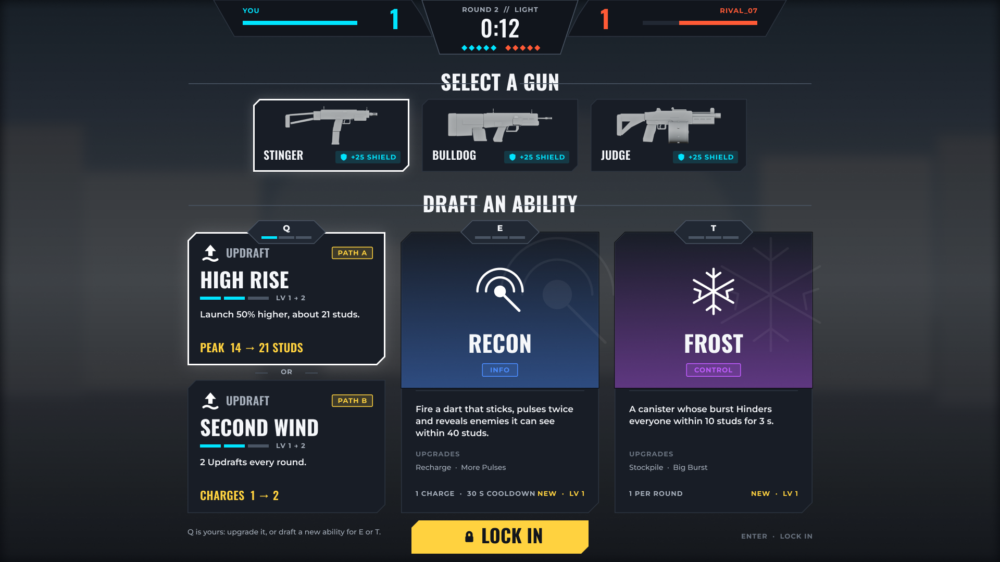
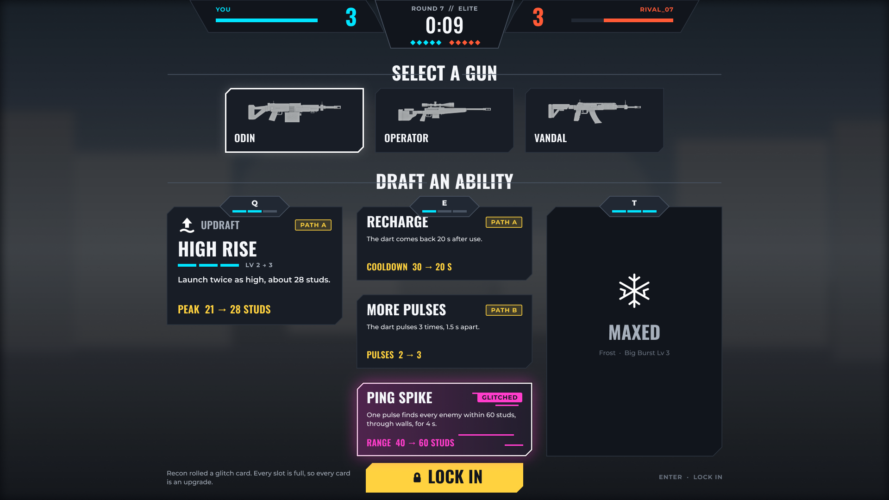
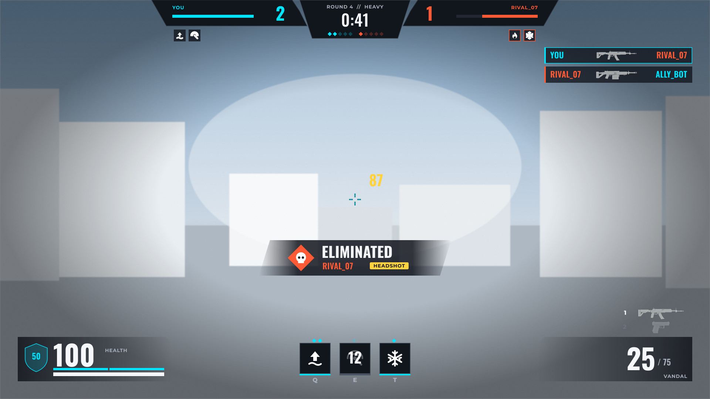
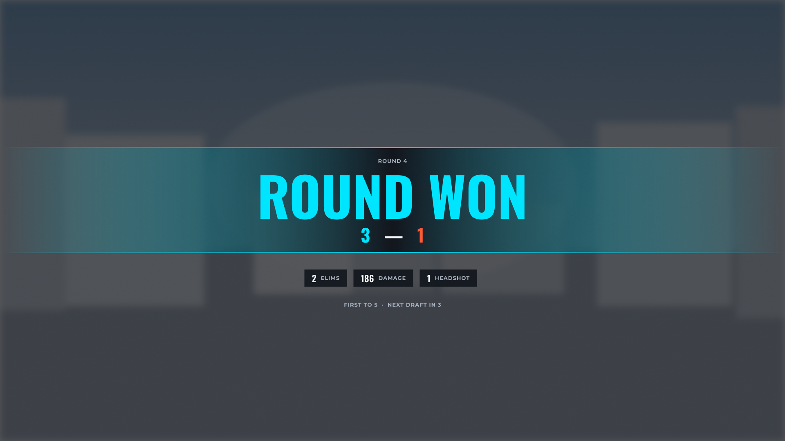
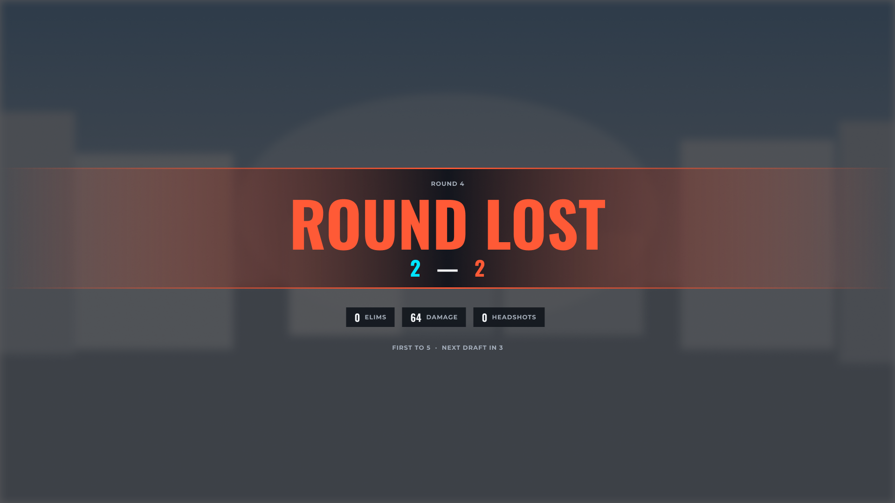
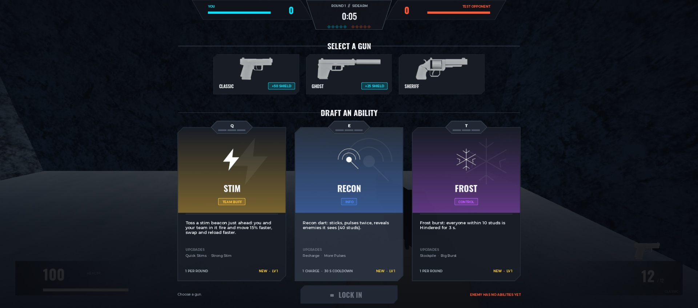
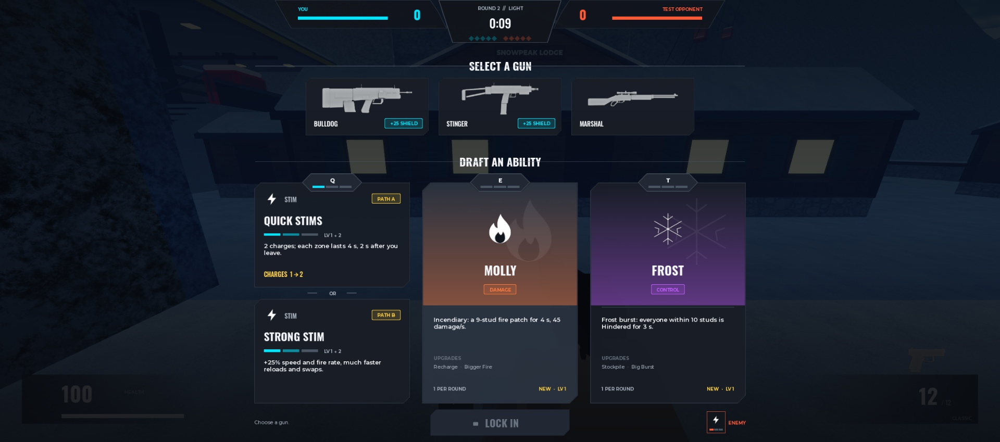
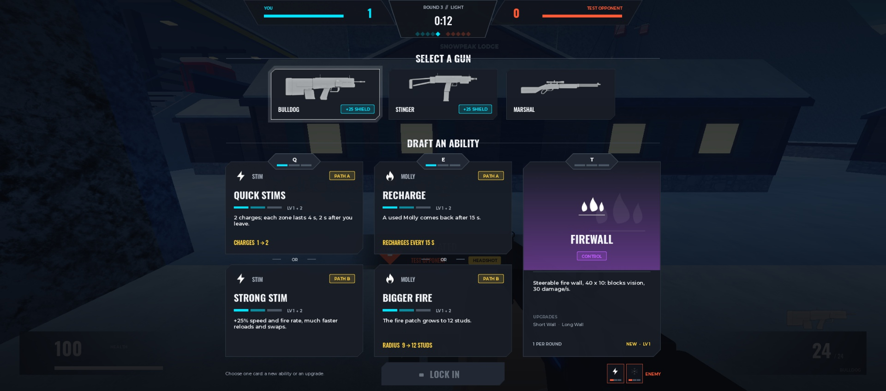
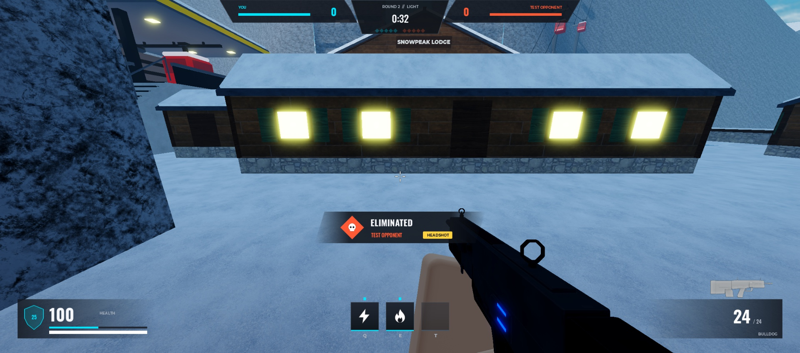

# UI Design

**v2 look (2026-11-05, waiting for the user's OK):** the match UI now shares the Lobby's rounded v2 style (Montserrat Heavy + Builder Sans, navy surfaces, gold action colour), replacing the cut corners and Oswald below; see [Match HUD](../01%20Design/Match%20HUD.md). The layouts and behaviour described here still apply.

The look of every screen: Valorant's clean, tactical layout with RIVALS' chunky readability, built for Roblox (PC first, then phone and gamepad). **Status: v1 approved by the user and built in game (2026-11-03): draft screen, top bar, round banners, health, ammo, ability slots, kill feed and ELIMINATED pop-up.** Ability icons and new-ability card art are ChatGPT-made since 2026-11-04 ([UI Art Brief](UI%20Art%20Brief%20(ChatGPT).md)). The draft mechanic it shows is built: [Match Flow](../01%20Design/Match%20Flow.md) → Abilities.

**Figma file:** [Glitched Gauntlet — Game UI](https://www.figma.com/design/UbCKQXuZijn0Gpryt0uUxN) (pages: Screens, Components; tokens in the "Theme" variable collection, type in text styles).

## Direction
- **From Valorant:** square or cut corners (never round), thin 1.5 px lines, dark translucent panels, condensed uppercase titles, small spaced-out caps for labels, white outline = selected, team colours only where they mean something.
- **From RIVALS:** big chunky numbers (health, ammo, score, timer), bright accents, punchy pop-ups (kill banner, round result), nothing small or fussy that a phone player can't read.
- **Roblox fit:** both fonts are built into Roblox, no custom font assets. Everything is panels, text, icons and gun pictures, so it builds from Frames, ImageLabels and a few 9-slice images.

## Tokens (Figma "Theme" variables)
| Token | Hex | Use |
|---|---|---|
| `bg/scrim` | `#07090D` | Behind menus (70–90%) |
| `surface/panel` · `card` · `raised` · `hover` | `#11151C` · `#181D26` · `#212833` · `#2A3340` | Panels, cards, hover |
| `line/soft` · `line/strong` | `#2C3440` · `#4A5564` | Card borders, dividers |
| `text/primary` · `secondary` · `dim` | `#F5F7FA` · `#A7B0BC` · `#69727F` | Text |
| `team/ally` · `team/enemy` | `#00E5FF` · `#FF5A36` | Same as `Config/Mods COLORS` (in-world tints) |
| `accent/gold` | `#FFD23F` | LOCK IN, upgrade numbers, path badges, damage numbers |
| `accent/glitch` | `#FF3DCB` | Glitch cards only (same as `COLORS.glitch`) |
| `accent/ready` | `#3FD68A` | LOCKED |
| `role/*` | Mobility `#2BD9A8`, Damage `#FF7A3D`, Control `#C15CFF`, Info `#4C8DFF`, Sustain `#6BE36F`, Team buff `#FFC53D`, Escape `#8E7CFF` | Role tag and card tint |

## Type
Two families (LihFolk: two maximum), both in Roblox's font list:
- **Oswald** (Bold / SemiBold / Medium): titles, numbers, timer. Closest built-in to Valorant's Tungsten.
- **Montserrat** (ExtraBold / Bold / SemiBold / Medium): labels, key letters, body. Roblox's Gotham now renders as Montserrat, so it already "feels Roblox".

| Style | Font | Size (1080p) |
|---|---|---|
| Display XL / L / M | Oswald Bold, caps | 96–132 / 56 / 40 |
| Title Card / S | Oswald Bold / SemiBold, caps | 34–44 / 22 |
| Number HUD / Timer | Oswald Bold / Medium | 64–76 / 44 |
| Label Caps | Montserrat Bold, caps, +8% tracking | 13 |
| Body M / S | Montserrat SemiBold / Medium | 17 / 14 |
| Key chip | Montserrat ExtraBold | 16 |

On a 667×375 phone the 1080p layout scales to 0.35, so 14 px body text ends up at 5 px. The phone layout needs its own sizes, with a 12 px floor after scaling ([LihFolk](../04%20Tech/LihFolk.md): Readable Text and UI Scale).

## Shapes
- Cards and buttons: a **cut top-left and bottom-right corner** (20 px on big cards, 12–16 on small). In Roblox: one 9-slice PNG per corner size (`SliceCenter`), tinted with `ImageColor3`.
- Key tab: a flat hexagon over the card's top edge, with 3 level pips (filled = levels owned).
- Tags (role, path, shield): 3 px radius, 16% tint fill + 1.5 px stroke in the tag colour.
- Selected: 3 px white border plus a soft white glow. Glitch cards use a magenta glow and scanline slivers.

## Screens (v1)

**Draft · round 1.** Top bar: score, timer, round and phase, first-to-5 pips. Three gun cards (real renders, shield badge). One column per key (Q / E / T), each with a new ability: icon, name, role tag, what it does, its charges and its two upgrade path names.

**Draft · round 2, the new rule.** Q is already Updraft, so its column shows its upgrades (Path A **or** Path B, stacked, with the stat change in gold). E and T still offer new abilities. You pick one card from any column.

**Draft · later round.** Q at level 2 shows a single level-3 card, E at level 1 shows A, B and a rolled **glitch** card (compact cards), and T is **MAXED**.

**HUD.** Top bar plus each side's abilities under its plate, a teal crosshair, damage number, a RIVALS-style **ELIMINATED** pop-up with HEADSHOT tag, kill feed with gun pictures, health 100 + shield 50 bottom-left, Q/E/T slots with charge diamonds and cooldown number bottom-centre, ammo and weapon slots bottom-right.

 
**Round end.** A wide band in the winner's team colour, the score, three stat chips, "next draft in 3".

## Assets made for it
- **Gun pictures:** side renders of all 19 guns (uploaded) from their Blender files (`art-source/ui/guns/*.png`, light grey like Gauntlet's), made by `tools/blender/render_ui_gun.py` (Workbench, then mirrored and cropped); the other 9 guns are one command each. In game these can be ImageLabels instead of the current ViewportFrames, which are cheaper and match the design.
- **Ability icons:** a new set of 9 white glyphs plus Reroll, Lock, Shield, Skull and Glitch (Figma Components page), exported at 256 px to `art-source/ui/icons/` and uploaded. The old `art-source/abilities/Icons` are the retired Mod names.

## Built in Roblox (2026-11-03)

| Piece | Where |
|---|---|
| Tokens, fonts, image ids | `src/shared/Config/Theme.luau` |
| Kit: text styles, cut-corner 9-slice cards, tags, key tab, gun picture, `fit` (UIScale from the ScreenGui's size), `tween` | `src/client/Util/Ui.luau` |
| Draft screen | `DraftController` (Figma Draft screens; the top bar is the match HUD's, drawn above it; Enter locks in) |
| Top bar + banners | `MatchHudController` (team plates with names and health, score, first-to-5 diamonds, round // phase, clock; GET READY, countdown, FIGHT, LOCKED IN, ROUND WON / LOST / DRAW, VICTORY / DEFEAT) |
| Health, shield, ammo, gun picture | `HudController` |
| Q / E / T slots | `ModHudController` (square slots, ready bar, key under, charge diamonds above; same logic as before) |
| Kill feed + ELIMINATED | `Util/KillFeed`, fed by the `Killed` remote (gun and ability kills) |
| Ability icons | `Config/Mods` `icon` (the new set) |
| Assets | `art-source/ui/{icons,shapes,guns}`, made by `tools/ui_shapes.py` and `tools/blender/render_ui_gun.py`; ids in `art-source/uploads.json` (decals) and `Config/Theme` (images) |

**Not built yet:** per-round stat chips on the round banner (no per-round stats exist yet), ability kit icons under the top-bar plates (only the draft knows the enemy kit), weapon slot pictures, a phone layout (the 1080p design scales down, too small on phones), gamepad selection in the draft.

## Sound, motion and feel (2026-11-04)
**Sounds** (`Config/UiSounds`, played by `Util/UiSound` in a new "Ui" sound group): Roblox's own UI pack (`Roblox_UI_*`) plus one APM sting, all licensed, nothing uploaded. **Provisional until the user auditions them:** paste `tools/studio/AuditionUiSounds.luau` into Studio's command bar (Edit mode); it plays each cue with its name in the Output.

| Moment | Cue |
|---|---|
| Hover a card / LOCK IN | Hover (soft tick, at most every 0.06 s) |
| Pick a card | Select |
| Lock in / not ready yet | LockIn / Denied (with a shake) |
| Draft opens, each card lands, draft leaves | Open, CardIn, Close |
| Last 5 s of the draft and round, the 3-2-1 countdown | Tick, TickFinal on 1 |
| GET READY / FIGHT / ROUND WON / ROUND LOST / DRAW / VICTORY / DEFEAT | Banner / Fight / RoundWon / RoundLost / Banner / Victory / RoundLost |
| A point scored | Score |

**Motion** (LihFolk: UI Motion Language and Timing):
- **Draft:** the backdrop fades in (0.25 s); the cards rise into place one after another (48 px, 0.32 s Quint, 0.05 s apart, capped at 0.4 s); hover lifts a card 6 px and lights it; a pick pops it (1.05, 0.07 s out, 0.25 s Back back); LOCK IN breathes while ready, pops and turns green LOCKED; leaving sinks the cards and fades out (0.15 s Quint In).
- **Banners:** the band opens from its middle (0.22 s), the title punches in (1.15 → 1, Back), and it folds shut when it ends. Neutral banners are a plain dark band; results use the team colour.
- **Top bar:** in the last seconds the clock goes red and pops on every tick; a point pops the new diamond and the score.
- **HUD:** taking damage flashes the health number red, and a red chip holds the lost health for 0.4 s, then drains; kill feed rows slide in from the right and out again.

**Feel (UX):**
- **Draft keys:** 1 / 2 / 3 pick a gun (numbers on the cards), Q / E / T pick a card in that column (press again to step through its cards), Enter locks in.
- **The hint under the cards** says what's missing. In the last 5 s it names **what you'll get if time runs out** ("3s left. You'll get: Ghost + Molly").
- **Locked:** the button turns green LOCKED and the screen leaves.

Tested 2026-11-04 in a Studio match: keys 2 + E picked Ghost and Molly, hover lifted the card, Enter locked in and the draft left; the countdown ticked with a red clock; the round's DRAW banner opened and closed. Sounds not heard (no audio in the MCP), so audition them.

## How it was planned
1. Export from Figma: icons (2x PNG, max 1024), 9-slice corner pieces, gun renders. Upload under the group.
2. A `Config/Theme` module holds the tokens above. No hex values or fonts inside builders (LihFolk: Figma to Roblox UI pipeline).
3. Root layout: design at 1920×1080 with Offset sizes and one UIScale = min(w/1920, h/1080) on the root, and `ScreenInsets = CoreUISafeInsets`. Phone gets its own sizes later.
4. Rebuild `DraftController` from the components (GunCard, AbilityCard, UpgradeCard, compact and glitch cards, MaxedCard, KeyTab, LOCK IN), then `MatchHudController` (top bar, round banners), `HudController` (health, ammo, kill feed, kill banner) and `ModHudController` (Q/E/T slots).
5. Motion: entrances 0.2–0.35 s, exits 0.1–0.2 s with Quad/Quint In, pops through UIScale (never Size), card select 0.12 s.
6. Touch targets at least 44 px drawn (52 design px), nothing interactive in the top bar band or the bottom-left thumb zone.

## Open questions for the user
- Accent gold for LOCK IN and upgrade numbers, or keep it all white like Valorant?
- Team colours: keep the in-world cyan / orange-red (`#00E5FF` / `#FF5A36`) or move to Valorant's teal / red?
- Rerolls: Gauntlet has one per column (3 per match). Ours are parked ([Match Flow](../01%20Design/Match%20Flow.md) → Parked).
- Ability card art: Gauntlet uses agent portraits behind the icon. We use a role-colour tint plus a large faded icon. Concept art (e.g. from ChatGPT) could go there later.

## Sources
- The user's screenshots: `01 Design/ValorantUIExamples/` (git-ignored, third-party).
- Valorant tokens: [oppadu Valorant design system](https://www.oppadu.com/tools/design-systems-site/brand/valorant.html) (`#FF4655`, `#0F1923`, Tungsten + DIN, square corners); HUD layout: [Evil Geniuses: Screen Studies](https://geniusguide.evilgeniuses.gg/p/screen-studies-valorant), [ONE Esports HUD guide](https://www.oneesports.gg/valorant/valorant-beginners-guide-understanding-the-hud/).
- Gauntlet: Glitched draft: [esports.gg](https://esports.gg/news/valorant/gauntlet-glitched-ability-draft/), [allthings.how](https://allthings.how/valorant-gauntlet-glitched-how-the-8-duo-ability-draft-mode-works/).
- Roblox fonts: [Font datatype](https://create.roblox.com/docs/reference/engine/datatypes/Font) (Oswald, Montserrat, Roboto Condensed, Titillium Web, Sarpanch are built in; Bebas, Teko, Barlow are not).
- RIVALS: almost nothing is written about its UI. Our RIVALS take comes from playing it, so screenshots from a real match would sharpen it.
- LihFolk: Figma to Roblox UI pipeline, Designing Roblox UI in Figma, Responsive UI, Safe Areas and Insets, Readable Text and UI Scale, Text Fonts and Rich Text, UI Motion Language and Timing.
