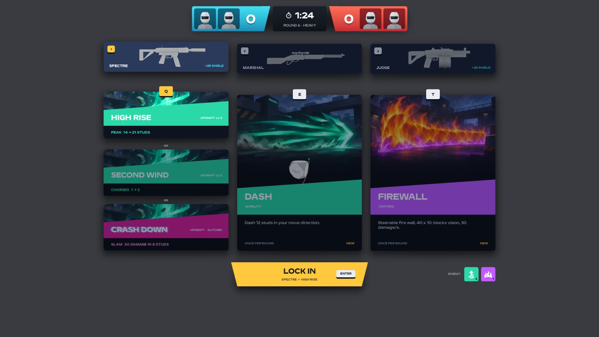
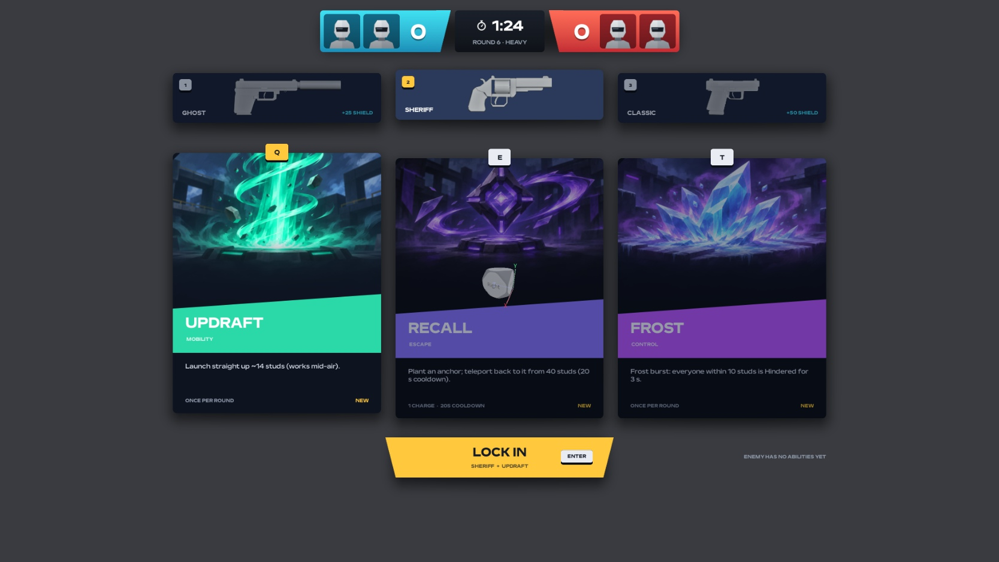
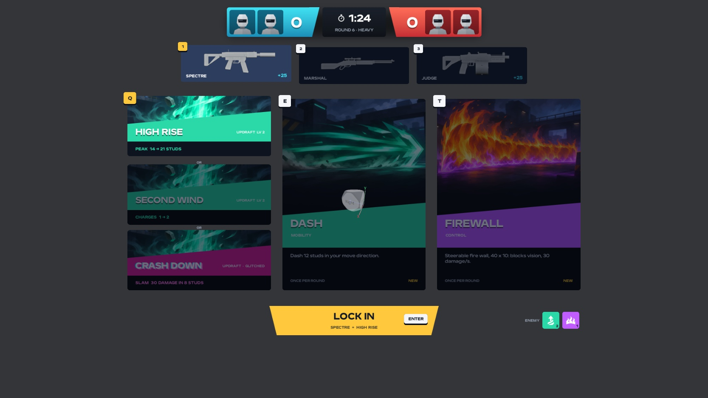
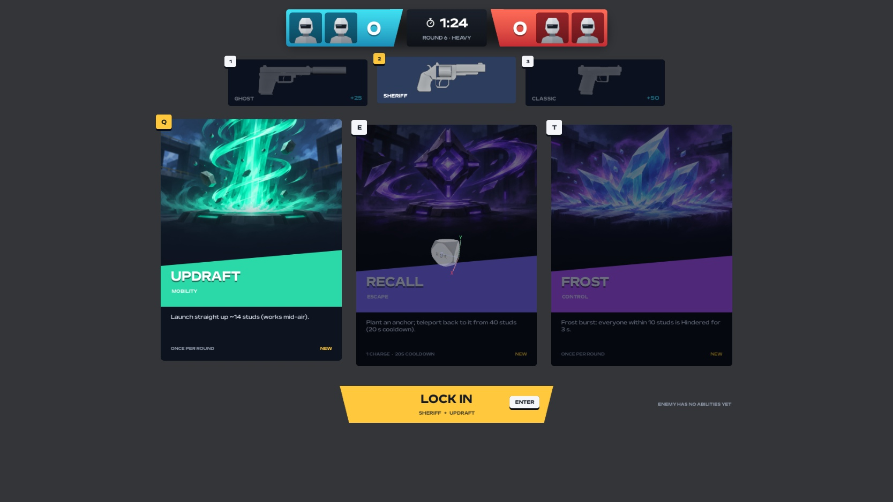
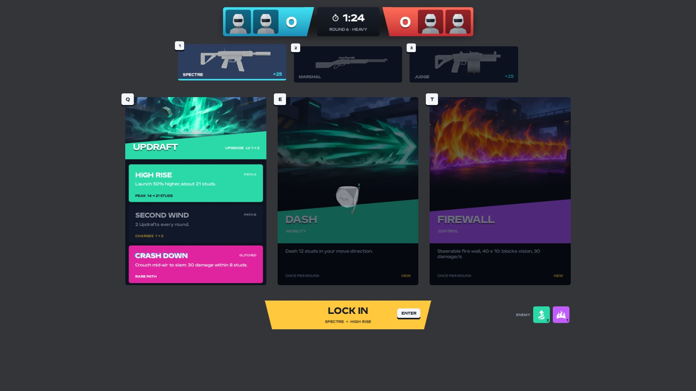
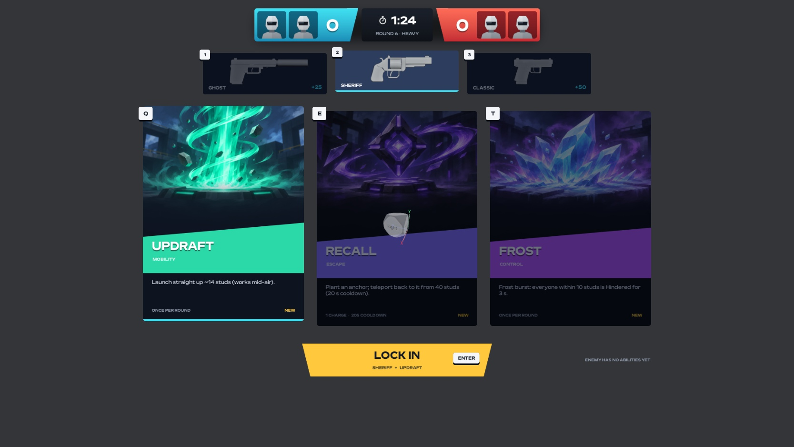
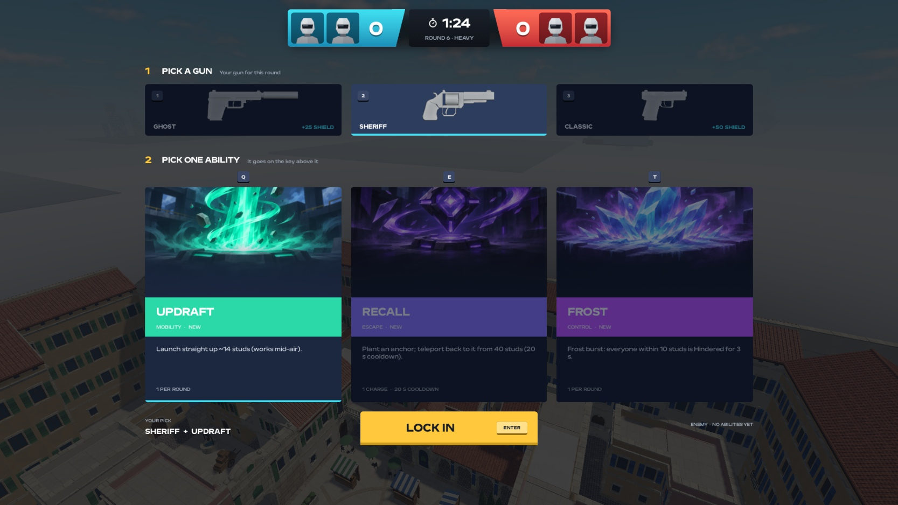
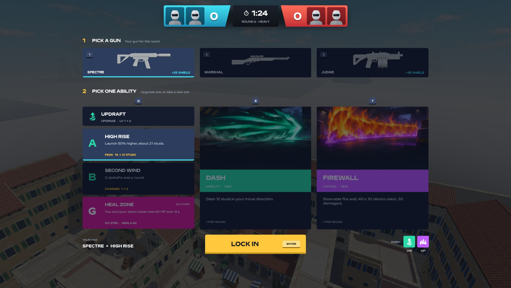

# Draft screen redesign (mockup, 2026-11-14)

## v4 (current mockup)
Owner on v3: "still looks a bit off", one more pass. My read of what was off, fixed here:
- **One grid:** three 400 px columns, 28 apart, hold the guns, the cards and LOCK IN. The guns were narrower than the cards and LOCK IN lined up with nothing.
- **Key tabs:** a centred tab (Q / E / T) on the top edge of each column replaces the corner stickers. Gun keys sit inside their cards.
- **Cleaner type:** no drop shadow on band names (it read muddy); the unpicked dim is lighter (`150,155,166`) so the screen isn't dull.
- **Depth:** soft shadows under every card and under LOCK IN.
- LOCK IN is the width of the middle column and carries the picks. The enemy kit is right-aligned to the grid.
- Rebuilt from a script: `tools/studio/BuildDraftMockup.luau` (also the backup).
- Round 3: 
- Round 1: 

## v3
Owner on v2: "pretty good", but the Updraft upgrade "doesn't sit well with the cards", the blue bar under the picked card "looks AI", and the upgrade round "looks a bit off". Look at the Valorant examples (`vault/01 Design/ValorantUIExamples/`, Spike Rush draft).
- **Lesson from Valorant:** an upgrade column **splits into smaller copies of the same card** (art, name band, one stat line), with a small OR between them, so it sits with the new-ability cards.
- **Upgrade column:** 2 or 3 half-cards, one per path. Each has the ability art, the slanted band with the **path name** big and `UPDRAFT LV 2` small, and one stat line in the role colour ("PEAK 14 → 21 STUDS"). **Glitched:** a magenta band, a split cyan/magenta title, and `UPDRAFT · GLITCHED`.
- **Picked state, no bars:** the picked card or half lifts and stays bright, the others darken, and **its keycap turns gold** (guns and abilities alike). The cyan selection bars are gone.
- Round 3: 
- Round 1: 

## v2
Owner on v1: "still that AI feel", "too simple, too vibe coded", drop the "1 PICK A GUN / 2 PICK…" labels; A/B/G letters "don't really make sense".
- No section labels; the layout itself says what to do. Guns are a slim row; abilities are three tall cards; LOCK IN is below.
- **Ability cards:** the art fills the card. A **slanted role-colour band** cuts across it (the top bar's slanted-edge idea) with the name in large type and the role. A dark panel holds one description line, the charge line and NEW in gold.
- **Key stickers:** light keycaps (Q / E / T, 1 / 2 / 3) sit on each card's top-left corner.
- **Upgrade card:** the same card, with the art as a short banner and the band carrying `UPDRAFT · UPGRADE LV 1 → 2`. Below it is one row per path: the path name, PATH A / PATH B tag, one line and the stat change. The chosen row fills with the role colour. The **glitched path** is a magenta row with a split cyan/magenta title (the one "glitch" touch, the game's name) and a GLITCHED tag. No letters, no OR.
- **Selection:** the picked card lifts 12 px and stays bright, with a cyan bar along its bottom. The others darken.
- **LOCK IN:** a gold block with slanted ends (the top bar caps) that shows your pick ("SPECTRE + HIGH RISE") and an ENTER keycap.
- **Enemy:** small role-colour blocks with their level, or ENEMY HAS NO ABILITIES YET.
- Round 3: 
- Round 1: 
- (Captured in Edit mode on a grey void; the small "Right" cube on a card is Studio's 3D view gizmo, not UI.)

## v1 (superseded)

**Owner's brief:** keep the look and the card art, but restructure so it's cleaner. The upgrade choices were "too much going on": purple and glitch overlapping things, too much info, not clear what to do.

**Status:** mockup in Studio, waiting on the owner's review. The live draft is still the old code-built one (`DraftController`). Figma's Starter-plan limit blocked again, so the mockup was built in Studio with the real fonts and art.
- `StarterGui.DraftMockup` in the match place, **Enabled off**. It has two canvases: `CanvasRound1` (new abilities) and `CanvasRound3` (upgrade + glitch).
- Before: 
- Round 1: 
- Round 3: 

## What changed
- **Two numbered steps** say what to do: **1 PICK A GUN** ("Your gun for this round") and **2 PICK ONE ABILITY** ("It goes on the key above it" / "Upgrade one, or take a new one"). Then **one gold LOCK IN** with an ENTER keycap. Beside it is **YOUR PICK: SHERIFF + UPDRAFT**, so you always see what you'll get.
- **Selection is one rule everywhere:** the picked card stays bright, with a cyan bar along its bottom (like the hotbar). Everything else darkens. No outlines, no glow.
- **Gun cards:** flat navy, keycap 1/2/3, the gun, the name, and the shield as plain cyan text (no pill).
- **New-ability cards:** the art on top, then a solid role-colour band with the name and `ROLE · NEW`. Under it, one description line and the charges/cooldown line. The "UPGRADES: …" list and the NEW / LV 1 pill were removed.
- **Upgrade column** (the part that was messy): a header with the ability's icon, name and `UPGRADE · LV 1 → 2`. Under it, one tile per path, all the same size:
  - a big letter **A** / **B** in the role colour;
  - the path name, one effect line and the stat change in gold.
  - The **glitch path** is the same tile in solid magenta with a small `GLITCHED` label: no overlap, no extra box.
  - The "OR" dividers, level pips and path pills are gone.
- **Key per column:** a keycap Q / E / T above each column (no tab shape).
- **Enemy:** small role-colour blocks with their level under them, or `ENEMY · NO ABILITIES YET`.
- Card art stays as is for now. New art could come later (the owner wants Claude's opinion on what it should look like).

## Still to decide / build
- Phone layout (compact cards, gun bar).
- MAXED columns and L2 → L3 upgrades: one tile.
- Hover lift, a pick pop, a LOCK IN press, and the shake when not ready.
- Wiring: build `StarterGui.Draft` from the mockup and have `DraftController` fill it, keeping its inputs, `DraftPick` remote calls and timeout rules.
