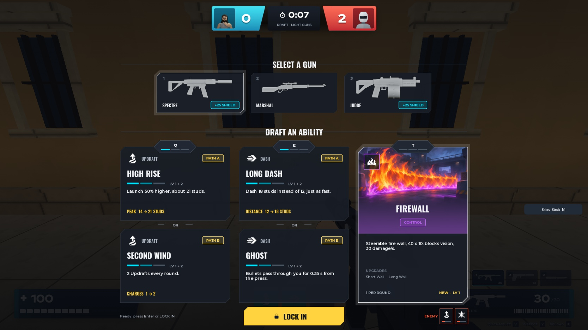

# Draft screen redesign (mockup, 2026-11-14)

**Owner's brief:** keep the look and the card art, but restructure so it's cleaner. The upgrade choices were "too much going on": purple and glitch overlapping things, too much info, not clear what to do.

**Status:** mockup in Studio, waiting on the owner's review. The live draft is still the old code-built one (`DraftController`). Figma's Starter-plan limit blocked again, so the mockup was built in Studio with the real fonts and art.
- `StarterGui.DraftMockup` in the match place, **Enabled off**. It has two canvases: `CanvasRound1` (new abilities) and `CanvasRound3` (upgrade + glitch).
- Before: 
- Round 1: 
- Round 3: 

## What changed
- **Two numbered steps** say what to do: **1 PICK A GUN** ("Your gun for this round") and **2 PICK ONE ABILITY** ("It goes on the key above it" / "Upgrade one, or take a new one"). Then **one gold LOCK IN** with an ENTER keycap. Beside it is **YOUR PICK: SHERIFF + UPDRAFT**, so you always see what you'll get.
- **Selection is one rule everywhere:** the picked card stays bright, with a cyan bar along its bottom (like the hotbar). Everything else darkens. No outlines, no glow.
- **Gun cards:** flat navy, keycap 1/2/3, the gun, the name, and the shield as plain cyan text (no pill).
- **New-ability cards:** the art on top, then a solid role-colour band with the name and `ROLE · NEW`. Under it, one description line and the charges/cooldown line. The "UPGRADES: …" list and the NEW / LV 1 pill were removed.
- **Upgrade column** (the part that was messy): a header with the ability's icon, name and `UPGRADE · LV 1 → 2`. Under it, one tile per path, all the same size:
  - a big letter **A** / **B** in the role colour;
  - the path name, one effect line and the stat change in gold.
  - The **glitch path** is the same tile in solid magenta with a small `GLITCHED` label: no overlap, no extra box.
  - The "OR" dividers, level pips and path pills are gone.
- **Key per column:** a keycap Q / E / T above each column (no tab shape).
- **Enemy:** small role-colour blocks with their level under them, or `ENEMY · NO ABILITIES YET`.
- Card art stays as is for now. New art could come later (the owner wants Claude's opinion on what it should look like).

## Still to decide / build
- Phone layout (compact cards, gun bar).
- MAXED columns and L2 → L3 upgrades: one tile.
- Hover lift, a pick pop, a LOCK IN press, and the shake when not ready.
- Wiring: build `StarterGui.Draft` from the mockup and have `DraftController` fill it, keeping its inputs, `DraftPick` remote calls and timeout rules.
