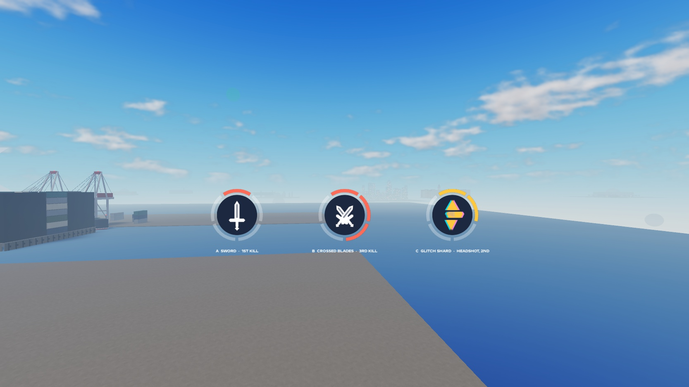
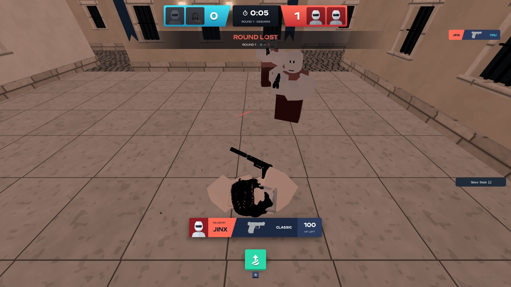
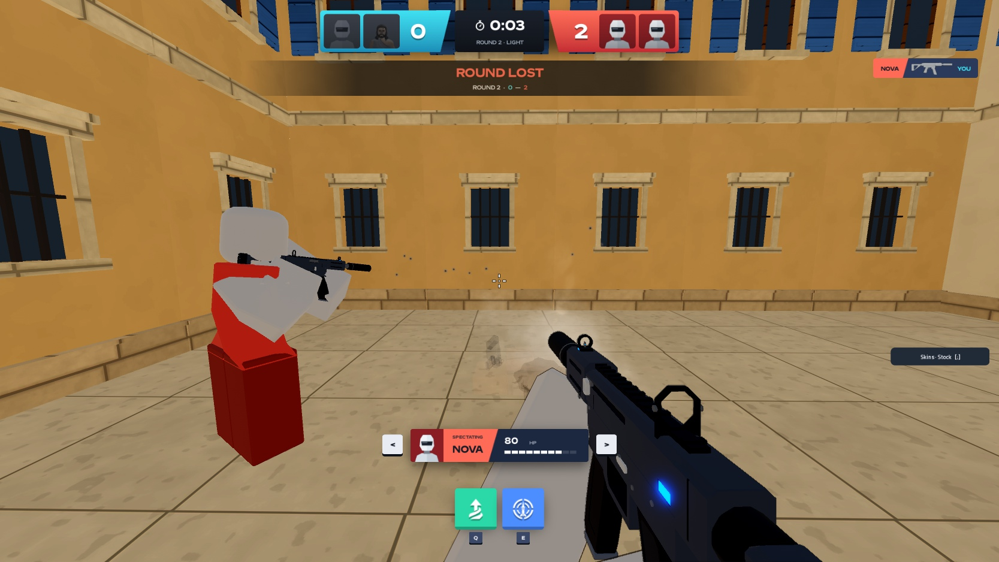
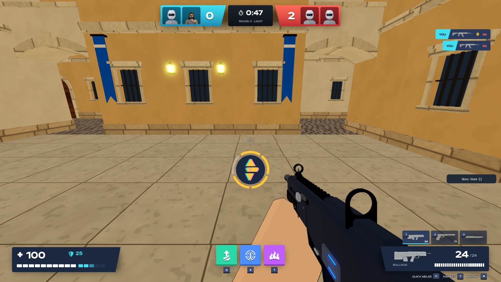
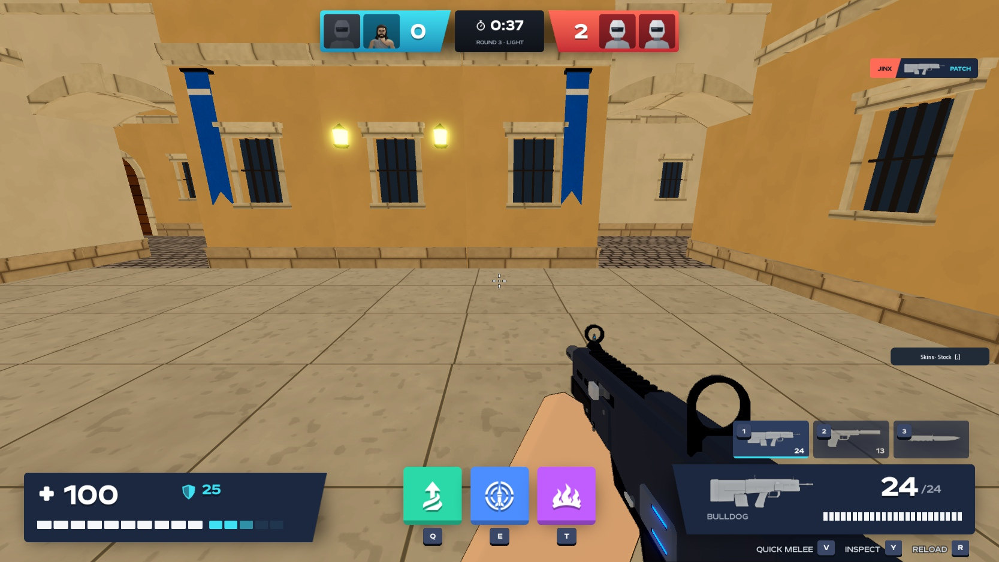

# Kill feed, ELIMINATED, killed-by and spectate (2026-11-14)

**Owner's brief:** the kill feed and the spectate screen next, "same style" as the new top bar, HUD and draft.

## Before
All code-built: the kill feed rows (Oswald, a team-colour edge strip, an outline on your rows), the ELIMINATED pop (skull diamond, gradient slant, headshot pill), the SPECTATING bar (cut plate with an outline, `<` `>` arrows, thin health line). No killed-by panel at all.

## Mockup v1 (in Studio, waiting on the owner)
`StarterGui.FeedMockup` in the match place (Enabled off), two canvases; rebuilt by `tools/studio/BuildFeedMockup.luau`.

One rule for all four: **a team-colour block with a slanted end that joins a navy plate** (the top bar's slant cap), dark ink on the bright block (keycap rule, readable at feed size), Builder Extended ExtraBold, soft shadows on the big cards. No outlines, edge strips, pills, glows or gradients.

- **Kill feed** (top right, under the top bar, right-aligned, width fits the names): killer block in their team colour, then on navy the gun silhouette (or the Mod's icon), a gold skull for a headshot, and the victim's name in their team colour. Rows with you in them sit on the brighter navy (no outline).
- **ELIMINATED** (your kill, just under the crosshair): a red skull block, ELIMINATED, the victim and HEADSHOT in gold, and the kill-ladder bars under it (one per kill this round, lit red).
- **Killed by** (new; bottom centre during the death camera): the killer's headshot cell, a red block with KILLED BY and their name, their gun and HEADSHOT, and **their HP left**.
- **Spectating** (bottom centre): `<` `>` keycaps either side, the player's cell, a team block with SPECTATING and the name, and their HP with the bottom HUD's segment bar.

Death: 
Spectating (v2, no kill pop): 

## Mockup v2: the kill pop (owner on v1)
Owner: the kill pop should be "a little more simple", the skull "doesn't look" right, it shouldn't say "eliminated" + a name (it read oddly next to the spectate bar), and "more like Valorant… a circle with the skull, or maybe… the sword… something fun, different".
- **Kill pop = a circle, no words:** a navy disc with a white emblem, ringed by **5 segments, one lit red per kill this round** (the kill ladder). A headshot turns the emblem and its lit segments gold. It pops from its centre, a little bigger each kill (as now), under the crosshair, only for your own kills.
- **Three emblem options** (`tools/ui/make_kill_icons.py` → `art-source/ui/hud/kill_*.png`, faceted like the HUD icons):
  - **A Sword** (`rbxassetid://123591008906340`): one blade up, crossguard, diamond pommel.
  - **B Crossed blades** (`rbxassetid://98763575799680`).
  - **C Glitch shard** (`rbxassetid://76745392849672`): a diamond cut in three, the slices knocked sideways, with cyan / pink copies offset behind (the glitched draft title's split): the game's name.
  - Ring segment `rbxassetid://136514326667794` (rotated 72° per segment).
- The ELIMINATED card is gone from the spectate view.

Kill pop options: 

## Built (live on desktop; owner picked C, the glitch shard)
- **Studio-owned guis** (backup `tools/studio/BuildFeedScreens.luau`, checked: a rebuild matches Studio with 0 differences):
  - `StarterGui.KillFeed` (DisplayOrder 6): `Canvas.Feed` (vertical list, right-aligned, under the top bar) and `Canvas.KillPop` (5 ring segments, navy disc, the glitch shard with its cyan / pink split).
  - Feed row template `ReplicatedStorage.UiTemplates.KillFeed.Row`: a fixed holder, the `Strip` (CanvasGroup, horizontal list, sizes to the names) right-aligned in it.
  - `StarterGui.DeathScreen` (DisplayOrder 7): `Canvas.KilledBy` and `Canvas.Spectate` (`<` `>` keycap buttons either side of the strip).
- **`Controllers/KillFeedController`** fills the feed and the kill pop from the `Killed` event. Rows slide in from the right and fade (5 s, 4 at most, newest on top), rows with you on the brighter navy, no killer block for the zone / falls / your own Molly. Your kill: the disc pops from its centre (bigger each kill this round), one more ring segment lit, gold on a headshot. `Util/KillFeed` keeps playing the kill sounds (its kill-tone ladder, another session's uncommitted work); its old code-built rows and pop are taken off screen on desktop.
- **`Util/DeathScreen`**, fed by `SpectateController`: killed-by during the death camera (killer's headshot, name, gun or Mod, HEADSHOT, their HP left), then the spectate bar (name in their team colour, live HP and segments). The `<` `>` keycaps cycle; a click on them doesn't also count as the Fire / Aim cycle. The old bar is hidden.
- Phones keep the old feed and bar until the mobile pass.
- **Checked live** (2v2 bot match): killed-by (JINX, Classic, 100 HP left), spectating NOVA (80 HP), feed rows, and the kill pop (sent by a test `Killed` from the server: the glitch shard, gold on a headshot).

Killed by: 
Spectating: 
Kill pop (headshot): 

## Fix: hotbar over the ammo panel (owner, testing)
The hotbar sat a fixed 106 px above the bottom while the ammo panel grows with the screen (its UIScale), so above 1080p the panel ran into it. `StarterGui.BottomHud.Root.Right` is now one column (hotbar, ammo, key hints) with a vertical `UIListLayout` (8 px) and one `Fit` UIScale, so they stack at any size. `Util/BottomHud` and `tools/studio/BuildBottomHud.luau` updated (rebuild matches Studio but for preview-only values). Checked at 1.4x scale: 11 px between each.

