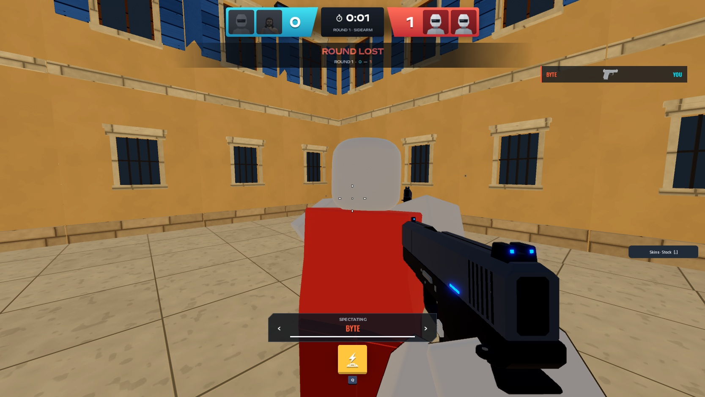
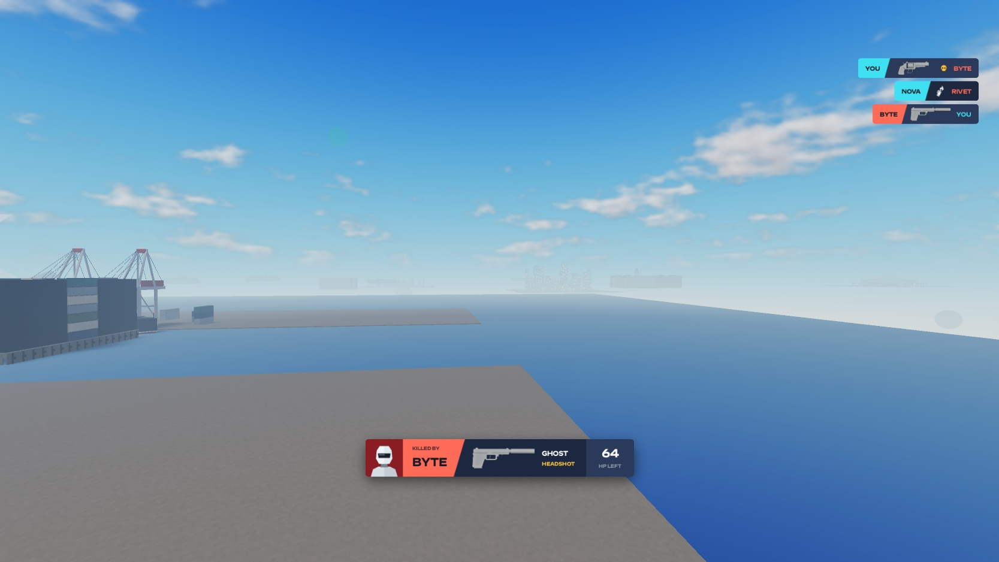
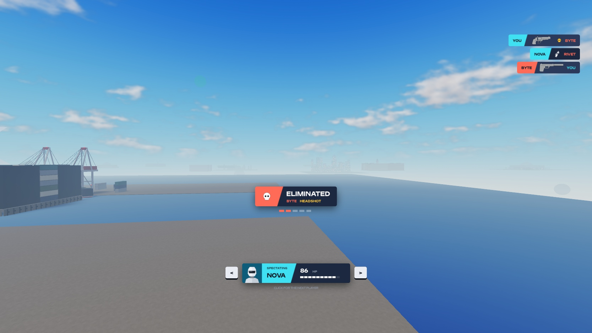

# Kill feed, ELIMINATED, killed-by and spectate (2026-11-14)

**Owner's brief:** the kill feed and the spectate screen next, "same style" as the new top bar, HUD and draft.

## Before
All code-built: the kill feed rows (Oswald, a team-colour edge strip, an outline on your rows), the ELIMINATED pop (skull diamond, gradient slant, headshot pill), the SPECTATING bar (cut plate with an outline, `<` `>` arrows, thin health line). No killed-by panel at all.

## Mockup v1 (in Studio, waiting on the owner)
`StarterGui.FeedMockup` in the match place (Enabled off), two canvases; rebuilt by `tools/studio/BuildFeedMockup.luau`.

One rule for all four: **a team-colour block with a slanted end that joins a navy plate** (the top bar's slant cap), dark ink on the bright block (keycap rule, readable at feed size), Builder Extended ExtraBold, soft shadows on the big cards. No outlines, edge strips, pills, glows or gradients.

- **Kill feed** (top right, under the top bar, right-aligned, width fits the names): killer block in their team colour, then on navy the gun silhouette (or the Mod's icon), a gold skull for a headshot, and the victim's name in their team colour. Rows with you in them sit on the brighter navy (no outline).
- **ELIMINATED** (your kill, just under the crosshair): a red skull block, ELIMINATED, the victim and HEADSHOT in gold, and the kill-ladder bars under it (one per kill this round, lit red).
- **Killed by** (new; bottom centre during the death camera): the killer's headshot cell, a red block with KILLED BY and their name, their gun and HEADSHOT, and **their HP left**.
- **Spectating** (bottom centre): `<` `>` keycaps either side, the player's cell, a team block with SPECTATING and the name, and their HP with the bottom HUD's segment bar.

Death: 
Spectating: 

## Build plan (after the owner's OK)
- Studio-owned `StarterGui.KillFeed` (feed + ELIMINATED) and `StarterGui.DeathScreen` (killed-by + spectate), backups in `tools/studio/`; row and cell templates in `ReplicatedStorage.UiTemplates`.
- `Util/KillFeed` keeps its feed logic and the kill-ladder sound/pips (another session's uncommitted work), drawing into the new gui on desktop. `SpectateController` feeds the spectate bar and a new killed-by card from the `Killed` event (attacker, weapon, headshot) and the killer's health.
- Motion: rows slide in from the right and fade out; ELIMINATED pops from its centre (bigger per kill, as now); killed-by rises in, then hands over to the spectate bar.
- Phones keep the old layout until the mobile pass.
