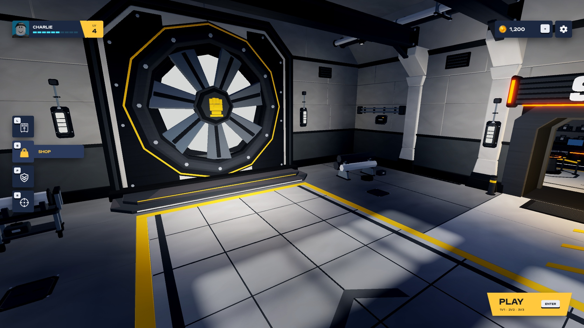
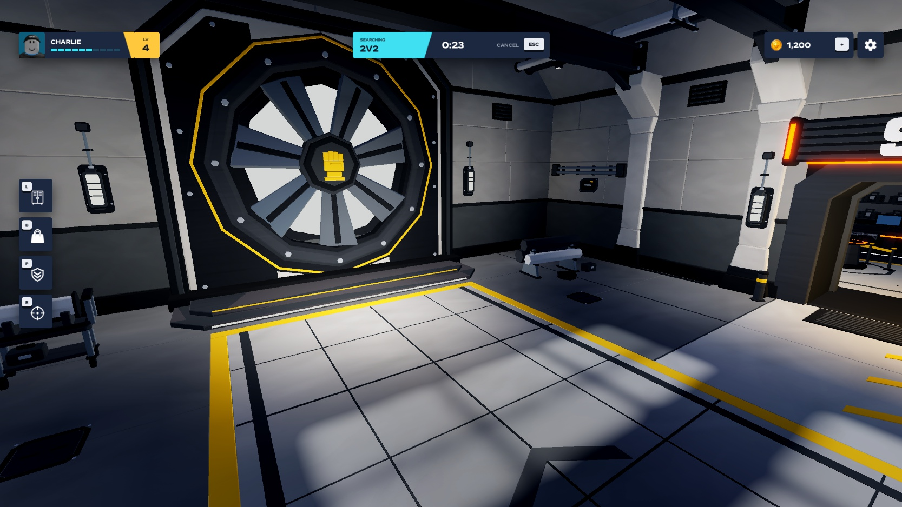
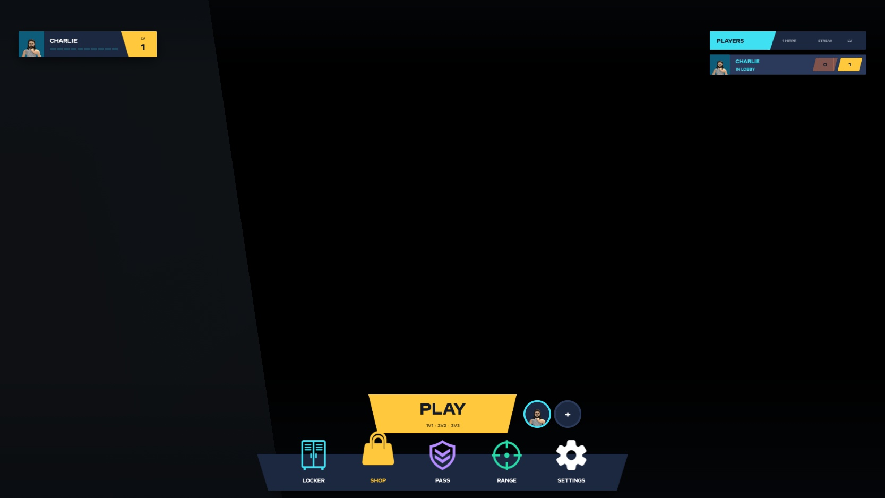
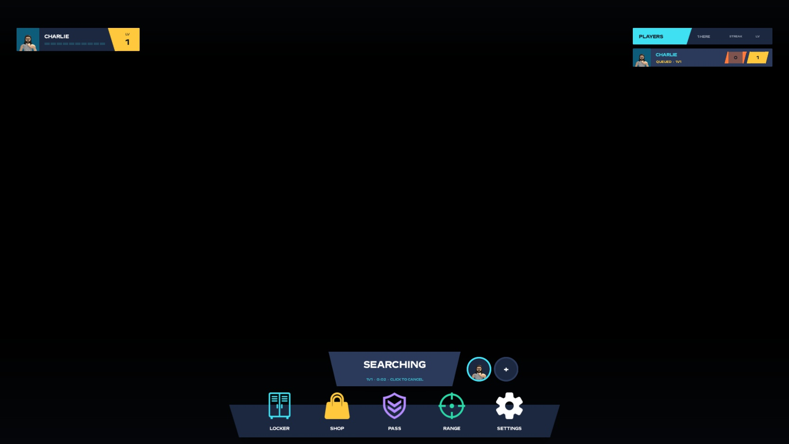

# Lobby main HUD redesign (2026-11-14)

**Owner:** "lets do the lobby next. Start with the Main hud. I want to redesign it maybe move things, etc." Lobby Rojo: `rojo serve lobby.project.json --port 34873` (the match place stays on 34872).

## Today (code-built, `src/lobby/client/Controllers/LobbyHud.luau`, lobby UI v2)

- **Top row** (in Roblox's top-bar strip): a profile pill (avatar, name, XP line, LV tag) on the left; coins with a + and a settings gear on the right.
- **Bottom dock:** LOCKER · SHOP · **PLAY** (big gold, "1V1 · 2V2 · 3V3") · BATTLE PASS · RANGE. A "searching" pill above the dock; toasts above it.
- The older rounded look: pills, gradient gold, glow. The match UI has moved past this (no pills, no glows or gradients; navy plates, slanted team / gold blocks, Builder Extended, keycaps).

## Brainstorm (suggested answer ★)
1. **Style:** ★ the match UI's language everywhere (navy plates, slanted gold / team blocks, Builder Extended, keycaps, soft shadows).
2. **Layout:**
   - A. Keep the bottom dock, restyled.
   - ★ B. **Corner PLAY** (bottom right, like RIVALS / Fortnite) with the selected mode on a card above it; the menus as a **list on the left**; the middle stays clear for your character and the hub.
   - C. A top nav bar (Valorant): PLAY in the top middle, menus beside it.
3. **Mode card** over PLAY: the mode (1V1 / 2V2 / 3V3) with keycap arrows to change it; while searching it shows the time and CANCEL.
4. **Profile:** the top bar's portrait cell, your name, a level block and a segmented XP bar (the bottom HUD's segments).
5. **Currency:** coin icon and amount on a navy plate, + as a keycap.
6. **Hotkeys** on the menu items as keycaps.
7. **Toasts and queue messages** in the match's notification band at the top.
8. Later / parked: party panel (invite friends), daily challenges, battle pass progress teaser, news card.

## Mockup v1 (owner picked layout B: corner PLAY + left menu)
Built in the Lobby place as `StarterGui.LobbyHudMockup` (Enabled off; `tools/studio/BuildLobbyHudMockup.luau`): `CanvasIdle` and `CanvasSearching`.
- **Profile** (top left, under Roblox's buttons): portrait cell, name, a segmented cyan XP bar with "1,240 / 2,000 XP", the level on a gold block with a slanted start.
- **Coins and settings** (top right): coin icon and amount on a navy plate with a + keycap; the gear on its own navy square.
- **Menu list** (left): LOCKER, SHOP, BATTLE PASS, RANGE, each a navy plate with a hotkey keycap (L, B, P, R), its icon, the name and one line under it. The hovered one is the brighter navy, slides out and turns gold.
- **PLAY** (bottom right): the mode card (< 2V2 > · TEAM DUEL · FIRST TO 5) over a big gold PLAY block with slanted ends and an ENTER keycap. **Searching:** the card reads SEARCHING with the time in cyan, and PLAY becomes a navy CANCEL with ESC.
- The middle stays clear for your character and the hub.

Idle: 
Searching: 

## Mockup v2 (owner on v1)
Owner: "I don't really like that... it is not like Valorant or Fortnite because the player is in an actual game, not just a lobby." The hub is walked around, so the HUD must be a light in-game HUD, not a menu screen. Owner's picks:
- Play: **both**, the Duels pads in the hub plus a small PLAY shortcut on the HUD.
- Menus: a **small icon rail on the left edge**.
- No extras for now.

Built (same `StarterGui.LobbyHudMockup`, rebuilt by `tools/studio/BuildLobbyHudMockup.luau`):
- **Profile** (top left): a compact 300 x 56 plate with portrait, name, a thin segmented XP bar and the level on a gold block.
- **Coins and settings** (top right): the same height; coin and amount with a + keycap, and the gear.
- **Rail** (left edge, centred): four 72 px square buttons (Locker, Shop, Battle Pass, Range) with the icon and a small hotkey keycap (L, B, P, R) in the corner. On hover the icon turns gold and the name slides out on a plate beside it.
- **PLAY** (bottom right): a compact gold block with slanted ends, "1V1 · 2V2 · 3V3" and ENTER. It opens the Play menu, like the pads do.
- **Searching:** PLAY hides; a small strip at the top centre reads SEARCHING 2V2 (cyan block) with the time and CANCEL / ESC.

Idle: 
Searching: 

## Mockup v3 (owner: "more like Rivals... bottom bar looking things", not a copy)
Reference (the owner's RIVALS hub screenshot): 
What makes it fun: big colourful icons sitting on and breaking out of a bottom bar with names under them and red badges; PLAY on top of the bar with your party slots beside it; a callout pointing at something new; daily tasks on the left.

Our version (same `StarterGui.LobbyHudMockup`, `tools/studio/BuildLobbyHudMockup.luau`), in the match UI style:
- **Bottom bar:**
  - a navy plate with five big coloured icons breaking out of its top edge: LOCKER cyan, SHOP gold, PASS purple, RANGE teal, SETTINGS white;
  - each has "[key] NAME" under it (L, B, P, R, O);
  - red circle badges for new things; the hovered one lifts, grows and its name turns gold.
- **PLAY** on top of the bar: the gold block with slanted ends (PLAY, 1V1 · 2V2 · 3V3, ENTER); **searching** turns it navy (SEARCHING · 2V2 · 0:23, ESC). Beside it, **party slots:** your portrait in a cyan ring and an invite + circle.
- **Callout:** a red plate with a pointer ("NEW SKIN UNLOCKED") over the item it's about.
- **Daily tasks** (left, a proposal: no tasks system yet): a gold DAILY TASKS block, three tasks with segmented progress, counts and coin rewards, and the reset time.
- **Profile** top left and **coins** top right stay compact; settings moved into the bar.
- **Open:** the icons are today's flat white art tinted. Proper illustrated icons (faceted, our art style) would make it pop like RIVALS' 3D icons.

Idle: 
Searching: 

## Mockup v4 (owner on v3: "I like it", clean it up)
- **No hotkeys** on the bar ("we don't need keys to open things"), and no ENTER / ESC keys on PLAY.
- **Settings stays** in the bottom bar.
- **No coins** on the HUD.
- **Icons:** today's art "looks bad". New icons to be generated later; parked in Bugs & Ideas.
- **Cleaner:** bigger icons (74, hovered 84) with more room (140 apart), the name centred under each; PLAY's text centred; searching reads "2V2 · 0:23 · CLICK TO CANCEL".
- **New: a custom player list** (owner: "a custom player list, like the leaderboard... players, their level... we can add more to it later"). It's top right where the coins were:
  - a cyan PLAYERS header with the online count;
  - one row per player: portrait, name, where they are (IN LOBBY cyan, IN MATCH grey, QUEUED · 2V2 gold), and the level on a gold block;
  - your row is the brighter navy with your name in cyan;
  - built to take more columns later. It replaces Roblox's own player list in the lobby, which gets hidden.

## Mockup v5 (owner: "I don't really like the way the pills look... a little off")
The owner picked all four groups as pill-like: player list badges and rows, the red callout, the bottom bar and PLAY, and the profile / tasks panels. The cause was soft rounded corners on short plates. Switched to the match top bar's sharp, slanted-cut language:
- **Corners** are near-square (2 px) everywhere.
- **Level tags** in the player list are slanted gold **parallelograms**, and so is the red **callout**, with a sharp diamond pointer.
- **Bottom bar** is a slab with mirrored angled ends (like PLAY / LOCK IN).
- Party portraits stay **circles** (circles with rings are part of the theme).
- Helper `slant(body, colour, h, capW, parallel)` in the builder: caps outside each end; parallel = both lean the same way, otherwise mirrored.

## Built (desktop; owner: "Build it")
- **Studio-owned ScreenGuis, one per part (like the match HUD):** `StarterGui.LobbyProfile` (top left), `LobbyPlayerList` (top right), `LobbyBar` (PLAY, party and the bottom bar), `LobbyToast` and `LobbyTasks` (off until daily tasks exist). Each has its own `Fit` UIScale group anchored to its edge, is enabled in StarterGui so you can see and edit it in the editor, and is switched off on phones (they keep the old dock). They live in the Lobby place, with the row template `ReplicatedStorage.UiTemplates.Lobby.PlayerRow`. Backup `tools/studio/BuildLobbyHud.luau`; Studio was rebuilt from it, so they match exactly.
- **Four groups**, each anchored to its screen edge with its own Fit scale: **TopLeft** (profile; the daily tasks panel, hidden), **TopRight** (the player list), **Bottom** (bar, PLAY, party, callout), **Toast** (top centre).
- **`src/lobby/client/Util/LobbyHudView.luau`** fills and animates it; `Controllers/LobbyHud` uses it on desktop. Phones keep the old v2 dock, and `LobbyHud.toast` goes to the new toast.
  - **Bar:** Locker, Shop, Pass, Range, Settings open their menus through `Router.toggle`. On hover the icon grows and lifts and the name turns gold.
  - **PLAY:** opens the Play menu. While searching it is navy (mode, timer, CLICK TO CANCEL; a click leaves the queue). MATCH FOUND is green.
  - **Party:** you, then the friends in your Roblox party who are here (a gold LEAD tag on the leader); + opens the party card (see Functionality pass).
  - **Player list** (owner: "will show level and win streak"): everyone in this lobby, you first, with portrait, name, where they are (IN LOBBY / QUEUED · mode / JOINING A MATCH, read from the server's `QueueStatus` / `QueueMode` attributes), an orange **win streak** tag and the gold **level** tag, under STREAK / LV column labels. 8 rows, then "+N MORE". Roblox's own player list is hidden.
  - **Menus:** while a menu is open the corners step up and the bottom slides away, so the menu's title and close button are clear.
- **Placeholders until the data exists:** level and XP (`Level`, `XpShare` player attributes; LV 1 today), win streak (`WinStreak`; 0, shown dimmer), badges (`setBadge`), the callout (`callout`), daily tasks (`setTasks`, panel hidden).
- **Checked live** in the Lobby:
  - the HUD shows and the old dock and top row are gone;
  - PLAY opens the Play menu, Find Match makes PLAY "SEARCHING · 1V1 · 0:02" and your row "QUEUED · 1V1", and bots filled it into MATCH FOUND (Studio can't teleport);
  - hovering SHOP lifts it; Settings opens from the bar and the corners step aside.
- **Open:** new illustrated icons; the menus themselves (Play, Settings...) are still the old style; phone layout.

Live: 
Searching: 

## Functionality pass (owner, 2026-11-14)
Owner: "Tab should open/close leaderboard... better animations... the + should use the Roblox party feature... queue together" ("Roblox has a built in party system... rivals uses it").

- **Tab** shows / hides the player list like Roblox's own (it slides off to the right and springs back; ignored while typing).
- **Roblox parties** (research: Roblox Party API, June 2025; LihFolk *Parties and Group Teleports*): parties are made in Roblox (the Party button in the Roblox menu or app). A game **can't create a party or send a party invite**; it can read `Player.PartyId` (server only), `SocialService:GetPartyAsync` / `GetPlayersByPartyId`, and teleport members together. So:
  - `server/Matchmaking/Parties` groups the players here by party; the leader is the first to join the Roblox party. Clients get `PartyKey` / `PartyLeader` attributes.
  - The queue takes a party as **one group on one team**: only the leader starts a search (the whole party goes; a party bigger than the mode gets a message), anyone can cancel for all, a friend who arrives mid-search joins it, and a party that no longer fits stops with a message. The matchmaker never splits a group (checked: duo + 2 solos, two duos, solo/duo/solo, trio + duo with bot fill).
  - HUD: party slots pop in and out; **+** opens a **party card** (SOLO / PARTY OF N, who leads, how Roblox parties work here, INVITE FRIENDS TO THE GAME = Roblox's game invite). PLAY reads YOUR LEADER STARTS and the Play menu's button LEADER STARTS for non-leaders.
  - Studio can't test real parties: use Studio's **Party Simulator** (Server & Clients test) or set a `TestPartyId` attribute on players from the server. **Not yet tested with a real party** (needs the simulator or a published place).
- **Motion** (coil, snap, overshoot, settle): staggered intro (corners drop, list rows open one by one, bar icons pop up in turn, PLAY lands), hover lifts with a spring, presses coil and bounce back, PLAY pops when its state changes, new players' rows open in, the bottom springs back after a menu, toasts pop in and shrink away.
- **Studio:** patched in place (not rebuilt, to keep hand edits): `LobbyBar.Bottom.Party` (You + Invite, a row that grows), `PartyCard`, template `UiTemplates.Lobby.PartySlot`, `Pop` UIScales on the bar icons and the toast. Builder updated to match.
- **Icons (in):** ChatGPT's faceted full-colour set (locker, bag, chevron shield, plus-in-octagon, gear), sources `art-source/ui/lobby-icons/` (sheet + 512 px transparent PNGs), cropped to one 400 px square and uploaded (Locker 132989779567545, Shop 105282475222207, Pass 89820225124220, Range 115113209840744, Settings 140552828867154). The colour is in the art now (icons untinted). Open: Range still reads like a health pickup, a target would read better; the bag's navy handles sit low-contrast on the navy bar.

## Bar v6: concept A + C's hover, icons v2 (owner, 2026-11-14)
Owner on the first icon set: "they just don't fit... the bottom bar and all looks dull". ChatGPT round 2 (prompt in this session; files `art-source/ui/lobby-icons/`: `bar_concepts_v2.png` with concepts A/B/C, `sheet_v2.png`, `*_v2.png`; references `reference_current_bar.png` / `reference_current_hud.png`). **Owner picked A + C's hover.**
- **Icons v2:** flat-faceted (3 flat tones per colour), a shared tilt, no navy parts, Range is now a target. Cropped to one 400 px square; assets Locker 94062620763078, Shop 75746609493674, Pass 124123984170556, Range 79251886607751, Settings 139738672487062.
- **A:** each name sits on a slanted tag in the item's colour (dark ink text; Settings white), always on; the bar is now a parallelogram (both ends lean the same way, like the tags).
- **C's hover:** the item's colour plate with a » pops up behind the icon from its base while the icon lifts; it shrinks away on leave. The tag's slanted ends hide while the plate is up (the cap image's dark edge fringe showed on the same-colour plate).
- Studio patched in place (`Tag`, `Plate` per item, icon images, bar `CapL`); builder `decorateItem` matches. Checked in play (hover on Pass and Shop).
