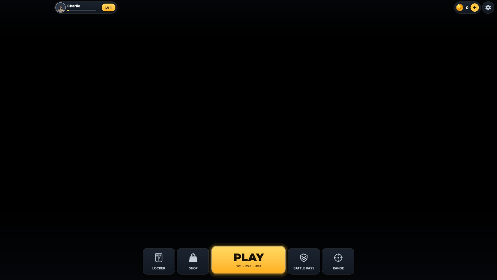
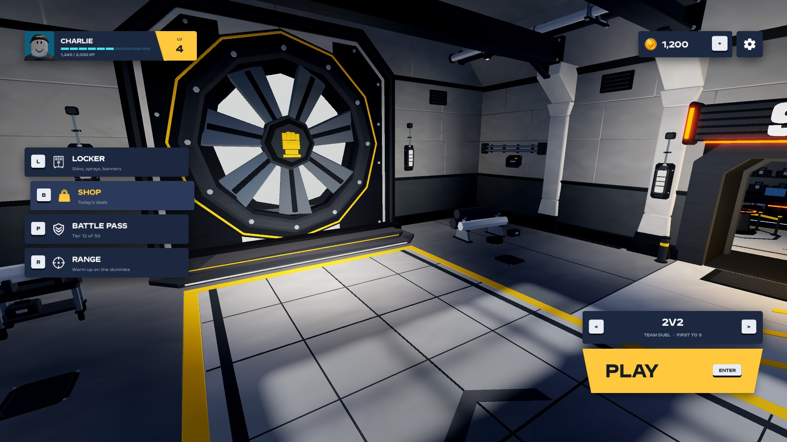

# Lobby main HUD redesign (2026-11-14)

**Owner:** "lets do the lobby next. Start with the Main hud. I want to redesign it maybe move things, etc." Lobby Rojo: `rojo serve lobby.project.json --port 34873` (the match place stays on 34872).

## Today (code-built, `src/lobby/client/Controllers/LobbyHud.luau`, lobby UI v2)

- **Top row** (in Roblox's top-bar strip): a profile pill (avatar, name, XP line, LV tag) on the left; coins with a + and a settings gear on the right.
- **Bottom dock:** LOCKER · SHOP · **PLAY** (big gold, "1V1 · 2V2 · 3V3") · BATTLE PASS · RANGE. A "searching" pill above the dock; toasts above it.
- The older rounded look: pills, gradient gold, glow. The match UI has moved past this (no pills, no glows or gradients; navy plates, slanted team / gold blocks, Builder Extended, keycaps).

## Brainstorm (suggested answer ★)
1. **Style:** ★ the match UI's language everywhere (navy plates, slanted gold / team blocks, Builder Extended, keycaps, soft shadows).
2. **Layout:**
   - A. Keep the bottom dock, restyled.
   - ★ B. **Corner PLAY** (bottom right, like RIVALS / Fortnite) with the selected mode on a card above it; the menus as a **list on the left**; the middle stays clear for your character and the hub.
   - C. A top nav bar (Valorant): PLAY in the top middle, menus beside it.
3. **Mode card** over PLAY: the mode (1V1 / 2V2 / 3V3) with keycap arrows to change it; while searching it shows the time and CANCEL.
4. **Profile:** the top bar's portrait cell, your name, a level block and a segmented XP bar (the bottom HUD's segments).
5. **Currency:** coin icon and amount on a navy plate, + as a keycap.
6. **Hotkeys** on the menu items as keycaps.
7. **Toasts and queue messages** in the match's notification band at the top.
8. Later / parked: party panel (invite friends), daily challenges, battle pass progress teaser, news card.

## Mockup v1 (owner picked layout B: corner PLAY + left menu)
Built in the Lobby place as `StarterGui.LobbyHudMockup` (Enabled off; `tools/studio/BuildLobbyHudMockup.luau`): `CanvasIdle` and `CanvasSearching`.
- **Profile** (top left, under Roblox's buttons): portrait cell, name, a segmented cyan XP bar with "1,240 / 2,000 XP", the level on a gold block with a slanted start.
- **Coins and settings** (top right): coin icon and amount on a navy plate with a + keycap; the gear on its own navy square.
- **Menu list** (left): LOCKER, SHOP, BATTLE PASS, RANGE, each a navy plate with a hotkey keycap (L, B, P, R), its icon, the name and one line under it. The hovered one is the brighter navy, slides out and turns gold.
- **PLAY** (bottom right): the mode card (< 2V2 > · TEAM DUEL · FIRST TO 5) over a big gold PLAY block with slanted ends and an ENTER keycap. **Searching:** the card reads SEARCHING with the time in cyan, and PLAY becomes a navy CANCEL with ESC.
- The middle stays clear for your character and the hub.

Idle: 
Searching: 
