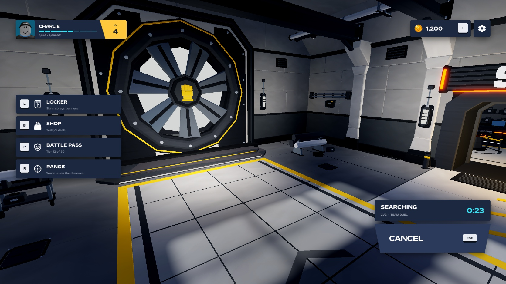
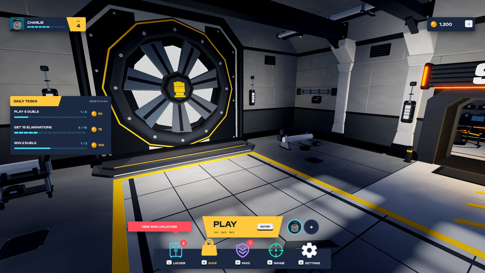
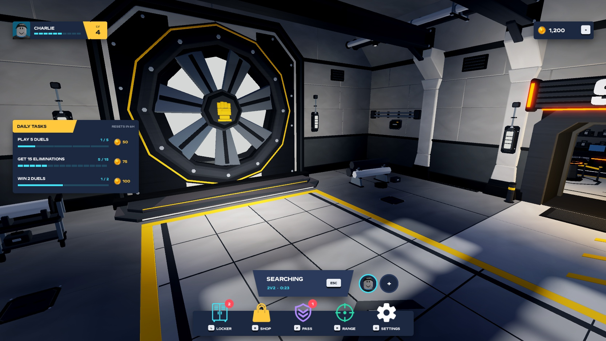
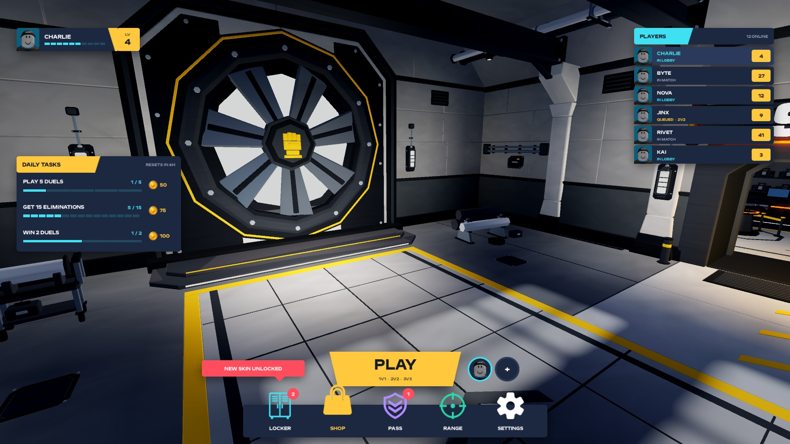

# Lobby main HUD redesign (2026-11-14)

**Owner:** "lets do the lobby next. Start with the Main hud. I want to redesign it maybe move things, etc." Lobby Rojo: `rojo serve lobby.project.json --port 34873` (the match place stays on 34872).

## Today (code-built, `src/lobby/client/Controllers/LobbyHud.luau`, lobby UI v2)

- **Top row** (in Roblox's top-bar strip): a profile pill (avatar, name, XP line, LV tag) on the left; coins with a + and a settings gear on the right.
- **Bottom dock:** LOCKER · SHOP · **PLAY** (big gold, "1V1 · 2V2 · 3V3") · BATTLE PASS · RANGE. A "searching" pill above the dock; toasts above it.
- The older rounded look: pills, gradient gold, glow. The match UI has moved past this (no pills, no glows or gradients; navy plates, slanted team / gold blocks, Builder Extended, keycaps).

## Brainstorm (suggested answer ★)
1. **Style:** ★ the match UI's language everywhere (navy plates, slanted gold / team blocks, Builder Extended, keycaps, soft shadows).
2. **Layout:**
   - A. Keep the bottom dock, restyled.
   - ★ B. **Corner PLAY** (bottom right, like RIVALS / Fortnite) with the selected mode on a card above it; the menus as a **list on the left**; the middle stays clear for your character and the hub.
   - C. A top nav bar (Valorant): PLAY in the top middle, menus beside it.
3. **Mode card** over PLAY: the mode (1V1 / 2V2 / 3V3) with keycap arrows to change it; while searching it shows the time and CANCEL.
4. **Profile:** the top bar's portrait cell, your name, a level block and a segmented XP bar (the bottom HUD's segments).
5. **Currency:** coin icon and amount on a navy plate, + as a keycap.
6. **Hotkeys** on the menu items as keycaps.
7. **Toasts and queue messages** in the match's notification band at the top.
8. Later / parked: party panel (invite friends), daily challenges, battle pass progress teaser, news card.

## Mockup v1 (owner picked layout B: corner PLAY + left menu)
Built in the Lobby place as `StarterGui.LobbyHudMockup` (Enabled off; `tools/studio/BuildLobbyHudMockup.luau`): `CanvasIdle` and `CanvasSearching`.
- **Profile** (top left, under Roblox's buttons): portrait cell, name, a segmented cyan XP bar with "1,240 / 2,000 XP", the level on a gold block with a slanted start.
- **Coins and settings** (top right): coin icon and amount on a navy plate with a + keycap; the gear on its own navy square.
- **Menu list** (left): LOCKER, SHOP, BATTLE PASS, RANGE, each a navy plate with a hotkey keycap (L, B, P, R), its icon, the name and one line under it. The hovered one is the brighter navy, slides out and turns gold.
- **PLAY** (bottom right): the mode card (< 2V2 > · TEAM DUEL · FIRST TO 5) over a big gold PLAY block with slanted ends and an ENTER keycap. **Searching:** the card reads SEARCHING with the time in cyan, and PLAY becomes a navy CANCEL with ESC.
- The middle stays clear for your character and the hub.

Idle: 
Searching: 

## Mockup v2 (owner on v1)
Owner: "I don't really like that... it is not like Valorant or Fortnite because the player is in an actual game, not just a lobby." The hub is walked around, so the HUD must be a light in-game HUD, not a menu screen. Owner's picks:
- Play: **both**, the Duels pads in the hub plus a small PLAY shortcut on the HUD.
- Menus: a **small icon rail on the left edge**.
- No extras for now.

Built (same `StarterGui.LobbyHudMockup`, rebuilt by `tools/studio/BuildLobbyHudMockup.luau`):
- **Profile** (top left): a compact 300 x 56 plate with portrait, name, a thin segmented XP bar and the level on a gold block.
- **Coins and settings** (top right): the same height; coin and amount with a + keycap, and the gear.
- **Rail** (left edge, centred): four 72 px square buttons (Locker, Shop, Battle Pass, Range) with the icon and a small hotkey keycap (L, B, P, R) in the corner. On hover the icon turns gold and the name slides out on a plate beside it.
- **PLAY** (bottom right): a compact gold block with slanted ends, "1V1 · 2V2 · 3V3" and ENTER. It opens the Play menu, like the pads do.
- **Searching:** PLAY hides; a small strip at the top centre reads SEARCHING 2V2 (cyan block) with the time and CANCEL / ESC.

Idle: 
Searching: 

## Mockup v3 (owner: "more like Rivals... bottom bar looking things", not a copy)
Reference (the owner's RIVALS hub screenshot): 
What makes it fun: big colourful icons sitting on and breaking out of a bottom bar with names under them and red badges; PLAY on top of the bar with your party slots beside it; a callout pointing at something new; daily tasks on the left.

Our version (same `StarterGui.LobbyHudMockup`, `tools/studio/BuildLobbyHudMockup.luau`), in the match UI style:
- **Bottom bar:**
  - a navy plate with five big coloured icons breaking out of its top edge: LOCKER cyan, SHOP gold, PASS purple, RANGE teal, SETTINGS white;
  - each has "[key] NAME" under it (L, B, P, R, O);
  - red circle badges for new things; the hovered one lifts, grows and its name turns gold.
- **PLAY** on top of the bar: the gold block with slanted ends (PLAY, 1V1 · 2V2 · 3V3, ENTER); **searching** turns it navy (SEARCHING · 2V2 · 0:23, ESC). Beside it, **party slots:** your portrait in a cyan ring and an invite + circle.
- **Callout:** a red plate with a pointer ("NEW SKIN UNLOCKED") over the item it's about.
- **Daily tasks** (left, a proposal: no tasks system yet): a gold DAILY TASKS block, three tasks with segmented progress, counts and coin rewards, and the reset time.
- **Profile** top left and **coins** top right stay compact; settings moved into the bar.
- **Open:** the icons are today's flat white art tinted. Proper illustrated icons (faceted, our art style) would make it pop like RIVALS' 3D icons.

Idle: 
Searching: 

## Mockup v4 (owner on v3: "I like it", clean it up)
- **No hotkeys** on the bar ("we don't need keys to open things"), and no ENTER / ESC keys on PLAY.
- **Settings stays** in the bottom bar.
- **No coins** on the HUD.
- **Icons:** today's art "looks bad". New icons to be generated later; parked in Bugs & Ideas.
- **Cleaner:** bigger icons (74, hovered 84) with more room (140 apart), the name centred under each; PLAY's text centred; searching reads "2V2 · 0:23 · CLICK TO CANCEL".
- **New: a custom player list** (owner: "a custom player list, like the leaderboard... players, their level... we can add more to it later"). It's top right where the coins were:
  - a cyan PLAYERS header with the online count;
  - one row per player: portrait, name, where they are (IN LOBBY cyan, IN MATCH grey, QUEUED · 2V2 gold), and the level on a gold block;
  - your row is the brighter navy with your name in cyan;
  - built to take more columns later. It replaces Roblox's own player list in the lobby, which gets hidden.

