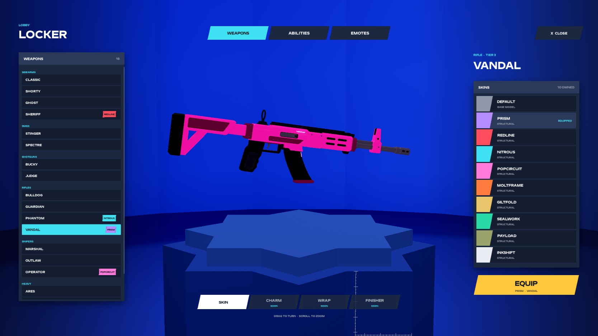
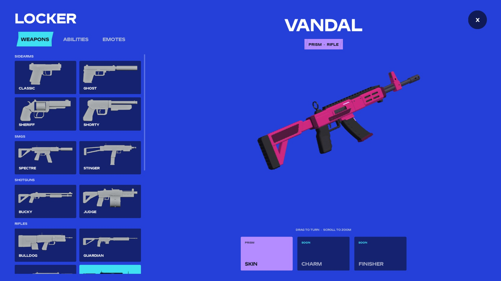
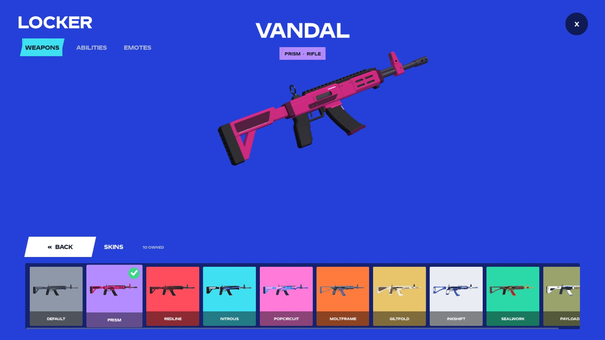

# UI: Locker

The Lobby's Locker: equip weapon skins on a live 3D gun you can turn (RIVALS-style), later emotes, charms, wraps and ability cosmetics. Owner picked **UI + a 3D model you can turn** over Valorant's flat cards (2026-11-15); browse like Valorant (weapon → its skins → equip), inspect in 3D like RIVALS.

Related: [UI Lobby HUD](UI%20Lobby%20HUD.md), [Lobby](../01%20Design/Lobby.md) (Weapons wing + Locker apse with a 3D preview), [Style Bible](Style%20Bible.md), [UI Theme v4 Soft Edge](UI%20Theme%20v4%20Soft%20Edge.md), [Structural Skin Round One Results](Skins/Structural%20Skin%20Round%20One%20Results.md). Locked: cosmetics only (wraps, charms, Mod VFX), no paid random boxes (Home → Locked decisions).

## Weapons in the Lobby (done 2026-11-15)
- The Lobby now has the match place's exact `ReplicatedStorage.Weapons` (19 guns) and `ReplicatedStorage.WeaponSkins` (10 lines, 101 ready skin models): 11,252 instances, all 480 gun meshes with their ids.
- **Keep it in sync** with `tools/studio/SyncWeapons.luau`: run it with `MODE = "push"` in the match place, then `MODE = "pull"` in the Lobby, then save the Lobby. It goes through a dev-only DataStore key (`DevWeaponSync`, about 2.5 MB of the 4 MB limit) because the two places share a universe; a local HTTP relay was tried first and the Studio assistant's HTTP allowlist blocks localhost. The old folders stay in `ServerStorage.WeaponSyncBackup` until the next pull.
- Rule: after any gun or skin change in the match place, push + pull + save both places.

## What we know (facts)
- Skins: `WeaponSkins/<Line>/<Gun>` (Knife `<Line>/Knife`, PopCircuit Bat `PopCircuit/Bat`), `SkinReady = true`. In matches a player picks a line with the `PreviewSkinLine` remote → `PreviewSkinLine` attribute (`SkinPreviewService`, validated, rate-limited). **Not saved** anywhere, and the Lobby → Match TeleportData has no skin field yet.
- Guns aren't a loadout: every round opens a shared weapon tier (Match Flow), so a skin is **per gun** and shows whenever you hold that gun.
- Mods are drafted every round (Q/E/T, one card per draft). There is **no** pre-match ability loadout in the design yet.
- The current Locker (`Panels.luau` `buildLocker`) is a placeholder: three 2D gun renders and a "SOON" line.

## Rundown (proposal, owner to confirm; ★ = suggested)
1. **Where the 3D gun lives:** ★ the camera cuts to a lit **showroom stand inside the Lobby's Locker room** (Weapons wing apse), so the gun is real, lit, and shadowed; the HUD steps aside. (Alternative: a ViewportFrame: flat lighting, no shadows, cheaper.)
2. **Screen layout** (Soft Edge, sharp slants, no pills):
   - **Top:** tabs **WEAPONS · ABILITIES · EMOTES** (later CHARMS / WRAPS as sub-tabs), the close button top right.
   - **Left:** weapon list grouped by class (Sidearms, SMGs, Rifles, Snipers, Shotguns, Heavy, Melee), each row with a small render and the equipped skin's colour tag.
   - **Centre:** the gun on its stand: drag to turn, scroll to zoom, idles slowly turning, a soft snap back to a hero angle.
   - **Right:** the skin list for that gun (Default + each line that has a ready model for it), the selected skin's name, line and rarity colour, **EQUIP** (gold) / EQUIPPED.
   - **Bottom:** INSPECT (plays the gun's inspect on the stand, later) and a "used in the match on every gun of this line" hint if we keep lines.
3. **Equip rules:** ★ per gun (Vandal: Prism, Sheriff: Redline...), not one line for all; all skins free while testing (lock icons later with the economy).
4. **Saving + match:** a Lobby `LockerService` (validated remote, DataStore with session-safe saves) stores `{ [gunId] = line }`; the match reads it (the same DataStore, both places share the universe) and sets what `SkinPreviewService` sets today. TeleportData stays as is (it passes through the client).
5. **Abilities tab:** owner said "selection of abilities": see the open question below.
6. **Emotes tab:** empty slots for an emote wheel (4-8 slots), filled when emotes exist.
7. **Motion:** camera glide into the showroom (0.6 s, ease out), panels slide in from their edges with a stagger, the gun drops onto the stand with a small bounce, skin swap = quick spin + pop, EQUIP press coil + settle.

## Owner's answers (2026-11-15)
- **Stage:** a **hidden studio stage** (a separate lit set away from the map with a clean backdrop, like RIVALS); the camera cuts there while the Locker is open.
- **Equip:** per gun.
- **Ownership:** every ready skin free while testing; locks and prices come with the economy.
- **Abilities tab = your Mod collection.** The 12 free Mods are locked as **ALWAYS EQUIPPED**. Owned paid Mods can be equipped and unequipped with no limit. This replaces the earlier permanent-equip rule for paid Mods. The tab shows each built Mod's icon, role, and base effect. No paid Mods are currently sold.

### Abilities tab implementation (2026-11-22)

The Lobby Locker mounts the collection beneath its existing tabs. `Config/Mods.free` identifies the always-available roster. `PlayerDataV2.mods` stores paid ownership and equip choices together. `LockerModRequest` saves each choice in a server transaction and `LockerMods` mirrors the result. DraftService builds offers per player from the free catalog and their saved, owned equips. Future paid grants set `data.mods.owned[id] = true` in the same player-data transaction system. An owned paid Mod starts unequipped until selected in the Locker.

Desktop Studio lobby play showed all 12 locked cards and hid the weapon stage. The server rejected requests to unequip a free Mod or equip an unknown Mod. Round one of a Studio 1v1 pad duel against a bot dealt three free Mods. An isolated Luau fixture verified paid equip and unequip across a simulated save reload, multiple paid equips, filtering and bot takeover.
  - Open (owner): earnable with in-game currency as well as Robux? Ranked uses only base Mods (keeps "nothing that changes a fight is sold" for ranked)?

## Mockup v1 (2026-11-15, owner: "Build the mockup")

- **Stage** `Workspace.LockerStage` (Lobby place, at (0, 600, -3000), far from the map): a faceted arc of nine flat backdrop plates in RIVALS-ish blue (`2A3F8F`), an octagon floor and a two-tier octagon plinth (each octagon = two rotated slabs; no curves), and its own light (key spot with shadows, cool rim, warm fill, a blue wash on the backdrop) because the Lobby's lighting is a dark night set. The gun is the Prism Vandal skin model, anchored, scale 1.2, muzzle right, turned 22° toward the camera, nose up 8°, hovering over the plinth. Camera: `LockerStage.CameraCFrame`, FOV 30. In the real build the client clones the stage (StreamingEnabled would not stream a far-off set) and the camera cuts there.
- **Screen** `StarterGui.LockerMockup` (one 1920x1080 canvas with a Fit scale): LOBBY / LOCKER title top left; tabs WEAPONS (cyan, active) · ABILITIES · EMOTES top centre; X CLOSE top right; left panel WEAPONS with class groups (Sidearms, SMGs, Shotguns, Rifles, Snipers, Heavy, Melee), the selected gun cyan and a slanted tag in the equipped skin's colour; right: RIFLE · TIER 3 / VANDAL, the SKINS list (swatch, name, STRUCTURAL, EQUIPPED, » on the one on the stand) and a gold **EQUIP** (the one gold thing); bottom centre SKIN · CHARM · WRAP · FINISHER (the last three SOON) and DRAG TO TURN · SCROLL TO ZOOM. Dark fades at the left and right edges keep the panels calm.
- Self-review: first capture was too dark (the night lighting) and the gun too big (stock behind the panel), the ✕ glyph isn't in Builder Extended (now "X CLOSE"); fixed with the stage lights, a farther camera, a smaller plinth right under the gun.
- Builder (backup, re-runnable): `tools/studio/BuildLockerMockup.luau`. `LockerMockup` is **Enabled** so it shows in the editor: turn it off before a play-test until it's wired.
- **Owner to review:** layout, the blue stage, the plinth, skins as a list vs a card grid, class grouping, what goes in ABILITIES (Mod collection) and EMOTES.

## Mockup v2 (2026-11-15)
Owner on v1: "the UI looks too AI, pilly and boring... remember everything we have been talking about." v1 had panels inside panels, rows of identical grey bars, skinny tags, no pictures.

- **Every gun and skin is a picture:** each card holds a ViewportFrame of the real model (side view, muzzle right, framed to fit, bright ambient), so the skins read at a glance.
- **No boxes-in-boxes:** the columns sit straight on dark side fades over the stage; no panel heads, no grey list bars.
- **Left:** gun cards (2 per row) grouped by class (cyan headers); the selected gun's card turns cyan; a small slanted block in the corner shows the equipped skin's colour.
- **Centre:** the gun's name huge (VANDAL), under it a slanted tag in the skin's colour (PRISM · RIFLE); the gun on the stage; DRAG TO TURN · SCROLL TO ZOOM.
- **Right:** SKINS as big picture cards whose foot is the skin's colour (the bar's coloured name tags); the one on the stage is lighter with a »; EQUIPPED as a small white slanted tag; a big gold **EQUIP »** (the one gold thing).
- **Top:** LOCKER, tabs as big words (the active one on a cyan slab, the rest muted text: no plates), a round close.
- **Bottom:** SKIN / CHARM / WRAP / FINISHER as big words, the active one on a white slab, the rest muted with SOON.
- Kept: the blue stage, plinth and lights from v1.
- Builder: `tools/studio/BuildLockerMockup.luau` (v2). `LockerMockup` is Enabled for viewing: switch it off before a play-test.

## Wired (2026-11-15, owner: "Looks good, wire it")
- **Studio:** `StarterGui.Locker` (off; the controller opens it), `ReplicatedStorage.LockerStage` (backdrop, plinth, `GunSpot`, `CameraCFrame`; no gun), templates `UiTemplates.Lobby.GunCard / SkinCard / GunGroup`. Builder `tools/studio/BuildLocker.luau` builds the v2 mockup then strips it to this. The mockup gui is gone.
- **Client** `client/Controllers/LockerController`: Router menu "Locker" (it used `clear = true`, no blur; since the plate look of 2026-11-16 it blurs the lobby under the Shop's violet wash like the other menus). Gun cards by class (Config/Weapons class + tier, only guns with a model) and skin cards (`Shared/Locker.linesFor`) with live ViewportFrame thumbnails; clicking a skin puts it on the stand with one full spin that lands back on the hero angle; EQUIP fires `LockerRequest`; the server's `LockerSkins` value drives EQUIPPED, the gun cards' colour block and the button (EQUIP gold → EQUIPPED navy). Drag on the stage to turn (pitch ±35°), scroll to zoom; idles after 3 s. ABILITIES / EMOTES show "MOD COLLECTION · SOON" / "EMOTES · SOON" for now. Entrance: columns slide in from their edges.
- **The stage is a full-screen ViewportFrame** behind the UI, not a real far-off set: the first wiring cut the camera to a set in the world, and it opened dark for ~3 s because Roblox lights the area round the camera progressively (raising Lighting.Ambient didn't help). The ViewportFrame lights instantly (Ambient 118,128,170, warm key from upper left), needs no camera move or streaming and works on phones; no real shadows (barely visible on our flat-coloured guns).
- **Server** `server/Services/LockerService`: validated (`Shared/Locker.valid`: a real gun, a known line, a SkinReady model), rate-limited `{4, 10}`, DataStore `LockerV1` key `u_<userId>` = `{ v = 1, skins = { [gunId] = line } }`; loaded with retries (never written if the load failed), debounced UpdateAsync (3 s), on leave and BindToClose.
- **Match** loads `LockerV1` on join into the player's `LockerSkins` JSON StringValue, keyed by gun ID. `Shared/SkinPreview.line(player, gunId)` uses the saved line whenever the F7 preview is on Stock.
- **Checked in Studio (Lobby):** open / close (camera, HUD, stage cleaned up), Redline equipped on the Vandal, junk requests dropped (bad line, wrong types, a removed gun, unknown action), the equip saved and loaded again after a restart. **Not checked yet:** the match place reading it live (its Studio was in a play session), a phone layout.
- **Security review (roblox-reviewer, 2026-11-15):** no critical or high issues; validation holds. Fixed its medium / low points: saves **merge** into the stored record (a pair the Lobby's synced copy doesn't know is never dropped), one write at a time per player with a 6 s gap (Roblox's per-key write limit), leave and BindToClose wait for writes in flight, **MATCH FOUND flushes the save** (QueueService → `LockerService.flush`) so it lands before the teleport, and the PopCircuit knife maps to the Bat like the match does. Re-checked: Prism on the Vandal and PopCircuit on the Knife saved and loaded after a restart.

## v3 (2026-11-15, owner on the wired v2)
Owner: "The drag does not work... a bit glitchy... the bat angle and the fan... should not auto rotate... larger and look nicer like Rivals... rotate it around like all directions, then it goes back to its original position (tween)... no wraps... the guns like in the game, the grey / white version... the selection should just be a coloured background like rivals."

- **Drag fixed:** v2 read mouse movement deltas, which Roblox only fills while the mouse is locked. Now a `DragArea` button over the stage takes the press, and movement uses positions. The drag turns the gun about the screen's up and right axes (any direction); letting go tweens it back to its pose (Quint, 0.7 s). **No auto-rotate.** Scroll zooms (eased), not over the lists.
- **Pose:** RIVALS-style diagonal: the side toward the camera, muzzle raised 24° on screen, turned 26° toward the camera, big (guns 4.7 studs, melee 0.78 of that so a bat doesn't reach under the cards). A swap rises and settles (Back 0.5 s) instead of spinning.
- **Melee and odd shapes:** every item is laid out the same way before posing (longest side left-right, thinnest toward the camera), so the PopCircuit **bat** lies along the diagonal and the Giltfold **fan** shows its open face (stage and thumbnails).
- **Look:** flat saturated blue (`2340D8`, the stage's `Background` attribute), no floor or plinth; bigger everything (LOCKER 68, gun name 104, cards 236 wide); cards are dark see-through plates (`0B1236` at 35%); **gun cards use the in-game gun icons** (`Theme.GUN`, the grey / white renders); a **selected card is a solid colour** (cyan for the gun, the skin's own colour for a skin; its icon / text turns ink); skin cards keep a live picture plus a small slanted swatch; SKIN / CHARM / FINISHER (**no wraps**).
- Studio: `tools/studio/BuildLocker.luau` rewritten to build v3 straight to the live structure (`LockerStage` is now values only: `GunSpot`, `CameraCFrame`, `Background`). Checked in play: open, gun and skin selection, drag + release back to the pose, the knife / bat / fan.

## v4 (2026-11-15, owner on v3)
Owner: "drag and everything should be smoother... too much UI... the gun is not centred in the origin so it feels weird... RIVALS: when you click skin at the bottom it opens a separate menu... your call."
 
- **Less UI, two views.** Main: the gun list, the big gun, its name and skin tag, and three tiles at the bottom: **SKIN** (filled with the equipped skin's colour, its name on it), CHARM, FINISHER (soon). The skins column and the EQUIP button are gone.
- **The skins tray** (SKIN tile): the list slides out left, the tiles slide down, the gun glides to the middle and lifts, and a tray slides up: a white slanted **« BACK**, SKINS · n OWNED, and a strip of big tiles, each **filled with its skin's colour** with a live picture and the name on a dark band (RIVALS' rarity-coloured tiles). **One click equips** (green drawn tick on the equipped tile; the selected one is a touch bigger). BACK returns and shows the equipped skin.
- **Smoother turning:** the drag sets a target and the drawn turn eases toward it (exponential follow, 14/s), so there are no jumps; letting go eases the target home (Quint 0.8 s). It never turns on its own.
- **Centred:** every item's pivot is its bounding-box centre and the camera looks straight at it; the camera then slides sideways / up (`cameraFor`) so the gun's centre lands in the middle of the free area in each view (main: canvas 1240,520; tray: 960,400), so it always turns about its own middle.
- Studio: `tools/studio/BuildLocker.luau` v4 (template `SkinTile` replaces `SkinCard`; `Tray` with `Back`, `Strip`). Checked in play: open, the tray, one-click equip (Redline on the Vandal, ticks moved), BACK.

## v4.1 (2026-11-15, owner: "some guns are not centred... moving should be slower and smoother... a slight natural wobble when not moved")
- **Off-centre, found and fixed:** the gun models have a **PrimaryPart**, and with one set Roblox takes the pivot from that part and ignores `WorldPivot`, so the display copy turned about its handle, 1-2 studs from its middle (measured: pivot (0,0,0) vs box centre (1.39,0.49,-0.64)), and longer items drifted further off their spot. Now the copy is laid out by its own pivot (keeps it upright), then its PrimaryPart is cleared and its pivot set to the centre, again after `ScaleTo` (which keeps its old origin). Measured after: pivot = box centre to 1e-6.
- **Sizes:** items fit a box (at most 5 long and 2 tall; melee x0.8) instead of one length, so pistols no longer blow up over the title.
- **Slower, smoother turning:** 0.24°/px, the drawn turn follows at 6/s, letting go eases home over 1.2 s (Sine in-out).
- **Idle wobble:** while untouched, a slow bob (±0.05) and sway (yaw ±3.2°, pitch ±1.6°, roll ±1.2°) on mismatched periods (0.52-1.05 rad/s) so it never visibly loops; it fades out while dragging and back in once the gun is home.
- Checked in play: Vandal, Classic, Operator, the PopCircuit bat (tray view) all centred on their spots; fan thumbnail upright and open.

## v5 (2026-11-15, owner: "the locker seems a bit unprofessional"; "something to identify skins besides just their colour... the way they look in the list I don't like")
**Critique of v4.1** (captures in Studio):
- The flat blue had no depth, and the gun floated in nothing.
- The gun list was cut off mid-screen.
- Pistol icons were huge next to rifles.
- A cryptic coloured slant was the only sign of a skin.
- Tiny headers and hint.
- SKIN / CHARM / FINISHER read as placeholder boxes.
- The skins tray sat in a dark box that clipped tiles, with small pictures.
- In the tray, the gun hit the title.
- Skins were identified **only by colour**.

**Owner's pick for skin identity:** an **emblem per skin line** (Prism, Redline, ...), a single-colour icon tinted with the line's colour. Tiles become neutral dark plates with a big render of the skinned gun, the emblem and the name.

**Built:**
- **Backdrop with depth:** the stage colour, a soft shade at the top and bottom, and a floor shadow under the gun that follows its spot and shrinks as the camera pulls back. The gun's ViewportFrame is now see-through, between `Backdrop` and `Canvas`.
- **Side panel:** a dark panel from the screen's top to bottom edge behind the title, tabs and gun list. The list scrolls to the bottom edge. In the skins view the panel slides away with the list.
- **Gun cards:**
  - icons sized by class (a share of the box width: sidearms 0.5, SMGs 0.74, shotguns 0.86, rifles / snipers / heavy 1, melee 0.56), so guns read at a similar size;
  - the name, then the equipped skin's **emblem and name**;
  - class headers at 16 px with a count.
- **Stage header:** the class (cyan) above the name, and the skin as **emblem + name** (the white slanted tag is gone).
- **SKIN tile:** a real button, 380 wide, with the equipped skin's big emblem, its name and a ». CHARM and FINISHER are dimmer, marked SOON.
- **Skins view:**
  - no box around the strip;
  - tiles 216 x 232: dark plate, emblem top left, a big live picture, the name;
  - the **previewed** tile fills with its line's colour, and its emblem turns ink so a light colour (Inkshift) never hides it;
  - a green tick marks the equipped one;
  - the camera pulls back (zoom 1.3), so the gun clears the title.
- **Emblems:** `Shared/Locker.EMBLEMS[line]` (image ids, empty for now), template `UiTemplates.Lobby.SkinEmblem`. Until the art exists, each emblem is a diamond in the line's colour with its first letter.
- The skin tile press uses clean Quint motion (no Back), per the owner's "cleaner animations".
- Checked in Studio play:
  - main view, and the skins view with Prism previewed (filled lilac, dark emblem, tick moved);
  - the side panel slides out;
  - the owner's Vandal was put back on Inkshift afterwards;
  - no errors.
- Builder `tools/studio/BuildLocker.luau` v5; controller `client/Controllers/LockerController`.

### Emblem art: ChatGPT prompt (paste into the icons chat)
> Make a set of 10 emblem icons for skin collections in a stylised Roblox shooter. Each emblem is a **single flat white shape on a transparent background** (it gets tinted in-game), bold and readable at 14 px and at 64 px. Fill a square, centred, with no text, no letters, no outlines, no gradients, no 3D and no drop shadows. They are sharp and geometric: **no round curves or circles**; curves are made of angled facets, and the corners are chamfered, not blunt. All ten share one visual family, like a set of faction marks.
> 1. **Default:** a simple chamfered hexagon plate with a notch.
> 2. **Prism:** a faceted gem or prism with a split facet.
> 3. **Redline:** a drafting-blueprint mark: a set square and a sharp line.
> 4. **Nitrous:** an abstract burst of hard angular shards (explosive speed).
> 5. **PopCircuit:** a sparkle star with angular "bubble" facets (anime pop).
> 6. **Moltframe:** an insect-armour carapace of three overlapping plates with a slit.
> 7. **Giltfold:** a folded fan of three pleats (folded card).
> 8. **Sealwork:** a clipped-corner square seal with a stepped border (a stamp seal).
> 9. **Payload:** a spacecraft or satellite mark, an angular capsule with two fins.
> 10. **Inkshift:** a comic-panel mecha visor, an angular helmet slit with an ink stroke.
>
> Output each as its own 512x512 PNG with a transparent background, white only, named `emblem_<name>.png`, plus one contact sheet of all 10 on dark grey.

Then upload the PNGs (Open Cloud, like the bar icons) and put the ids in `Shared/Locker.EMBLEMS`.

### Emblems in (2026-11-15)
ChatGPT made the set from the prompt above (sources and a contact sheet in `art-source/ui/collection-emblems/`, 512 px, white on transparent). They are uploaded, and the ids are in `Shared/Locker.EMBLEMS`:

| Line | Emblem | Asset id |
|---|---|---|
| Default | chamfered hexagon plate with a notch | 89295875546813 |
| Prism | faceted gem with a split facet | 122467699745583 |
| Redline | set square and a sharp line | 71004506302641 |
| Nitrous | angular shard burst | 113536349803482 |
| PopCircuit | sparkle star with a bubble | 129293303801424 |
| Moltframe | carapace with a slit | 130609703264142 |
| Giltfold | folded fan | 137880589089631 |
| Sealwork | stepped square seal | 90587660646204 |
| Payload | angular capsule with fins | 74808720750414 |
| Inkshift | mecha visor with an ink stroke | 92911837408821 |

Checked in Studio play: every emblem loads, tinted in its line colour, on the gun cards (14 px), the header (30), the SKIN tile (64) and the skin tiles (32). On the previewed tile it turns ink.

## Release #1 fixes (2026-11-28, owner's phone + PC test)

The Locker v3 (`LockerV3Controller`), six notes from the owner's release test. Studio-tested on desktop and with the `ForceLayout = "phone"` switch; real phone sizes still need the owner's Device Emulator check.

| Owner's note | Fix |
|---|---|
| "Side bar of guns should not show up when you have knife selected" | KNIFE hides the LOADOUT / PRIMARY / SECONDARY column and opens its skin strip at once (skins are all the knife has). |
| "Should be an easy one click out of the locker somewhere" | The lobby's round close button (`Util/CloseButton`, drawn X) right of the coins, always there; one click closes. At least 46 px on a phone. Back / gamepad B still step out of the strip first, then close. |
| "Should be able to see skins and charms for weapons you don't have unlocked" | SKIN and CHARM open on every gun. A locked gun shows solid while you browse (the lock plate comes back when the strip closes). Nothing equips on a locked gun; UNLOCK / TRY stay the way to use them. |
| "More clear when you have a skin that you actually don't have unlocked" | Unowned tiles carry a grey **NOT OWNED** tag; while one is previewed a line over the strip reads **NOT OWNED** (red) · tier · "GET IT FROM SKIN CASES / THE SHOP / THE BATTLE PASS" (charms: the pass or a Strike / Overdrive box), and EQUIP turns into a dark **PREVIEW ONLY**. A locked gun's preview reads "PREVIEW · UNLOCK THE PUMP TO USE IT". Closing the strip puts the gun back in what you own. |
| Phone: coin overlaps price, Back / Skin / Charm under the iPhone home bar, text off its box, the knife card over the gun list | Touch screens get a boost (`Lobby/Config.LOCKER_TOUCH`: phone 1.3, tablet 1.1) and `homeGap` 18 px above the bottom safe area. The gun list gets shorter instead of the column smaller, and stops above the round buttons where they share its width. The right column shrinks only to stay between the coins and the buttons. The skin strip now fills the space between the columns, or (narrower than 640 design px: every phone and tablet) takes the gun list's place while open. The coin and price share one right-aligned box sized to the drawn number. Any label whose text doesn't fit steps its size down (to 60%). |
| "When I left the locker in the range on PC there was still a blur" | Range → LOADOUT → LOCKER → close: the Router reopens LOADOUT (with its blur) at once, the Locker's close then re-enabled that screen and called `ArmedHideController.refresh()`, which hid it while armed. The blur stayed with no menu on screen, and LOADOUT stayed hidden until the player left the Range. Opening the Locker from the bar skipped this, so it "did not happen every time". The Locker now calls the refresh only when the zone changed while it was open (the pad-duel case it was added for). Checked: LOADOUT comes back over the blur and closing it clears the blur. |

Layout math for the brief's sizes (same code as `fit()`): 667x375 scale 0.45, list 456 design px, strip replaces the list (430 px wide); 844x390 (notch) 0.47; 932x430 0.52; iPad 1024x768 0.78. None of them overlap. Body text on a 375-tall phone is still small (13 design px ≈ 6 px): if the owner wants it bigger, raise `phoneBoost`; the lists and the right column already make room.

Captures: [locked gun skin](Locker/2026-11-28/01%20locked%20gun%20skin%20preview.jpg) · [charm not owned](Locker/2026-11-28/02%20charm%20not%20owned%20preview%20only.jpg) · [knife](Locker/2026-11-28/03%20knife%20tab.jpg) · [Range: LOADOUT back after the Locker](Locker/2026-11-28/04%20range%20loadout%20back%20after%20locker.jpg) · [phone switch](Locker/2026-11-28/05%20phone%20layout%20switch.jpg).

Not done: the close button is made in code (`CloseButton.make`), not in the Studio template yet.

## Locked guns v2 (2026-11-28, owner's second pass)

The owner, after the first fixes: "it can't see the skins anymore, that's my bad". So **note 3 is reversed**: a locked gun opens no skin or charm strip (SKIN and CHARM hide on it). The rest of the first pass stands. Reference: the owner's RIVALS screenshots, plus RIVALS' `Assets.Misc.EquipmentScenes.*.UnlockEffect`: four chain strands from a centre padlock, animated off on unlock. We studied the structure only and nothing was copied ([Rivals Reference](../03%20Research/Rivals%20Reference/00%20Rivals%20Reference.md)).

- **3D lock over a locked gun:** an X of four faceted gold chain strands and a big padlock with a cut keyhole, floating 1.5 studs in front of the gun and facing the camera, with a slow float of its own. The padlock is 1.15 studs across, and the strands (14 links each) run off every screen edge (owner: "the lock should kind of extend through the whole screen"). Gold `D49A2A` Metal (a brighter `F2B530` bloomed into flat yellow). It drops in with each gun (the gun rises into place, Quint out). The gun itself is no longer see-through. Built in headless Blender: `tools/blender/build_locker_lock.py`. Links are stadiums swept from a 6-sided section with 4-facet ends, and every other link is turned 90° so they interlock. The body has chamfered edges, a framed inset front panel, a keyhole cut with a dark insert, and a faceted shackle seated in collars. 7,048 tris, 0 non-manifold, no smooth faces. Review renders are in `art-source/ui/locker-lock/review/`, the asset is `117306657900034` (v2; v1 `111084314361914` had 6-link strands), and it's installed in Studio by `tools/studio/InstallLockerLock.luau` as `ReplicatedStorage.LockerV3Stage.LockChains` (pivot faces the keyhole; `Width` / `Height` / `PadlockWidth` attributes). **Owner: save the place.** Without the model, the old 2D lock icon shows instead.
- **Unlock moment:** buying the gun breaks the lock over 0.8 s. The strands fly out along their diagonals and fall, the shackle pops, the padlock drops, and everything fades.
- **Locked panel:** the name, then three short lines (slot + class, how it fires, its line from `Config/Loadout.ROLES`), then the UNLOCK price row. No Overview/stats and no TRY IN THE RANGE row ("no free trial").
- **Locked rows:** the name greyed between two small padlocks (`Theme.ICON.Padlock`, a white render of our padlock: `tools/blender/render_locker_lock_icon.py`, decal 140513655036396 / image 100375076852187; the old lock icon read as a dash at row size), in one row sized to the name; LOCKED under it; coin + price on the right.
- **Skin / charm strip:** every tile is washed in its rarity colour (tier colour from `Config/Skins`, charm rarity from `ShopCatalog.RARITY_COLOR`), deeper when not selected. Anything you don't own gets a big padlock over the art (the art dimmed). The equipped tile has a green drawn check. A **BACK** button and a **search** box sit above the row, and the search filters by name. Tiles are built once per open and restyled on click, so their hover and press pops (from the centre, Quint) stay smooth. They pop in a beat apart when the strip opens.
- **Motion:** the columns leave toward their edges as the close wipe comes down; gun rows dip on press and grow 1.5% on hover; the gun rises in on every swap; the tiles pop in.

Checked in Studio Play (desktop, Output clean): [locked gun with chains](Locker/2026-11-28/06%20locked%20gun%20chains.jpg) · [skin row with BACK, search, green check](Locker/2026-11-28/07%20skin%20row%20back%20search%20check.jpg) · [unowned Legendary preview](Locker/2026-11-28/08%20locked%20legendary%20skin%20preview.jpg) · [after the unlock break](Locker/2026-11-28/09%20after%20unlock.jpg). The owner tried unlocks in the same session and liked the break animation. Studio Play here uses the live DataStore, so test purchases are real (use `FreshOnboarding` for a throwaway save).
