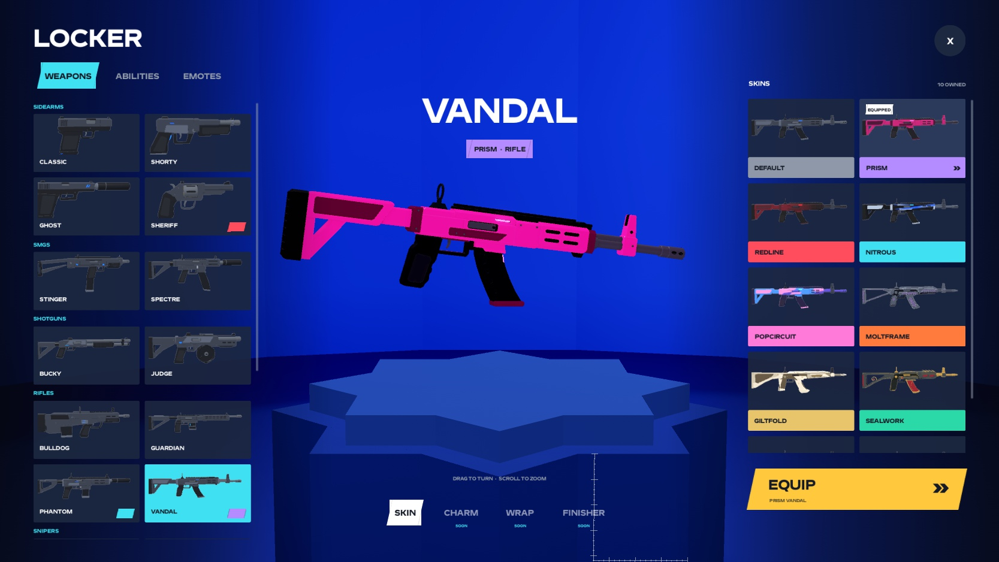
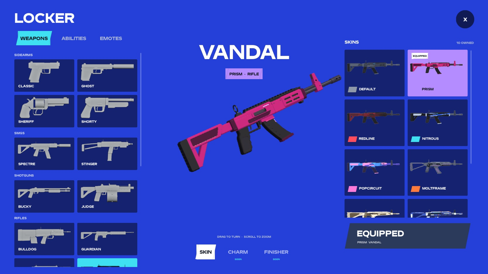

# UI: Locker

The Lobby's Locker: equip weapon skins on a live 3D gun you can turn (RIVALS-style), later emotes, charms, wraps and ability cosmetics. Owner picked **UI + a 3D model you can turn** over Valorant's flat cards (2026-11-15); browse like Valorant (weapon → its skins → equip), inspect in 3D like RIVALS.

Related: [UI Lobby HUD](UI%20Lobby%20HUD.md), [Lobby](../01%20Design/Lobby.md) (Weapons wing + Locker apse with a 3D preview), [Style Bible](Style%20Bible.md), [UI Theme v4 Soft Edge](UI%20Theme%20v4%20Soft%20Edge.md), [Structural Skin Round One Results](Skins/Structural%20Skin%20Round%20One%20Results.md). Locked: cosmetics only (wraps, charms, Mod VFX), no paid random boxes (Home → Locked decisions).

## Weapons in the Lobby (done 2026-11-15)
- The Lobby now has the match place's exact `ReplicatedStorage.Weapons` (19 guns) and `ReplicatedStorage.WeaponSkins` (10 lines, 101 ready skin models): 11,252 instances, all 480 gun meshes with their ids.
- **Keep it in sync** with `tools/studio/SyncWeapons.luau`: run it with `MODE = "push"` in the match place, then `MODE = "pull"` in the Lobby, then save the Lobby. It goes through a dev-only DataStore key (`DevWeaponSync`, about 2.5 MB of the 4 MB limit) because the two places share a universe; a local HTTP relay was tried first and the Studio assistant's HTTP allowlist blocks localhost. The old folders stay in `ServerStorage.WeaponSyncBackup` until the next pull.
- Rule: after any gun or skin change in the match place, push + pull + save both places.

## What we know (facts)
- Skins: `WeaponSkins/<Line>/<Gun>` (Knife `<Line>/Knife`, PopCircuit Bat `PopCircuit/Bat`), `SkinReady = true`. In matches a player picks a line with the `PreviewSkinLine` remote → `PreviewSkinLine` attribute (`SkinPreviewService`, validated, rate-limited). **Not saved** anywhere, and the Lobby → Match TeleportData has no skin field yet.
- Guns aren't a loadout: every round opens a shared weapon tier (Match Flow), so a skin is **per gun** and shows whenever you hold that gun.
- Mods are drafted every round (Q/E/T, one card per draft). There is **no** pre-match ability loadout in the design yet.
- The current Locker (`Panels.luau` `buildLocker`) is a placeholder: three 2D gun renders and a "SOON" line.

## Rundown (proposal, owner to confirm; ★ = suggested)
1. **Where the 3D gun lives:** ★ the camera cuts to a lit **showroom stand inside the Lobby's Locker room** (Weapons wing apse), so the gun is real, lit, and shadowed; the HUD steps aside. (Alternative: a ViewportFrame: flat lighting, no shadows, cheaper.)
2. **Screen layout** (Soft Edge, sharp slants, no pills):
   - **Top:** tabs **WEAPONS · ABILITIES · EMOTES** (later CHARMS / WRAPS as sub-tabs), the close button top right.
   - **Left:** weapon list grouped by class (Sidearms, SMGs, Rifles, Snipers, Shotguns, Heavy, Melee), each row with a small render and the equipped skin's colour tag.
   - **Centre:** the gun on its stand: drag to turn, scroll to zoom, idles slowly turning, a soft snap back to a hero angle.
   - **Right:** the skin list for that gun (Default + each line that has a ready model for it), the selected skin's name, line and rarity colour, **EQUIP** (gold) / EQUIPPED.
   - **Bottom:** INSPECT (plays the gun's inspect on the stand, later) and a "used in the match on every gun of this line" hint if we keep lines.
3. **Equip rules:** ★ per gun (Vandal: Prism, Sheriff: Redline...), not one line for all; all skins free while testing (lock icons later with the economy).
4. **Saving + match:** a Lobby `LockerService` (validated remote, DataStore with session-safe saves) stores `{ [gunId] = line }`; the match reads it (the same DataStore, both places share the universe) and sets what `SkinPreviewService` sets today. TeleportData stays as is (it passes through the client).
5. **Abilities tab:** owner said "selection of abilities": see the open question below.
6. **Emotes tab:** empty slots for an emote wheel (4-8 slots), filled when emotes exist.
7. **Motion:** camera glide into the showroom (0.6 s, ease out), panels slide in from their edges with a stagger, the gun drops onto the stand with a small bounce, skin swap = quick spin + pop, EQUIP press coil + settle.

## Owner's answers (2026-11-15)
- **Stage:** a **hidden studio stage** (a separate lit set away from the map with a clean backdrop, like RIVALS); the camera cuts there while the Locker is open.
- **Equip:** per gun.
- **Ownership:** every ready skin free while testing; locks and prices come with the economy.
- **Abilities tab = your Mod collection:** "you have your main mods... I will be adding new ones that you can buy... maybe in a future update we will add skins for mods. You can't unequip any mods." So: the base Mods are always yours; new Mods are bought and join your **draft pool** for good (no unequip); the tab shows every Mod (owned / locked with its price later), its stats and a preview; Mod skins later. **This changed the locked Money decision** (was cosmetics only): Home → Locked decisions and Game Plan §1 updated.
  - Open (owner): earnable with in-game currency as well as Robux? Ranked uses only base Mods (keeps "nothing that changes a fight is sold" for ranked)?

## Mockup v1 (2026-11-15, owner: "Build the mockup")

- **Stage** `Workspace.LockerStage` (Lobby place, at (0, 600, -3000), far from the map): a faceted arc of nine flat backdrop plates in RIVALS-ish blue (`2A3F8F`), an octagon floor and a two-tier octagon plinth (each octagon = two rotated slabs; no curves), and its own light (key spot with shadows, cool rim, warm fill, a blue wash on the backdrop) because the Lobby's lighting is a dark night set. The gun is the Prism Vandal skin model, anchored, scale 1.2, muzzle right, turned 22° toward the camera, nose up 8°, hovering over the plinth. Camera: `LockerStage.CameraCFrame`, FOV 30. In the real build the client clones the stage (StreamingEnabled would not stream a far-off set) and the camera cuts there.
- **Screen** `StarterGui.LockerMockup` (one 1920x1080 canvas with a Fit scale): LOBBY / LOCKER title top left; tabs WEAPONS (cyan, active) · ABILITIES · EMOTES top centre; X CLOSE top right; left panel WEAPONS with class groups (Sidearms, SMGs, Shotguns, Rifles, Snipers, Heavy, Melee), the selected gun cyan and a slanted tag in the equipped skin's colour; right: RIFLE · TIER 3 / VANDAL, the SKINS list (swatch, name, STRUCTURAL, EQUIPPED, » on the one on the stand) and a gold **EQUIP** (the one gold thing); bottom centre SKIN · CHARM · WRAP · FINISHER (the last three SOON) and DRAG TO TURN · SCROLL TO ZOOM. Dark fades at the left and right edges keep the panels calm.
- Self-review: first capture was too dark (the night lighting) and the gun too big (stock behind the panel), the ✕ glyph isn't in Builder Extended (now "X CLOSE"); fixed with the stage lights, a farther camera, a smaller plinth right under the gun.
- Builder (backup, re-runnable): `tools/studio/BuildLockerMockup.luau`. `LockerMockup` is **Enabled** so it shows in the editor: turn it off before a play-test until it's wired.
- **Owner to review:** layout, the blue stage, the plinth, skins as a list vs a card grid, class grouping, what goes in ABILITIES (Mod collection) and EMOTES.

## Mockup v2 (2026-11-15)
Owner on v1: "the UI looks too AI, pilly and boring... remember everything we have been talking about." v1 had panels inside panels, rows of identical grey bars, skinny tags, no pictures.

- **Every gun and skin is a picture:** each card holds a ViewportFrame of the real model (side view, muzzle right, framed to fit, bright ambient), so the skins read at a glance.
- **No boxes-in-boxes:** the columns sit straight on dark side fades over the stage; no panel heads, no grey list bars.
- **Left:** gun cards (2 per row) grouped by class (cyan headers); the selected gun's card turns cyan; a small slanted block in the corner shows the equipped skin's colour.
- **Centre:** the gun's name huge (VANDAL), under it a slanted tag in the skin's colour (PRISM · RIFLE); the gun on the stage; DRAG TO TURN · SCROLL TO ZOOM.
- **Right:** SKINS as big picture cards whose foot is the skin's colour (the bar's coloured name tags); the one on the stage is lighter with a »; EQUIPPED as a small white slanted tag; a big gold **EQUIP »** (the one gold thing).
- **Top:** LOCKER, tabs as big words (the active one on a cyan slab, the rest muted text: no plates), a round close.
- **Bottom:** SKIN / CHARM / WRAP / FINISHER as big words, the active one on a white slab, the rest muted with SOON.
- Kept: the blue stage, plinth and lights from v1.
- Builder: `tools/studio/BuildLockerMockup.luau` (v2). `LockerMockup` is Enabled for viewing: switch it off before a play-test.

## Wired (2026-11-15, owner: "Looks good, wire it")
- **Studio:** `StarterGui.Locker` (off; the controller opens it), `ReplicatedStorage.LockerStage` (backdrop, plinth, `GunSpot`, `CameraCFrame`; no gun), templates `UiTemplates.Lobby.GunCard / SkinCard / GunGroup`. Builder `tools/studio/BuildLocker.luau` builds the v2 mockup then strips it to this. The mockup gui is gone.
- **Client** `client/Controllers/LockerController`: Router menu "Locker" with `clear = true` (new Router option: no blur / grade). Gun cards by class (Config/Weapons class + tier, only guns with a model) and skin cards (`Shared/Locker.linesFor`) with live ViewportFrame thumbnails; clicking a skin puts it on the stand with one full spin that lands back on the hero angle; EQUIP fires `LockerRequest`; the server's `Skin_<gun>` attribute drives EQUIPPED, the gun cards' colour block and the button (EQUIP gold → EQUIPPED navy). Drag on the stage to turn (pitch ±35°), scroll to zoom; idles after 3 s. ABILITIES / EMOTES show "MOD COLLECTION · SOON" / "EMOTES · SOON" for now. Entrance: columns slide in from their edges.
- **The stage is a full-screen ViewportFrame** behind the UI, not a real far-off set: the first wiring cut the camera to a set in the world, and it opened dark for ~3 s because Roblox lights the area round the camera progressively (raising Lighting.Ambient didn't help). The ViewportFrame lights instantly (Ambient 118,128,170, warm key from upper left), needs no camera move or streaming and works on phones; no real shadows (barely visible on our flat-coloured guns).
- **Server** `server/Services/LockerService`: validated (`Shared/Locker.valid`: a real gun, a known line, a SkinReady model), rate-limited `{4, 10}`, DataStore `LockerV1` key `u_<userId>` = `{ v = 1, skins = { [gunId] = line } }`; loaded with retries (never written if the load failed), debounced UpdateAsync (3 s), on leave and BindToClose.
- **Match:** `SkinPreviewService` loads `LockerV1` on join into `Skin_<gunId>`; `Shared/SkinPreview.line(player, gunId)` uses it whenever the F7 preview is on Stock (F7 still wins while previewing).
- **Checked in Studio (Lobby):** open / close (camera, HUD, stage cleaned up), Redline equipped on the Vandal, junk requests dropped (bad line, wrong types, a removed gun, unknown action), the equip saved and loaded again after a restart. **Not checked yet:** the match place reading it live (its Studio was in a play session), a phone layout.
- **Security review (roblox-reviewer, 2026-11-15):** no critical or high issues; validation holds. Fixed its medium / low points: saves **merge** into the stored record (a pair the Lobby's synced copy doesn't know is never dropped), one write at a time per player with a 6 s gap (Roblox's per-key write limit), leave and BindToClose wait for writes in flight, **MATCH FOUND flushes the save** (QueueService → `LockerService.flush`) so it lands before the teleport, and the PopCircuit knife maps to the Bat like the match does. Re-checked: Prism on the Vandal and PopCircuit on the Knife saved and loaded after a restart.

## v3 (2026-11-15, owner on the wired v2)
Owner: "The drag does not work... a bit glitchy... the bat angle and the fan... should not auto rotate... larger and look nicer like Rivals... rotate it around like all directions, then it goes back to its original position (tween)... no wraps... the guns like in the game, the grey / white version... the selection should just be a coloured background like rivals."

- **Drag fixed:** v2 read mouse movement deltas, which Roblox only fills while the mouse is locked. Now a `DragArea` button over the stage takes the press, and movement uses positions. The drag turns the gun about the screen's up and right axes (any direction); letting go tweens it back to its pose (Quint, 0.7 s). **No auto-rotate.** Scroll zooms (eased), not over the lists.
- **Pose:** RIVALS-style diagonal: the side toward the camera, muzzle raised 24° on screen, turned 26° toward the camera, big (guns 4.7 studs, melee 0.78 of that so a bat doesn't reach under the cards). A swap rises and settles (Back 0.5 s) instead of spinning.
- **Melee and odd shapes:** every item is laid out the same way before posing (longest side left-right, thinnest toward the camera), so the PopCircuit **bat** lies along the diagonal and the Giltfold **fan** shows its open face (stage and thumbnails).
- **Look:** flat saturated blue (`2340D8`, the stage's `Background` attribute), no floor or plinth; bigger everything (LOCKER 68, gun name 104, cards 236 wide); cards are dark see-through plates (`0B1236` at 35%); **gun cards use the in-game gun icons** (`Theme.GUN`, the grey / white renders); a **selected card is a solid colour** (cyan for the gun, the skin's own colour for a skin; its icon / text turns ink); skin cards keep a live picture plus a small slanted swatch; SKIN / CHARM / FINISHER (**no wraps**).
- Studio: `tools/studio/BuildLocker.luau` rewritten to build v3 straight to the live structure (`LockerStage` is now values only: `GunSpot`, `CameraCFrame`, `Background`). Checked in play: open, gun and skin selection, drag + release back to the pose, the knife / bat / fan.

