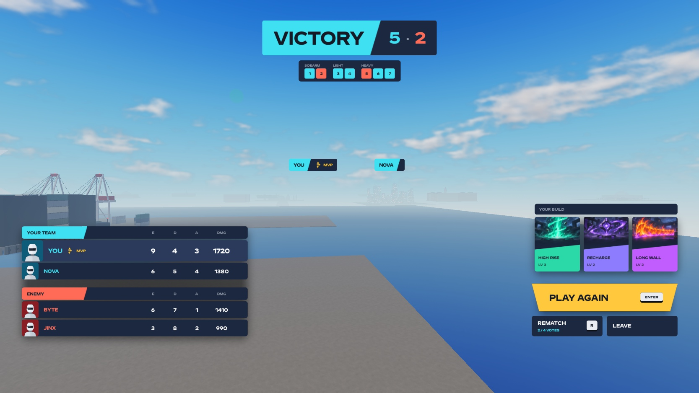
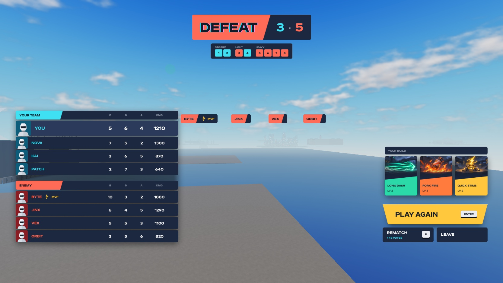
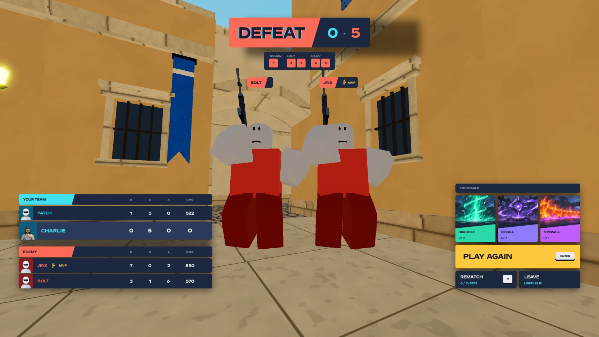

# Match end screen: brainstorm (2026-11-14)

**Owner:** the match end screen is next; brainstorm what should be on it and how it should look before any mockup.

## What it is today
`MatchEndController` (code-built, UI v1 style), after the final-kill replay:
- a **victory scene** on the map: copies of the winning side, side by side, cheering, the camera pushing in;
- VICTORY / DEFEAT on top, **your stats card** at the bottom, a **table of everyone** (E, D, A, DMG) in team modes;
- **Rematch** (with votes) / **Play Again** / **Leave** at the bottom right; an MVP tag.
- Data the server already has (`StatsService`): eliminations, deaths, assists, damage dealt and taken, MVP (most eliminations, then damage). Not tracked yet: headshots, round-by-round winners.

## Ideas (suggested answer marked ★)
1. **The beat order:** final-kill replay → result slams in → the scene settles → the scoreboard and buttons slide in. ★ Keep the scene and replay; the UI arrives in that order, not all at once.
2. **The result headline:** ★ a big VICTORY / DEFEAT slam (like the kill pop: big, snap, settle) on a team-colour block with the slanted end, and the **final score** under it in the top bar's style (cyan 5 · 3 red). Defeat gets the glitch split (cyan / pink offset) as a "you got glitched" touch. Alternatives: text only; or a full-width band like the notifications.
3. **Name plates over the cheering winners** in the scene (team colour block, name, MVP shard on the MVP).
4. **Scoreboard:** ★ two team blocks (yours left, theirs right) like the top bar; one row per player: portrait cell, name, E / D / A / DMG; your row on the brighter navy; MVP marked with the glitch shard. Alternatives: one table (today); or player cards side by side (RIVALS style).
5. **Your card:** your numbers big (E / D / A, damage) with an MVP badge if you earned it. ★ Fold it into your scoreboard row (bigger) instead of a separate card, so the screen stays simple.
6. **Round history** (new data): ★ a strip of round chips, each in the winner's colour with the gun tier under it, so a comeback reads at a glance.
7. **Your build** (unique to this game): ★ your drafted Mods with their path names and levels (the cards' art as small chips), because the draft is what makes a match yours. Optionally the enemy's build beside it.
8. **Awards** later: most damage, clutch round, first blood. Parked.
9. **Buttons:** ★ keycap style; PLAY AGAIN as the gold primary (the LOCK IN block), REMATCH with its votes (2 / 4) filling in, LEAVE plain. Keys: Enter = Play Again, R = Rematch.
10. **Progression** (XP, rank, unlocks): none in the game yet. Parked, but leave room on the right for it.

## Mockup v1 (in Studio, waiting on the owner)
The starred picks, built in Studio as `StarterGui.MatchEndMockup` (Enabled off; `tools/studio/BuildMatchEndMockup.luau`): `CanvasVictory` (2v2) and `CanvasDefeat` (4v4). The middle stays clear for the victory scene.
- **Top:** VICTORY / DEFEAT in a team-colour block (dark ink; DEFEAT with the cyan / pink glitch split) joined to a navy plate with the final score (cyan · red). Under it the **round history**: one chip per round in the winner's colour, grouped by gun tier (SIDEARM / LIGHT / HEAVY).
- **Bottom left:** the **scoreboard**, bottom-aligned with the buttons and growing upward for bigger teams: a YOUR TEAM header (cyan block) and an ENEMY header (red), columns E / D / A / DMG; one row per player with their portrait cell; **your row bigger, on the brighter navy**; MVP = the gold glitch shard + MVP.
- **Bottom right:** **YOUR BUILD** (your three drafted Mods as small cards: art, role-colour band, path name, level), then **PLAY AGAIN** (the gold LOCK IN block, ENTER keycap), **REMATCH** (votes "2 / 4", R keycap) and **LEAVE**.
- **Scene:** name plates over the cheering winners (team block + name, the MVP's shard).

Victory 2v2: 
Defeat 4v4: 

**To build:** round winners need recording (a `MatchRounds` list on the match state); motion as in idea 1 (result slams like the kill pop, then the history, scoreboard rows and buttons slide in one after another).

## Built (live on desktop, owner: "looks good")
- **Studio-owned `StarterGui.MatchEndScreen`** + templates `ReplicatedStorage.UiTemplates.MatchEnd` (Header, Row, Tier, Chip, Plate); backup `tools/studio/BuildMatchEndScreen.luau` (rebuild matches Studio, 0 differences).
- **`Util/MatchEndScreen`** fills and animates it; **`MatchEndController`** keeps the victory scene, the server choices (`MatchChoice`) and the old code-built screen for phones. Keys: Enter = PLAY AGAIN, R = REMATCH.
- **Changes from the mockup:**
  - the right column is exactly 400 px and stacked by a list layout;
  - PLAY AGAIN is a flat gold block the column's width (the slanted caps stuck out);
  - REMATCH shows its votes and "VOTED" in gold, LEAVE shows "LOBBY IN n";
  - build cards are full-art like the draft half-cards;
  - the scoreboard is one UIListLayout, so rows can't overlap.
- **Name plates** over the cheering winners are drawn in the same ScreenGui and placed over each head every frame (BillboardGuis didn't show up in captures).
- **Entrance:** the result slams in (1.6x → 0.88 → 1.05 → 1), the round history drops in, scoreboard rows slide in one by one, the build cards pop, the buttons pop; soft shadows fade in once the result settles.
- **Round history:** `MatchService` now writes `MatchRoundHistory` ("winner:WeaponPhase" per round); draws show grey.
- **Checked live** (two full 2v2 bot matches): DEFEAT 0 · 5 with the glitch split, round chips by tier, scoreboard with your row and the MVP, your real build, plates over BOLT and JINX (MVP), R voted a rematch (1 / 1). The shadow-timing fix wasn't re-checked live (the owner called it done).
- Studio note: a play session can start as "phone" when Studio reports a small viewport at startup (`Util/Device` decides once); use `Workspace.ForceLayout = "desktop"` when testing.

