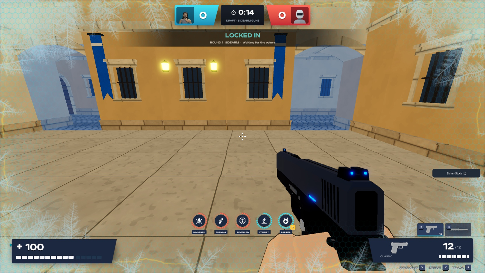
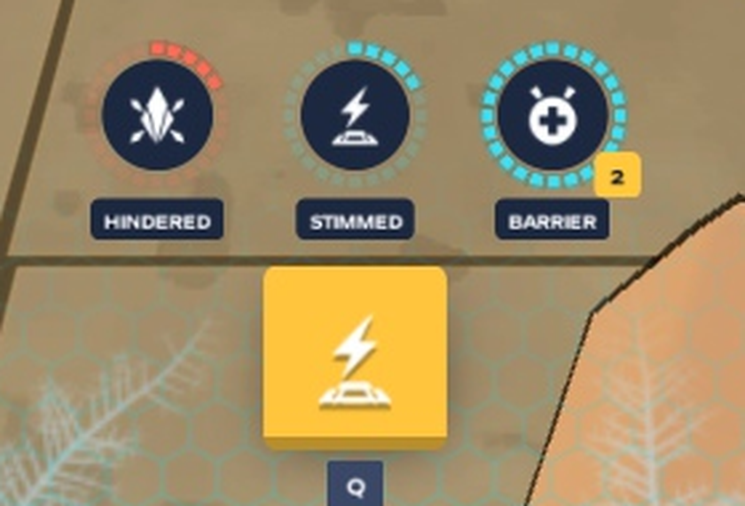
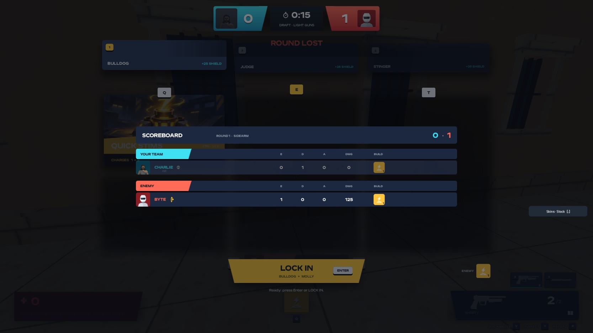
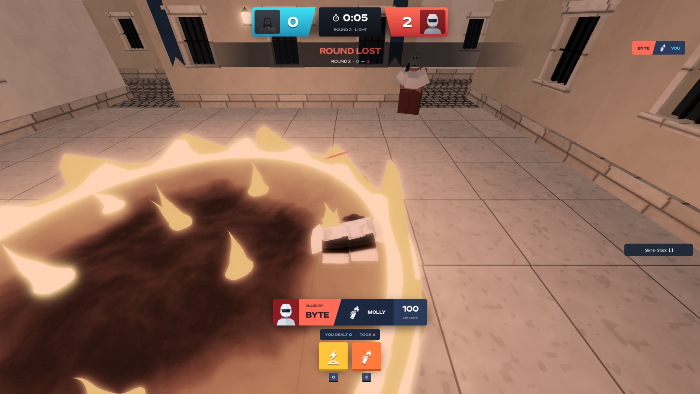
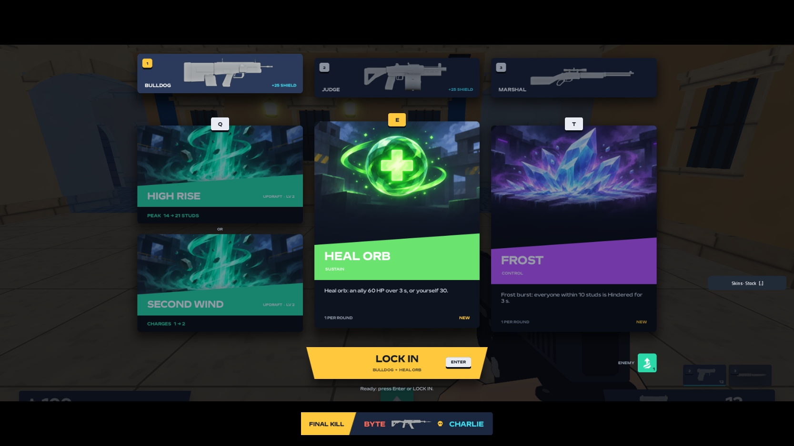

# Match UI extras (plan, 2026-11-14)

**Owner:** after the match end screen: "do all of these, up to the phone pass" (phones later), keep the skin-select button for now, and add a status tray: "when you are hindered… a dedicated part of the screen similar to Valorant where it can show multiple effects and is a circle progress bar instead of time text".

Same style as the rest of the match UI (top bar, bottom HUD, draft, feed, match end): team-colour blocks with a slanted end joining navy, dark ink on bright blocks, Builder Extended, keycaps, soft shadows; no outlines, pills, glows or gradients; pops scale from the centre. Each piece is a Studio-built gui with a backup script in `tools/studio/`, desktop only.

## The pieces
1. **Status tray** (new): your active effects (Hindered, Frozen, Stimmed, Burning, Healing, Barrier, Revealed...) as circles in a row just above the Mod cells, each an icon in a navy disc with a ring that drains as the effect runs out (no time text). Debuffs ring red, buffs cyan. New effects pop in from the centre; the row stays centred (UIListLayout).
2. **Hold-Tab scoreboard** (new): live E / D / A / damage and each fighter's drafted build (Mod chips with their level), both teams, reusing the match end rows. Needs live stats and every fighter's kit on the client.
3. **Damage report** on the killed-by card: "YOU DEALT 85 · TOOK 150" against your killer (Valorant's combat report). Needs per-pair damage from the server.
4. **Restyles:** the final-kill replay overlay, the Mod hint / deny text, the Crash Down and Recall Crash prompts (keycap prompts), and an **OUTSIDE THE ZONE** warning in the notification band during sudden death.

## Not now
Phone pass (later), the skin-select button stays, crosshair / hit markers / damage numbers (another lane), scope overlay, test-only menus.

## Built (desktop)
- **Status tray** (`StarterGui.StatusTray`, entry template `UiTemplates.Status.Entry`, `Util/StatusTray`):
  - a centred row above the Mod cells;
  - each effect is its Mod's icon in a navy disc, a **24-segment ring that drains** (the segment going out fades), and a small name tag; red ring for debuffs, cyan for buffs;
  - covers Frozen, Hindered, Burning and Revealed (debuffs), Strong Stim and Stimmed (buffs), Barrier (gold hit count), and Crash Recovery's state (the old Recall chip moved in here: CRASH READY / OUT OF RANGE / PLANT ANCHOR / RECOVERED);
  - full lengths aren't sent, so each is noted when it starts or is extended;
  - the Mod hint moved onto a navy plate above the tray (warnings gold, with a kick);
  - the old "HINDERED 2.1" status line and the red REVEALED tag are hidden on desktop.
- **Hold-Tab scoreboard** (`StarterGui.Scoreboard`, templates `UiTemplates.Scoreboard`, `ScoreboardController`):
  - round and score, both teams, live E / D / A / DMG, each fighter's build as role-colour chips with their level, the MVP shard;
  - the dead are dimmed with a skull;
  - the client asks once a second while it's open: new remote `Scoreboard`, rate-limited (Config/Match RATE), answered by `StatsService` to that client only; bots' kits are read through `Pawns` on the server.
- **Combat report** under the killed-by card: "YOU DEALT x · TOOK y" against your killer this life (new remote `CombatReport` from `StatsService`).
  - Bug found and fixed in testing: the death handler cleared the life's damage before the killing hit's listener ran, so only the last hit counted. The clear is now deferred.
  - Checked: took 150 = the 150 the client received.
- **Final-kill card** (`UiTemplates.Replay.FinalKill`, cloned by `ReplayController`): the gold FINAL KILL block, the killer, the gun or Mod, a gold skull on a headshot, the victim, in the letterbox bar (the replay now keeps `sourceId` and headshot from `Killed`).
- **Crash Down prompt:** a keycap and a navy plate (no outline).
- **OUTSIDE THE ZONE:** a danger alert in the notification band while you're outside the sudden-death circle (`MatchHudController.alert`, called by `ZoneController`).
- Backups: `tools/studio/BuildMatchExtras.luau` (tray, scoreboard, templates) and `BuildFeedScreens.luau` (the report plate). Both rebuild Studio with 0 differences.
- **Not checked live:**
  - the zone alert (needs sudden death);
  - the Crash Down prompt (needs the glitched Updraft path);
  - the final-kill card with real data (needs a full match; checked with sample text).

Status tray: 
Close-up: 
Scoreboard: 
Combat report: 
Final kill: 
