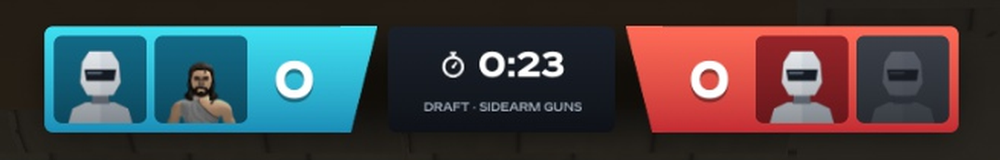
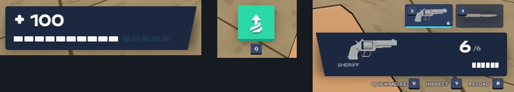

# Match notifications and the de-AI pass (2026-11-14)

## Notifications
**Owner's brief:** no full-screen banners and no big 3-2-1. Small pop-up notifications at the top, one for match point, simple. Then, after a boxed card: "longer at the top and just smoother", no pills, no gradients.

**Built:** `StarterGui.Notify` (Studio-owned, backup `tools/studio/BuildNotify.luau`) driven by `MatchHudController` (the old full-width band is gone).
- One long band just under the top bar (980 × 68): near-black, fading out at both ends, no box, strip, glow or outline.
- Title in Builder Extended ExtraBold 30, coloured by tone (white, ally cyan, enemy red, gold, danger). One small line under it: `ROUND 3  ·  Light guns`.
- Opens from its middle and fades in (0.32 s); closes toward the middle (0.22 s).
- Messages:
  - GET READY: the countdown, replacing 3-2-1. The top bar clock counts and ticks. Its line names the gun tier, with NEW when a tier opens.
  - **MATCH POINT** in gold, instead of GET READY when either side needs one round ("You need one more round" / "They need…" / "Next round wins it").
  - FIGHT for 1.2 s, SUDDEN DEATH (red), ROUND WON / LOST / DRAW with the score, VICTORY (gold) / DEFEAT, LOCKED IN, WAITING FOR OPPONENT.
- Checked live: GET READY → FIGHT → hidden → ROUND LOST. Match point was not seen live (the bot never reached 4).

## De-AI pass on the bottom HUD (owner: "pills look AI… off-putting", "I don't like the gradients")
The anti-AI rules are in memory `ui-anti-ai-tells`, from the owner's screenshots and pasted rules.
- **Panels:** flat navy faces, with the gradients and the cyan edge glow removed. Low health pulses the whole face toward dark red.
- **Shield:** an icon and a cyan number, with no chip box.
- **Hotbar:** flat cells, no outline. The held slot is a brighter face with a cyan underline.
- **Mods:**
  - Flat role-colour blocks with a darker lip, no gloss.
  - **Only drafted Mods show; the row centres on them** (like Valorant).
  - The key sits right under its cell.
- **Keycaps everywhere** (owner liked "a fake button"): a raised face on a darker base.
- **Key hints** read the real bindings from `Config/Input` (QuickMelee V, Inspect Y, Reload R; Mods Q / E / T).
- **Pivots:** the timer, scores, player cells, Mod faces and hotbar cells now scale from their centre (memory `ui-scale-pivot`). Inside list layouts the item is a fixed holder and a centred inner part carries the `UIScale`. The team-block bump on a point was removed (it scaled a whole row item).
- Research: LihFolk (UI Style Directions, HUD Design, UI Motion, Notification and Toast Systems) and the superdesign.dev article. Both say: references over adjectives, one dominant colour and one accent, hierarchy from type and space not borders, no card shadows or gradients, iterate from screenshots.

**Backups (regenerated 2026-11-14):** `tools/studio/BuildTopBar.luau`, `BuildBottomHud.luau` and `BuildNotify.luau` now rebuild the current Studio UI. Checked by building into a temporary copy and comparing every node: the top bar and its template match exactly. The bottom HUD differs only in preview-only values the game overwrites. 16 dead leftovers (switched-off gradients, the hidden role wash, the old ready line) were deleted from the live UI so the hierarchy stays flat.
