# Shop (2026-11-16, plan)

Owner's brief (RIVALS screenshots: Home, Bundles, Daily, Keys, bundle hover, item card, skin-bundle preview, case popup, odds list):
- A shop with sections, RIVALS-like. It **blurs the world with a coloured accent** (not a plain blur). The shop sits in the middle **without a structured back panel**, like the Play menu.
- **Home:** cases, special offers, the season battle pass, and a small cosmetics section (charms, emotes, more later; not skins).
- **Bundles:** Robux bundles.
- **Daily:** a rotating daily shop (fewer items than RIVALS: skins, charms, emotes). Underneath it, **login / daily rewards** (placeholder for now).
- **Coins:** coin packs (prices later).
- **Coins on the main HUD:** a coin counter at the **top middle** of the screen, like RIVALS' keys.
- **Motion:**
  - Everything scrolls in one frame, the tab row included.
  - The coin counter is not part of the scroll; it **tweens up and out** once you scroll far down.
  - Big cards (bundles, large items, not the small cells): on hover, **a frame closes in around the card** to select it.
  - Hovering a bundle shows its contents laid out.
  - Clicking an item in a bundle shows an item card ("Apex Rifle Skin · given to Energy Rifle").
  - Clicking a skin bundle opens a 3D preview: the skin big, Back / Buy item / Buy bundle, and a strip of the bundle's items.
  - A case opens a popup (case art, prices, Contents → an odds list).
- No loading screen yet (no game name or logo); the shop comes first.

## What we already decided (vault)
- **Money** (Home → Locked decisions; [Game Plan](../05%20Production/Game%20Plan.md) §Money):
  - cosmetics are sold directly, and extra Mods can be bought;
  - base Mods and every gun stay free;
  - **no Robux loot boxes** (restricted in the UK, Australia and Brazil).
- Planned (Game Plan):
  - a direct-buy shop and a rotating daily shop;
  - a cosmetic "Supporter Pack";
  - codes that give cosmetic currency;
  - an earned-only ranked currency for prestige cosmetics;
  - a season pass with free and premium tracks.
- Nothing is built: no currency, no `MarketplaceService` / `ProcessReceipt`. The Lobby's Shop is a placeholder panel.

## Roblox rules that shape it (LihFolk `11 Monetization Publishing and Live Ops`: Regional Compliance - Paid Random Items and Country Rules; Limited-Time Offers - Design and Ethics; Developer Products and ProcessReceipt; Battle Pass and Season Design; Ethical Design and Player Trust; Daily Rewards System End to End)
- **Cases are "paid random items"** if they can be bought with Robux **or with any currency Robux can buy** (keys, tickets, coins).
  - Every outcome must be shown with its odds (summing to 100%) behind a labelled Contents / Details button.
  - The case must be hidden or locked for players where `PolicyService:GetPolicyInfoForPlayerAsync().ArePaidRandomItemsRestricted` is true (checked per player; if the check fails, treat the player as restricted).
  - A currency that can **only be earned** (never sold) is not covered.
- **Daily shop:** the same rotation for everyone, fixed in advance; the timer comes from a server end time.
  - Call it "today's items", not "limited".
  - No fake stock.
  - A strikethrough "was" price must be a price really charged before; no invented "x12 VALUE" claims.
- **Robux purchases:** developer products (repeatable, e.g. coin packs, bundles) through one `ProcessReceipt` handler.
  - It grants and saves first, then returns `PurchaseGranted`.
  - It is idempotent per `PurchaseId`.
  - Never grant from the client's "purchase finished" event.
  - One-time things can be game passes.
- **Season pass:** everyone is on the free track. About a month per season. Missions reset daily and never need Robux. A late premium buyer gets the tiers already reached. Unclaimed rewards are granted at season end.
- **Login rewards:** UTC day index, grace days on streaks, no paid streak restore, claim rate-limited server-side.

## Proposed shop (★ = my suggestion; open points in **Questions**)
**Currency: Coins** (one currency; earned by playing and sold in packs). The top-middle counter on the HUD and in the shop shows Coins with a + that opens the Coins tab.

**Tabs:** HOME · BUNDLES · DAILY · COINS (+ the close button). The tab row scrolls with the page.

**Home** (two columns, like RIVALS):
- **Cases:** a row of case cards. *How they're bought is the big open question.*
- **Season Pass:** a big card (art, current tier, VIEW).
- **Special offers:** a wide card that cycles through offers with dots (Starter Bundle first). Value claims only if they're real.
- **Cosmetics:** a grid of small cells (charms, emotes; more types later), each with its price.
- (★ **Mods:** a row for the buyable Mods, since they're the one non-cosmetic thing we sell, or keep them in the Locker's Abilities tab only.)

**Bundles:** big cards in two rows (3 then 2), each with art, a name and a Robux price.
- Hover: the frame closes in, and a layout of the contents appears (skins, charms, coins x N).
- Clicking an item: an item card.
- Clicking a skin bundle: the 3D preview (our Locker stage, reused) with BACK · BUY ITEM · BUY BUNDLE and the strip of items.

**Daily:**
- A header with "New items in 3h 12m" (server time).
- ★ 6 items in a row (2 skins, 2 charms, 2 emotes), the same for everyone, refreshed daily at 00:00 UTC.
- Underneath, **Login rewards**: 7 days (placeholders), today's claimable card lit, a grand prize on day 7.

**Coins:** five or six coin packs as big cards (prices later).

**Look:** our Locker / Play-menu language (Builder Extended ExtraBold, dark navy see-through plates, cyan selection with slant ends, the drawn-X close button). Prices sit in a solid plate:
- Robux = a green plate with the Robux mark;
- Coins = a gold plate with our coin icon.

The selection frame is four corner brackets that close in from outside the card to its edges (0.18 s Quint). No pills, outlines, glows or edge strips. The backdrop is a blur 18 plus a coloured wash (a deep violet-to-navy gradient scrim, like RIVALS' tinted blur).

## Build order
1. **Mockup** in Studio (StarterGui.Shop, Studio-built): the backdrop, the coin counter, the tabs, and Home + Bundles + Daily + Coins with placeholder art. Owner review.
2. **Wire the UI:** tabs, scroll, the counter tweening out, hover frames, bundle hover contents, item card, skin-bundle preview, case popup + Contents.
3. **Economy** (its own task, security review): Coins in the player data, `ProcessReceipt` (dev products), the daily rotation, login rewards, case rolls + odds + PolicyService gate if cases stay paid, the season pass.

## Owner's answers (2026-11-16)
- **Cases: paid, done right.** Cases can be bought with Robux or Coins, like RIVALS. This changed the locked "no Robux loot boxes" decision (Home, Game Plan). The rules that apply:
  - every case has **CONTENTS**: an odds list with every outcome and its % (summing to 100%), plus the disclaimer;
  - cases are hidden or locked for players where `ArePaidRandomItemsRestricted` (checked per player; if the check fails, treat them as restricted);
  - no duplicate cosmetics (a cosmetic you own is re-rolled or skipped, and the shown odds come from the same table as the roll);
  - the popup: case art x1, BUY (Coins), BUY (Robux), BUY x3 (Robux), CONTENTS.
- **Currency: one, Coins.** Earned by playing and sold in packs (COINS tab). The top-middle counter shows it with a +.
- **Mods:** sold in the Locker's Abilities tab. **Some Robux bundles include exclusive Mods** (owner: "somewhat pay to win but nothing too crazy"). Bundle contents show Mods with their own tag.
- **Daily shop: 8 items, refreshed daily** (00:00 UTC, the same for everyone). The owner adds more cosmetics before release.

## Art (ChatGPT): prompts to paste
One style for all of it: our lobby bar icons v2 (`art-source/ui/lobby-icons/`), **chunky, faceted, stylised 3D** with clean flat shading. **No round curves or spheres** (curves are angled facets) and **no blunt ends** (chamfered). No text unless asked. Transparent PNGs unless it says banner. Give each set a contact sheet on dark grey, and save into `art-source/ui/shop/`.

1. **Coin (the currency):**
   > Make a game currency icon for a stylised Roblox shooter, in the same chunky faceted 3D style as our lobby icons: a thick gold coin built from angled facets (an octagon or decagon, not a circle) with a raised chamfered rim and a bold embossed mark in the middle (a sharp angled "G" or a faceted star). Warm gold with a cooler shadow, clean flat lighting, no outline, no glow, no text. 3/4 view, slightly tilted. Output: `coin.png` 512x512 transparent, plus `coin_flat.png`, a single flat white silhouette of it (for small UI, tinted in-game), plus `coin_stack.png`, three coins stacked and offset.
2. **Cases (3 tiers):**
   > Make 3 weapon case icons in the same chunky faceted 3D style: hard-shell gun cases, long and low, with chamfered corners, ribbed lids, latches and a handle, built from angled plates (no round curves). Tier 1 "Standard Case": slate grey with cyan trim. Tier 2 "Elite Case": deep violet with gold trim. Tier 3 "Apex Case": black with hot red-orange trim and a faceted gem latch. Same 3/4 front view and size for all three, clean flat lighting, no text, no glow. Output: `case_standard.png`, `case_elite.png`, `case_apex.png`, each 768x512 transparent, plus a contact sheet.
3. **Shop tab icons (they poke above the tab buttons, like the lobby bar):**
   > Make 4 icons in the exact style of our lobby bar icons (chunky faceted 3D, bright colour, clean flat lighting, no outline, no text): HOME (a faceted shop storefront with an angled awning), BUNDLES (a stack of three chunky gift boxes with angled bows), DAILY (a faceted tear-off calendar page with a bold sun mark), COINS (a small pile of our faceted gold coins). Each 512x512 transparent, centred, the same scale.
4. **Coin packs (6 sizes, for the COINS tab cards):**
   > Make 6 coin pack images in the same style, growing in size: a few faceted gold coins, a small stack, a big stack, a pouch with coins spilling out (angled cloth folds), an open faceted chest of coins, and a huge vault crate overflowing with coins. Same 3/4 view and lighting, no text. Each 768x512 transparent.
5. **Banners (wide card art, no text, the subject on the right so our title fits on the left):**
   > Make 3 wide banner illustrations, 1600x700, in a stylised faceted low-poly look matching our game (angular shapes, no round curves, clean flat lighting, rich colour, a soft vignette): (a) SEASON PASS: a heroic faceted winged shield emblem in silver and gold on a deep blue-violet backdrop with angular light shards; (b) STARTER BUNDLE: a pile of rewards (a weapon case, a coin stack, a charm) on a bright green-teal backdrop; (c) a generic BUNDLE backdrop template: an angled-plate tech pattern in deep red that can be re-coloured. Leave the left 40% calm and darker for a title.
6. Later, once the bundles, charms, emotes and login rewards exist: bundle art per bundle, item icons per cosmetic, login reward icons.

Upload: like the emblems (local server + Studio MCP `upload_image`); the ids go in a shop config.

## Mockup v1 (2026-11-16, owner: "Build the mockup")
Built in Studio by `tools/studio/BuildShop.luau`: `StarterGui.Shop` (off) and `StarterGui.LobbyCoins` (the top-middle counter, off until Coins are wired so it never shows a fake balance). Placeholder art throughout: colour washes, a gold diamond for the coin, chamfered slabs for cases. Every picture is an `Art` ImageLabel ready for the ChatGPT set.

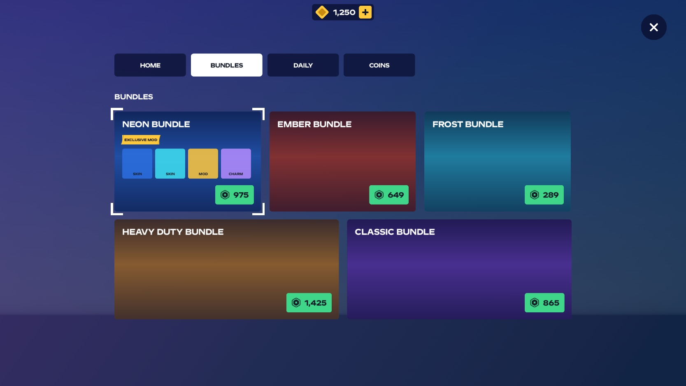
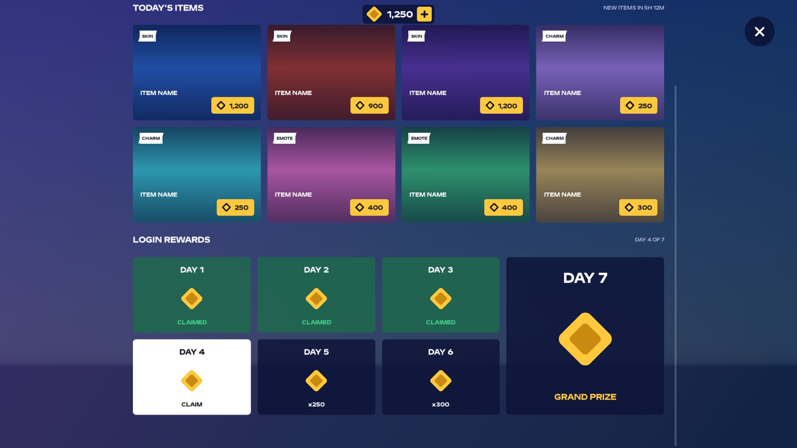
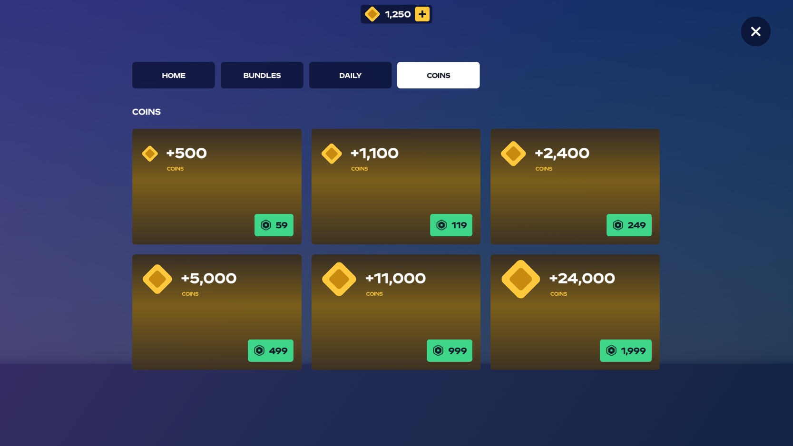

- **Backdrop:** the Router's blur plus a **violet-to-navy wash** (`3B1D63` → `161A44` → `0A1230`, 35°, 0.3 see-through). No back panel.
- **Coin counter:** top middle, a dark plate with the coin, the balance and a gold **+** (opens COINS). DisplayOrder 31, over the shop.
- **One ScrollingFrame** (1280 content) holds the tab row and the page. The close button (drawn X) and the counter stay put.
- **Tabs:** HOME · BUNDLES · DAILY · COINS. Dark plates; the open one is white with ink text. An `Icon` slot pokes above each for the tab icons.
- **Home:**
  - CASES: Standard / Elite / Apex cards with a Coins price;
  - the SEASON PASS card (season, tier, VIEW »);
  - SPECIAL OFFERS: the Starter Bundle card with page dots and a Robux price;
  - a 3x2 grid of cosmetics (CHARM / EMOTE tags, Coins prices).
- **Bundles:** 3 + 2 big cards with Robux prices. Neon shows the **hover contents** (SKIN, SKIN, MOD, CHARM cells) and an **EXCLUSIVE MOD** tag.
- **Daily:** TODAY'S ITEMS (8 cells, 4x2, tags + Coins prices, "NEW ITEMS IN 5H 12M"); LOGIN REWARDS (days 1-3 claimed in green, day 4 lit white with CLAIM, days 5-6 ahead, a big DAY 7 GRAND PRIZE).
- **Coins:** 6 pack cards (+500 to +24,000; the coin grows with the pack) with Robux prices. The amounts and prices are placeholders.
- **Price plates:** Coins = gold with the coin mark; Robux = green with the Robux mark (`rbxasset://textures/ui/common/robux.png`).
- **Selection frame:** four thick white corner brackets around a big card. Shown on the Season Pass and Neon cards in the mockup; the controller will tween them in from outside on hover.
- Not wired yet: tabs, scroll, the counter tweening out, hover frames, bundle hover, item card, skin-bundle preview, case popup + odds. The Lobby still opens the old placeholder shop.

## Mockup v1.1 (2026-11-16)

- **Tried and rejected, the same day:** after the owner said v1's "pills" and "gradients look too AI" and "the dark colours are a bit sad", a v2 was built: flat, bright, saturated cards, zero gradients across the shop and the whole lobby (Play tiles, Locker, HUD shades, menus). The owner rejected it: "the bright colours are a bit too much... let's go back to what it was before... maybe it was just missing the icons... I like the icons on the top". It was never committed, and the lobby is back as it was.
- **v1.1 = v1's dark look, plus:**
  - **RIVALS-style icon tabs:** each tab is a plate with a big icon popping out over its top and its name across the bottom; the open tab is white. The lobby bar icons stand in until the ChatGPT tab icons arrive.
  - **Slanted price plates** (no pills): Coins gold, Robux green, with the mark and number in their own row inside the slanted ends.
- Lesson (saved in memory): when a screen "looks AI", the missing piece is usually real art and icons, not a palette swap. Change one thing at a time.
- Next: drop in the ChatGPT art (coin, cases, tab icons, coin packs, banners) when it lands, then wire the shop.

## Wired, pass 1 (2026-11-16, owner: "Wire the shop")
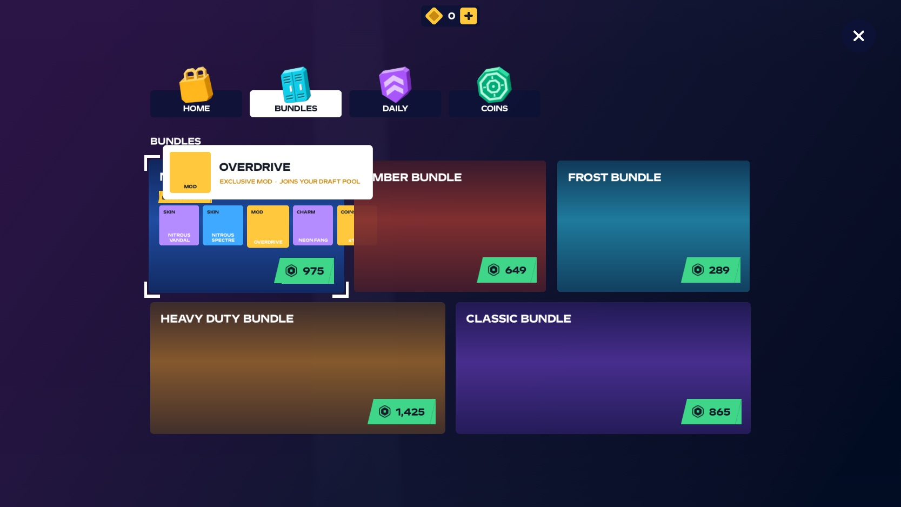
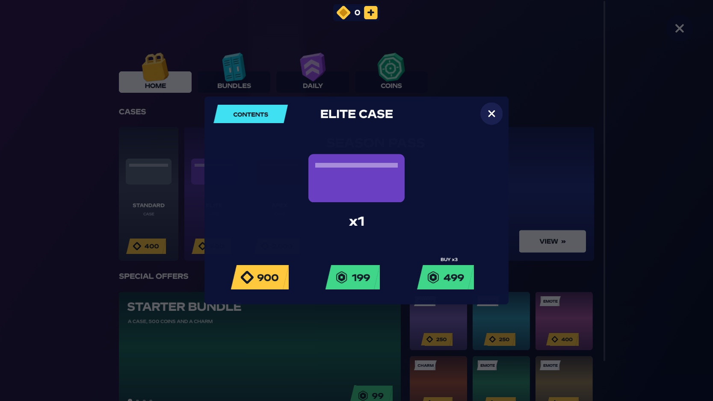

Code: `client/Controllers/ShopController` (desktop; phones keep the old placeholder shop in `Panels`). The data is `Lobby/ShopCatalog`: cases with contents and weights, bundles with items. **Placeholder** names, prices and weights until the owner fills them; the economy will read the same table.

- **Router "Shop":** the world blurs and the violet wash fades in. Opening it with a tab name opens that tab (the counter's **+** opens COINS).
- **Tabs:** the icon lifts on hover, the plate dips on press, and switching resets the scroll. The page's cards rise in (0.94 → 1, staggered).
- **Coin counter:** shown while the shop is open (with the `Coins` attribute, or 0); on the HUD only once Coins exist. It tweens up and out after 50 px of scroll and back at the top.
- **Selection frame:** every big card (cases, season pass, offer, bundles, coin packs). On hover the four corner brackets start 22 px outside and close in (0.2 s Quint); leaving sends them back out. Small cells lift 1.04.
- **Bundles:** hovering shows the bundle's items as cells (sized to fit the card, popping in one after another). Clicking a cell shows the **item card** above it:
  - a skin: "SKIN · GIVEN TO VANDAL";
  - a Mod: "EXCLUSIVE MOD · JOINS YOUR DRAFT POOL";
  - coins: "+1,500 COINS".

  Leaving the bundle or clicking elsewhere hides it.
- **Cases:** clicking a case opens the **case popup**: name, CONTENTS, close, the case x1, buy with Coins / Robux / x3 Robux.
  - **CONTENTS** lists every outcome: a rarity-coloured cell, the name in its rarity colour, rarity + gun, and the % (from the weights, adding up to 100, at least 4 significant digits), then the disclaimer. Close goes back to the case.
  - **Region check:** `PolicyService:GetPolicyInfoForPlayerAsync` on the client. If paid random items are restricted, **or the check fails**, buying a case says "Cases aren't available where you are". **The server must enforce the same rule** in the economy pass; the client check is only for display.
- **Daily:** "NEW ITEMS IN 2H 26M" counts down to 00:00 UTC (display only; the server will own the rotation's end time).
- **Buying anything** (cases, bundles, packs, daily items, cosmetics, the pass, the offer, login CLAIM) shows "... opens with the shop economy" for now.
- Checked in Studio play: open from the bar, the selection frame on the Season Pass, the BUNDLES tab, Neon hover contents + the Mod item card, the Elite case popup, CONTENTS (35 / 30 / 20 / 12 / 3 %), back and close, Daily scrolled with the counter gone. No errors. Fixed after the test: bundle cells overflowed a 5-item card (they size to fit now); the popup panels were see-through (solid now); the counter waited too long to leave (50 px now).
- **Next:** the skin-bundle 3D preview (Locker stage: BACK · BUY ITEM · BUY BUNDLE + a strip of items), then the economy (Coins in data, `ProcessReceipt`, the daily rotation, login rewards, case rolls + the server region gate; security review), and the ChatGPT art when it lands.

## Art in (2026-11-16)
ChatGPT's set (reviewed and committed by the owner's ChatGPT pass, `00ca7484`, in `art-source/ui/shop/` with contact sheets) is uploaded and wired: the ids are in `ART` at the top of `tools/studio/BuildShop.luau`; the cases' are also in `ShopCatalog.CASES[].art`.

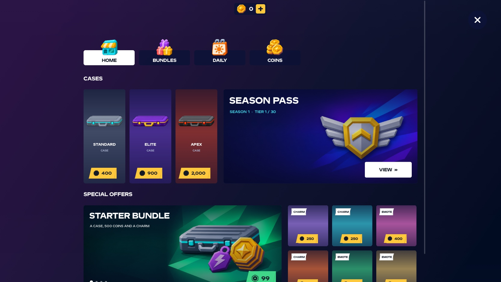
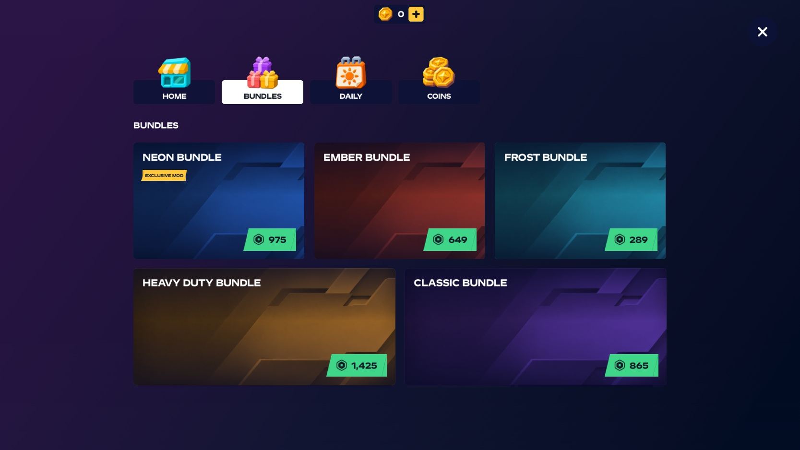
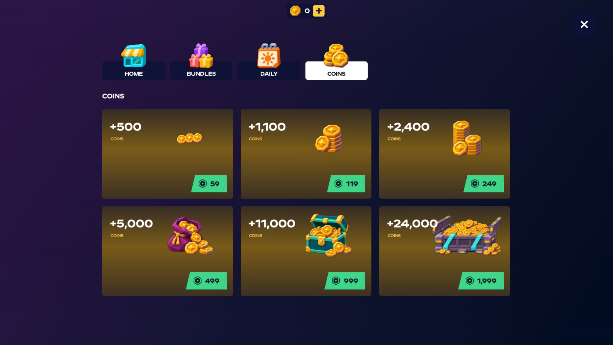
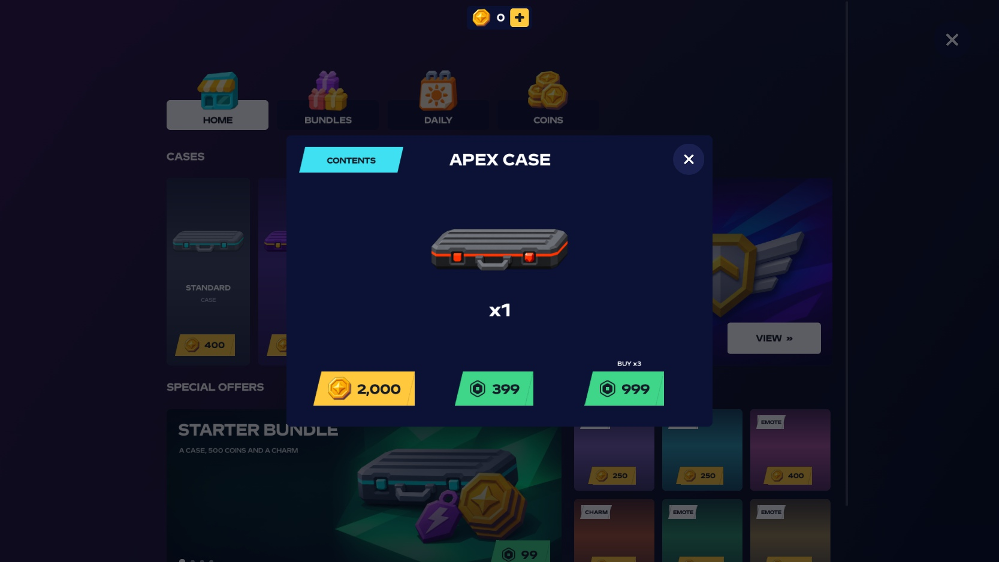

| Art | Where |
|---|---|
| `coin.png` | the coin everywhere: the counter, price plates (full colour reads on the gold plate; the flat ink silhouette was a blob), login days |
| `coin_stack.png` | the Day 7 grand prize |
| `coin_flat.png` | uploaded, unused for now |
| `case_standard/elite/apex.png` | the case cards and the case popup |
| `tab_home/bundles/daily/coins.png` | the RIVALS-style tab icons (96 px, lifting to 106 on hover) |
| `pack_01`…`pack_06` | the six coin pack cards, on the right of the amount |
| `banner_season_pass.png`, `banner_starter_bundle.png` | the Season Pass and Starter Bundle cards |
| `banner_bundle_grey.png` (made here: a lifted greyscale copy of `banner_bundle_template.png`) | every bundle card, **tinted with the bundle's colour** (one asset, any colour) |

Checked in Studio play: Home, Bundles, Coins and the Apex case popup with its art; no errors. The vault crate overlapped "+24,000", so the pack art sits lower and smaller now.
Still placeholder: the charm and emote cells, the daily items and the login reward icons (need the real cosmetics), and per-bundle art if wanted.

## Skin-bundle 3D preview (2026-11-16, owner: "work on 3D preview... no bundle yet, just something that'll look like it"; no economy yet, UI first)
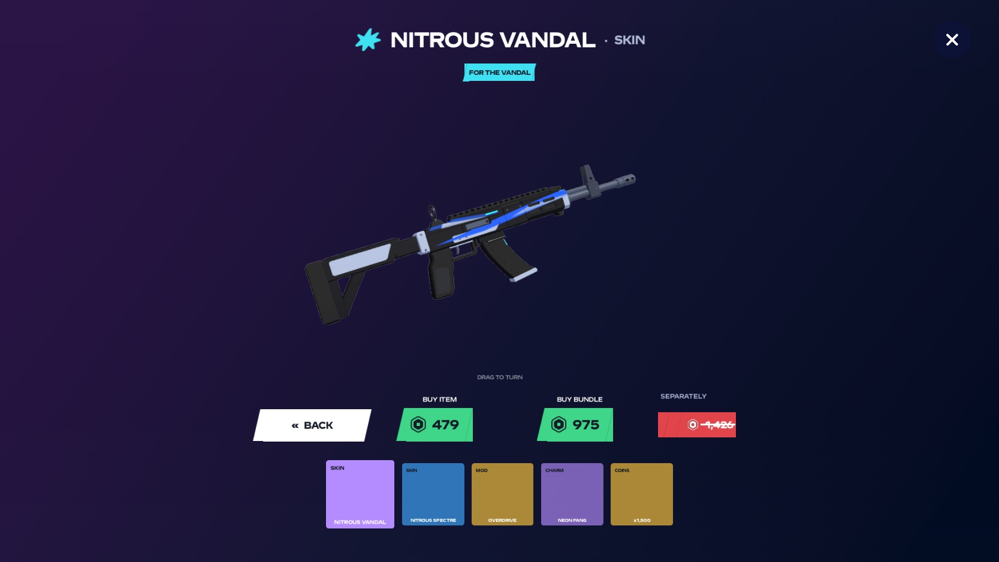
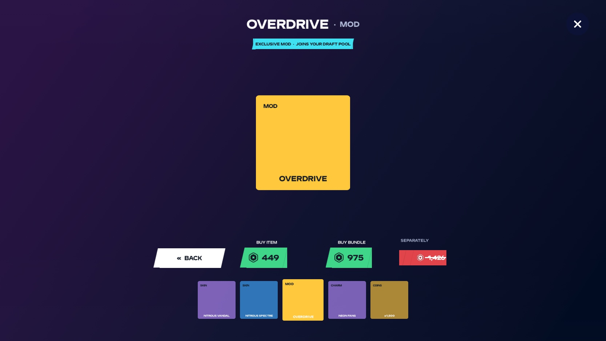

Clicking a bundle card opens its preview on its first skin (RIVALS-style; the tabs and page step aside):
- **Top:** the skin line's **emblem** (tinted), the item's name and "· SKIN", and a cyan chip:
  - "FOR THE VANDAL" for a skin;
  - "EXCLUSIVE MOD · JOINS YOUR DRAFT POOL" for a Mod;
  - "+1,500 COINS" for coins.
- **The stage:** a skin is shown **in 3D**, its real skin model from `WeaponSkins` (the stock gun if a line doesn't have that gun yet). It's posed side-on with a tilt; **drag to turn** (eases home), idle wobble, swing-in on change. A charm, Mod or coins shows as a big coloured card instead.
- **Actions:**
  - **« BACK**;
  - **BUY ITEM** (the item's own price; hidden for coins);
  - **BUY BUNDLE**;
  - **SEPARATELY**, struck through: the real sum of the items' own prices (`ShopCatalog.separately`), shown only when it's more than the bundle.
- **The strip:** a cell per item. The open one is raised and bright, the rest a touch back; clicking one switches the preview.
- Closing the shop also closes the preview. Buying shows "opens with the shop economy".

Code:
- `client/Util/ItemStage` (new, shared): presentable model, fit to a box, pose, drag, wobble, swap. The Locker keeps its own copy for now; fold it onto this one day.
- `ShopController`: openPreview / selectPreview / closePreview.
- Builder: the `Preview` frame in `BuildShop.luau`.
- Catalog: `ITEM_ROBUX` (placeholder prices by kind and rarity), `itemRobux`, `separately`.

Checked in Studio play: Neon (Nitrous Vandal in 3D, 479 / 975 / separately 1,426), the Overdrive Mod card (449), BACK. No errors. Then aligned the separately plate with the others and made the gun a little bigger.

## Plate look (2026-11-16, first pass)
Owner, on the style board ([style_board.jpg](Shop/style_board.jpg): A chunky block, B slanted + depth, C clean block): picked **B**, then "I like the slanted look because that is the style we are going for. But I want to add the shine and just the good nice look of the chunky block. so mix them and then get this look to all of the UI in the lobby". Also: the chunky tick, bigger; the Locker over the blurred lobby + wash; anchors at 0.5,0.5 so pops grow from the centre.

What changed:
- `client/Util/Plates` (new): `finish(plate)` gives every slanted plate (a body with CapL / CapR) a **shine** (top 46%, its colour 24% toward white, flat) and a **lip** (bottom 5 px, 45% toward ink), both with slanted ends clipped from the caps. Layers: caps, then shine / lip, then the words; they follow the plate's colour and fade. White words get a soft ink stroke. `deepen(gui)` runs once per screen (Shop, Season Pass, Play, Party, Locker); `NoLip = true` opts a plate out.
- `client/Util/Pivot` (new): `fix(gui)` centre-anchors every free GuiObject that pops (position kept) and wraps layout items in a same-size holder so their UIScale grows from the centre (owner rule; memory "UI scale pivot").
- Robux plates: brighter green `3FD45C`, white words and icon.
- **Chunky tick** (Season Pass claimed rewards, Locker equipped skin): a big green tick with a dark under-layer, replacing the thin one.
- **Locker:** the flat blue backdrop is now the violet wash over the blurred lobby; a staged open (wash, side panel, list, card cascade, the gun swinging in from a big angle, header pieces, tiles, close last); card presses dip and return instead of snapping.

Checked in Studio play: Shop Home ([look_shop_home.jpg](Shop/look_shop_home.jpg)), the case popup ([look_case_popup.jpg](Shop/look_case_popup.jpg)), the Season Pass ([look_season_pass.jpg](Shop/look_season_pass.jpg)) and the Locker ([look_locker.jpg](Shop/look_locker.jpg)). No new errors (the `203785492` warning is old Studio content). Fixed on the way: the shine drew over the price words (sibling ZIndex), now caps < bands < words.

**Next, after the owner's OK:** the rest of the lobby's square buttons (VIEW, INVITE FRIENDS, LEAVE, the party card, tab plates, Play menu chips) get slanted plates with the shine; then the match UI.

### Plate look, pass 2 (2026-11-16)
Owner on pass 1 (with RIVALS button crops): "it looks better", but the WEAPONS tab and the 99 Robux plate had "a weird fold on the sides"; "the gradients ... just look off still"; "I dont like how you see the scrolling frame UI"; RIVALS' buttons "look so much better". Also: some shop items will later be just the object with no plate (art to make; nothing to do now).
- **The fold was a sizing bug, not the art.** A plate that sizes itself to its words (AutomaticSize X: prices, tags, the Locker tabs, filter chips, claim tags; 80 of the 102 plates) counted its right cap in that size, so the body ran a cap's width past the slant. `Plates.finish` now moves the caps into a full-size `Ends` frame (scale-sized children don't count), so the body ends where the slant starts (checked: 102 → 89 px, the right end now 1 px from the cap). The caps then follow the body's fade, since code that hides caps by looping the plate's children no longer finds them.
- **Depth is now RIVALS-like and in one piece:** one smooth top-to-bottom UIGradient on the body *and* both caps (bright top, a little deeper below, a darker 5 px lip), the plate's colour lifted 12% for its bright top, a thin bright line across the top inset from the slanted ends, and white words outlined in a dark shade of the plate's own colour (UIStroke 1.5). The pass-1 bands are gone (they were clipped frames over the caps; a rotated cap can't be clipped, which also showed as a fold).
- **No scroll bars:** Shop, Season Pass odds, Locker list and skin strip, Party grid: `ScrollBarThickness = 0` **and** `ScrollBarImageTransparency = 1` (thickness 0 alone still drew a hairline). In the builders and in StarterGui.

Checked in Studio play: [look2_shop_home.jpg](Shop/look2_shop_home.jpg), [look2_case_popup.jpg](Shop/look2_case_popup.jpg), close-ups [look2_plates_zoom.png](Shop/look2_plates_zoom.png). No new errors.

### Plate look, pass 3: one piece (2026-11-16)
Owner: "how are those slanted buttons working, if they are multiple parts ... the look and highlights and parts unalign with each other when hovered".
- They were a body + two cap images + gradients; a hover pop scales each piece and rounds it to the pixel separately, so seams showed. **Now every slanted plate is one sliced image** (`art-source/ui/plates/plate_base.png`, greyscale parallelogram: bright top → a little deeper → darker lip, tinted with the plate's colour) plus `plate_gloss.png` (thin top line + soft sheen) on the exact same rect and slicing. The end columns keep their width (SliceScale from the old cap width), the middle stretches. `Util/Plates.finish` hides the body's own fill (a transparent UIGradient), removes the caps, adds the two layers; the body's colour and transparency still drive it, so code that recolours or fades plates is unchanged. No Figma needed: the plate is our own baked art.
- Plates that size themselves to their words now get their width from their words in code (Roblox's AutomaticSize counted the plate art and grew every frame).
- **The lobby HUD** (PLAY, the bottom bar, the level / streak tags, the toast, the leader tag) uses the same plates (`LobbyHudView` deepens the HUD guis and each cloned row and slot).
- **Text that sizes itself was measured before its font loaded** (the Season Pass title was a 288 px box for 361 px of text, centred, so it spilled out; tags clipped their words). New `Util/TextFit.settle(PlayerGui)` waits for the fonts, then has every self-sizing text measure itself again. Checked: 391 self-sizing texts, 0 too short.

Checked in Studio play: [look3_shop_hover.jpg](Shop/look3_shop_hover.jpg) (a hovered card mid-pop, plates in one piece), [look3_season_pass.jpg](Shop/look3_season_pass.jpg), [look3_hud_zoom.png](Shop/look3_hud_zoom.png). No new errors.

### Plate look, pass 4: cells and cards (2026-11-16)
Owner: "the cells and a lot of the UI still just looks bland, not fun. the buttons looks better but that effect and style that we like needs to be added to everything else please. and the fonts i think need to be better."
- **Cells get the block look, one piece:** `Util/Cards` gives each cell a `Skin` (`art-source/ui/plates/card_base.png`: rounded box, bright top → deeper → 5 px dark lip, tinted with the cell's colour, under everything) and a `Bevel` (`card_over.png`: bright top edge line, soft top sheen, dark lip) just above the layers that cover the cell (art, shade, dim) and under its words, tags, ticks and hover brackets. 9-sliced with the cell's corner radius, so the edges keep their pixel size on any cell. The cell's own fill is hidden; its colour and fade still drive the skin. Text-carrying boxes are skipped (the hider would hide their words).
- **Where:** `Util/LobbyLook` (runs first in the lobby client): Shop cards, daily cells, case / odds / item panels; Season Pass reward cells, FREE / PREMIUM badges, level box, odds panel; Play menu mode tiles; Party slots; Locker kind tiles; the player list head; and every clone of the PlayerRow, ShopContentCell, PartyPlayerCard, GunCard and SkinTile templates. It also runs `TextFit`.
- **Fonts:** the whole lobby is Builder Sans Extended (Roblox's default face, 302 labels), a big part of the "generic" feel. A board of six fonts set in our plates and cells, in Studio: [font_board.jpg](Shop/font_board.jpg) (A Builder Extended now, B Sarpanch, C Fredoka One, D Luckiest Guy, E Gotham Black, F Nunito Black). Owner picks.

Checked in Studio play: [look4_season_pass.jpg](Shop/look4_season_pass.jpg), [look4_locker.jpg](Shop/look4_locker.jpg), [look4_play.jpg](Shop/look4_play.jpg). No new errors.
- **Owner picked C · Fredoka One** (2026-11-16). Swapped in place on the lobby's Studio ScreenGuis and `UiTemplates.Lobby` (327 labels, weights kept; Fredoka has one weight), so no rebuild wiped hand edits; the builders' font constant (`BX`) changed in BuildShop / BuildBattlePass / BuildLocker / BuildLobbyMenus / BuildLobbyHud / BuildMatchFound so a rebuild matches. Style Bible, Home's locked UI row and the `gauntlet-ui-style` skill updated. Match builders still use Builder Extended (the match pass is next). Checked: [look5_fredoka_pass.jpg](Shop/look5_fredoka_pass.jpg), [look5_fredoka_shop.jpg](Shop/look5_fredoka_shop.jpg); 447 visible texts, nothing clipped. **Save the Lobby place** to keep the swap.

### Plate look, pass 6: final tweaks (2026-11-16)
Owner: "it looks better. but honestly i dont like the bevels on the icons and things. it just makes it look weird ... just some final tweaks".
- **The cell bevel is under everything in the cell now** (on the skin, under icons, art, words and tags). Cells covered by art simply show their art.
- **Fredoka One at its one real weight.** The labels still asked for Bold / ExtraBold, so Roblox faked the weight and small words smeared ("NEWITEMS"). All 327 lobby labels and the builders' weight constants are Regular now.
- **Shop tabs** (HOME / BUNDLES / DAILY / COINS) get the cell depth; icons sit on top. Slanted plates that share a cell's name are skipped by `Util/Cards`.
- **Text that sizes itself re-measures whenever its font lands** (`Util/TextFit.watch`), not once at start: hidden screens only load their font when opened, which brought back the clipped Season Pass title and tags. Checked: 391 self-sizing texts, 0 short.

Checked in Studio play: [look6_daily.jpg](Shop/look6_daily.jpg), [look6_season_pass.jpg](Shop/look6_season_pass.jpg). No new errors. **Save the Lobby place** (font weights changed on the Studio screens).

## Layout v2 and the flat look (2026-11-20)
Owner: "organize the shop a little better": cases as square tiles in a 2 x 2; BUNDLES = two featured (Ruin-Blighted, Kuronami-inspired Tempest-Strike) + a Thanksgiving bundle; Daily and Coins are good; "I don't like the gradients on the item list ... not brighter pastel colours but something to improve on it". Then RIVALS shop screenshots: cases have no card behind them, item cells are flat colour with the item big and spilling out, bundle banners are made art ("we will create those in photoshop later").
- **Applied by `tools/studio/ShopLayoutV2.luau`** (patches the Studio-owned `StarterGui.Shop` in place, re-runnable; `BuildShop.luau` is the older full builder and no longer matches these parts).
- **HOME:** the four cases (Standard, Elite, Apex, Knife) in a 2 x 2 grid of 208 px tiles with **no card**: name on top, the render big (200 x 140), the price plate under it (`NoCard` keeps `Util/Cards` off them). The Season Pass fills the rest of the row (824 x 432).
- **BUNDLES:** FEATURED (Ruin-Blighted, Tempest-Strike, 628 x 340 each), LIMITED TIME (Thanksgiving, full width 1280 x 240). Each card: name, a line under it, a slanted tag, the Robux plate. Words and prices come from `ShopCatalog.BUNDLES` (new fields `slot`, `tag`, `sub`, `soon`); a `soon` bundle (Thanksgiving, contents not decided) toasts "coming soon" instead of opening. The old five example bundles are gone. Card art is flat colour until the owner's Photoshop banners.
- **No gradients on item cards:** the dark Shade layer (transparency 0.35 → 0.85 → 0.40) is off; the card is one flat colour, 30 % toward ink (keeps the dark look; the bright flat restyle was rejected before).
- **DAILY** shows real skins now (`ShopCatalog.DAILY`, eight placeholder picks with portraits; price by tier `DAILY_COINS`; the rotation and buying come with the economy): tier colour, "RARE SKIN" tag, name, coin price, the portrait big and spilling over the top edge like RIVALS' cells.
- A three-way board was made first ([look7_card_board.jpg](Shop/look7_card_board.jpg): A flat + slash pattern, B dark + slanted slab, C dark + colour tile); the owner's RIVALS refs settled it before a pick, so it's kept only as a record. New art: `art-source/ui/shop/patterns/slash_tile.png` (106157372800881) and `slant_slab.png` (113628028222678), not used in the shop yet.

Checked in Studio play: [v2_home.jpg](Shop/v2_home.jpg), [v2_bundles.jpg](Shop/v2_bundles.jpg), [v2_daily.jpg](Shop/v2_daily.jpg). No new errors.
- **Open:** the Home charm and emote cards are still placeholders with no art (flat colour + words); bundle banner art (owner, Photoshop); Tempest-Strike's roster beyond the Vandal; the Thanksgiving contents; real prices. **Save the Lobby place.**

## Release layout (2026-11-22, owner: "cut the shop down to what's sold at launch")
Plan: **record the full layout first (below), then switch to the launch layout with one flag**, never deleting a section. Icons and pricing are the next task.

### The full layout before this change (kept, `Release.SHOP_FULL_LAYOUT = true` brings it back)
Studio owns the screen: `StarterPlayer.StarterPlayerScripts.UI.Lobby.Shop` (ScreenGui; cloned to `PlayerGui.Shop`), plus `LobbyCoins` for the coin counter. Older copy: `ServerStorage.PlateMigrationBackup.StarterGui.Shop`. Patch scripts: `tools/studio/ShopLayoutV2.luau` (current look), `tools/studio/BuildShop.luau` (older full builder, no longer matches). Code: `src/lobby/client/Controllers/ShopController.luau` (wiring), data `src/lobby/shared/ShopCatalog.luau`, server `src/lobby/server/Services/ShopService.luau`.

Everything sits in `Shop.Canvas.Scroll` (UIListLayout, 1340 wide; pages 1280 wide, AutomaticSize):
- **Tabs** (`Scroll.Tabs`): HOME, BUNDLES, DAILY, COINS (each `Tabs.<NAME>.Plate` + icon + label).
- **HOME** (`Scroll.Home`, list padding 22):
  - `Head_CASES` "CASES".
  - `Top` (1280 x 432, row, padding 24): `Cases` (432 x 432, UIGridLayout 208 x 208 cells, padding 16 → 2 x 2) with `Case_Standard` (400 coins), `Case_Elite` (900), `Case_Apex` (2,000), `Case_Knife` (2,500); each opens the case popup (`PopupCanvas.CasePanel` + `OddsPanel`). `SeasonPass` (824 x 432) → Router "BattlePass"; already hidden by `Release.BATTLE_PASS_OPEN = false`.
  - `Head_SPECIAL OFFERS` "SPECIAL OFFERS".
  - `Mid` (1280 x 330, row, padding 24): `Offer` (760 x 330; card "STARTER BUNDLE", sub "A CASE, 500 COINS AND A CHARM", 99 Robux plate, 4 dots, art Crop; tap = "Special offers" coming soon) and `Cosmetics` (496 x 330, grid 154 x 157): `Charm_1` (250), `Charm_2` (250), `Emote_1` (400), `Charm_3` (250), `Emote_2` (400), `Emote_3` (600), all "Buying cosmetics" coming soon, placeholder art.
- **BUNDLES** (`Scroll.Bundles`): `Head_FEATURED` "FEATURED"; `Row1` (1280 x 340): `Bundle_RuinBlighted` (628 x 340, 1,999 R$, EXCLUSIVE, 5 skins) and `Bundle_TempestStrike` (628 x 340, 1,499 R$, NEW, 5 guns + Katana), both open the 3D bundle preview (`Canvas.Preview`); `Head_LIMITED` "LIMITED TIME" (LayoutOrder 3); `Row2` (LayoutOrder 4, 1280 x 240): `Bundle_Thanksgiving` (799 R$, LIMITED TIME, `soon`, toasts coming soon). Words and prices from `ShopCatalog.BUNDLES`.
- **DAILY** (`Scroll.Daily`): `Head_TODAY'S ITEMS` (+ "NEW ITEMS IN …" note), `Items` (grid of `Item1`–`Item8`, 308 x 230, from `ShopCatalog.DAILY`, coin price by tier), `Head_LOGIN REWARDS` ("DAY 4 OF 7"), `Login` (`Days` grid `Day1`–`Day6` + big `Day7`).
- **COINS** (`Scroll.Coins`): `Head_COINS`, `Packs` (grid of `Pack1`–`Pack6`, 410 x 280; Studio grants test coins, live = coming soon).
- Overlays: `Canvas.Preview` (bundle 3D preview, BUY ITEM / BUY BUNDLE / SEPARATELY), `Canvas.ItemCard`, `Dim`, `PopupCanvas` (CasePanel, OddsPanel).
- Before captures: [release_before_home.jpg](Shop/release_before_home.jpg), [release_before_bundles.jpg](Shop/release_before_bundles.jpg).

### Launch layout (applied 2026-11-22)
- **Switch:** `src/shared/Config/Release.luau` → `SHOP_FULL_LAYOUT = false` (launch). Set it to `true` to get the full layout above back exactly (checked in Studio play: charms/emotes, 2 x 2 cases, 760-wide offer, LIMITED TIME row all return; the Starter row hides).
- **How:** nothing is deleted or built in code. The Studio screen carries attributes that `ShopController.applyLayout` reads: `FullOnly` (hidden at launch), `LaunchOnly` (shown only at launch), `LaunchSize` (UDim2), and on a UIGridLayout `LaunchCellPadding` / `LaunchMaxCells`. The saved Studio sizes are the full layout's. Patch script: `tools/studio/ShopReleaseLayout.luau` (re-runnable, Edit mode).
- **HOME:** CASES = the four cases in one row across the page (`Top` and `Cases` LaunchSize 1280 x 208, grid padding 149 x 16, 4 cells per row); SPECIAL OFFERS = the Starter Bundle offer card full width (`Offer` LaunchSize 1280 x 330; its art is Crop so it just shows more). `Mid.Cosmetics` (charms, emotes) is FullOnly. The Season Pass card stays behind `BATTLE_PASS_OPEN`.
- **BUNDLES:** FEATURED (Ruin-Blighted, Tempest-Strike) unchanged; `Head_LIMITED` + `Row2` (Thanksgiving) are FullOnly; new LaunchOnly `Head_STARTER` "STARTER" (LayoutOrder 5) + `Row3` (6) with `Bundle_Starter` (full width 1280 x 240, cloned from the Thanksgiving card, flat green 2E7D5B). Its words come from the new `ShopCatalog.BUNDLES` entry `Starter` (slot "Starter", tag NEW PLAYERS, **placeholder 99 R$, `soon`**: tapping toasts "coming soon" until the owner sets contents and price).
- **DAILY, COINS:** unchanged.
- **Checked in Studio play:** PC [release_home_pc.jpg](Shop/release_home_pc.jpg), [release_bundles_pc.jpg](Shop/release_bundles_pc.jpg); phone scale [release_home_phone.jpg](Shop/release_home_phone.jpg), [release_bundles_phone.jpg](Shop/release_bundles_phone.jpg) (the MCP can't resize the viewport, so the phone shots are this 2178 x 964 viewport (aspect 2.26, close to a notched phone's 2.16) with the Canvas's phone fit applied by hand: fit × PhoneBoost 1.5, canvas resized as `UiLayout.fitCanvas` does). Starter card tap → "coming soon" toast. No new console errors. StyLua and Selene clean.
- **Not tested:** the real Device Emulator and a real phone; gamepad focus order through the hidden cards (hidden GuiObjects aren't selectable, but not walked through); a published server. The Home offer card still says "A CASE, 500 COINS AND A CHARM" (charms aren't sold at launch: owner to reword in the pricing pass).
- **Next (owner):** shop icons and pricing; Starter Bundle contents; whether the Starter Bundle stays in the full layout later (today it's LaunchOnly: clear the attribute on `Head_STARTER` and `Row3` to keep it). **Save the Lobby place** (the Studio attributes and the Starter row live only in the place).
