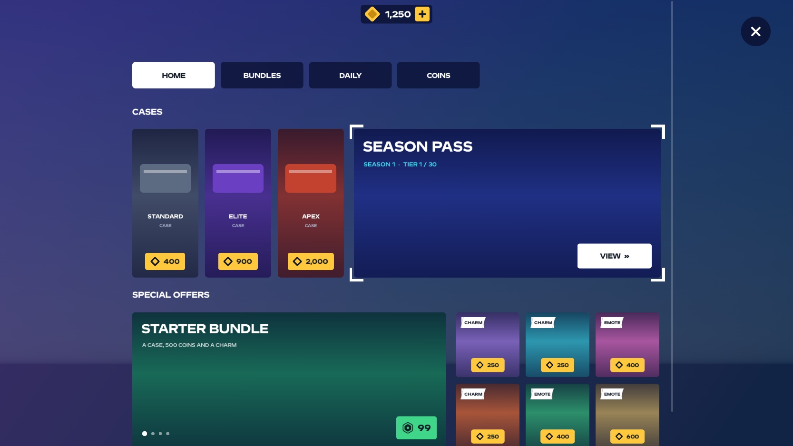
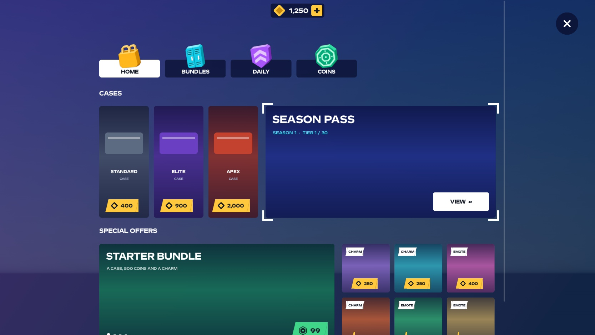
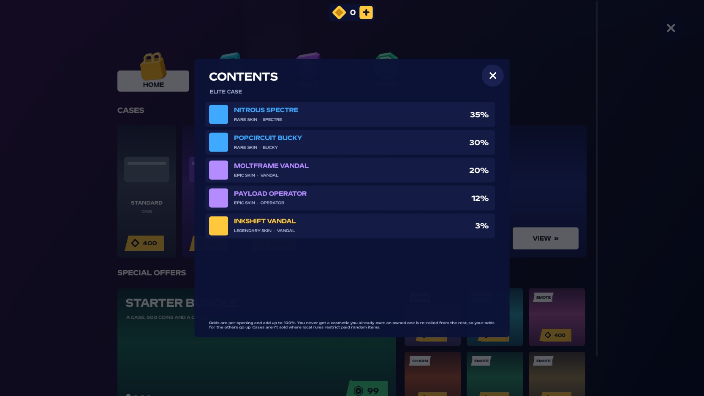

# Shop (2026-11-16, plan)

Owner's brief (RIVALS screenshots: Home, Bundles, Daily, Keys, bundle hover, item card, skin-bundle preview, case popup, odds list):
- A shop with sections, RIVALS-like. It **blurs the world with a coloured accent** (not a plain blur). The shop sits in the middle **without a structured back panel**, like the Play menu.
- **Home:** cases, special offers, the season battle pass, and a small cosmetics section (charms, emotes, more later; not skins).
- **Bundles:** Robux bundles.
- **Daily:** a rotating daily shop (fewer items than RIVALS: skins, charms, emotes). Underneath it, **login / daily rewards** (placeholder for now).
- **Coins:** coin packs (prices later).
- **Coins on the main HUD:** a coin counter at the **top middle** of the screen, like RIVALS' keys.
- **Motion:**
  - Everything scrolls in one frame, the tab row included.
  - The coin counter is not part of the scroll; it **tweens up and out** once you scroll far down.
  - Big cards (bundles, large items, not the small cells): on hover, **a frame closes in around the card** to select it.
  - Hovering a bundle shows its contents laid out.
  - Clicking an item in a bundle shows an item card ("Apex Rifle Skin · given to Energy Rifle").
  - Clicking a skin bundle opens a 3D preview: the skin big, Back / Buy item / Buy bundle, and a strip of the bundle's items.
  - A case opens a popup (case art, prices, Contents → an odds list).
- No loading screen yet (no game name or logo); the shop comes first.

## What we already decided (vault)
- **Money** (Home → Locked decisions; [Game Plan](../05%20Production/Game%20Plan.md) §Money):
  - cosmetics are sold directly, and extra Mods can be bought;
  - base Mods and every gun stay free;
  - **no Robux loot boxes** (restricted in the UK, Australia and Brazil).
- Planned (Game Plan):
  - a direct-buy shop and a rotating daily shop;
  - a cosmetic "Supporter Pack";
  - codes that give cosmetic currency;
  - an earned-only ranked currency for prestige cosmetics;
  - a season pass with free and premium tracks.
- Nothing is built: no currency, no `MarketplaceService` / `ProcessReceipt`. The Lobby's Shop is a placeholder panel.

## Roblox rules that shape it (LihFolk `11 Monetization Publishing and Live Ops`: Regional Compliance - Paid Random Items and Country Rules; Limited-Time Offers - Design and Ethics; Developer Products and ProcessReceipt; Battle Pass and Season Design; Ethical Design and Player Trust; Daily Rewards System End to End)
- **Cases are "paid random items"** if they can be bought with Robux **or with any currency Robux can buy** (keys, tickets, coins).
  - Every outcome must be shown with its odds (summing to 100%) behind a labelled Contents / Details button.
  - The case must be hidden or locked for players where `PolicyService:GetPolicyInfoForPlayerAsync().ArePaidRandomItemsRestricted` is true (checked per player; if the check fails, treat the player as restricted).
  - A currency that can **only be earned** (never sold) is not covered.
- **Daily shop:** the same rotation for everyone, fixed in advance; the timer comes from a server end time.
  - Call it "today's items", not "limited".
  - No fake stock.
  - A strikethrough "was" price must be a price really charged before; no invented "x12 VALUE" claims.
- **Robux purchases:** developer products (repeatable, e.g. coin packs, bundles) through one `ProcessReceipt` handler.
  - It grants and saves first, then returns `PurchaseGranted`.
  - It is idempotent per `PurchaseId`.
  - Never grant from the client's "purchase finished" event.
  - One-time things can be game passes.
- **Season pass:** everyone is on the free track. About a month per season. Missions reset daily and never need Robux. A late premium buyer gets the tiers already reached. Unclaimed rewards are granted at season end.
- **Login rewards:** UTC day index, grace days on streaks, no paid streak restore, claim rate-limited server-side.

## Proposed shop (★ = my suggestion; open points in **Questions**)
**Currency: Coins** (one currency; earned by playing and sold in packs). The top-middle counter on the HUD and in the shop shows Coins with a + that opens the Coins tab.

**Tabs:** HOME · BUNDLES · DAILY · COINS (+ the close button). The tab row scrolls with the page.

**Home** (two columns, like RIVALS):
- **Cases:** a row of case cards. *How they're bought is the big open question.*
- **Season Pass:** a big card (art, current tier, VIEW).
- **Special offers:** a wide card that cycles through offers with dots (Starter Bundle first). Value claims only if they're real.
- **Cosmetics:** a grid of small cells (charms, emotes; more types later), each with its price.
- (★ **Mods:** a row for the buyable Mods, since they're the one non-cosmetic thing we sell, or keep them in the Locker's Abilities tab only.)

**Bundles:** big cards in two rows (3 then 2), each with art, a name and a Robux price.
- Hover: the frame closes in, and a layout of the contents appears (skins, charms, coins x N).
- Clicking an item: an item card.
- Clicking a skin bundle: the 3D preview (our Locker stage, reused) with BACK · BUY ITEM · BUY BUNDLE and the strip of items.

**Daily:**
- A header with "New items in 3h 12m" (server time).
- ★ 6 items in a row (2 skins, 2 charms, 2 emotes), the same for everyone, refreshed daily at 00:00 UTC.
- Underneath, **Login rewards**: 7 days (placeholders), today's claimable card lit, a grand prize on day 7.

**Coins:** five or six coin packs as big cards (prices later).

**Look:** our Locker / Play-menu language (Builder Extended ExtraBold, dark navy see-through plates, cyan selection with slant ends, the drawn-X close button). Prices sit in a solid plate:
- Robux = a green plate with the Robux mark;
- Coins = a gold plate with our coin icon.

The selection frame is four corner brackets that close in from outside the card to its edges (0.18 s Quint). No pills, outlines, glows or edge strips. The backdrop is a blur 18 plus a coloured wash (a deep violet-to-navy gradient scrim, like RIVALS' tinted blur).

## Build order
1. **Mockup** in Studio (StarterGui.Shop, Studio-built): the backdrop, the coin counter, the tabs, and Home + Bundles + Daily + Coins with placeholder art. Owner review.
2. **Wire the UI:** tabs, scroll, the counter tweening out, hover frames, bundle hover contents, item card, skin-bundle preview, case popup + Contents.
3. **Economy** (its own task, security review): Coins in the player data, `ProcessReceipt` (dev products), the daily rotation, login rewards, case rolls + odds + PolicyService gate if cases stay paid, the season pass.

## Owner's answers (2026-11-16)
- **Cases: paid, done right.** Cases can be bought with Robux or Coins, like RIVALS. This changed the locked "no Robux loot boxes" decision (Home, Game Plan). The rules that apply:
  - every case has **CONTENTS**: an odds list with every outcome and its % (summing to 100%), plus the disclaimer;
  - cases are hidden or locked for players where `ArePaidRandomItemsRestricted` (checked per player; if the check fails, treat them as restricted);
  - no duplicate cosmetics (a cosmetic you own is re-rolled or skipped, and the shown odds come from the same table as the roll);
  - the popup: case art x1, BUY (Coins), BUY (Robux), BUY x3 (Robux), CONTENTS.
- **Currency: one, Coins.** Earned by playing and sold in packs (COINS tab). The top-middle counter shows it with a +.
- **Mods:** sold in the Locker's Abilities tab. **Some Robux bundles include exclusive Mods** (owner: "somewhat pay to win but nothing too crazy"). Bundle contents show Mods with their own tag.
- **Daily shop: 8 items, refreshed daily** (00:00 UTC, the same for everyone). The owner adds more cosmetics before release.

## Art (ChatGPT): prompts to paste
One style for all of it: our lobby bar icons v2 (`art-source/ui/lobby-icons/`), **chunky, faceted, stylised 3D** with clean flat shading. **No round curves or spheres** (curves are angled facets) and **no blunt ends** (chamfered). No text unless asked. Transparent PNGs unless it says banner. Give each set a contact sheet on dark grey, and save into `art-source/ui/shop/`.

1. **Coin (the currency):**
   > Make a game currency icon for a stylised Roblox shooter, in the same chunky faceted 3D style as our lobby icons: a thick gold coin built from angled facets (an octagon or decagon, not a circle) with a raised chamfered rim and a bold embossed mark in the middle (a sharp angled "G" or a faceted star). Warm gold with a cooler shadow, clean flat lighting, no outline, no glow, no text. 3/4 view, slightly tilted. Output: `coin.png` 512x512 transparent, plus `coin_flat.png`, a single flat white silhouette of it (for small UI, tinted in-game), plus `coin_stack.png`, three coins stacked and offset.
2. **Cases (3 tiers):**
   > Make 3 weapon case icons in the same chunky faceted 3D style: hard-shell gun cases, long and low, with chamfered corners, ribbed lids, latches and a handle, built from angled plates (no round curves). Tier 1 "Standard Case": slate grey with cyan trim. Tier 2 "Elite Case": deep violet with gold trim. Tier 3 "Apex Case": black with hot red-orange trim and a faceted gem latch. Same 3/4 front view and size for all three, clean flat lighting, no text, no glow. Output: `case_standard.png`, `case_elite.png`, `case_apex.png`, each 768x512 transparent, plus a contact sheet.
3. **Shop tab icons (they poke above the tab buttons, like the lobby bar):**
   > Make 4 icons in the exact style of our lobby bar icons (chunky faceted 3D, bright colour, clean flat lighting, no outline, no text): HOME (a faceted shop storefront with an angled awning), BUNDLES (a stack of three chunky gift boxes with angled bows), DAILY (a faceted tear-off calendar page with a bold sun mark), COINS (a small pile of our faceted gold coins). Each 512x512 transparent, centred, the same scale.
4. **Coin packs (6 sizes, for the COINS tab cards):**
   > Make 6 coin pack images in the same style, growing in size: a few faceted gold coins, a small stack, a big stack, a pouch with coins spilling out (angled cloth folds), an open faceted chest of coins, and a huge vault crate overflowing with coins. Same 3/4 view and lighting, no text. Each 768x512 transparent.
5. **Banners (wide card art, no text, the subject on the right so our title fits on the left):**
   > Make 3 wide banner illustrations, 1600x700, in a stylised faceted low-poly look matching our game (angular shapes, no round curves, clean flat lighting, rich colour, a soft vignette): (a) SEASON PASS: a heroic faceted winged shield emblem in silver and gold on a deep blue-violet backdrop with angular light shards; (b) STARTER BUNDLE: a pile of rewards (a weapon case, a coin stack, a charm) on a bright green-teal backdrop; (c) a generic BUNDLE backdrop template: an angled-plate tech pattern in deep red that can be re-coloured. Leave the left 40% calm and darker for a title.
6. Later, once the bundles, charms, emotes and login rewards exist: bundle art per bundle, item icons per cosmetic, login reward icons.

Upload: like the emblems (local server + Studio MCP `upload_image`); the ids go in a shop config.

## Mockup v1 (2026-11-16, owner: "Build the mockup")
Built in Studio by `tools/studio/BuildShop.luau`: `StarterGui.Shop` (off) and `StarterGui.LobbyCoins` (the top-middle counter, off until Coins are wired so it never shows a fake balance). Placeholder art throughout: colour washes, a gold diamond for the coin, chamfered slabs for cases. Every picture is an `Art` ImageLabel ready for the ChatGPT set.

- **Backdrop:** the Router's blur plus a **violet-to-navy wash** (`3B1D63` → `161A44` → `0A1230`, 35°, 0.3 see-through). No back panel.
- **Coin counter:** top middle, a dark plate with the coin, the balance and a gold **+** (opens COINS). DisplayOrder 31, over the shop.
- **One ScrollingFrame** (1280 content) holds the tab row and the page. The close button (drawn X) and the counter stay put.
- **Tabs:** HOME · BUNDLES · DAILY · COINS. Dark plates; the open one is white with ink text. An `Icon` slot pokes above each for the tab icons.
- **Home:**
  - CASES: Standard / Elite / Apex cards with a Coins price;
  - the SEASON PASS card (season, tier, VIEW »);
  - SPECIAL OFFERS: the Starter Bundle card with page dots and a Robux price;
  - a 3x2 grid of cosmetics (CHARM / EMOTE tags, Coins prices).
- **Bundles:** 3 + 2 big cards with Robux prices. Neon shows the **hover contents** (SKIN, SKIN, MOD, CHARM cells) and an **EXCLUSIVE MOD** tag.
- **Daily:** TODAY'S ITEMS (8 cells, 4x2, tags + Coins prices, "NEW ITEMS IN 5H 12M"); LOGIN REWARDS (days 1-3 claimed in green, day 4 lit white with CLAIM, days 5-6 ahead, a big DAY 7 GRAND PRIZE).
- **Coins:** 6 pack cards (+500 to +24,000; the coin grows with the pack) with Robux prices. The amounts and prices are placeholders.
- **Price plates:** Coins = gold with the coin mark; Robux = green with the Robux mark (`rbxasset://textures/ui/common/robux.png`).
- **Selection frame:** four thick white corner brackets around a big card. Shown on the Season Pass and Neon cards in the mockup; the controller will tween them in from outside on hover.
- Not wired yet: tabs, scroll, the counter tweening out, hover frames, bundle hover, item card, skin-bundle preview, case popup + odds. The Lobby still opens the old placeholder shop.

## Mockup v1.1 (2026-11-16)

- **Tried and rejected, the same day:** after the owner said v1's "pills" and "gradients look too AI" and "the dark colours are a bit sad", a v2 was built: flat, bright, saturated cards, zero gradients across the shop and the whole lobby (Play tiles, Locker, HUD shades, menus). The owner rejected it: "the bright colours are a bit too much... let's go back to what it was before... maybe it was just missing the icons... I like the icons on the top". It was never committed, and the lobby is back as it was.
- **v1.1 = v1's dark look, plus:**
  - **RIVALS-style icon tabs:** each tab is a plate with a big icon popping out over its top and its name across the bottom; the open tab is white. The lobby bar icons stand in until the ChatGPT tab icons arrive.
  - **Slanted price plates** (no pills): Coins gold, Robux green, with the mark and number in their own row inside the slanted ends.
- Lesson (saved in memory): when a screen "looks AI", the missing piece is usually real art and icons, not a palette swap. Change one thing at a time.
- Next: drop in the ChatGPT art (coin, cases, tab icons, coin packs, banners) when it lands, then wire the shop.

## Wired, pass 1 (2026-11-16, owner: "Wire the shop")

Code: `client/Controllers/ShopController` (desktop; phones keep the old placeholder shop in `Panels`). The data is `Lobby/ShopCatalog`: cases with contents and weights, bundles with items. **Placeholder** names, prices and weights until the owner fills them; the economy will read the same table.

- **Router "Shop":** the world blurs and the violet wash fades in. Opening it with a tab name opens that tab (the counter's **+** opens COINS).
- **Tabs:** the icon lifts on hover, the plate dips on press, and switching resets the scroll. The page's cards rise in (0.94 → 1, staggered).
- **Coin counter:** shown while the shop is open (with the `Coins` attribute, or 0); on the HUD only once Coins exist. It tweens up and out after 50 px of scroll and back at the top.
- **Selection frame:** every big card (cases, season pass, offer, bundles, coin packs). On hover the four corner brackets start 22 px outside and close in (0.2 s Quint); leaving sends them back out. Small cells lift 1.04.
- **Bundles:** hovering shows the bundle's items as cells (sized to fit the card, popping in one after another). Clicking a cell shows the **item card** above it:
  - a skin: "SKIN · GIVEN TO VANDAL";
  - a Mod: "EXCLUSIVE MOD · JOINS YOUR DRAFT POOL";
  - coins: "+1,500 COINS".

  Leaving the bundle or clicking elsewhere hides it.
- **Cases:** clicking a case opens the **case popup**: name, CONTENTS, close, the case x1, buy with Coins / Robux / x3 Robux.
  - **CONTENTS** lists every outcome: a rarity-coloured cell, the name in its rarity colour, rarity + gun, and the % (from the weights, adding up to 100, at least 4 significant digits), then the disclaimer. Close goes back to the case.
  - **Region check:** `PolicyService:GetPolicyInfoForPlayerAsync` on the client. If paid random items are restricted, **or the check fails**, buying a case says "Cases aren't available where you are". **The server must enforce the same rule** in the economy pass; the client check is only for display.
- **Daily:** "NEW ITEMS IN 2H 26M" counts down to 00:00 UTC (display only; the server will own the rotation's end time).
- **Buying anything** (cases, bundles, packs, daily items, cosmetics, the pass, the offer, login CLAIM) shows "... opens with the shop economy" for now.
- Checked in Studio play: open from the bar, the selection frame on the Season Pass, the BUNDLES tab, Neon hover contents + the Mod item card, the Elite case popup, CONTENTS (35 / 30 / 20 / 12 / 3 %), back and close, Daily scrolled with the counter gone. No errors. Fixed after the test: bundle cells overflowed a 5-item card (they size to fit now); the popup panels were see-through (solid now); the counter waited too long to leave (50 px now).
- **Next:** the skin-bundle 3D preview (Locker stage: BACK · BUY ITEM · BUY BUNDLE + a strip of items), then the economy (Coins in data, `ProcessReceipt`, the daily rotation, login rewards, case rolls + the server region gate; security review), and the ChatGPT art when it lands.
