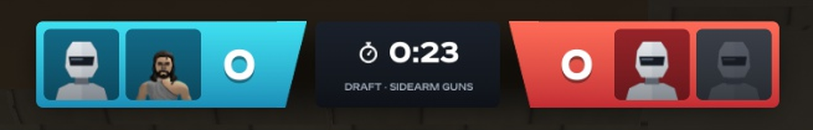
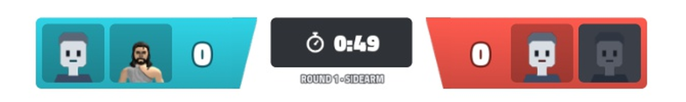

# Match top bar (2026-11-14)

## Current: v2.2 polish, built in Studio (waiting on the owner's review)


**v2.2 (owner on v2.1, 2026-11-14):** "looks dull and not professional"; the placeholder heads are only OK; "maybe a better font"; make it more satisfying and cooler.
- **Font:** compared 10 built-in families at score/timer size ([sheet](References/ui-overhaul/2026-11-14-font-sheet.jpg)). **Builder Extended** won: wide, clean, esports-like; Titillium Heavy looked squashed, the rest generic or cartoony. Numbers and clock: ExtraBold (score 50, clock 34); info line: Bold 13. (Builder *Sans* stays rejected; Extended is its distinct wide display cut.)
- **Colour depth:** each team is a two-tone gradient, bright on top and rich underneath (ally `3FE0F2` → ≈`1A8DB8`, enemy `FF6B57` → ≈`C42B33`). The body and the slant cap share the same `UIGradient`, so they match exactly (the cap image is now flat white).
- **Cells:** team-tinted insets (`CellColor` attribute on each Body: ally `0D5C7A`, enemy `8A1C24`) with a top-lit gradient; dead = slate `3A3F48` + a greyed headshot.
- **Score:** white numbers with a soft drop shadow (a dark copy 3 px below) instead of an outline.
- **Timer:** the same 80 px height as the blocks, so the bar reads as one band; stopwatch + clock on top, the info line inside under it.
- **Shadow:** one soft 9-slice shadow under the whole bar lifts it off the map; `TopBarController` sizes it to the bar.
- **Bots:** a clean helmet-and-visor silhouette instead of the fake face.
- **Motion:** a point now also bumps the whole team block (6%) on top of the flash and number pop.
- Structure change: `TopBar` → `Root` (fixed, centred, `Fit` UIScale) → `Shadow` + `Bar`; `Score` is a Frame with `Shadow` + `Value` labels; `Timer` → `Clock` (`Icon`, `Time`) + `Info`.
- Images: `tools/ui/make_topbar_v22_images.py` (flat caps `130377997107460` / `75584308608588`, shadow `121253415859134`, bot helmet `119185654291939`).

### v2.1 (superseded by v2.2)


**v2.1 (owner on v2, 2026-11-14):** "a little cutoff under" the block, and "each player should have its own distinct cell".
- The cutoff was Roblox's 9-slice squashing the slant: its bottom row came out offset, so the block looked notched at the bottom. Each block is now a rounded **Body** frame (team colour + a `UIGradient` shade, white → 205 grey) plus a fixed-size **Slant** cap image (28 × 80, same shade baked in) that overlaps the body's inner corners by 8 px. Nothing stretches the cap, so the slant is one clean line. The dark bottom lip is gone too.
- **Player cells:** each player sits in a 70 × 66 cell (a `CanvasGroup`, black at 74% over the team colour = a darker inset, radius 6) that clips the headshot. Dead: the cell turns opaque slate `3A3F48` and the headshot fades grey into it.
- The section below describes v2; where it says the block is one 9-slice image or headshots are frameless, v2.1 replaces it.

**How we got here (owner's calls, 2026-11-14):**
- Draft 1 (Figma, below): liked, "could be a bit larger". Score chips: keep. Info line: "some of all of it", my judgment. Dead: **just greyed out**.
- Sliced vs fully rounded ([comparison](References/ui-overhaul/2026-11-14-topbar-sliced-vs-rounded.png)): picked rounded, "make sure it doesn't look too AI, have character, add some colour pop".
- v1 in Studio (rounded tiles, [capture](References/ui-overhaul/2026-11-14-topbar-v1-rounded-tiles.jpg)): **"too AI looking, not enough character, the rounding doesn't look good."** Pointed at RIVALS' bar for its cleaner look (not to copy).
- What RIVALS' bar does that v1 didn't: one bold solid colour block per team (not a row of small framed tiles), headshots loose in the block (no frame or outline), chunky heavy numbers, an icon on the timer, no hairlines, washes or tiny caps.

**v2, our own take:**
- **Team blocks:** one per side, solid team colour (ally `2FD3E6`, enemy `FF5A4E`) with a baked top-to-bottom shade, a 1 px lit top line and a darker 4 px lip at the bottom. Small 6 px radius on the outer corners; **the inner edge is slanted like the brand slash**, so the two blocks frame the timer (`/ ally /  timer  / enemy /`). 80 px tall.
- **Headshots:** 78 px, loose in the block, bottom-aligned, no frame. Player 1 sits next to the score. Real Roblox headshots (`rbxthumb://type=AvatarHeadShot`); bots use a stand-in block head.
- **Dead:** the headshot greys out (tint `464C56`, 25% fade), with a short dip.
- **Score:** inside each block on the timer side, Titillium Web **Heavy** 56, white with a dark team-ink stroke.
- **Timer:** dark plate 160 × 56 (radius 6) with a **stopwatch icon** and the time in Titillium Web Heavy 40. Urgent (countdown, last 10 s, Sudden Death): time, icon and a 2 px edge go red, and it pulses each second.
- **Info line** under the timer, Titillium Web Bold 17 with a soft dark outline: `ROUND 6 · HEAVY`, `DRAFT · LIGHT GUNS`, `ROUND 9 · MATCH POINT` (gold), `ROUND 4 · SUDDEN DEATH` (red), `FIRST TO 5` before round 1.
- **Motion:** the bar drops in with a slight overshoot, headshots pop in, a death dips and greys, a point pops the number and flashes the team block, the urgent clock pulses.
- **Size:** about 700 × 80 for 2v2 at 1920 × 1080 (one `UIScale` "Fit" keeps it proportional on other screens).

**Where it lives:**
- Layout (Studio-owned, edit it in Explorer): `StarterGui.TopBar` → `Bar` → `AllyTeam` (`Body` → `Players`, `Score`; `Slant`) / `Centre` (`Timer` → `Icon`, `Time`; `Info`) / `EnemyTeam`. Cell template: `ReplicatedStorage.UiTemplates.TopBar.Player` (CanvasGroup → `Headshot`). The preview cells in Edit mode carry a `Preview` attribute and are removed in play.
- Behaviour: `src/client/Controllers/TopBarController.luau`. The old bar in `MatchHudController` is hidden (still runs for its tick and score sounds; remove it later).
- Backup in git: `tools/studio/BuildTopBar.luau` (command bar rebuild, v2.1). Images: `tools/ui/make_topbar_v2_images.py` → `art-source/ui/topbar/` (slant caps `104711862457786` right / `72125760733139` left, stopwatch `85745477188818`, bot head `90507197778591`; the 9-slice block images are no longer used).
- v1 (rounded tiles) is parked in `ServerStorage.UiArchive` for comparison; delete it once v2 is approved.

**Checked in a playtest (1920 × 1080 preview, TestMode off):** 1v1 and 2v2 vs bots; your headshot loads; player order; greyed-out downed bot (forced locally for display); countdown red; no overflow. **Not checked:** a real score change (needs a round won), 3v3/4v4 widths, Sudden Death wording live.

---

# Draft 1 (Figma, superseded)

**What this is:** the first section of the UI overhaul ([UI Overhaul Research](UI%20Overhaul%20Research.md) §6). The owner picked the match **top bar** first and asked for:
- simpler, closer to Valorant and RIVALS;
- **time** and a little info in the centre;
- on each side, **one picture per player** (their Roblox headshot) instead of the long health bars; 2 players = 2 pictures a side, up to 4v4;
- room to add more later;
- a new, simpler theme: "rounded corners but also a little sliced".

This is a **draft for the owner to react to**, not final. Nothing is built in Studio.

## Figma (file `UbCKQXuZijn0Gpryt0uUxN`, page "Foundations · v4 Soft Edge (draft)", row at y 4960)
- [In game, 2v2 over the scene](https://www.figma.com/design/UbCKQXuZijn0Gpryt0uUxN?node-id=59-907)
- [States: 1v1, 2v2, 3v3, 4v4 + last 10 s](https://www.figma.com/design/UbCKQXuZijn0Gpryt0uUxN?node-id=59-992)
- [Components](https://www.figma.com/design/UbCKQXuZijn0Gpryt0uUxN?node-id=58-874): `TopBar/Portrait` (Side Ally/Enemy × State Alive/Dead), `TopBar/Score` (Ally/Enemy), `TopBar/Timer` (Normal/Low), 8 placeholder avatars.

## The design (1920 × 1080)
```
 [P4][P3][P2][P1]  [3] [ 1:24 ] [2]  [P1][P2][P3][P4]
  allies, outward     ROUND 6        enemies, outward
```
- **One row, centred, 16 px from the top of the screen.** Groups 12 px apart; portraits 6 px apart; score chips 4 px from the timer. A 1v1 bar is about 370 px wide; 4v4 about 730 px.
- **Timer plate:** 136 × 64, radius 10, no cut (the centre stays symmetric). Time in Titillium Web Bold 34, white; under it the info line in Titillium Web Bold 12 caps, +14% tracking, muted (`ROUND 6`, `MATCH POINT`). In the last 10 s the time turns danger red `FF4D5E`.
- **Score chips:** 56 × 52, radius 8, **one 12 px cut on the outer bottom corner** (left chip bottom-left, right chip bottom-right). Number in Sarpanch ExtraBold 32 in team colour (ally `2FD3E6`, enemy `FF5A4E`).
- **Portraits:** 52 × 52, radius 8, **one 10 px cut on the outer bottom corner** (allies bottom-left, enemies bottom-right), 1.5 px hairline at 16% white. A 3 px team-colour line sits 3 px under each portrait. Player 1 sits closest to the centre.
- **Dead:** the picture drops to 28% under a dark shade, a team-colour **slash** crosses it (the brand mark, no skull), and the line goes grey `3A414C`.
- **Plates:** `10141B` at 86%, 1.5 px hairline at 12% white. No glow, no gradients, no gold (nothing on the top bar is an act-now thing).
- **Shape language (the new theme):** soft radius 8-10 everywhere, plus **exactly one slice per plate, always on the corner facing out from the centre**, so the whole bar reads as mirrored. The centre plate is the only one with no slice.
- A soft radial fade behind the bar (`06080C`, 62% → 0) helps it over bright skies. In the Figma scene the plates hold contrast on their own; the fade could go.

### Why these choices
- Valorant: the timer is the hub and alive portraits sit beside it ([Valorant UI](../03%20Research/UI%20References/Valorant%20UI.md), scorebug row). RIVALS: one strip with player heads, a dead slot is dimmed with a mark ([Rivals PC UI](../03%20Research/UI%20References/Rivals%20PC%20UI.md), player slot row).
- Scores are kept beside the timer because rounds are first-to-5; they can go if the owner wants only time + portraits.
- Sarpanch's colon draws as a single dot ("1·24"), so the timer uses Titillium Web; Sarpanch stays for the score numbers.

## How it would be built in Studio (when approved)
- `StarterGui.MatchHud` (ScreenGui, `ResetOnSpawn = false`, `ScreenInsets = DeviceSafeInsets`: the bar is centred, clear of Roblox's corner buttons).
- `TopBar` Frame: `AnchorPoint (0.5, 0)`, `Position {0.5, 0}, {0, 16}`, `AutomaticSize = X`, height 64; `UIListLayout` horizontal, centred, padding 12 → `Allies`, `Centre`, `Enemies` (each its own `UIListLayout`; `Allies` uses `LayoutOrder` descending so player 1 is innermost).
- **Portrait template** (`ReplicatedStorage.UiTemplates.TopBar.Portrait`): a plate `ImageLabel` (9-slice with the cut baked in, one image per side) → the headshot `ImageLabel` on top. Roblox headshots come with a **transparent background** (`rbxthumb://type=AvatarHeadShot&id=<userId>&w=150&h=150`), so the plate's cut shape shows through. Roblox can't clip an image to a cut corner, so the plate carries the shape. Bots use a stock headshot. Dead state: headshot `ImageTransparency 0.72`, a shade frame, a tinted slash image, and the line recoloured.
- Score and timer: plates as 9-slice images (timer: plain `UICorner` 10); text with fixed `TextSize` (numbers never use `TextScaled`, per the research note §5).
- The script only fills in data: who is on each team, alive/dead, scores, time, info line. The layout lives in Studio.

## Known issues in the draft
- The "2.5x DETAIL" row on the states board was centred before it was scaled, so it runs off the board's right edge. It needs moving left in Figma.
- The avatars are vector placeholders (block heads); in game they are the players' real Roblox headshots.
- **Figma MCP limit:** the file is on a Starter plan and the MCP tool-call limit was reached during this pass, so further Figma edits by Claude wait until the limit resets or the plan is upgraded. The owner can edit the boards directly.

## Open for the owner
1. Keep the score chips beside the timer, or time + portraits only?
2. What goes on the info line: round number, gun tier ("ROUND 3 · RIFLES"), match point?
3. Portrait shape: cut corner as drafted, or fully rounded?
4. Dead look: slash (drafted), skull, or just greyed out?
5. Later additions you mentioned (health line under each portrait? Mod icons? ult-style charge?).
